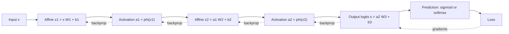
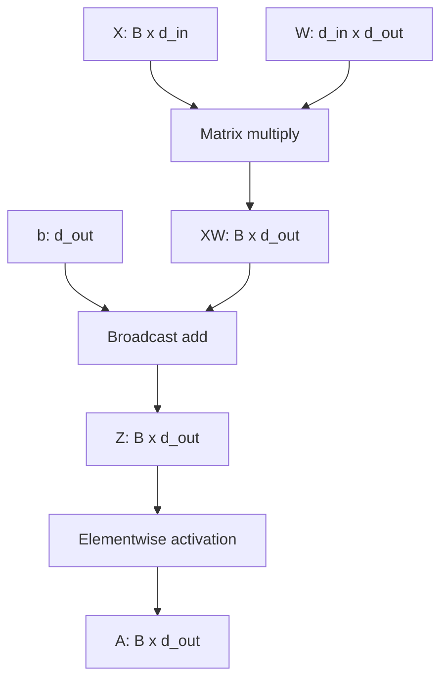
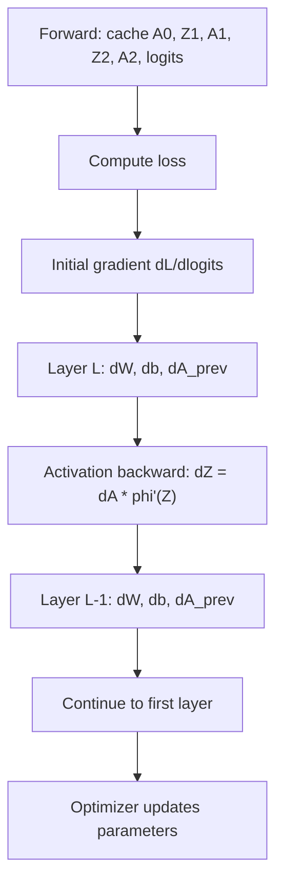

# Artificial Neural Networks: Feedforward Networks, Backpropagation, and Training Mechanics

An artificial neural network, in the standard supervised learning sense, is a differentiable function approximator composed from affine maps and nonlinear activation functions. The most basic and still fundamental form is the fully connected feedforward network, also called a multilayer perceptron (MLP). It maps an input vector $x \in \mathbb{R}^{d_0}$ to an output $\hat{y}$ through a sequence of layers:

$$
f_\theta(x)
=
f^{(L)}_{\theta_L}
\circ
f^{(L-1)}_{\theta_{L-1}}
\circ
\cdots
\circ
f^{(1)}_{\theta_1}(x).
$$

The parameters $\theta$ are weights and biases. Training chooses $\theta$ by minimizing an empirical loss over examples:

$$
\theta^\star
=
\arg\min_{\theta}
\frac{1}{n}
\sum_{i=1}^{n}
\ell(f_\theta(x_i), y_i).
$$

This chapter focuses on the mechanics: how dense layers compute, how nonlinearities change expressivity, how losses produce gradients, how backpropagation applies the chain rule efficiently, and how numerical and engineering choices determine whether training works.



## 1. From Neurons to Dense Layers

For one neuron with input $x \in \mathbb{R}^{d}$, weights $w \in \mathbb{R}^{d}$, bias $b \in \mathbb{R}$, pre-activation $z$, activation function $\phi$, and scalar output $a$, the computation is:

$$
z
=
w^\top x + b,
$$

$$
a
=
\phi(z).
$$

The weight $w_j$ controls the local sensitivity of the pre-activation to feature $x_j$:

$$
\frac{\partial z}{\partial x_j}
=
w_j.
$$

The bias $b$ translates the decision boundary. Without a bias, the set $w^\top x = 0$ always passes through the origin. With a bias, the hyperplane is:

$$
w^\top x + b = 0.
$$

For $m$ neurons in the same layer, stack their weights into a matrix $W \in \mathbb{R}^{d \times m}$ and biases into $b \in \mathbb{R}^{m}$. For a single row-vector input $x \in \mathbb{R}^{1 \times d}$:

$$
z
=
xW + b,
$$

$$
a
=
\phi(z).
$$

For a mini-batch $X \in \mathbb{R}^{B \times d}$ with batch size $B$:

$$
Z
=
XW + \mathbf{1}b^\top,
$$

$$
A
=
\phi(Z).
$$

Here $\mathbf{1} \in \mathbb{R}^{B}$ is a column vector of ones. In actual NumPy, PyTorch, TensorFlow, and JAX code, broadcasting implements $\mathbf{1}b^\top$ without explicitly materializing $\mathbf{1}$.

### Execution of a Dense Layer

For a batch:

1. Read input matrix $X$ with shape $(B, d_{\text{in}})$.
2. Multiply by weight matrix $W$ with shape $(d_{\text{in}}, d_{\text{out}})$.
3. Broadcast-add bias $b$ with shape $(d_{\text{out}})$.
4. Apply elementwise nonlinearity $\phi$ unless this is an output-logit layer.
5. Cache $X$, $W$, $Z$, and sometimes $A$ for backpropagation.



## 2. Why Nonlinearity Is Essential

If every layer is affine and no activation is used, a deep network collapses into one affine map. Consider two layers:

$$
h
=
xW_1 + b_1,
$$

$$
\hat{y}
=
hW_2 + b_2.
$$

Substitute $h$:

$$
\hat{y}
=
(xW_1 + b_1)W_2 + b_2
=
x(W_1W_2) + (b_1W_2 + b_2).
$$

Define:

$$
W^\prime = W_1W_2,
\qquad
b^\prime = b_1W_2 + b_2.
$$

Then:

$$
\hat{y}
=
xW^\prime + b^\prime.
$$

The same argument extends to any number of affine layers. Depth without nonlinearity changes parameterization, not representational class. Nonlinear activation functions allow the network to compose simple local transformations into piecewise-linear or smooth nonlinear decision surfaces.

## 3. Common Activation Functions

An activation function determines gradient flow, output range, and inductive bias. Let $z$ denote a scalar pre-activation.

### Sigmoid

$$
\sigma(z)
=
\frac{1}{1 + e^{-z}}.
$$

Derivative:

$$
\sigma^\prime(z)
=
\sigma(z)(1-\sigma(z)).
$$

Derivation:

$$
\sigma(z)
=
(1+e^{-z})^{-1},
$$

$$
\frac{d\sigma}{dz}
=
-(1+e^{-z})^{-2}(-e^{-z})
=
\frac{e^{-z}}{(1+e^{-z})^2}.
$$

Since:

$$
1-\sigma(z)
=
\frac{e^{-z}}{1+e^{-z}},
$$

we obtain:

$$
\sigma^\prime(z)
=
\frac{1}{1+e^{-z}}
\frac{e^{-z}}{1+e^{-z}}
=
\sigma(z)(1-\sigma(z)).
$$

The maximum derivative is $1/4$, attained at $z=0$. For large $\lvert z \rvert$, the derivative approaches $0$, causing saturated units to learn slowly. Sigmoid is still appropriate for binary output probabilities, but is rarely preferred in hidden layers.

### Tanh

$$
\tanh(z)
=
\frac{e^z - e^{-z}}{e^z + e^{-z}}.
$$

Derivative:

$$
\frac{d}{dz}\tanh(z)
=
1-\tanh^2(z).
$$

Tanh is zero-centered, unlike sigmoid. This often improves optimization because hidden activations can be positive or negative. It still saturates for large $\lvert z \rvert$.

### ReLU

$$
\operatorname{ReLU}(z)
=
\max(0,z).
$$

Derivative, away from $z=0$:

$$
\operatorname{ReLU}^\prime(z)
=
\begin{cases}
1, & z > 0, \\
0, & z < 0.
\end{cases}
$$

At $z=0$, ReLU is not differentiable. Implementations choose a subgradient, commonly $0$. ReLU does not saturate for positive inputs, is cheap to evaluate, and produces sparse activations. Its main failure mode is a dead unit: if a unit's pre-activation stays negative for all training examples, its gradient through ReLU is zero.

### Leaky ReLU and PReLU

Leaky ReLU keeps a small negative slope:

$$
\operatorname{LeakyReLU}_{\alpha}(z)
=
\begin{cases}
z, & z > 0, \\
\alpha z, & z \leq 0,
\end{cases}
$$

where $0 < \alpha < 1$. PReLU treats $\alpha$ as a learnable parameter. These variants reduce dead-unit risk.

### Softmax

For logits $s \in \mathbb{R}^{K}$:

$$
\operatorname{softmax}(s)_k
=
\frac{e^{s_k}}{\sum_{j=1}^{K} e^{s_j}}.
$$

Softmax is invariant to adding the same constant to all logits:

$$
\operatorname{softmax}(s)_k
=
\operatorname{softmax}(s+c\mathbf{1})_k.
$$

This property is used for numerical stability by subtracting $\max_j s_j$ before exponentiation.

## 4. Network as a Composition of Layers

Let an $L$-layer MLP use hidden activations for layers $1$ through $L-1$ and an output-logit layer $L$:

$$
A^{(0)}
=
X,
$$

$$
Z^{(\ell)}
=
A^{(\ell-1)}W^{(\ell)} + \mathbf{1}(b^{(\ell)})^\top,
\qquad
\ell = 1,\dots,L,
$$

$$
A^{(\ell)}
=
\phi^{(\ell)}(Z^{(\ell)}),
\qquad
\ell = 1,\dots,L-1.
$$

For classification, the final layer often returns logits:

$$
S
=
Z^{(L)}.
$$

Binary classification can use one logit $s$ and sigmoid:

$$
\hat{p}
=
\sigma(s)
=
P_\theta(y=1 \mid x).
$$

Multi-class classification can use $K$ logits and softmax:

$$
\hat{p}_k
=
\frac{e^{s_k}}{\sum_{j=1}^{K} e^{s_j}}
=
P_\theta(y=k \mid x).
$$

Regression usually keeps a linear output:

$$
\hat{y}
=
s.
$$

## 5. Loss Functions and First-Principles Derivations

### Mean Squared Error for Regression

Assume scalar regression targets:

$$
y_i
=
f_\theta(x_i) + \epsilon_i,
$$

where $\epsilon_i \sim \mathcal{N}(0,\sigma^2)$ independently. The likelihood is:

$$
p(y_i \mid x_i,\theta)
=
\frac{1}{\sqrt{2\pi\sigma^2}}
\exp\left(
-
\frac{(y_i-\hat{y}_i)^2}{2\sigma^2}
\right).
$$

The negative log-likelihood over $n$ samples is:

$$
-\log p(y \mid X,\theta)
=
\sum_{i=1}^{n}
\left[
\frac{1}{2}\log(2\pi\sigma^2)
+
\frac{(y_i-\hat{y}_i)^2}{2\sigma^2}
\right].
$$

The constant and scale do not change the minimizer, so the training objective becomes MSE:

$$
\mathcal{L}_{\text{MSE}}
=
\frac{1}{n}
\sum_{i=1}^{n}
(y_i-\hat{y}_i)^2.
$$

With the common factor $1/2$:

$$
\mathcal{L}_{\text{MSE-half}}
=
\frac{1}{2n}
\sum_{i=1}^{n}
(\hat{y}_i-y_i)^2,
$$

the derivative is clean:

$$
\frac{\partial \mathcal{L}_{\text{MSE-half}}}{\partial \hat{y}_i}
=
\frac{1}{n}(\hat{y}_i-y_i).
$$

### Binary Cross-Entropy

For $y_i \in \{0,1\}$ and predicted probability $\hat{p}_i = P(y_i=1 \mid x_i)$, the Bernoulli likelihood is:

$$
p(y_i \mid x_i,\theta)
=
\hat{p}_i^{y_i}(1-\hat{p}_i)^{1-y_i}.
$$

The negative log-likelihood is:

$$
\mathcal{L}_{\text{BCE}}
=
-
\frac{1}{n}
\sum_{i=1}^{n}
\left[
y_i \log \hat{p}_i
+
(1-y_i)\log(1-\hat{p}_i)
\right].
$$

If $\hat{p}_i = \sigma(s_i)$, the derivative with respect to the logit is:

$$
\frac{\partial \mathcal{L}_{\text{BCE}}}{\partial s_i}
=
\frac{1}{n}(\hat{p}_i-y_i).
$$

Derivation for one example:

$$
\ell
=
-
\left[
y\log \sigma(s)
+
(1-y)\log(1-\sigma(s))
\right].
$$

Differentiate with respect to $s$:

$$
\frac{\partial \ell}{\partial s}
=
-
\left[
y\frac{1}{\sigma(s)}\sigma^\prime(s)
+
(1-y)\frac{1}{1-\sigma(s)}(-\sigma^\prime(s))
\right].
$$

Substitute $\sigma^\prime(s)=\sigma(s)(1-\sigma(s))$:

$$
\frac{\partial \ell}{\partial s}
=
-
\left[
y(1-\sigma(s))
-
(1-y)\sigma(s)
\right]
=
\sigma(s)-y.
$$

This cancellation is why sigmoid plus BCE is numerically and algebraically convenient.

### Multi-Class Cross-Entropy

For one-hot target $y \in \{0,1\}^{K}$ with $\sum_k y_k = 1$, softmax probabilities $p_k$, and logits $s_k$:

$$
p_k
=
\frac{e^{s_k}}{\sum_{j=1}^{K}e^{s_j}},
$$

$$
\ell
=
-
\sum_{k=1}^{K}
y_k \log p_k.
$$

If the true class is $c$, then $y_c=1$ and:

$$
\ell
=
-\log p_c.
$$

The derivative with respect to a logit $s_j$ is:

$$
\frac{\partial \ell}{\partial s_j}
=
p_j - y_j.
$$

Derivation:

$$
\log p_k
=
s_k
-
\log
\sum_{r=1}^{K}
e^{s_r}.
$$

Thus:

$$
\ell
=
-
\sum_{k=1}^{K}y_k s_k
+
\sum_{k=1}^{K}y_k
\log
\sum_{r=1}^{K}e^{s_r}.
$$

Because $\sum_k y_k=1$:

$$
\ell
=
-
\sum_{k=1}^{K}y_k s_k
+
\log
\sum_{r=1}^{K}e^{s_r}.
$$

Differentiate with respect to $s_j$:

$$
\frac{\partial \ell}{\partial s_j}
=
-y_j
+
\frac{e^{s_j}}{\sum_{r=1}^{K}e^{s_r}}
=
p_j-y_j.
$$

This compact gradient is central to efficient classification training.

## 6. Backpropagation

Backpropagation is reverse-mode automatic differentiation applied to a neural network computation graph. It computes all parameter gradients in time proportional to a small constant multiple of the forward pass.

For a dense layer:

$$
Z
=
AW + \mathbf{1}b^\top,
$$

where $A \in \mathbb{R}^{B \times d_{\text{in}}}$, $W \in \mathbb{R}^{d_{\text{in}} \times d_{\text{out}}}$, $b \in \mathbb{R}^{d_{\text{out}}}$, and $Z \in \mathbb{R}^{B \times d_{\text{out}}}$.

Let:

$$
G_Z
=
\frac{\partial \mathcal{L}}{\partial Z}
\in
\mathbb{R}^{B \times d_{\text{out}}}.
$$

Then:

$$
\frac{\partial \mathcal{L}}{\partial W}
=
A^\top G_Z,
$$

$$
\frac{\partial \mathcal{L}}{\partial b}
=
\sum_{i=1}^{B} G_{Z,i:},
$$

$$
\frac{\partial \mathcal{L}}{\partial A}
=
G_Z W^\top.
$$

If the layer output is $H=\phi(Z)$ and we receive upstream gradient $G_H=\partial \mathcal{L}/\partial H$, then:

$$
G_Z
=
G_H \odot \phi^\prime(Z),
$$

where $\odot$ is elementwise multiplication.

### Matrix Derivation for Dense-Layer Gradients

Consider elementwise:

$$
Z_{ik}
=
\sum_{j=1}^{d_{\text{in}}}
A_{ij}W_{jk}
+
b_k.
$$

For a weight $W_{uv}$:

$$
\frac{\partial Z_{ik}}{\partial W_{uv}}
=
\begin{cases}
A_{iu}, & k=v, \\
0, & k \neq v.
\end{cases}
$$

Therefore:

$$
\frac{\partial \mathcal{L}}{\partial W_{uv}}
=
\sum_{i=1}^{B}
\sum_{k=1}^{d_{\text{out}}}
\frac{\partial \mathcal{L}}{\partial Z_{ik}}
\frac{\partial Z_{ik}}{\partial W_{uv}}
=
\sum_{i=1}^{B}
G_{Z,iv}A_{iu}.
$$

This is exactly the $(u,v)$ entry of $A^\top G_Z$.

For $b_v$:

$$
\frac{\partial Z_{ik}}{\partial b_v}
=
\begin{cases}
1, & k=v, \\
0, & k \neq v,
\end{cases}
$$

so:

$$
\frac{\partial \mathcal{L}}{\partial b_v}
=
\sum_{i=1}^{B}
G_{Z,iv}.
$$

For input activation $A_{iu}$:

$$
\frac{\partial Z_{ik}}{\partial A_{iu}}
=
W_{uk},
$$

therefore:

$$
\frac{\partial \mathcal{L}}{\partial A_{iu}}
=
\sum_{k=1}^{d_{\text{out}}}
G_{Z,ik}W_{uk},
$$

which is the $(i,u)$ entry of $G_ZW^\top$.

### Backpropagation Execution



For a network with softmax cross-entropy, backprop starts with:

$$
G_S
=
\frac{1}{B}(P-Y),
$$

where $P$ is the matrix of predicted class probabilities and $Y$ is the one-hot target matrix.

Then for each layer from $L$ down to $1$:

1. Compute $\partial \mathcal{L}/\partial W^{(\ell)}$ and $\partial \mathcal{L}/\partial b^{(\ell)}$.
2. Propagate $\partial \mathcal{L}/\partial A^{(\ell-1)}$.
3. If $\ell-1$ is a hidden layer, multiply elementwise by the activation derivative.

## 7. Worked Example: One Hidden-Layer Network

Consider one example with two input features, two hidden ReLU units, and one sigmoid output:

$$
x
=
\begin{bmatrix}
1 & 2
\end{bmatrix},
\qquad
y=1.
$$

First-layer parameters:

$$
W_1
=
\begin{bmatrix}
0.10 & -0.20 \\
0.40 & 0.20
\end{bmatrix},
\qquad
b_1
=
\begin{bmatrix}
0.00 & 0.10
\end{bmatrix}.
$$

Second-layer parameters:

$$
W_2
=
\begin{bmatrix}
0.30 \\
-0.50
\end{bmatrix},
\qquad
b_2
=
\begin{bmatrix}
0.20
\end{bmatrix}.
$$

Forward pass:

$$
z_1
=
xW_1+b_1
=
\begin{bmatrix}
1 & 2
\end{bmatrix}
\begin{bmatrix}
0.10 & -0.20 \\
0.40 & 0.20
\end{bmatrix}
+
\begin{bmatrix}
0.00 & 0.10
\end{bmatrix}.
$$

Compute each hidden pre-activation:

$$
z_{1,1}
=
1(0.10)+2(0.40)+0.00
=
0.90,
$$

$$
z_{1,2}
=
1(-0.20)+2(0.20)+0.10
=
0.30.
$$

So:

$$
z_1
=
\begin{bmatrix}
0.90 & 0.30
\end{bmatrix}.
$$

ReLU activation:

$$
a_1
=
\operatorname{ReLU}(z_1)
=
\begin{bmatrix}
0.90 & 0.30
\end{bmatrix}.
$$

Output logit:

$$
s
=
a_1W_2+b_2
=
0.90(0.30)+0.30(-0.50)+0.20
=
0.32.
$$

Sigmoid probability:

$$
\hat{p}
=
\sigma(0.32)
=
\frac{1}{1+e^{-0.32}}
\approx
0.5793.
$$

Binary cross-entropy:

$$
\ell
=
-\log(0.5793)
\approx
0.5459.
$$

Backward pass starts with:

$$
\frac{\partial \ell}{\partial s}
=
\hat{p}-y
=
0.5793-1
=
-0.4207.
$$

Second-layer gradients:

$$
\frac{\partial \ell}{\partial W_2}
=
a_1^\top
\frac{\partial \ell}{\partial s}
=
\begin{bmatrix}
0.90 \\
0.30
\end{bmatrix}
(-0.4207)
=
\begin{bmatrix}
-0.3786 \\
-0.1262
\end{bmatrix},
$$

$$
\frac{\partial \ell}{\partial b_2}
=
-0.4207.
$$

Gradient into hidden activations:

$$
\frac{\partial \ell}{\partial a_1}
=
\frac{\partial \ell}{\partial s}W_2^\top
=
-0.4207
\begin{bmatrix}
0.30 & -0.50
\end{bmatrix}
=
\begin{bmatrix}
-0.1262 & 0.2104
\end{bmatrix}.
$$

Both hidden pre-activations are positive, so ReLU derivatives are $1$:

$$
\frac{\partial \ell}{\partial z_1}
=
\begin{bmatrix}
-0.1262 & 0.2104
\end{bmatrix}.
$$

First-layer gradients:

$$
\frac{\partial \ell}{\partial W_1}
=
x^\top
\frac{\partial \ell}{\partial z_1}
=
\begin{bmatrix}
1 \\
2
\end{bmatrix}
\begin{bmatrix}
-0.1262 & 0.2104
\end{bmatrix}
=
\begin{bmatrix}
-0.1262 & 0.2104 \\
-0.2524 & 0.4207
\end{bmatrix}.
$$

$$
\frac{\partial \ell}{\partial b_1}
=
\begin{bmatrix}
-0.1262 & 0.2104
\end{bmatrix}.
$$

With learning rate $\eta=0.1$, the output-layer update is:

$$
W_2
\leftarrow
W_2
-
\eta
\frac{\partial \ell}{\partial W_2}
=
\begin{bmatrix}
0.30 \\
-0.50
\end{bmatrix}
-
0.1
\begin{bmatrix}
-0.3786 \\
-0.1262
\end{bmatrix}
=
\begin{bmatrix}
0.3379 \\
-0.4874
\end{bmatrix}.
$$

The update increases the logit for this positive example because the probability was below the target.

## 8. Gradient Descent and Variants

The basic gradient descent update is:

$$
\theta_{t+1}
=
\theta_t
-
\eta
\nabla_\theta
\mathcal{L}(\theta_t),
$$

where $\eta > 0$ is the learning rate.

### Batch, Stochastic, and Mini-Batch Gradient Descent

Let:

$$
\mathcal{L}(\theta)
=
\frac{1}{n}
\sum_{i=1}^{n}
\ell_i(\theta).
$$

Batch gradient descent uses:

$$
g_t
=
\frac{1}{n}
\sum_{i=1}^{n}
\nabla_\theta \ell_i(\theta_t).
$$

Stochastic gradient descent uses one sample:

$$
g_t
=
\nabla_\theta \ell_{i_t}(\theta_t).
$$

Mini-batch gradient descent uses a subset $\mathcal{B}_t$:

$$
g_t
=
\frac{1}{\lvert \mathcal{B}_t \rvert}
\sum_{i \in \mathcal{B}_t}
\nabla_\theta \ell_i(\theta_t).
$$

Mini-batches dominate practice because they expose matrix-matrix operations, reduce gradient variance relative to single-sample SGD, and fit GPU/TPU execution.

### Momentum

Momentum maintains a velocity:

$$
v_{t+1}
=
\mu v_t + g_t,
$$

$$
\theta_{t+1}
=
\theta_t - \eta v_{t+1}.
$$

Here $\mu \in [0,1)$ controls memory. Momentum damps oscillation in high-curvature directions and accelerates in persistent descent directions.

### Adam

Adam estimates first and second moments of stochastic gradients:

$$
m_t
=
\beta_1m_{t-1} + (1-\beta_1)g_t,
$$

$$
v_t
=
\beta_2v_{t-1} + (1-\beta_2)g_t \odot g_t.
$$

Bias correction:

$$
\hat{m}_t
=
\frac{m_t}{1-\beta_1^t},
\qquad
\hat{v}_t
=
\frac{v_t}{1-\beta_2^t}.
$$

Update:

$$
\theta_{t+1}
=
\theta_t
-
\eta
\frac{\hat{m}_t}{\sqrt{\hat{v}_t}+\epsilon}.
$$

Adam rescales each parameter's step by a running estimate of gradient magnitude. It is usually a strong default, but it can generalize differently from SGD with momentum and is sensitive to learning-rate schedules and weight decay choices.

## 9. Weight Initialization

Poor initialization can shrink or explode signals as they pass through depth. Assume a layer:

$$
z_j
=
\sum_{i=1}^{d_{\text{in}}}
w_{ij}a_i.
$$

Assume:

$$
\mathbb{E}[w_{ij}]=0,
\qquad
\mathbb{E}[a_i]=0,
\qquad
\operatorname{Var}(w_{ij})=\sigma_w^2,
\qquad
\operatorname{Var}(a_i)=\sigma_a^2,
$$

and approximate independence. Then:

$$
\operatorname{Var}(z_j)
=
\sum_{i=1}^{d_{\text{in}}}
\operatorname{Var}(w_{ij}a_i)
=
d_{\text{in}}\sigma_w^2\sigma_a^2.
$$

To preserve forward variance, choose:

$$
\sigma_w^2
\approx
\frac{1}{d_{\text{in}}}.
$$

To also preserve backward gradient variance, Xavier/Glorot initialization balances fan-in and fan-out:

$$
\operatorname{Var}(W)
=
\frac{2}{d_{\text{in}}+d_{\text{out}}}.
$$

For ReLU, about half the activations are zero under symmetric inputs, so He initialization uses:

$$
\operatorname{Var}(W)
=
\frac{2}{d_{\text{in}}}.
$$

Common choices:

$$
W_{ij}
\sim
\mathcal{N}
\left(
0,
\frac{2}{d_{\text{in}}}
\right)
\quad
\text{for ReLU layers},
$$

or:

$$
W_{ij}
\sim
U
\left(
-
\sqrt{\frac{6}{d_{\text{in}}+d_{\text{out}}}},
\sqrt{\frac{6}{d_{\text{in}}+d_{\text{out}}}}
\right)
\quad
\text{for tanh-like layers}.
$$

Biases are often initialized to zero. Symmetry is broken by random weights, not random biases.

## 10. Regularization and Generalization

### L2 Penalty and Weight Decay

L2-regularized empirical risk is:

$$
\mathcal{J}(\theta)
=
\mathcal{L}(\theta)
+
\frac{\lambda}{2}
\lVert W \rVert_2^2.
$$

The gradient contribution is:

$$
\nabla_W
\frac{\lambda}{2}
\lVert W \rVert_2^2
=
\lambda W.
$$

SGD update:

$$
W_{t+1}
=
W_t
-
\eta
(\nabla_W\mathcal{L}+\lambda W_t)
=
(1-\eta\lambda)W_t
-
\eta\nabla_W\mathcal{L}.
$$

For plain SGD, L2 regularization and weight decay are equivalent. For adaptive optimizers, decoupled weight decay is not identical to adding an L2 penalty to the gradient.

### Dropout

During training, dropout samples a Bernoulli mask:

$$
M_j
\sim
\operatorname{Bernoulli}(q),
$$

where $q$ is the keep probability. In inverted dropout:

$$
\tilde{a}
=
\frac{M \odot a}{q}.
$$

Then:

$$
\mathbb{E}[\tilde{a}_j]
=
a_j,
$$

so inference can use the raw activation without scaling.

Dropout injects multiplicative noise into hidden representations. It can reduce co-adaptation, but it may be unnecessary or harmful in small MLPs, networks with strong normalization, or data regimes where underfitting dominates.

### Early Stopping

Early stopping monitors validation loss and stops when it no longer improves. It is a form of implicit regularization because training time controls function complexity.

## 11. Numerical Stability

### Stable Sigmoid

Direct $\sigma(z)=1/(1+e^{-z})$ can overflow when $z$ is very negative. A stable implementation branches:

$$
\sigma(z)
=
\begin{cases}
\frac{1}{1+e^{-z}}, & z \geq 0, \\
\frac{e^z}{1+e^z}, & z < 0.
\end{cases}
$$

### Stable Softmax

Naive softmax overflows when logits are large. Use:

$$
p_k
=
\frac{e^{s_k-m}}{\sum_{j=1}^{K}e^{s_j-m}},
\qquad
m=\max_j s_j.
$$

The result is unchanged because:

$$
\frac{e^{s_k-m}}{\sum_j e^{s_j-m}}
=
\frac{e^{s_k}e^{-m}}{e^{-m}\sum_j e^{s_j}}
=
\frac{e^{s_k}}{\sum_j e^{s_j}}.
$$

### Stable Cross-Entropy from Logits

For a true class $c$:

$$
\ell
=
-s_c
+
\log\sum_{j=1}^{K}e^{s_j}.
$$

Using $m=\max_j s_j$:

$$
\ell
=
-s_c
+
m
+
\log\sum_{j=1}^{K}e^{s_j-m}.
$$

This avoids forming probabilities before the log. Libraries such as PyTorch combine log-softmax and negative log-likelihood internally for this reason.

## 12. Python Implementation from Scratch

The following NumPy implementation trains a two-layer MLP for multi-class classification. It uses:

- He initialization for the ReLU hidden layer.
- Stable softmax cross-entropy from logits.
- Mini-batch gradient descent.
- Explicit forward and backward passes.

```python
import numpy as np


def relu(z):
    return np.maximum(z, 0.0)


def relu_backward(dout, z):
    dz = dout.copy()
    dz[z <= 0.0] = 0.0
    return dz


def softmax_cross_entropy_with_logits(logits, y):
    """
    logits: shape (B, K)
    y: integer class labels, shape (B,)

    Returns:
        loss: scalar
        dlogits: shape (B, K), gradient of mean loss wrt logits
        probs: shape (B, K)
    """
    batch_size = logits.shape[0]

    shifted = logits - np.max(logits, axis=1, keepdims=True)
    exp_shifted = np.exp(shifted)
    probs = exp_shifted / np.sum(exp_shifted, axis=1, keepdims=True)

    correct_log_probs = -np.log(probs[np.arange(batch_size), y] + 1e-12)
    loss = np.mean(correct_log_probs)

    dlogits = probs.copy()
    dlogits[np.arange(batch_size), y] -= 1.0
    dlogits /= batch_size

    return loss, dlogits, probs


class TwoLayerMLP:
    def __init__(self, input_dim, hidden_dim, num_classes, seed=0):
        rng = np.random.default_rng(seed)

        self.W1 = rng.normal(
            loc=0.0,
            scale=np.sqrt(2.0 / input_dim),
            size=(input_dim, hidden_dim),
        )
        self.b1 = np.zeros(hidden_dim)

        self.W2 = rng.normal(
            loc=0.0,
            scale=np.sqrt(2.0 / hidden_dim),
            size=(hidden_dim, num_classes),
        )
        self.b2 = np.zeros(num_classes)

    def forward(self, X):
        z1 = X @ self.W1 + self.b1
        a1 = relu(z1)
        logits = a1 @ self.W2 + self.b2

        cache = {
            "X": X,
            "z1": z1,
            "a1": a1,
            "logits": logits,
        }
        return logits, cache

    def backward(self, dlogits, cache):
        X = cache["X"]
        z1 = cache["z1"]
        a1 = cache["a1"]

        dW2 = a1.T @ dlogits
        db2 = np.sum(dlogits, axis=0)

        da1 = dlogits @ self.W2.T
        dz1 = relu_backward(da1, z1)

        dW1 = X.T @ dz1
        db1 = np.sum(dz1, axis=0)

        return {
            "W1": dW1,
            "b1": db1,
            "W2": dW2,
            "b2": db2,
        }

    def step(self, grads, lr):
        self.W1 -= lr * grads["W1"]
        self.b1 -= lr * grads["b1"]
        self.W2 -= lr * grads["W2"]
        self.b2 -= lr * grads["b2"]

    def predict(self, X):
        logits, _ = self.forward(X)
        return np.argmax(logits, axis=1)


def iterate_minibatches(X, y, batch_size, rng):
    indices = rng.permutation(len(X))
    for start in range(0, len(X), batch_size):
        batch_idx = indices[start:start + batch_size]
        yield X[batch_idx], y[batch_idx]


def fit(model, X_train, y_train, epochs=100, batch_size=32, lr=0.05, seed=1):
    rng = np.random.default_rng(seed)

    for epoch in range(epochs):
        losses = []

        for Xb, yb in iterate_minibatches(X_train, y_train, batch_size, rng):
            logits, cache = model.forward(Xb)
            loss, dlogits, _ = softmax_cross_entropy_with_logits(logits, yb)
            grads = model.backward(dlogits, cache)
            model.step(grads, lr)
            losses.append(loss)

        if epoch % 10 == 0 or epoch == epochs - 1:
            train_pred = model.predict(X_train)
            acc = np.mean(train_pred == y_train)
            print(f"epoch={epoch:03d} loss={np.mean(losses):.4f} acc={acc:.3f}")
```

Example on synthetic data:

```python
from sklearn.datasets import make_moons
from sklearn.preprocessing import StandardScaler

X, y = make_moons(n_samples=600, noise=0.20, random_state=42)
X = StandardScaler().fit_transform(X)

mlp = TwoLayerMLP(input_dim=2, hidden_dim=32, num_classes=2, seed=42)
fit(mlp, X, y, epochs=200, batch_size=32, lr=0.05)
```

### Gradient Checking

Gradient checking compares analytical gradients to finite differences. For parameter $\theta_j$:

$$
\frac{\partial \mathcal{L}}{\partial \theta_j}
\approx
\frac{
\mathcal{L}(\theta_j+\epsilon)
-
\mathcal{L}(\theta_j-\epsilon)
}{
2\epsilon
}.
$$

Use small networks and double precision. A typical relative error is:

$$
\frac{
\lVert g_{\text{analytic}}-g_{\text{numeric}} \rVert_2
}{
\lVert g_{\text{analytic}} \rVert_2
+
\lVert g_{\text{numeric}} \rVert_2
+
10^{-12}
}.
$$

```python
def loss_for_params(model, X, y):
    logits, _ = model.forward(X)
    loss, _, _ = softmax_cross_entropy_with_logits(logits, y)
    return loss


def check_one_weight(model, X, y, epsilon=1e-5):
    logits, cache = model.forward(X)
    loss, dlogits, _ = softmax_cross_entropy_with_logits(logits, y)
    grads = model.backward(dlogits, cache)

    original = model.W1[0, 0]

    model.W1[0, 0] = original + epsilon
    loss_plus = loss_for_params(model, X, y)

    model.W1[0, 0] = original - epsilon
    loss_minus = loss_for_params(model, X, y)

    model.W1[0, 0] = original

    numerical = (loss_plus - loss_minus) / (2.0 * epsilon)
    analytical = grads["W1"][0, 0]

    return analytical, numerical, abs(analytical - numerical)
```

## 13. Equivalent Library Implementations

### PyTorch

```python
import torch
from torch import nn


class TorchMLP(nn.Module):
    def __init__(self, input_dim, hidden_dim, num_classes):
        super().__init__()
        self.net = nn.Sequential(
            nn.Linear(input_dim, hidden_dim),
            nn.ReLU(),
            nn.Linear(hidden_dim, num_classes),
        )

    def forward(self, x):
        return self.net(x)


model = TorchMLP(input_dim=2, hidden_dim=32, num_classes=2)
optimizer = torch.optim.AdamW(model.parameters(), lr=1e-3, weight_decay=1e-4)
criterion = nn.CrossEntropyLoss()

for xb, yb in train_loader:
    optimizer.zero_grad(set_to_none=True)
    logits = model(xb)
    loss = criterion(logits, yb)
    loss.backward()
    optimizer.step()
```

Internally:

- `nn.Linear(in_features, out_features)` stores a weight tensor with shape `(out_features, in_features)` and computes an affine transform equivalent to $xW^\top+b$.
- `nn.ReLU()` applies an elementwise threshold and records enough information for autograd to zero gradients where the input was non-positive.
- `nn.CrossEntropyLoss()` expects raw logits, not softmax probabilities. It effectively combines `log_softmax` and negative log-likelihood for stable computation.
- `loss.backward()` runs reverse-mode automatic differentiation over the dynamic computation graph built during the forward pass.
- `optimizer.step()` reads accumulated `.grad` tensors and mutates parameters according to the optimizer rule.

### TensorFlow and Keras

```python
import tensorflow as tf


model = tf.keras.Sequential([
    tf.keras.layers.Dense(32, activation="relu", input_shape=(2,)),
    tf.keras.layers.Dense(2),
])

model.compile(
    optimizer=tf.keras.optimizers.AdamW(learning_rate=1e-3, weight_decay=1e-4),
    loss=tf.keras.losses.SparseCategoricalCrossentropy(from_logits=True),
    metrics=["accuracy"],
)

model.fit(X_train, y_train, batch_size=32, epochs=50, validation_split=0.2)
```

Internally, `Dense` computes:

$$
\operatorname{output}
=
\operatorname{activation}(XW+b).
$$

Keras manages variable creation, initialization, mini-batch iteration, metric aggregation, and automatic differentiation through TensorFlow's gradient tape system. `from_logits=True` is important because it tells the loss to apply the numerically stable log-softmax path itself.

### scikit-learn

```python
from sklearn.neural_network import MLPClassifier
from sklearn.pipeline import make_pipeline
from sklearn.preprocessing import StandardScaler


clf = make_pipeline(
    StandardScaler(),
    MLPClassifier(
        hidden_layer_sizes=(32,),
        activation="relu",
        solver="adam",
        alpha=1e-4,
        batch_size=32,
        learning_rate_init=1e-3,
        max_iter=500,
        random_state=42,
    ),
)

clf.fit(X_train, y_train)
pred = clf.predict(X_test)
```

scikit-learn's `MLPClassifier` is convenient for tabular baselines and small to medium datasets. It implements a feedforward MLP trained with solvers such as LBFGS, SGD, or Adam. It is not a replacement for PyTorch or TensorFlow when custom layers, GPUs, large-scale training, or detailed training-loop control are required.

## 14. Complexity

For one dense layer with batch size $B$, input width $d_{\text{in}}$, and output width $d_{\text{out}}$:

Forward matrix multiplication costs:

$$
O(Bd_{\text{in}}d_{\text{out}}).
$$

Bias addition and activation cost:

$$
O(Bd_{\text{out}}).
$$

Backward pass computes $A^\top G_Z$, $G_ZW^\top$, and bias sums, so its dominant cost is also:

$$
O(Bd_{\text{in}}d_{\text{out}}).
$$

For an $L$-layer MLP with widths $d_0,d_1,\dots,d_L$, one forward-backward step costs:

$$
O
\left(
B
\sum_{\ell=1}^{L}
d_{\ell-1}d_{\ell}
\right).
$$

Parameter memory is:

$$
O
\left(
\sum_{\ell=1}^{L}
(d_{\ell-1}d_{\ell}+d_{\ell})
\right).
$$

Per-example cached activation memory for backpropagation is:

$$
O
\left(
\sum_{\ell=0}^{L}
d_{\ell}
\right).
$$

For batch size $B$, this becomes:

$$
O
\left(
B
\sum_{\ell=0}^{L}
d_{\ell}
\right)
$$

up to constants and framework-specific saved tensors. Optimizers add state: SGD adds little, momentum adds one velocity per parameter, and Adam usually adds two moment tensors per parameter.

## 15. Edge Cases, Limitations, and Pitfalls

### Feature Scaling

MLPs are sensitive to input scale. If one feature has variance $10^6$ and another has variance $1$, early gradients and activations are dominated by the large-scale feature. Standardization is often essential:

$$
x^\prime_j
=
\frac{x_j-\mu_j}{\sigma_j+\epsilon}.
$$

### Saturating Activations

Sigmoid and tanh units can saturate:

$$
\lvert z \rvert \gg 0
\implies
\phi^\prime(z) \approx 0.
$$

Repeated multiplication by small derivatives creates vanishing gradients:

$$
\frac{\partial \mathcal{L}}{\partial A^{(0)}}
=
\frac{\partial \mathcal{L}}{\partial A^{(L)}}
\prod_{\ell=L}^{1}
\frac{\partial A^{(\ell)}}{\partial A^{(\ell-1)}}.
$$

### Exploding Gradients

If Jacobian norms are repeatedly larger than $1$, gradients can explode. Symptoms include NaN loss, huge parameter norms, and unstable logits. Common mitigations:

- smaller learning rate;
- gradient clipping;
- better initialization;
- normalization layers;
- residual connections in deep architectures.

### Applying Softmax Twice

For cross-entropy in PyTorch or TensorFlow with `from_logits=True`, pass logits. Applying softmax before these losses can worsen numerical stability and produce incorrect gradients.

### Wrong Axis in Softmax

For logits of shape `(batch, classes)`, softmax should normalize across classes:

$$
\sum_{k=1}^{K}p_{ik}=1
\quad
\text{for each sample } i.
$$

Normalizing across the batch is a silent and severe bug.

### Batch Averaging Conventions

Some implementations sum losses, others average over batch or over all elements. The gradient scale changes with batch size. When comparing scratch implementations to libraries, verify reduction semantics.

### ReLU Dead Units

A high learning rate can push a ReLU unit into a region where $z<0$ for all examples. Then:

$$
\operatorname{ReLU}^\prime(z)=0,
$$

and the unit may never recover. Leaky ReLU, smaller learning rates, normalization, and appropriate initialization help.

### Overparameterization

MLPs can memorize. If training accuracy is high and validation accuracy is poor, the issue is not necessarily optimization. Consider:

- more data or augmentation;
- stronger regularization;
- smaller network;
- early stopping;
- better validation split;
- label-noise analysis.

### Tabular Data Limitations

For tabular data, gradient-boosted trees often outperform plain MLPs with less tuning. MLPs become more compelling when there are high-dimensional dense features, learned embeddings, multimodal inputs, or very large datasets.

## 16. Connections to Related ML Concepts

### Logistic Regression

Binary logistic regression is a neural network with no hidden layer:

$$
\hat{p}
=
\sigma(x^\top w+b).
$$

A linear softmax classifier is the multi-class equivalent:

$$
p
=
\operatorname{softmax}(xW+b).
$$

An MLP adds hidden nonlinear feature learning before the same kind of output layer.

### Kernel Methods

Kernel methods use fixed or implicitly defined feature maps:

$$
f(x)
=
w^\top \phi(x).
$$

An MLP learns the feature map:

$$
h_\theta(x)
=
\phi^{(L-1)}(\cdots\phi^{(1)}(xW^{(1)}+b^{(1)})\cdots),
$$

then learns a final predictor on top.

### Representation Learning

Hidden activations can be viewed as learned representations:

$$
h
=
g_\theta(x).
$$

Deep learning works well when useful representations can be built compositionally: low-level patterns combine into higher-level patterns.

### Convolutional Neural Networks

CNNs replace dense matrices with convolutional operators. They use local connectivity and parameter sharing to exploit spatial structure. A dense layer treats every input dimension independently with no built-in spatial prior.

### Recurrent Networks and Transformers

RNNs and transformers also use affine maps, activations, losses, and backpropagation. Transformers are not conceptually separate from the machinery here; they add attention, normalization, residual connections, and specialized parameter sharing.

### Universal Approximation

MLPs with suitable nonlinear activations can approximate broad classes of continuous functions on compact domains, given enough hidden units. This theorem explains expressivity, not trainability. Optimization, data, architecture, and regularization determine whether a useful approximation is actually learned.

## 17. Practical Training Checklist

1. Standardize inputs, especially for tabular data.
2. Start with a small MLP and verify it can overfit a tiny subset.
3. Use ReLU or GELU-like hidden activations unless there is a reason not to.
4. Use He initialization for ReLU-family networks.
5. Use logits with cross-entropy losses.
6. Track train loss, validation loss, accuracy or task metric, and gradient norms.
7. Tune learning rate before network depth.
8. Use mini-batches sized for hardware efficiency, not as a statistical principle alone.
9. Add regularization only after confirming the model can optimize.
10. Gradient-check custom layers before trusting training curves.

## 18. References and Deeper Reading

- Ian Goodfellow, Yoshua Bengio, and Aaron Courville, *Deep Learning*, Chapter 6, "Deep Feedforward Networks": https://www.deeplearningbook.org/contents/mlp.html
- David E. Rumelhart, Geoffrey E. Hinton, and Ronald J. Williams, "Learning representations by back-propagating errors", *Nature*, 1986: https://www.nature.com/articles/323533a0
- Xavier Glorot and Yoshua Bengio, "Understanding the difficulty of training deep feedforward neural networks", AISTATS 2010: https://proceedings.mlr.press/v9/glorot10a.html
- Kaiming He, Xiangyu Zhang, Shaoqing Ren, and Jian Sun, "Delving Deep into Rectifiers", ICCV 2015: https://arxiv.org/abs/1502.01852
- Diederik P. Kingma and Jimmy Ba, "Adam: A Method for Stochastic Optimization", 2014: https://arxiv.org/abs/1412.6980
- PyTorch documentation, `torch.nn.Linear` and `torch.nn.CrossEntropyLoss`: https://docs.pytorch.org/docs/stable/nn.html
- TensorFlow Keras documentation, `tf.keras.layers.Dense`: https://www.tensorflow.org/api_docs/python/tf/keras/layers/Dense
- scikit-learn documentation, `MLPClassifier`: https://scikit-learn.org/stable/modules/generated/sklearn.neural_network.MLPClassifier.html
