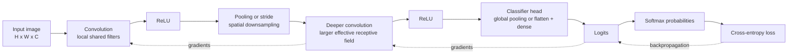
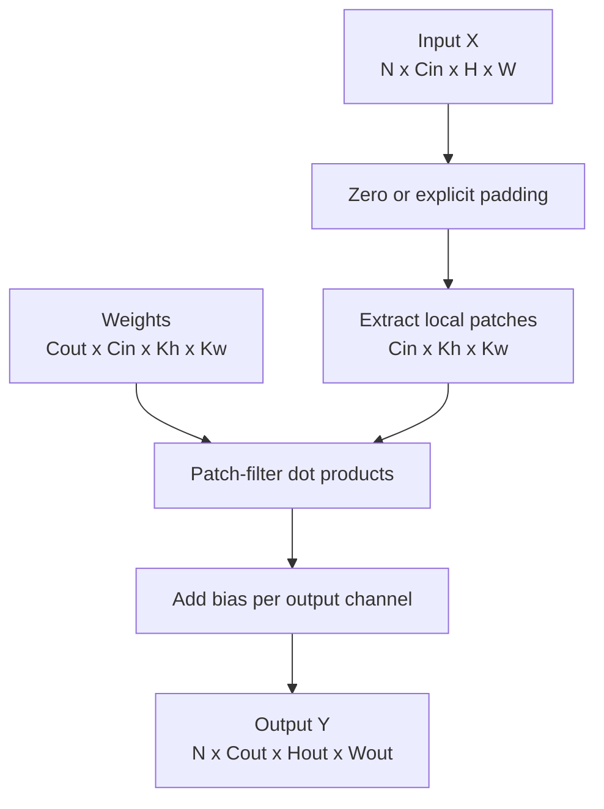
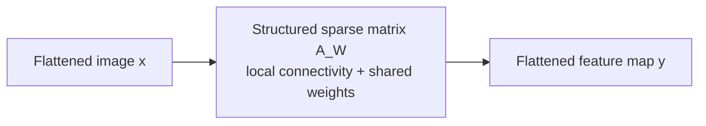
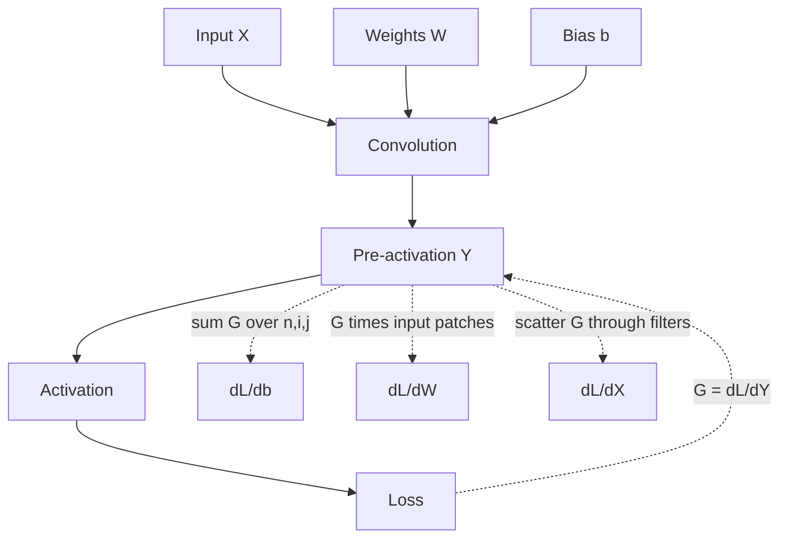

# Convolutional Neural Networks: Convolution, Pooling, Backpropagation, and Implementation Mechanics

A convolutional neural network (CNN) is a neural architecture whose dominant inductive biases are **locality**, **translation equivariance**, and **parameter sharing**. These biases make CNNs effective for images, video frames, spectrograms, medical volumes, and other grid-structured signals where nearby coordinates tend to be semantically related.

Compared with a dense network over raw pixels, a CNN does not learn a separate weight for every input-output pixel pair. It learns small spatial kernels that are reused over all locations. For a $256 \times 256 \times 3$ RGB image, a dense layer with only $1024$ hidden units would need

$$
256 \cdot 256 \cdot 3 \cdot 1024
=
201{,}326{,}592
$$

weights before biases. A convolution layer with $64$ filters of size $3 \times 3$ over the same RGB input needs

$$
64 \cdot 3 \cdot 3 \cdot 3
=
1{,}728
$$

weights before biases. The difference is not only computational. The convolutional parameterization says that the same edge, corner, texture, or part detector can be useful wherever it appears in the image.



## 1. Tensor Conventions

An image-like mini-batch is usually represented as a rank-4 tensor. Two common layouts are:

| Layout | Shape | Common usage |
| --- | --- | --- |
| Channels-first | $(N, C, H, W)$ | PyTorch default |
| Channels-last | $(N, H, W, C)$ | TensorFlow/Keras default |

Here:

- $N$ is batch size.
- $C$ is the number of input channels.
- $H$ and $W$ are spatial height and width.

This chapter uses the channels-first notation:

$$
X \in \mathbb{R}^{N \times C_{\text{in}} \times H_{\text{in}} \times W_{\text{in}}}.
$$

A 2D convolution layer with $C_{\text{out}}$ filters, kernel size $K_h \times K_w$, stride $(S_h,S_w)$, padding $(P_h,P_w)$, and dilation $(D_h,D_w)$ has weights

$$
W \in \mathbb{R}^{C_{\text{out}} \times C_{\text{in}} \times K_h \times K_w}
$$

and biases

$$
b \in \mathbb{R}^{C_{\text{out}}}.
$$

The output is

$$
Y \in \mathbb{R}^{N \times C_{\text{out}} \times H_{\text{out}} \times W_{\text{out}}}.
$$

## 2. Convolution Versus Cross-Correlation

Mathematical convolution flips the kernel before sliding it across the signal. For 2D discrete signals,

$$
(X * K)[i,j]
=
\sum_{u}
\sum_{v}
X[i-u,j-v]K[u,v].
$$

Deep-learning libraries usually implement **cross-correlation** but call it convolution:

$$
(X \star K)[i,j]
=
\sum_{u}
\sum_{v}
X[i+u,j+v]K[u,v].
$$

The distinction rarely matters for learned CNN filters because the kernel values are parameters. If a model can learn $K$, it can also learn the spatially flipped version of $K$. It does matter when implementing from scratch or when loading handcrafted filters such as Sobel edge detectors.

## 3. Single-Channel 2D Convolution

Let $X \in \mathbb{R}^{H \times W}$ and $K \in \mathbb{R}^{K_h \times K_w}$. With no padding, stride $1$, dilation $1$, and cross-correlation semantics, the output is

$$
Y[i,j]
=
\sum_{u=0}^{K_h-1}
\sum_{v=0}^{K_w-1}
X[i+u,j+v]K[u,v].
$$

The valid output coordinates are:

$$
0 \leq i \leq H-K_h,
\qquad
0 \leq j \leq W-K_w.
$$

Therefore,

$$
H_{\text{out}} = H-K_h+1,
\qquad
W_{\text{out}} = W-K_w+1.
$$

### Worked Example

Input:

$$
X =
\begin{bmatrix}
1 & 1 & 1 \\
0 & 1 & 0 \\
0 & 1 & 0
\end{bmatrix}
$$

Kernel:

$$
K =
\begin{bmatrix}
1 & 0 \\
0 & 1
\end{bmatrix}
$$

The output has shape $2 \times 2$. The four entries are:

$$
Y[0,0]
=
1 \cdot 1 + 1 \cdot 0 + 0 \cdot 0 + 1 \cdot 1
=
2,
$$

$$
Y[0,1]
=
1 \cdot 1 + 1 \cdot 0 + 1 \cdot 0 + 0 \cdot 1
=
1,
$$

$$
Y[1,0]
=
0 \cdot 1 + 1 \cdot 0 + 0 \cdot 0 + 1 \cdot 1
=
1,
$$

$$
Y[1,1]
=
1 \cdot 1 + 0 \cdot 0 + 1 \cdot 0 + 0 \cdot 1
=
1.
$$

So:

$$
Y =
\begin{bmatrix}
2 & 1 \\
1 & 1
\end{bmatrix}.
$$

Intuitively, each output value measures how strongly the kernel pattern matches the corresponding local patch.

## 4. Multi-Channel and Multi-Filter Convolution

Real image inputs have channels. A color image has red, green, and blue channels. Intermediate CNN activations often have tens, hundreds, or thousands of channels.

For one output channel $c_o$, the layer sums over all input channels:

$$
Y[n,c_o,i,j]
=
b[c_o]
+
\sum_{c_i=0}^{C_{\text{in}}-1}
\sum_{u=0}^{K_h-1}
\sum_{v=0}^{K_w-1}
X[n,c_i,i+u,j+v]W[c_o,c_i,u,v].
$$

Each output channel has its own full kernel bank:

$$
W[c_o,:,:,:] \in \mathbb{R}^{C_{\text{in}} \times K_h \times K_w}.
$$

Thus the number of learnable parameters is:

$$
\#\theta
=
C_{\text{out}}C_{\text{in}}K_hK_w
+
C_{\text{out}}
$$

when biases are used.

For $C_{\text{in}}=3$, $C_{\text{out}}=64$, and $K_h=K_w=3$:

$$
\#\theta
=
64 \cdot 3 \cdot 3 \cdot 3 + 64
=
1{,}792.
$$

### Execution of a Convolution Layer

For each mini-batch element:

1. Pad the input spatially if padding is nonzero.
2. For each output channel, select its kernel bank.
3. Slide that kernel bank over the padded input.
4. At each spatial location, multiply the local input patch by the kernel values.
5. Sum over input channels and kernel coordinates.
6. Add the output-channel bias.
7. Store the result in the output feature map.



## 5. Padding, Stride, and Dilation

### Padding

Padding extends the input before convolution. Zero padding is most common:

$$
X_{\text{pad}}[c,i,j]
=
\begin{cases}
X[c,i-P_h,j-P_w], & P_h \leq i < P_h+H,\; P_w \leq j < P_w+W, \\
0, & \text{otherwise}.
\end{cases}
$$

Padding controls how quickly spatial resolution shrinks. Without padding, each $3 \times 3$ stride-1 convolution shrinks height and width by $2$. With padding $1$, a $3 \times 3$ stride-1 convolution preserves spatial size.

### Stride

Stride controls how far the kernel window moves between neighboring output positions. With stride $(S_h,S_w)$:

$$
Y[n,c_o,i,j]
=
b[c_o]
+
\sum_{c_i=0}^{C_{\text{in}}-1}
\sum_{u=0}^{K_h-1}
\sum_{v=0}^{K_w-1}
X_{\text{pad}}[n,c_i,iS_h+u,jS_w+v]
W[c_o,c_i,u,v].
$$

Stride performs learned downsampling when $S_h>1$ or $S_w>1$.

### Dilation

Dilation inserts gaps between kernel samples. With dilation $(D_h,D_w)$:

$$
Y[n,c_o,i,j]
=
b[c_o]
+
\sum_{c_i=0}^{C_{\text{in}}-1}
\sum_{u=0}^{K_h-1}
\sum_{v=0}^{K_w-1}
X_{\text{pad}}[n,c_i,iS_h+uD_h,jS_w+vD_w]
W[c_o,c_i,u,v].
$$

The effective kernel size is:

$$
K_{h,\text{eff}}
=
D_h(K_h-1)+1,
\qquad
K_{w,\text{eff}}
=
D_w(K_w-1)+1.
$$

Dilation increases receptive field without increasing parameter count, but it can introduce gridding artifacts if used carelessly.

### Output Shape

For each spatial dimension:

$$
H_{\text{out}}
=
\left\lfloor
\frac{
H_{\text{in}} + 2P_h - D_h(K_h-1) - 1
}{
S_h
}
+ 1
\right\rfloor,
$$

$$
W_{\text{out}}
=
\left\lfloor
\frac{
W_{\text{in}} + 2P_w - D_w(K_w-1) - 1
}{
S_w
}
+ 1
\right\rfloor.
$$

If the numerator is negative, the kernel does not fit and most libraries raise an error.

### Worked Shape Example

Let:

$$
H_{\text{in}} = W_{\text{in}} = 32,
\quad
K_h=K_w=3,
\quad
P_h=P_w=1,
\quad
S_h=S_w=2,
\quad
D_h=D_w=1.
$$

Then:

$$
H_{\text{out}}
=
\left\lfloor
\frac{32 + 2 - 1(3-1) - 1}{2}
+ 1
\right\rfloor
=
\left\lfloor
\frac{31}{2}+1
\right\rfloor
=
16.
$$

So the layer maps $32 \times 32$ to $16 \times 16$.

## 6. Convolution as a Sparse Linear Layer

For fixed input shape, convolution is a linear map before bias and nonlinearity. If we flatten the input $x$ and output $y$, there exists a matrix $A_W$ such that:

$$
y = A_W x + b_{\text{expanded}}.
$$

The matrix $A_W$ is sparse and highly structured:

- Most entries are zero because each output depends only on a local patch.
- Many nonzero values are tied because the same kernel is reused at different locations.

This view explains the relationship between CNNs and dense networks. CNNs are not magic; they are dense layers with a strong pattern of sparsity and parameter tying.



## 7. Feature Detectors and Learned Filters

A kernel is a local feature detector. Hand-designed edge kernels illustrate the idea.

Horizontal edge detector:

$$
K_h =
\begin{bmatrix}
-1 & -1 & -1 \\
0 & 0 & 0 \\
1 & 1 & 1
\end{bmatrix}
$$

Vertical edge detector:

$$
K_v =
\begin{bmatrix}
-1 & 0 & 1 \\
-1 & 0 & 1 \\
-1 & 0 & 1
\end{bmatrix}
$$

CNNs learn filters from data instead of manually specifying them. Early filters often resemble oriented edges or color contrasts. Middle layers combine earlier responses into motifs, textures, and parts. Deeper layers combine those into object-level evidence.

The hierarchical effect is partly due to increasing **effective receptive field**. If layer $\ell$ has kernel size $k_\ell$ and stride $s_\ell$ in one spatial dimension, define:

$$
r_\ell = \text{receptive field size at layer } \ell,
$$

$$
j_\ell = \text{jump between neighboring layer-}\ell\text{ units in input pixels}.
$$

Initialize:

$$
r_0 = 1,
\qquad
j_0 = 1.
$$

For layer $\ell$:

$$
j_\ell = j_{\ell-1}s_\ell,
$$

$$
r_\ell = r_{\ell-1} + (k_\ell-1)j_{\ell-1}.
$$

Example: three $3 \times 3$ stride-1 convolutions have:

$$
r_1 = 1 + 2 = 3,
$$

$$
r_2 = 3 + 2 = 5,
$$

$$
r_3 = 5 + 2 = 7.
$$

Thus stacking three $3 \times 3$ convolutions gives a $7 \times 7$ receptive field with nonlinearities between layers and fewer parameters than one $7 \times 7$ convolution.

For $C$ input and output channels, one $7 \times 7$ layer uses:

$$
49C^2
$$

weights, while three $3 \times 3$ layers use:

$$
3 \cdot 9C^2 = 27C^2.
$$

## 8. ReLU and Nonlinearity

After convolution, CNNs usually apply an elementwise nonlinearity. The standard ReLU is:

$$
\operatorname{ReLU}(z)
=
\max(0,z).
$$

Its derivative is:

$$
\frac{\partial}{\partial z}\operatorname{ReLU}(z)
=
\begin{cases}
1, & z > 0, \\
0, & z < 0.
\end{cases}
$$

At $z=0$, the derivative is undefined. Implementations choose a subgradient, usually $0$ or sometimes $1$. This choice almost never matters in floating-point training because exact zeros are rare except after explicit operations.

For input:

$$
[-3,4,-2,8],
$$

ReLU returns:

$$
[0,4,0,8].
$$

ReLU is important because a stack of convolution layers without nonlinearities collapses into a single linear convolutional operator. The same affine-composition argument used for multilayer perceptrons applies.

### Dying ReLU

A ReLU unit can become inactive for all examples if its pre-activation remains negative. Then its gradient is zero and it may not recover. Common mitigations include:

- He initialization for ReLU networks.
- Careful learning rates.
- Leaky ReLU or GELU in architectures where dead units become problematic.
- Batch normalization or other normalization layers.

## 9. Pooling

Pooling aggregates local windows. It reduces spatial resolution, increases local invariance, and lowers compute in later layers.

### Max Pooling

For a pooling window $\Omega_{i,j}$, max pooling computes:

$$
Y[n,c,i,j]
=
\max_{(u,v)\in \Omega_{i,j}}
X[n,c,u,v].
$$

Example with a $2 \times 2$ window:

$$
\begin{bmatrix}
1 & 3 \\
4 & 2
\end{bmatrix}
\mapsto
4.
$$

For:

$$
X =
\begin{bmatrix}
1 & 2 & 3 & 4 \\
5 & 6 & 7 & 8 \\
1 & 2 & 3 & 4 \\
5 & 6 & 7 & 8
\end{bmatrix}
$$

with non-overlapping $2 \times 2$ max pooling:

$$
Y =
\begin{bmatrix}
6 & 8 \\
6 & 8
\end{bmatrix}.
$$

During backpropagation, max pooling routes the upstream gradient only to the input location that achieved the maximum. If there are ties, libraries may choose the first maximal index or use another deterministic convention.

### Average Pooling

Average pooling computes:

$$
Y[n,c,i,j]
=
\frac{1}{|\Omega_{i,j}|}
\sum_{(u,v)\in \Omega_{i,j}}
X[n,c,u,v].
$$

For:

$$
\begin{bmatrix}
1 & 3 \\
4 & 2
\end{bmatrix},
$$

the average is:

$$
\frac{1+3+4+2}{4}
=
2.5.
$$

Average pooling distributes the upstream gradient equally across all input locations in the window.

### Pooling Versus Strided Convolution

Older CNNs often used max pooling after convolution. Modern architectures frequently replace some pooling operations with strided convolution. The tradeoff is:

| Operation | Parameters | Behavior |
| --- | ---: | --- |
| Max pooling | $0$ | Keeps strongest activation in each window |
| Average pooling | $0$ | Smooths local activations |
| Strided convolution | $C_{\text{out}}C_{\text{in}}K_hK_w$ | Learns the downsampling rule |

Max pooling is not universally more accurate than average pooling. The better choice depends on architecture, data, regularization, and task.

## 10. Flattening, Dense Heads, and Global Average Pooling

After convolutional blocks, a classifier needs a vector representation. The classical pipeline is:

$$
\text{feature maps}
\to
\text{flatten}
\to
\text{dense layers}
\to
\text{logits}.
$$

If feature maps have shape $C \times H \times W$, flattening gives a vector of length:

$$
CHW.
$$

For a $2 \times 2 \times 3$ tensor, flattening produces $12$ values.

Flattening preserves all spatial positions but can create many parameters. If a feature tensor has shape $512 \times 7 \times 7$ and the first dense layer has $4096$ units, the dense weight matrix has:

$$
512 \cdot 7 \cdot 7 \cdot 4096
=
102{,}760{,}448
$$

weights.

Many modern CNNs use global average pooling instead:

$$
g[n,c]
=
\frac{1}{HW}
\sum_{i=0}^{H-1}
\sum_{j=0}^{W-1}
X[n,c,i,j].
$$

This maps $C \times H \times W$ to $C$, reducing parameters and encouraging each channel to represent a class-relevant or semantic feature rather than a location-specific template.

## 11. Softmax and Cross-Entropy

The final classifier usually outputs logits:

$$
z \in \mathbb{R}^{K},
$$

where $K$ is the number of classes. Softmax converts logits into a probability vector:

$$
\hat{p}_k
=
\frac{\exp(z_k)}
{\sum_{j=1}^{K}\exp(z_j)}.
$$

For numerical stability, subtract the maximum logit:

$$
\hat{p}_k
=
\frac{\exp(z_k-m)}
{\sum_{j=1}^{K}\exp(z_j-m)},
\qquad
m = \max_j z_j.
$$

This gives the same probabilities because:

$$
\frac{\exp(z_k-m)}
{\sum_j \exp(z_j-m)}
=
\frac{\exp(z_k)\exp(-m)}
{\sum_j \exp(z_j)\exp(-m)}
=
\frac{\exp(z_k)}
{\sum_j \exp(z_j)}.
$$

For a one-hot label $y$, cross-entropy is:

$$
\mathcal{L}(z,y)
=
-
\sum_{k=1}^{K}
y_k \log \hat{p}_k.
$$

If the correct class is $t$, then $y_t=1$ and:

$$
\mathcal{L}(z,t)
=
-\log \hat{p}_t.
$$

The derivative of softmax cross-entropy with respect to logits is:

$$
\frac{\partial \mathcal{L}}{\partial z_k}
=
\hat{p}_k - y_k.
$$

This compact result is why most libraries combine softmax and cross-entropy into one numerically stable function. In PyTorch, `nn.CrossEntropyLoss` expects raw logits and class indices. Applying `softmax` before it is a common bug because it worsens numerical stability and changes the loss behavior.

### Worked Softmax Example

Let:

$$
z = [3.5,1.2,0.5].
$$

Subtract $m=3.5$:

$$
z-m = [0,-2.3,-3.0].
$$

Exponentiate:

$$
\exp(z-m)
\approx
[1,0.1003,0.0498].
$$

Normalize:

$$
\sum_j \exp(z_j-m)
\approx
1.1501.
$$

Thus:

$$
\hat{p}
\approx
[0.8695,0.0872,0.0433].
$$

If the correct class is class $1$ under zero-based indexing, the loss is:

$$
-\log(0.0872)
\approx
2.439.
$$

## 12. Backpropagation Through Convolution

Let the pre-activation output of a convolution be:

$$
Y[n,c_o,i,j]
=
b[c_o]
+
\sum_{c_i}
\sum_u
\sum_v
X_{\text{pad}}[n,c_i,iS_h+uD_h,jS_w+vD_w]
W[c_o,c_i,u,v].
$$

Let:

$$
G[n,c_o,i,j]
=
\frac{\partial \mathcal{L}}{\partial Y[n,c_o,i,j]}
$$

be the upstream gradient.

### Gradient with Respect to Bias

Since each bias contributes directly to every spatial position of its output channel:

$$
\frac{\partial \mathcal{L}}{\partial b[c_o]}
=
\sum_n
\sum_i
\sum_j
G[n,c_o,i,j].
$$

### Gradient with Respect to Weights

Each weight is reused across batch elements and spatial locations:

$$
\frac{\partial \mathcal{L}}{\partial W[c_o,c_i,u,v]}
=
\sum_n
\sum_i
\sum_j
G[n,c_o,i,j]
X_{\text{pad}}[n,c_i,iS_h+uD_h,jS_w+vD_w].
$$

The weight gradient is a sum of input patches weighted by upstream gradients.

### Gradient with Respect to Input

Each input element affects every output location whose receptive field includes that element:

$$
\frac{\partial \mathcal{L}}{\partial X_{\text{pad}}[n,c_i,h,w]}
=
\sum_{c_o}
\sum_i
\sum_j
\sum_u
\sum_v
G[n,c_o,i,j]
W[c_o,c_i,u,v]
\mathbf{1}\{h=iS_h+uD_h,\; w=jS_w+vD_w\}.
$$

After computing this gradient for the padded input, remove the padding region to obtain:

$$
\frac{\partial \mathcal{L}}{\partial X}.
$$



## 13. Efficient Implementations: im2col, GEMM, Winograd, FFT

The direct nested-loop convolution is conceptually simple but slow in Python. Production kernels use optimized lower-level strategies.

### im2col

`im2col` converts every local input patch into a column of a matrix. For a single example:

$$
X_{\text{cols}}
\in
\mathbb{R}^{(C_{\text{in}}K_hK_w) \times (H_{\text{out}}W_{\text{out}})}.
$$

Flatten the filters into:

$$
W_{\text{mat}}
\in
\mathbb{R}^{C_{\text{out}} \times (C_{\text{in}}K_hK_w)}.
$$

Then convolution becomes matrix multiplication:

$$
Y_{\text{mat}}
=
W_{\text{mat}}X_{\text{cols}}
+
b.
$$

Finally reshape:

$$
Y_{\text{mat}}
\to
Y \in \mathbb{R}^{C_{\text{out}} \times H_{\text{out}} \times W_{\text{out}}}.
$$

This approach uses fast GEMM kernels but can increase memory because overlapping input pixels are duplicated in `X_cols`.

### Implicit GEMM

Implicit GEMM avoids explicitly materializing the full `im2col` matrix. It computes tiles as needed while still mapping the problem to matrix-multiply-like execution. This is a common GPU strategy because it reduces memory traffic relative to explicit `im2col`.

### Winograd and FFT

Winograd algorithms reduce multiplication count for small kernels such as $3 \times 3$, while FFT-based methods can be useful for large kernels. Real frameworks choose among algorithms based on tensor shape, hardware, determinism requirements, memory workspace, and precision.

## 14. Grouped, Depthwise, and Pointwise Convolutions

### Grouped Convolution

Grouped convolution splits channels into $G$ independent groups. Each output group only sees the corresponding input group. The weight shape is effectively:

$$
W \in \mathbb{R}^{C_{\text{out}} \times (C_{\text{in}}/G) \times K_h \times K_w}.
$$

The parameter count is:

$$
\#\theta
=
\frac{C_{\text{out}}C_{\text{in}}K_hK_w}{G}
+
C_{\text{out}}.
$$

At $G=1$, this is standard convolution. At $G=C_{\text{in}}$ with $C_{\text{out}}$ proportional to $C_{\text{in}}$, it becomes depthwise-like.

### Depthwise Separable Convolution

A depthwise separable convolution factors standard convolution into:

1. Depthwise convolution: one spatial filter per input channel.
2. Pointwise convolution: a $1 \times 1$ convolution that mixes channels.

For $C_{\text{in}}=C_{\text{out}}=C$ and kernel size $K \times K$, standard convolution uses:

$$
C^2K^2
$$

weights. Depthwise separable convolution uses:

$$
CK^2 + C^2.
$$

For $C=256$ and $K=3$:

$$
\text{standard} = 256^2 \cdot 9 = 589{,}824,
$$

$$
\text{separable} = 256 \cdot 9 + 256^2 = 67{,}840.
$$

This is about:

$$
\frac{589{,}824}{67{,}840}
\approx
8.69
$$

times fewer weights.

### Pointwise Convolution

A $1 \times 1$ convolution mixes channels independently at each spatial location:

$$
Y[n,c_o,i,j]
=
b[c_o]
+
\sum_{c_i=0}^{C_{\text{in}}-1}
X[n,c_i,i,j]W[c_o,c_i,0,0].
$$

It is a dense layer applied at every spatial coordinate with shared weights.

## 15. CNN Training Pipeline

A typical supervised image-classification training step:

1. Load a mini-batch of images and labels.
2. Apply data augmentation such as crops, flips, color jitter, or mixup if appropriate.
3. Normalize input channels using training-set statistics.
4. Run the CNN forward pass to compute logits.
5. Compute cross-entropy loss from logits and integer labels.
6. Run backpropagation to compute gradients.
7. Update parameters with SGD, momentum, AdamW, or another optimizer.
8. Track metrics on held-out validation data.


## 16. Python from Scratch

The following implementation favors clarity over speed. It implements 2D convolution, ReLU, max pooling, flattening, a dense layer, and softmax cross-entropy using NumPy.

```python
import numpy as np


class Conv2D:
    """Naive channels-first Conv2D with cross-correlation semantics."""

    def __init__(self, in_channels, out_channels, kernel_size, stride=1, padding=0, seed=0):
        rng = np.random.default_rng(seed)
        if isinstance(kernel_size, int):
            kernel_size = (kernel_size, kernel_size)
        if isinstance(stride, int):
            stride = (stride, stride)
        if isinstance(padding, int):
            padding = (padding, padding)

        self.in_channels = in_channels
        self.out_channels = out_channels
        self.kh, self.kw = kernel_size
        self.sh, self.sw = stride
        self.ph, self.pw = padding

        # He initialization for ReLU networks.
        fan_in = in_channels * self.kh * self.kw
        scale = np.sqrt(2.0 / fan_in)
        self.W = rng.normal(0.0, scale, size=(out_channels, in_channels, self.kh, self.kw))
        self.b = np.zeros(out_channels)

    def forward(self, X):
        self.X = X
        N, C, H, W = X.shape
        assert C == self.in_channels

        Xp = np.pad(
            X,
            pad_width=((0, 0), (0, 0), (self.ph, self.ph), (self.pw, self.pw)),
            mode="constant",
        )
        self.Xp = Xp

        Hout = (H + 2 * self.ph - self.kh) // self.sh + 1
        Wout = (W + 2 * self.pw - self.kw) // self.sw + 1
        Y = np.zeros((N, self.out_channels, Hout, Wout))

        for n in range(N):
            for co in range(self.out_channels):
                for i in range(Hout):
                    hs = i * self.sh
                    for j in range(Wout):
                        ws = j * self.sw
                        patch = Xp[n, :, hs:hs + self.kh, ws:ws + self.kw]
                        Y[n, co, i, j] = np.sum(patch * self.W[co]) + self.b[co]
        return Y

    def backward(self, dY):
        Xp = self.Xp
        N, C, Hp, Wp = Xp.shape
        _, _, Hout, Wout = dY.shape

        dXp = np.zeros_like(Xp)
        self.dW = np.zeros_like(self.W)
        self.db = np.zeros_like(self.b)

        for n in range(N):
            for co in range(self.out_channels):
                for i in range(Hout):
                    hs = i * self.sh
                    for j in range(Wout):
                        ws = j * self.sw
                        grad = dY[n, co, i, j]
                        patch = Xp[n, :, hs:hs + self.kh, ws:ws + self.kw]

                        self.dW[co] += grad * patch
                        self.db[co] += grad
                        dXp[n, :, hs:hs + self.kh, ws:ws + self.kw] += grad * self.W[co]

        if self.ph == 0 and self.pw == 0:
            return dXp
        return dXp[:, :, self.ph:Hp - self.ph, self.pw:Wp - self.pw]


class ReLU:
    def forward(self, X):
        self.mask = X > 0
        return X * self.mask

    def backward(self, dY):
        return dY * self.mask


class MaxPool2D:
    def __init__(self, kernel_size=2, stride=2):
        if isinstance(kernel_size, int):
            kernel_size = (kernel_size, kernel_size)
        if isinstance(stride, int):
            stride = (stride, stride)
        self.kh, self.kw = kernel_size
        self.sh, self.sw = stride

    def forward(self, X):
        self.X = X
        N, C, H, W = X.shape
        Hout = (H - self.kh) // self.sh + 1
        Wout = (W - self.kw) // self.sw + 1
        Y = np.zeros((N, C, Hout, Wout))
        self.argmax = {}

        for n in range(N):
            for c in range(C):
                for i in range(Hout):
                    hs = i * self.sh
                    for j in range(Wout):
                        ws = j * self.sw
                        window = X[n, c, hs:hs + self.kh, ws:ws + self.kw]
                        flat_idx = np.argmax(window)
                        u, v = np.unravel_index(flat_idx, window.shape)
                        Y[n, c, i, j] = window[u, v]
                        self.argmax[(n, c, i, j)] = (hs + u, ws + v)
        return Y

    def backward(self, dY):
        dX = np.zeros_like(self.X)
        N, C, Hout, Wout = dY.shape

        for n in range(N):
            for c in range(C):
                for i in range(Hout):
                    for j in range(Wout):
                        h, w = self.argmax[(n, c, i, j)]
                        dX[n, c, h, w] += dY[n, c, i, j]
        return dX


class Flatten:
    def forward(self, X):
        self.input_shape = X.shape
        return X.reshape(X.shape[0], -1)

    def backward(self, dY):
        return dY.reshape(self.input_shape)


class Dense:
    def __init__(self, in_features, out_features, seed=0):
        rng = np.random.default_rng(seed)
        self.W = rng.normal(0.0, np.sqrt(2.0 / in_features), size=(in_features, out_features))
        self.b = np.zeros(out_features)

    def forward(self, X):
        self.X = X
        return X @ self.W + self.b

    def backward(self, dY):
        self.dW = self.X.T @ dY
        self.db = dY.sum(axis=0)
        return dY @ self.W.T


def softmax_cross_entropy(logits, y):
    """Returns mean loss and gradient with respect to logits."""
    shifted = logits - logits.max(axis=1, keepdims=True)
    exp_shifted = np.exp(shifted)
    probs = exp_shifted / exp_shifted.sum(axis=1, keepdims=True)

    N = logits.shape[0]
    loss = -np.log(probs[np.arange(N), y] + 1e-12).mean()

    dlogits = probs.copy()
    dlogits[np.arange(N), y] -= 1.0
    dlogits /= N
    return loss, dlogits, probs
```

### Tiny End-to-End CNN

This model is intentionally small: `Conv2D -> ReLU -> MaxPool2D -> Flatten -> Dense`.

```python
class TinyCNN:
    def __init__(self, seed=0):
        self.conv = Conv2D(1, 2, kernel_size=3, stride=1, padding=1, seed=seed)
        self.relu = ReLU()
        self.pool = MaxPool2D(kernel_size=2, stride=2)
        self.flat = Flatten()
        self.fc = Dense(2 * 14 * 14, 10, seed=seed + 1)

    def forward(self, X):
        out = self.conv.forward(X)
        out = self.relu.forward(out)
        out = self.pool.forward(out)
        out = self.flat.forward(out)
        logits = self.fc.forward(out)
        return logits

    def backward(self, dlogits):
        grad = self.fc.backward(dlogits)
        grad = self.flat.backward(grad)
        grad = self.pool.backward(grad)
        grad = self.relu.backward(grad)
        grad = self.conv.backward(grad)
        return grad

    def step(self, lr):
        for layer in [self.conv, self.fc]:
            layer.W -= lr * layer.dW
            layer.b -= lr * layer.db


# Example synthetic batch: 8 grayscale images of size 28 x 28 and labels in {0,...,9}.
rng = np.random.default_rng(42)
X = rng.normal(size=(8, 1, 28, 28))
y = rng.integers(0, 10, size=8)

model = TinyCNN(seed=1)
logits = model.forward(X)
loss, dlogits, probs = softmax_cross_entropy(logits, y)
model.backward(dlogits)
model.step(lr=1e-2)

print("loss:", loss)
print("probabilities shape:", probs.shape)
```

Important implementation details:

- The convolution code uses cross-correlation semantics, matching common deep-learning libraries.
- The backward pass accumulates gradients because the same weight appears at many spatial positions.
- Max pooling stores argmax indices during the forward pass because the backward pass needs the winning locations.
- The softmax loss subtracts the per-row maximum for stability.
- This implementation is too slow for real training; it is for correctness and learning.

## 17. Equivalent Library Implementations

### PyTorch

```python
import torch
from torch import nn
from torch.nn import functional as F


class TorchCNN(nn.Module):
    def __init__(self, num_classes=10):
        super().__init__()
        self.features = nn.Sequential(
            nn.Conv2d(1, 32, kernel_size=3, stride=1, padding=1),
            nn.ReLU(inplace=True),
            nn.MaxPool2d(kernel_size=2, stride=2),
            nn.Conv2d(32, 64, kernel_size=3, stride=1, padding=1),
            nn.ReLU(inplace=True),
            nn.MaxPool2d(kernel_size=2, stride=2),
        )
        self.classifier = nn.Sequential(
            nn.Flatten(),
            nn.Linear(64 * 7 * 7, 128),
            nn.ReLU(inplace=True),
            nn.Linear(128, num_classes),
        )

    def forward(self, x):
        x = self.features(x)
        return self.classifier(x)


model = TorchCNN(num_classes=10)
x = torch.randn(8, 1, 28, 28)
y = torch.randint(0, 10, (8,))

logits = model(x)
loss = F.cross_entropy(logits, y)
loss.backward()
```

Under the hood:

- `nn.Conv2d` stores weights with shape `(out_channels, in_channels / groups, kernel_height, kernel_width)`.
- The operation is cross-correlation, not mathematically flipped convolution.
- `padding=1` with `kernel_size=3` and `stride=1` preserves height and width.
- `groups` controls channel connectivity. `groups=1` is ordinary convolution; `groups=in_channels` with compatible output channels is depthwise convolution.
- Autograd records the forward operators and calls optimized backward kernels for weight, bias, and input gradients.
- `F.cross_entropy` combines log-softmax and negative log-likelihood loss in a stable formulation.

### TensorFlow/Keras

```python
import tensorflow as tf


model = tf.keras.Sequential([
    tf.keras.layers.Input(shape=(28, 28, 1)),
    tf.keras.layers.Conv2D(32, kernel_size=3, strides=1, padding="same", activation="relu"),
    tf.keras.layers.MaxPooling2D(pool_size=2, strides=2),
    tf.keras.layers.Conv2D(64, kernel_size=3, strides=1, padding="same", activation="relu"),
    tf.keras.layers.MaxPooling2D(pool_size=2, strides=2),
    tf.keras.layers.Flatten(),
    tf.keras.layers.Dense(128, activation="relu"),
    tf.keras.layers.Dense(10),
])

x = tf.random.normal((8, 28, 28, 1))
y = tf.random.uniform((8,), minval=0, maxval=10, dtype=tf.int32)

with tf.GradientTape() as tape:
    logits = model(x, training=True)
    loss = tf.keras.losses.sparse_categorical_crossentropy(
        y,
        logits,
        from_logits=True,
    )
    loss = tf.reduce_mean(loss)

grads = tape.gradient(loss, model.trainable_variables)
```

Under the hood:

- `Conv2D` in Keras defaults to channels-last inputs unless configured otherwise.
- `padding="same"` pads so that stride-1 output has the same spatial size as the input.
- `from_logits=True` tells the loss function to apply the stable softmax-cross-entropy computation internally.
- `GradientTape` records differentiable operations and computes vector-Jacobian products during backpropagation.

### PyTorch `unfold` as im2col

The following sketch shows how a convolution can be expressed with `unfold` plus matrix multiplication:

```python
import torch
import torch.nn.functional as F


def conv2d_unfold(x, weight, bias=None, stride=1, padding=0):
    # x: (N, Cin, H, W)
    # weight: (Cout, Cin, Kh, Kw)
    N, Cin, H, W = x.shape
    Cout, _, Kh, Kw = weight.shape

    cols = F.unfold(x, kernel_size=(Kh, Kw), padding=padding, stride=stride)
    # cols: (N, Cin * Kh * Kw, L), where L = Hout * Wout

    w_flat = weight.view(Cout, -1)
    # output: (N, Cout, L)
    out = torch.einsum("oc,ncl->nol", w_flat, cols)

    if bias is not None:
        out = out + bias.view(1, -1, 1)

    # Infer output spatial size from L for square examples or pass it explicitly in production code.
    Hout = int((H + 2 * padding - Kh) / stride + 1)
    Wout = int((W + 2 * padding - Kw) / stride + 1)
    return out.view(N, Cout, Hout, Wout)
```

This is close to the mathematical matrix-multiplication view. Production kernels may use implicit versions, avoid materializing all columns, or choose different algorithms.

## 18. Complexity

For a standard 2D convolution:

$$
X \in \mathbb{R}^{N \times C_{\text{in}} \times H_{\text{in}} \times W_{\text{in}}},
\qquad
Y \in \mathbb{R}^{N \times C_{\text{out}} \times H_{\text{out}} \times W_{\text{out}}}.
$$

The number of multiply-add operations is:

$$
O\left(
N
\cdot
C_{\text{out}}
\cdot
H_{\text{out}}
\cdot
W_{\text{out}}
\cdot
C_{\text{in}}
\cdot
K_h
\cdot
K_w
\right)
$$

if written as symbolic factors, but the actual product is:

$$
N
\cdot
C_{\text{out}}
\cdot
H_{\text{out}}
\cdot
W_{\text{out}}
\cdot
C_{\text{in}}
\cdot
K_h
\cdot
K_w.
$$

The parameter memory is:

$$
O(C_{\text{out}}C_{\text{in}}K_hK_w).
$$

The activation memory for the output is:

$$
O(NC_{\text{out}}H_{\text{out}}W_{\text{out}}).
$$

Training requires storing activations needed for backward, so memory can be dominated by intermediate feature maps rather than parameters.

For max pooling with kernel $K_h \times K_w$:

$$
O(NCH_{\text{out}}W_{\text{out}}K_hK_w)
$$

comparisons are needed.

## 19. Numerical Stability and Initialization

### Stable Softmax

Never compute:

$$
\frac{\exp(z_k)}{\sum_j \exp(z_j)}
$$

directly for arbitrary logits. Large positive logits can overflow and large negative logits can underflow. Use the max-subtracted form or a fused library loss.

### Initialization

For ReLU networks, He initialization uses:

$$
W_{ij}
\sim
\mathcal{N}\left(0,\frac{2}{\text{fan-in}}\right).
$$

For convolution:

$$
\text{fan-in}
=
C_{\text{in}}K_hK_w.
$$

The goal is to keep activation variance roughly stable across layers. If weights are too small, signals vanish. If too large, activations and gradients can explode.

### Normalization

Batch normalization, layer normalization, group normalization, and weight standardization can improve optimization. Batch normalization for convolution usually computes statistics over batch and spatial dimensions for each channel:

$$
\mu_c
=
\frac{1}{NHW}
\sum_{n,i,j} X[n,c,i,j],
$$

$$
\sigma_c^2
=
\frac{1}{NHW}
\sum_{n,i,j}
(X[n,c,i,j]-\mu_c)^2.
$$

Then:

$$
\hat{X}[n,c,i,j]
=
\frac{X[n,c,i,j]-\mu_c}
{\sqrt{\sigma_c^2+\epsilon}}.
$$

Learned affine parameters $\gamma_c$ and $\beta_c$ restore representational flexibility:

$$
Y[n,c,i,j]
=
\gamma_c \hat{X}[n,c,i,j] + \beta_c.
$$

## 20. Edge Cases and Implementation Pitfalls

### Shape Off-by-One Errors

The output-shape formula uses floor division. If stride does not evenly tile the padded input, the last partial window is dropped by many libraries.

### Confusing NCHW and NHWC

Passing channels-last data to a channels-first convolution, or the reverse, can silently produce wrong behavior when dimensions happen to be compatible. Always assert shapes near model boundaries.

### Applying Softmax Before Cross-Entropy

For PyTorch `CrossEntropyLoss`, pass logits directly. For Keras losses, use `from_logits=True` when the model returns logits.

### Forgetting to Accumulate Gradients

Convolutional weights are shared over all spatial locations. Their gradients must sum over batch, height, and width. Assigning instead of accumulating is wrong.

### Incorrect Padding in Backward Pass

When computing input gradients using a padded buffer, remove the padding before returning `dX`. If padding is asymmetric, slice each side carefully.

### Max-Pooling Ties

If multiple positions share the maximum value, the backward gradient routing is not mathematically unique. Deterministic tie-breaking is acceptable, but gradient checks may differ from another implementation.

### In-Place Operations

In-place activations save memory but can break autograd if the original tensor is needed for another gradient path. Frameworks detect many such errors, but not all design mistakes.

### Small Batch BatchNorm

Batch normalization can become noisy with tiny batch sizes. Group normalization or layer normalization can be more reliable in detection, segmentation, or memory-limited training.

### Data Leakage in Normalization

Compute dataset normalization statistics on the training split only. Using validation or test images leaks information.

### Over-Aggressive Downsampling

Too many stride-2 or pooling layers can destroy small-object information. Detection and segmentation models often preserve higher-resolution features or use feature pyramids.

## 21. Limitations of CNNs

CNNs encode useful spatial biases, but those biases are not always sufficient:

- A vanilla CNN is translation equivariant before global pooling, not inherently rotation or scale invariant.
- Local kernels may need many layers to model long-range interactions.
- Standard CNN classifiers can rely heavily on texture when shape would be more semantically robust.
- Spatial downsampling can discard fine localization details.
- Convolution assumes a grid; irregular domains require graph neural networks, point-cloud networks, or geometric deep-learning methods.

Transformers, MLP-Mixers, state-space models, and hybrid ConvNet-transformer architectures relax or modify some of these assumptions. CNNs remain competitive when data are limited, latency matters, inductive bias is useful, or deployment environments favor convolution kernels.

## 22. Connections to Related ML Concepts

- **Dense layers:** Convolution is a sparse, weight-tied linear layer followed by nonlinearities.
- **Signal processing:** CNN filters are learned finite impulse response filters.
- **Equivariance:** Convolution commutes with translation away from boundaries:

$$
T_\Delta(X \star K)
=
(T_\Delta X) \star K,
$$

where $T_\Delta$ is a spatial shift operator. Pooling and padding can weaken exact equivariance.

- **Regularization:** Data augmentation, weight decay, dropout, stochastic depth, and label smoothing often matter as much as architecture.
- **Transfer learning:** Early CNN layers often learn reusable low-level visual features, enabling fine-tuning from pretrained ImageNet-scale models.
- **Object detection and segmentation:** CNN backbones provide feature maps consumed by region proposal networks, feature pyramid networks, U-Nets, Mask R-CNN heads, and dense prediction decoders.
- **Graph neural networks:** Message passing on graphs generalizes local aggregation beyond regular grids.
- **Attention:** Self-attention learns content-dependent interactions, whereas convolution has fixed local connectivity and shared kernels.

## 23. Compact Interview Summary

A CNN processes grid-structured data using convolution layers, nonlinearities, and often downsampling. A convolution layer applies learnable local filters across all spatial positions, producing feature maps. Parameter sharing drastically reduces parameter count and encodes translation equivariance. ReLU introduces nonlinearity; pooling or strided convolution reduces spatial resolution; deeper layers gain larger receptive fields and learn increasingly abstract features. A classifier head maps final features to logits, and softmax cross-entropy trains the model through backpropagation. Internally, convolution gradients sum over all locations where each shared weight is used, and production frameworks implement convolutions with optimized kernels such as implicit GEMM, Winograd, or FFT variants.

## 24. References for Deeper Reading

- Yann LeCun, Leon Bottou, Yoshua Bengio, and Patrick Haffner, "Gradient-Based Learning Applied to Document Recognition", Proceedings of the IEEE, 1998: https://ieeexplore.ieee.org/document/726791
- Stanford CS231n notes, "Convolutional Neural Networks": https://cs231n.github.io/convolutional-networks/
- PyTorch documentation, `torch.nn.Conv2d`: https://docs.pytorch.org/docs/main/generated/torch.nn.modules.conv.Conv2d.html
- PyTorch documentation, `torch.nn.Unfold`: https://docs.pytorch.org/docs/main/generated/torch.nn.modules.fold.Unfold.html
- TensorFlow documentation, `tf.keras.layers.Conv2D`: https://www.tensorflow.org/api_docs/python/tf/keras/layers/Conv2D
- TensorFlow documentation, `tf.nn.convolution`: https://www.tensorflow.org/api_docs/python/tf/nn/convolution
- NVIDIA, "Convolutional Layers User's Guide": https://docs.nvidia.com/deeplearning/performance/dl-performance-convolutional/index.html
- Ian Goodfellow, Yoshua Bengio, and Aaron Courville, *Deep Learning*, Chapter 9, Convolutional Networks: https://www.deeplearningbook.org/contents/convnets.html
