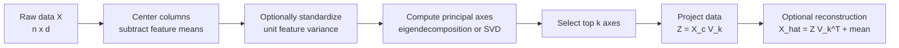
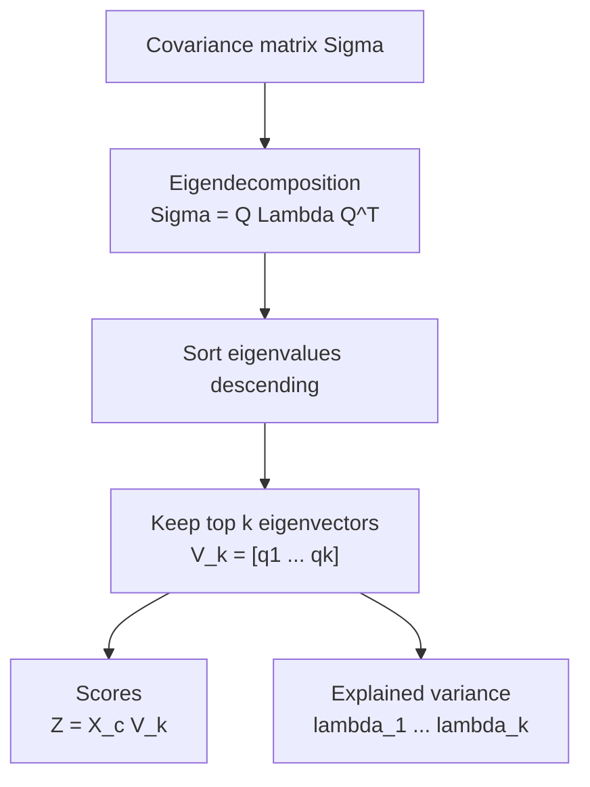
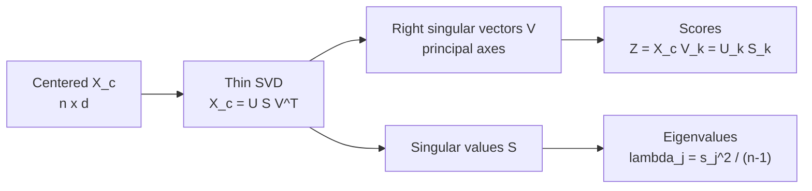
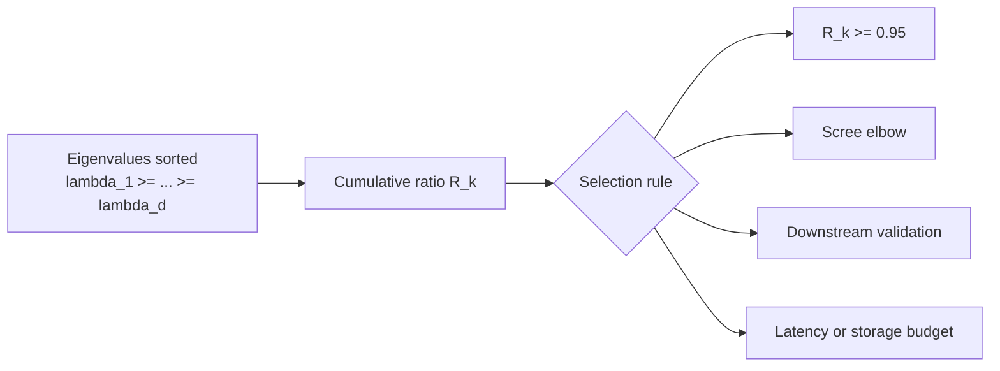

# Principal Component Analysis: Geometry, Eigendecomposition, SVD, and Implementation Mechanics

Principal Component Analysis (PCA) is a linear unsupervised dimensionality reduction method. Given centered observations in a high-dimensional feature space, PCA finds an orthonormal coordinate system whose first axis captures the largest possible sample variance, whose second axis captures the largest possible remaining variance subject to orthogonality, and so on.

Equivalently, PCA solves a best rank-$k$ linear approximation problem: among all $k$-dimensional linear subspaces, choose the one that minimizes squared reconstruction error.

PCA is used for:

- dimensionality reduction before downstream modeling,
- 2D or 3D visualization of high-dimensional data,
- denoising when low-variance directions are dominated by noise,
- decorrelation and multicollinearity handling,
- compression, for example images or embeddings,
- exploratory analysis of covariance structure.

The central assumption is linearity: the informative variation is well approximated by a low-dimensional affine subspace. If the data lie on a strongly nonlinear manifold, PCA may still be useful locally or as a baseline, but it cannot unfold curved structure.



## 1. Data Matrix and Notation

Let the dataset contain $n$ observations and $d$ features:

$$
X
\in
\mathbb{R}^{n \times d}.
$$

Rows are observations, columns are features:

$$
X
=
\begin{bmatrix}
x_1^\top \\
x_2^\top \\
\vdots \\
x_n^\top
\end{bmatrix},
\qquad
x_i \in \mathbb{R}^{d}.
$$

The sample mean vector is:

$$
\mu
=
\frac{1}{n}
\sum_{i=1}^{n}
x_i
\in
\mathbb{R}^{d}.
$$

The centered data matrix is:

$$
X_c
=
X - \mathbf{1}\mu^\top,
$$

where $\mathbf{1} \in \mathbb{R}^{n}$ is a column vector of ones. Centering is not optional for standard PCA: without centering, PCA finds directions that mix spread with distance from the origin.

The sample covariance matrix is:

$$
\Sigma
=
\frac{1}{n-1}
X_c^\top X_c
\in
\mathbb{R}^{d \times d}.
$$

The denominator $n-1$ gives the unbiased sample covariance estimator under the usual i.i.d. sampling assumption. Some numerical libraries use $n$ in probabilistic or maximum-likelihood contexts. The principal directions are unchanged by replacing $n-1$ with $n$ because that only rescales all eigenvalues by the same constant.

## 2. Centering Versus Standardization

PCA always needs centering. Standardization is a modeling choice.

For feature $j$, standardization transforms:

$$
z_{ij}
=
\frac{x_{ij} - \mu_j}{s_j},
$$

where $s_j$ is the sample standard deviation:

$$
s_j
=
\sqrt{
\frac{1}{n-1}
\sum_{i=1}^{n}
\left(x_{ij} - \mu_j\right)^2
}.
$$

Centering alone performs PCA on the covariance matrix. Centering plus scaling performs PCA on the correlation matrix:

$$
R
=
\frac{1}{n-1}
Z^\top Z.
$$

Use covariance PCA when feature units and magnitudes are meaningful, for example all features are pixel intensities or all features are returns measured on the same scale. Use correlation PCA when features have incomparable units, for example age, salary, and credit score.

| Preprocessing | Matrix being analyzed | Appropriate when |
| --- | --- | --- |
| Center only | Covariance matrix | Feature scales carry meaningful signal |
| Center and standardize | Correlation matrix | Feature units differ or scale should not dominate |
| Center and whiten after PCA | Diagonal identity covariance in component space | Downstream model benefits from decorrelated unit-variance inputs |

## 3. First Principal Component from First Principles

Choose a unit vector $v \in \mathbb{R}^{d}$. The scalar projection of centered sample $x_i - \mu$ onto $v$ is:

$$
z_i
=
v^\top (x_i - \mu).
$$

The sample variance of these projected values is:

$$
\operatorname{Var}(z)
=
\frac{1}{n-1}
\sum_{i=1}^{n}
\left(v^\top (x_i-\mu)\right)^2.
$$

Rewrite using matrix notation:

$$
\operatorname{Var}(z)
=
\frac{1}{n-1}
\left\|X_c v\right\|_2^2.
$$

Since $\left\|a\right\|_2^2 = a^\top a$:

$$
\operatorname{Var}(z)
=
\frac{1}{n-1}
(X_c v)^\top (X_c v).
$$

Move terms:

$$
\operatorname{Var}(z)
=
v^\top
\left(
\frac{1}{n-1}
X_c^\top X_c
\right)
v.
$$

Therefore:

$$
\operatorname{Var}(z)
=
v^\top \Sigma v.
$$

The first principal component solves:

$$
v_1
=
\arg\max_{v \in \mathbb{R}^{d}}
v^\top \Sigma v
\quad
\text{subject to}
\quad
v^\top v = 1.
$$

The unit-norm constraint is essential. Without it, the objective can be made arbitrarily large by scaling $v$.

### Lagrange Multiplier Derivation

Define the Lagrangian:

$$
\mathcal{L}(v,\lambda)
=
v^\top \Sigma v
-
\lambda(v^\top v - 1).
$$

Differentiate with respect to $v$:

$$
\nabla_v \mathcal{L}
=
2\Sigma v - 2\lambda v.
$$

At a stationary point:

$$
2\Sigma v - 2\lambda v = 0.
$$

So:

$$
\Sigma v = \lambda v.
$$

Thus, stationary directions are eigenvectors of the covariance matrix, and the projected variance along an eigenvector equals its eigenvalue:

$$
v^\top \Sigma v
=
v^\top \lambda v
=
\lambda v^\top v
=
\lambda.
$$

The maximizing direction is the eigenvector with the largest eigenvalue:

$$
v_1 = q_1,
\qquad
\lambda_1 = \max_j \lambda_j.
$$

Intuition: $v^\top \Sigma v$ is the variance seen when looking at the data cloud from direction $v$. The best direction is the orientation where the cloud casts the longest shadow.

## 4. Multiple Principal Components

For $k$ components, stack orthonormal loading vectors into:

$$
V_k
=
\begin{bmatrix}
v_1 & v_2 & \cdots & v_k
\end{bmatrix}
\in
\mathbb{R}^{d \times k},
$$

with:

$$
V_k^\top V_k = I_k.
$$

The projected coordinates, also called scores, are:

$$
Z
=
X_c V_k
\in
\mathbb{R}^{n \times k}.
$$

The optimization problem is:

$$
V_k^\star
=
\arg\max_{V_k^\top V_k = I_k}
\operatorname{tr}(V_k^\top \Sigma V_k).
$$

If the eigendecomposition of $\Sigma$ is:

$$
\Sigma
=
Q \Lambda Q^\top,
$$

where:

$$
Q^\top Q = I,
\qquad
\Lambda
=
\operatorname{diag}(\lambda_1,\lambda_2,\ldots,\lambda_d),
\qquad
\lambda_1 \geq \lambda_2 \geq \cdots \geq \lambda_d \geq 0,
$$

then:

$$
V_k^\star
=
\begin{bmatrix}
q_1 & q_2 & \cdots & q_k
\end{bmatrix}.
$$

The variance captured by the first $k$ components is:

$$
\sum_{j=1}^{k}
\lambda_j.
$$

The total sample variance in the original centered data is the trace of the covariance matrix:

$$
\operatorname{tr}(\Sigma)
=
\sum_{j=1}^{d}
\Sigma_{jj}
=
\sum_{j=1}^{d}
\lambda_j.
$$

Therefore, the explained variance ratio for component $j$ is:

$$
r_j
=
\frac{\lambda_j}{\sum_{\ell=1}^{d}\lambda_\ell}.
$$

The cumulative explained variance ratio after $k$ components is:

$$
R_k
=
\frac{
\sum_{j=1}^{k}\lambda_j
}{
\sum_{\ell=1}^{d}\lambda_\ell
}.
$$



## 5. PCA as Minimum Reconstruction Error

PCA is often introduced as variance maximization, but the reconstruction view is equally important.

Given $V_k^\top V_k = I_k$, the projection of a centered point $x_c$ onto the subspace spanned by $V_k$ is:

$$
\hat{x}_c
=
V_k V_k^\top x_c.
$$

For the whole centered matrix:

$$
\hat{X}_c
=
X_c V_k V_k^\top.
$$

The reconstruction error is:

$$
\left\|X_c - X_c V_k V_k^\top\right\|_F^2.
$$

PCA solves:

$$
V_k^\star
=
\arg\min_{V_k^\top V_k = I_k}
\left\|X_c - X_c V_k V_k^\top\right\|_F^2.
$$

To connect this with variance maximization, expand the squared Frobenius norm. The projection matrix is:

$$
P_k = V_k V_k^\top.
$$

Since $P_k$ is symmetric and idempotent:

$$
P_k^\top = P_k,
\qquad
P_k^2 = P_k.
$$

The error is:

$$
\left\|X_c - X_cP_k\right\|_F^2
=
\operatorname{tr}
\left(
(X_c - X_cP_k)^\top
(X_c - X_cP_k)
\right).
$$

Expanding:

$$
\left\|X_c - X_cP_k\right\|_F^2
=
\operatorname{tr}(X_c^\top X_c)
-
2\operatorname{tr}(P_k X_c^\top X_c)
+
\operatorname{tr}(P_k X_c^\top X_c P_k).
$$

Using cyclic trace and $P_k^2=P_k$:

$$
\operatorname{tr}(P_k X_c^\top X_c P_k)
=
\operatorname{tr}(P_k^2 X_c^\top X_c)
=
\operatorname{tr}(P_k X_c^\top X_c).
$$

Thus:

$$
\left\|X_c - X_cP_k\right\|_F^2
=
\operatorname{tr}(X_c^\top X_c)
-
\operatorname{tr}(P_k X_c^\top X_c).
$$

The first term does not depend on $V_k$. Minimizing reconstruction error is therefore equivalent to maximizing:

$$
\operatorname{tr}(P_k X_c^\top X_c)
=
\operatorname{tr}(V_k^\top X_c^\top X_c V_k)
=
(n-1)\operatorname{tr}(V_k^\top \Sigma V_k).
$$

This is the same objective as variance maximization.

## 6. SVD View of PCA

In practice, PCA is usually computed with Singular Value Decomposition (SVD), not by explicitly forming the covariance matrix.

The thin SVD of centered data is:

$$
X_c
=
U S V^\top,
$$

where:

$$
U \in \mathbb{R}^{n \times r},
\qquad
S \in \mathbb{R}^{r \times r},
\qquad
V \in \mathbb{R}^{d \times r},
\qquad
r = \operatorname{rank}(X_c).
$$

Here $U^\top U = I_r$, $V^\top V = I_r$, and:

$$
S
=
\operatorname{diag}(s_1,s_2,\ldots,s_r),
\qquad
s_1 \geq s_2 \geq \cdots \geq s_r > 0.
$$

Substitute the SVD into the covariance matrix:

$$
\Sigma
=
\frac{1}{n-1}
X_c^\top X_c.
$$

Since:

$$
X_c^\top X_c
=
(USV^\top)^\top(USV^\top)
=
VSU^\top USV^\top
=
VS^2V^\top,
$$

we get:

$$
\Sigma
=
V
\left(
\frac{S^2}{n-1}
\right)
V^\top.
$$

Thus the PCA loading vectors are the right singular vectors $V$, and the covariance eigenvalues are:

$$
\lambda_j
=
\frac{s_j^2}{n-1}.
$$

The scores are:

$$
Z
=
X_c V_k
=
U_k S_k.
$$

SVD is often numerically preferable because forming $X_c^\top X_c$ squares the condition number:

$$
\kappa(X_c^\top X_c)
=
\kappa(X_c)^2.
$$

This can amplify floating-point error when features are highly collinear or singular values span many orders of magnitude.



## 7. Step-by-Step PCA Execution

For a dense matrix $X \in \mathbb{R}^{n \times d}$:

1. Validate the input matrix: no non-numeric columns, no missing values unless imputed, and enough samples for the requested number of components.
2. Compute the feature mean $\mu$.
3. Center the data: $X_c = X - \mathbf{1}\mu^\top$.
4. Optionally compute feature standard deviations and divide each centered column by its standard deviation.
5. Compute either:
   - SVD of $X_c$, or
   - eigendecomposition of $\Sigma = X_c^\top X_c/(n-1)$.
6. Sort components by descending eigenvalue or singular value.
7. Choose $k$ components using a fixed number, explained variance threshold, scree plot, or downstream validation.
8. Project data into component coordinates:

$$
Z = X_c V_k.
$$

9. Reconstruct if needed:

$$
\hat{X}
=
ZV_k^\top + \mathbf{1}\mu^\top.
$$

10. For new data, reuse the training mean, training standard deviations, and training components. Never recompute PCA independently on test data.

## 8. Worked Numerical Example

Consider four 2D observations:

$$
X
=
\begin{bmatrix}
2 & 0 \\
0 & 2 \\
3 & 1 \\
1 & 3
\end{bmatrix}.
$$

The feature mean is:

$$
\mu
=
\begin{bmatrix}
\frac{2+0+3+1}{4} &
\frac{0+2+1+3}{4}
\end{bmatrix}
=
\begin{bmatrix}
1.5 & 1.5
\end{bmatrix}.
$$

The centered matrix is:

$$
X_c
=
\begin{bmatrix}
0.5 & -1.5 \\
-1.5 & 0.5 \\
1.5 & -0.5 \\
-0.5 & 1.5
\end{bmatrix}.
$$

Compute:

$$
X_c^\top X_c
=
\begin{bmatrix}
0.5 & -1.5 & 1.5 & -0.5 \\
-1.5 & 0.5 & -0.5 & 1.5
\end{bmatrix}
\begin{bmatrix}
0.5 & -1.5 \\
-1.5 & 0.5 \\
1.5 & -0.5 \\
-0.5 & 1.5
\end{bmatrix}.
$$

Entry by entry:

$$
(1,1)
=
0.5^2 + (-1.5)^2 + 1.5^2 + (-0.5)^2
=
5.
$$

$$
(2,2)
=
(-1.5)^2 + 0.5^2 + (-0.5)^2 + 1.5^2
=
5.
$$

$$
(1,2)
=
0.5(-1.5) + (-1.5)(0.5) + 1.5(-0.5) + (-0.5)(1.5)
=
-3.
$$

So:

$$
X_c^\top X_c
=
\begin{bmatrix}
5 & -3 \\
-3 & 5
\end{bmatrix}.
$$

The sample covariance matrix is:

$$
\Sigma
=
\frac{1}{3}
\begin{bmatrix}
5 & -3 \\
-3 & 5
\end{bmatrix}
=
\begin{bmatrix}
1.6667 & -1.0000 \\
-1.0000 & 1.6667
\end{bmatrix}.
$$

For a symmetric matrix:

$$
\begin{bmatrix}
a & b \\
b & a
\end{bmatrix},
$$

the eigenvectors are:

$$
q_1
=
\frac{1}{\sqrt{2}}
\begin{bmatrix}
1 \\
-1
\end{bmatrix},
\qquad
q_2
=
\frac{1}{\sqrt{2}}
\begin{bmatrix}
1 \\
1
\end{bmatrix}.
$$

The corresponding eigenvalues are:

$$
\lambda_1
=
a-b
=
1.6667 - (-1.0000)
=
2.6667,
$$

$$
\lambda_2
=
a+b
=
1.6667 + (-1.0000)
=
0.6667.
$$

The explained variance ratios are:

$$
r_1
=
\frac{2.6667}{2.6667 + 0.6667}
=
0.8,
$$

$$
r_2
=
\frac{0.6667}{2.6667 + 0.6667}
=
0.2.
$$

Using $k=1$, the first component captures $80\%$ of the sample variance.

Project the centered data onto $q_1$:

$$
z_i
=
x_{c,i}^\top q_1.
$$

For the first row:

$$
z_1
=
\begin{bmatrix}
0.5 & -1.5
\end{bmatrix}
\frac{1}{\sqrt{2}}
\begin{bmatrix}
1 \\
-1
\end{bmatrix}
=
\frac{0.5 + 1.5}{\sqrt{2}}
=
1.4142.
$$

The full one-dimensional score vector is:

$$
Z
=
\begin{bmatrix}
1.4142 \\
-1.4142 \\
1.4142 \\
-1.4142
\end{bmatrix}.
$$

Reconstruct the first point using one component:

$$
\hat{x}_{c,1}
=
z_1 q_1^\top
=
1.4142
\cdot
\frac{1}{\sqrt{2}}
\begin{bmatrix}
1 & -1
\end{bmatrix}
=
\begin{bmatrix}
1 & -1
\end{bmatrix}.
$$

Add the mean:

$$
\hat{x}_1
=
\hat{x}_{c,1} + \mu
=
\begin{bmatrix}
1 & -1
\end{bmatrix}
+
\begin{bmatrix}
1.5 & 1.5
\end{bmatrix}
=
\begin{bmatrix}
2.5 & 0.5
\end{bmatrix}.
$$

The original point was $(2,0)$, so the one-component approximation loses the variation along $q_2$.

## 9. Choosing the Number of Components

Common strategies:

- Fixed $k$: choose based on memory, latency, model constraints, or visualization needs.
- Explained variance threshold: choose the smallest $k$ such that $R_k \geq \tau$, for example $\tau=0.95$.
- Scree plot: inspect eigenvalue decay and choose the elbow.
- Cross-validation: choose $k$ that optimizes downstream validation performance.
- Noise-aware methods: retain components above a noise floor or compare against randomized baselines.

The explained variance rule is convenient but not always aligned with prediction. A low-variance component can be predictive if it aligns with the target. PCA is unsupervised and ignores labels.



## 10. Whitening

PCA decorrelates the data. The score covariance is diagonal:

$$
\operatorname{Cov}(Z)
=
\operatorname{Cov}(X_cV)
=
V^\top \Sigma V
=
\Lambda.
$$

Whitening additionally rescales components to unit variance:

$$
Z_{\text{white}}
=
X_c V_k \Lambda_k^{-1/2}.
$$

Then:

$$
\operatorname{Cov}(Z_{\text{white}})
=
I_k.
$$

Whitening can help algorithms sensitive to feature scale, but it also removes the relative variance information encoded by eigenvalues. It can amplify noise when small eigenvalues are retained, because $\lambda_j^{-1/2}$ becomes large.

## 11. From-Scratch NumPy Implementation

The implementation below uses SVD by default. It stores the training mean and scale so the same transformation can be applied to future data.

```python
import numpy as np


class PCAFromScratch:
    """Principal Component Analysis with SVD or covariance eigendecomposition."""

    def __init__(self, n_components=None, standardize=False, whiten=False, solver="svd", eps=1e-12):
        self.n_components = n_components
        self.standardize = standardize
        self.whiten = whiten
        self.solver = solver
        self.eps = eps

    def fit(self, X):
        X = np.asarray(X, dtype=np.float64)
        if X.ndim != 2:
            raise ValueError("X must be a 2D array with shape (n_samples, n_features).")

        n_samples, n_features = X.shape
        if n_samples < 2:
            raise ValueError("PCA needs at least two samples to estimate variance.")

        if not np.all(np.isfinite(X)):
            raise ValueError("X contains NaN or infinite values.")

        self.mean_ = X.mean(axis=0)
        Xc = X - self.mean_

        if self.standardize:
            scale = Xc.std(axis=0, ddof=1)
            zero_var = scale < self.eps
            if np.any(zero_var):
                # Constant columns carry no variance and cannot be standardized safely.
                scale = scale.copy()
                scale[zero_var] = 1.0
            self.scale_ = scale
            Xc = Xc / self.scale_
        else:
            self.scale_ = np.ones(n_features, dtype=np.float64)

        max_components = min(n_samples - 1, n_features)
        if self.n_components is None:
            k = max_components
        elif isinstance(self.n_components, float):
            if not 0.0 < self.n_components <= 1.0:
                raise ValueError("Float n_components must be in (0, 1].")
            k = None
        else:
            k = int(self.n_components)
            if not 1 <= k <= max_components:
                raise ValueError(f"n_components must be between 1 and {max_components}.")

        if self.solver == "svd":
            U, singular_values, Vt = np.linalg.svd(Xc, full_matrices=False)
            eigenvalues = (singular_values ** 2) / (n_samples - 1)
            components = Vt
        elif self.solver == "eigh":
            covariance = (Xc.T @ Xc) / (n_samples - 1)
            eigenvalues, eigenvectors = np.linalg.eigh(covariance)
            order = np.argsort(eigenvalues)[::-1]
            eigenvalues = eigenvalues[order]
            eigenvectors = eigenvectors[:, order]
            eigenvalues = np.maximum(eigenvalues, 0.0)
            singular_values = np.sqrt(eigenvalues * (n_samples - 1))
            components = eigenvectors.T
        else:
            raise ValueError("solver must be 'svd' or 'eigh'.")

        total_variance = eigenvalues.sum()
        if total_variance <= self.eps:
            raise ValueError("All features have near-zero variance after preprocessing.")

        explained_ratio = eigenvalues / total_variance
        cumulative = np.cumsum(explained_ratio)

        if k is None:
            k = int(np.searchsorted(cumulative, self.n_components, side="left") + 1)

        self.n_components_ = k
        self.components_ = components[:k]
        self.explained_variance_ = eigenvalues[:k]
        self.explained_variance_ratio_ = explained_ratio[:k]
        self.singular_values_ = singular_values[:k]
        self.total_variance_ = total_variance
        self.noise_variance_ = (
            eigenvalues[k:].mean() if k < len(eigenvalues) else 0.0
        )
        return self

    def transform(self, X):
        X = np.asarray(X, dtype=np.float64)
        Xc = (X - self.mean_) / self.scale_
        scores = Xc @ self.components_.T

        if self.whiten:
            scores = scores / np.sqrt(self.explained_variance_ + self.eps)

        return scores

    def inverse_transform(self, Z):
        Z = np.asarray(Z, dtype=np.float64)

        if self.whiten:
            Z = Z * np.sqrt(self.explained_variance_ + self.eps)

        Xc_hat = Z @ self.components_
        X_hat = Xc_hat * self.scale_ + self.mean_
        return X_hat

    def fit_transform(self, X):
        return self.fit(X).transform(X)
```

### Run the Worked Example

```python
X = np.array(
    [
        [2.0, 0.0],
        [0.0, 2.0],
        [3.0, 1.0],
        [1.0, 3.0],
    ]
)

pca = PCAFromScratch(n_components=1, solver="svd")
Z = pca.fit_transform(X)
X_hat = pca.inverse_transform(Z)

print("mean:", pca.mean_)
print("components:", pca.components_)
print("explained variance:", pca.explained_variance_)
print("explained variance ratio:", pca.explained_variance_ratio_)
print("scores:", Z.ravel())
print("reconstruction:", X_hat)
```

Expected values may differ by a sign flip in the component:

```text
mean: [1.5 1.5]
components: [[ 0.70710678 -0.70710678]]
explained variance: [2.66666667]
explained variance ratio: [0.8]
scores: [ 1.41421356 -1.41421356  1.41421356 -1.41421356]
reconstruction:
[[2.5 0.5]
 [0.5 2.5]
 [2.5 0.5]
 [0.5 2.5]]
```

The sign of an eigenvector is arbitrary. If $v$ is an eigenvector, then $-v$ is also an eigenvector:

$$
\Sigma(-v)
=
-\Sigma v
=
-\lambda v
=
\lambda(-v).
$$

Therefore, a PCA implementation may return scores with opposite signs while representing the same subspace.

## 12. Equivalent Library Implementations

### scikit-learn

```python
import numpy as np
from sklearn.decomposition import PCA
from sklearn.preprocessing import StandardScaler
from sklearn.pipeline import make_pipeline


X = np.array(
    [
        [2.0, 0.0],
        [0.0, 2.0],
        [3.0, 1.0],
        [1.0, 3.0],
    ]
)

pca = PCA(n_components=1, svd_solver="full")
Z = pca.fit_transform(X)
X_hat = pca.inverse_transform(Z)

print(pca.mean_)
print(pca.components_)
print(pca.explained_variance_)
print(pca.explained_variance_ratio_)
```

`sklearn.decomposition.PCA` centers the data but does not standardize features by default. To perform correlation PCA, put a scaler before PCA:

```python
pipe = make_pipeline(
    StandardScaler(with_mean=True, with_std=True),
    PCA(n_components=0.95, svd_solver="full"),
)

Z = pipe.fit_transform(X)
```

Important scikit-learn attributes:

| Attribute | Meaning |
| --- | --- |
| `mean_` | Training feature means used for centering |
| `components_` | Principal axes, shape `(n_components, n_features)` |
| `explained_variance_` | Eigenvalues of the covariance matrix for retained components |
| `explained_variance_ratio_` | Fraction of total variance explained by retained components |
| `singular_values_` | Singular values associated with retained components |
| `noise_variance_` | Average variance left outside the retained subspace |

Internally, exact PCA with a full SVD computes:

$$
X_c = U S V^\top,
$$

then sets:

$$
\texttt{components\_} = V_k^\top,
\qquad
\texttt{explained\_variance\_}_j = \frac{s_j^2}{n-1}.
$$

For large matrices, scikit-learn can use randomized truncated SVD. The randomized approach sketches the range of $X_c$ with random projections, orthonormalizes the sketch, and computes a smaller SVD in that subspace. This is faster when only a small number of components is needed.

### NumPy SVD

```python
Xc = X - X.mean(axis=0)
U, s, Vt = np.linalg.svd(Xc, full_matrices=False)

k = 1
components = Vt[:k]
scores = Xc @ components.T
explained_variance = (s[:k] ** 2) / (X.shape[0] - 1)
```

`np.linalg.svd` returns $U$, the singular values $s$, and $V^\top$ as `Vt`. With `full_matrices=False`, it returns the compact SVD, which avoids unnecessary orthonormal columns when the matrix is rectangular.

### PyTorch

```python
import torch

X_t = torch.tensor(X, dtype=torch.float64)
Xc_t = X_t - X_t.mean(dim=0, keepdim=True)

U, S, Vh = torch.linalg.svd(Xc_t, full_matrices=False)
components = Vh[:1]
scores = Xc_t @ components.T
explained_variance = (S[:1] ** 2) / (X_t.shape[0] - 1)
```

PyTorch is useful when PCA is part of a GPU pipeline, but classical PCA itself is not learned by gradient descent. The SVD operation is differentiable only away from repeated singular values and sign ambiguities, so care is needed if using PCA-like operations inside neural networks.

## 13. Complexity

Let $X \in \mathbb{R}^{n \times d}$ and $m=\min(n,d)$.

| Method | Time complexity | Space complexity | Best use case |
| --- | --- | --- | --- |
| Covariance plus eigendecomposition | $O(nd^2 + d^3)$ | $O(d^2)$ | Moderate $d$, many samples |
| Full SVD of $X_c$ | $O(ndm)$ | $O(nm + dm)$ depending on implementation | Numerically robust exact PCA |
| Truncated iterative SVD | Approximately $O(\operatorname{nnz}(X)k)$ per pass plus orthogonalization | $O((n+d)k)$ | Sparse or very large matrices |
| Randomized SVD | Approximately $O(nd(k+p))$ plus small SVD | $O((n+d)(k+p))$ | Large dense matrices, small $k$ |

Here $p$ is the oversampling parameter used by randomized SVD. More power iterations improve accuracy when the singular spectrum decays slowly, but they add passes over the data.

When $d$ is very large, explicitly forming the $d \times d$ covariance matrix can be impossible. When $n \ll d$, it can be cheaper to work with the Gram matrix $X_cX_c^\top \in \mathbb{R}^{n \times n}$ or use SVD directly.

## 14. Numerical Stability and Edge Cases

### Repeated or Nearly Equal Eigenvalues

If $\lambda_j = \lambda_{j+1}$, the individual eigenvectors inside that eigenspace are not unique. Any orthonormal basis spanning the same subspace is valid. This can make components appear unstable across runs or libraries even when the subspace is stable.

### Sign Ambiguity

Eigenvectors and singular vectors are defined only up to sign. Do not write tests that require an exact sign. Compare reconstructions, explained variance, or absolute correlations.

### Zero-Variance Features

A constant feature has variance zero. Centering makes it exactly zero. Standardization would divide by zero unless handled explicitly. Such features should be dropped or assigned scale one after centering.

### Missing Values

Classical PCA requires a complete numeric matrix. Typical options are:

- impute missing values before PCA,
- fit PCA with algorithms designed for missing data,
- use matrix factorization with an observed-entry loss.

Mean imputation can distort covariance. More careful imputation should be fitted inside the training fold only.

### Outliers

PCA uses squared deviations and is sensitive to outliers. A single extreme observation can rotate the first component. Robust alternatives include robust covariance estimation, trimming, winsorization, or robust PCA formulations.

### Sparse Data

Centering a sparse matrix usually makes it dense. For sparse high-dimensional data, such as bag-of-words features, use `TruncatedSVD` without centering when appropriate. That method is related to latent semantic analysis, but it is not exactly covariance PCA on centered features.

### Data Leakage

Fit PCA only on training data:

$$
\mu_{\text{train}},
\quad
V_{k,\text{train}}.
$$

Then transform validation and test data using those training quantities. Fitting PCA before the train-test split leaks distributional information.

### Supervised Tasks

PCA preserves variance, not predictive information. If a target-relevant direction has low variance, PCA may discard it. For supervised dimensionality reduction, compare against methods such as LDA, PLS, feature selection, autoencoders, or supervised embeddings.

## 15. Common Implementation Pitfalls

- Using PCA without centering.
- Standardizing test data with test-set means instead of training-set means.
- Assuming component signs are stable.
- Sorting eigenvalues in ascending order by accident.
- Computing covariance with rows as features instead of columns.
- Forgetting that `components_` in scikit-learn has shape `(k, d)`, so projection uses `Xc @ components_.T`.
- Choosing $k$ by explained variance alone for supervised prediction.
- Applying PCA to one-hot encoded categorical variables without considering the geometry implied by Euclidean distance.
- Keeping whitened components with tiny eigenvalues, which can amplify noise.
- Interpreting principal components causally. PCA finds directions of covariance, not causal factors.

## 16. Connections to Related Concepts

### Linear Autoencoders

A linear autoencoder with one hidden layer, squared reconstruction loss, and appropriate constraints learns the same principal subspace as PCA. However, the learned weights need not equal the exact PCA loading matrix unless orthogonality and normalization constraints are imposed.


### Probabilistic PCA

Probabilistic PCA models observations as:

$$
x
=
Wz + \mu + \epsilon,
$$

where:

$$
z \sim \mathcal{N}(0,I),
\qquad
\epsilon \sim \mathcal{N}(0,\sigma^2 I).
$$

The marginal distribution is:

$$
x
\sim
\mathcal{N}(\mu, WW^\top + \sigma^2 I).
$$

As $\sigma^2$ becomes small and parameters are estimated by maximum likelihood, the principal subspace aligns with classical PCA.

### Kernel PCA

Kernel PCA performs PCA in an implicit feature space:

$$
\phi(x)
\in
\mathcal{H},
$$

using only kernel evaluations:

$$
K_{ij}
=
k(x_i,x_j)
=
\langle \phi(x_i), \phi(x_j) \rangle.
$$

It can capture nonlinear structure, but scaling to large $n$ is difficult because it requires eigendecomposition of an $n \times n$ kernel matrix.

### Randomized SVD

Randomized SVD approximates the top singular subspace by first sampling the range of $X_c$:

$$
Y
=
X_c \Omega,
$$

where $\Omega \in \mathbb{R}^{d \times (k+p)}$ is a random test matrix. After orthonormalizing $Y$ into $Q$, compute a small SVD of:

$$
B
=
Q^\top X_c.
$$

This replaces a large decomposition with a smaller one when the top-$k$ subspace is enough.

### Factor Analysis

PCA explains total variance with orthogonal components. Factor analysis separates shared latent-factor variance from feature-specific noise variance. PCA is primarily a geometric matrix approximation method; factor analysis is a generative latent variable model.

## 17. Interview-Level Summary

PCA transforms centered data into orthogonal linear components ordered by decreasing variance. The first component solves a constrained maximization of $v^\top \Sigma v$, which leads to the covariance eigenvalue equation $\Sigma v = \lambda v$. The top $k$ eigenvectors maximize retained variance and minimize squared reconstruction error among all $k$-dimensional linear subspaces. In practice, PCA is usually computed through SVD of the centered data matrix because the right singular vectors are the principal axes and $\lambda_j=s_j^2/(n-1)$. PCA is powerful for compression, visualization, denoising, and decorrelation, but it is linear, scale-sensitive, outlier-sensitive, unsupervised, and can discard low-variance predictive signals.

## 18. References and Deeper Reading

- Karl Pearson, "On Lines and Planes of Closest Fit to Systems of Points in Space", 1901. https://www.stats.org.uk/pca/Pearson1901.pdf
- Harold Hotelling, "Analysis of a complex of statistical variables into principal components", 1933.
- I. T. Jolliffe, "Principal Component Analysis", Springer.
- Christopher M. Bishop, "Pattern Recognition and Machine Learning", Chapter 12.
- Michael E. Tipping and Christopher M. Bishop, "Probabilistic Principal Component Analysis", 1999.
- scikit-learn documentation, `sklearn.decomposition.PCA`. https://scikit-learn.org/stable/modules/generated/sklearn.decomposition.PCA.html
- scikit-learn User Guide, decomposition and PCA. https://scikit-learn.org/stable/modules/decomposition.html
- NumPy documentation, `numpy.linalg.svd`. https://numpy.org/doc/stable/reference/generated/numpy.linalg.svd.html
- Nathan Halko, Per-Gunnar Martinsson, and Joel A. Tropp, "Finding Structure with Randomness: Probabilistic Algorithms for Constructing Approximate Matrix Decompositions", 2011. https://arxiv.org/abs/0909.4061
