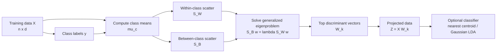
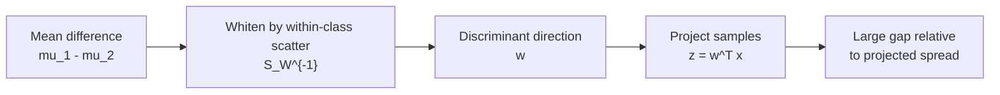
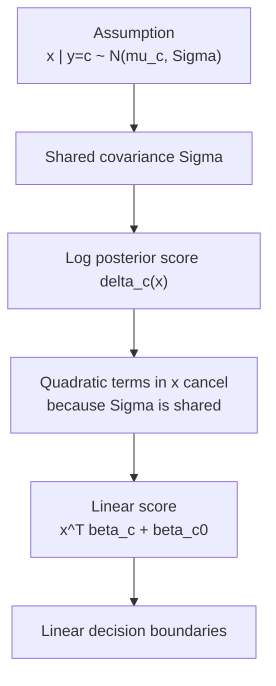
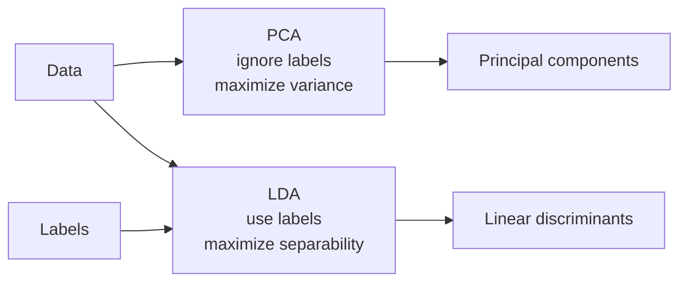

# Linear Discriminant Analysis: Fisher Projections, Gaussian Discriminants, and Implementation Mechanics

Linear Discriminant Analysis (LDA) is a supervised linear method with two equivalent-looking but operationally different uses:

- **Dimensionality reduction:** find a low-dimensional linear projection that preserves class separability.
- **Classification:** fit class-conditional Gaussian densities with a shared covariance matrix, then classify by Bayes' rule.

The projection view is often called **Fisher's linear discriminant**. The classifier view is the classical **Gaussian discriminant analysis** model with equal class covariances. Both lead to linear decision boundaries, and both depend on the same geometric idea: classes should be far apart relative to their internal spread.

LDA is useful when labels are available, the useful separation is mostly linear, and the number of target dimensions can be small. Its maximum number of useful discriminant components is:

$$
\min(d, C - 1),
$$

where $d$ is the number of input features and $C$ is the number of classes.



## 1. Notation

Let the dataset be:

$$
X =
\begin{bmatrix}
x_1^\top \\
x_2^\top \\
\vdots \\
x_n^\top
\end{bmatrix}
\in \mathbb{R}^{n \times d},
\qquad
x_i \in \mathbb{R}^{d},
$$

with labels:

$$
y_i \in \{1,2,\ldots,C\}.
$$

For class $c$, define the index set:

$$
\mathcal{I}_c = \{i : y_i = c\},
\qquad
n_c = |\mathcal{I}_c|.
$$

The class mean is:

$$
\mu_c =
\frac{1}{n_c}
\sum_{i \in \mathcal{I}_c}
x_i.
$$

The global mean is:

$$
\mu =
\frac{1}{n}
\sum_{i=1}^{n}
x_i
=
\sum_{c=1}^{C}
\frac{n_c}{n}\mu_c.
$$

The empirical class prior is:

$$
\pi_c =
\frac{n_c}{n}.
$$

LDA uses labels through $\mu_c$, $n_c$, and class-specific scatter. This is the key distinction from PCA, which only sees the unlabeled covariance of $X$.

## 2. Scatter Matrices

The **within-class scatter matrix** measures variation around each class mean:

$$
S_W =
\sum_{c=1}^{C}
\sum_{i \in \mathcal{I}_c}
(x_i - \mu_c)(x_i - \mu_c)^\top.
$$

Each term $(x_i-\mu_c)(x_i-\mu_c)^\top$ is a rank-1 matrix. Its $(j,k)$ entry is:

$$
(x_{ij} - \mu_{cj})(x_{ik} - \mu_{ck}),
$$

so diagonal entries accumulate within-class variances and off-diagonal entries accumulate within-class covariances.

The **between-class scatter matrix** measures variation of class means around the global mean:

$$
S_B =
\sum_{c=1}^{C}
n_c(\mu_c-\mu)(\mu_c-\mu)^\top.
$$

The factor $n_c$ matters: a class mean estimated from more samples contributes proportionally more to the total between-class scatter.

The **total scatter matrix** is:

$$
S_T =
\sum_{i=1}^{n}
(x_i-\mu)(x_i-\mu)^\top.
$$

These matrices satisfy:

$$
S_T = S_W + S_B.
$$

### Derivation of $S_T = S_W + S_B$

For any sample $x_i$ in class $c$:

$$
x_i - \mu =
(x_i-\mu_c) + (\mu_c-\mu).
$$

Therefore:

$$
(x_i-\mu)(x_i-\mu)^\top
=
\left((x_i-\mu_c)+(\mu_c-\mu)\right)
\left((x_i-\mu_c)+(\mu_c-\mu)\right)^\top.
$$

Expanding:

$$
\begin{aligned}
(x_i-\mu)(x_i-\mu)^\top
&=
(x_i-\mu_c)(x_i-\mu_c)^\top \\
&\quad+
(x_i-\mu_c)(\mu_c-\mu)^\top \\
&\quad+
(\mu_c-\mu)(x_i-\mu_c)^\top \\
&\quad+
(\mu_c-\mu)(\mu_c-\mu)^\top.
\end{aligned}
$$

Sum over $i \in \mathcal{I}_c$. The two cross terms vanish because:

$$
\sum_{i \in \mathcal{I}_c}
(x_i-\mu_c)
=
\sum_{i \in \mathcal{I}_c}x_i - n_c\mu_c
=
0.
$$

Thus:

$$
\sum_{i \in \mathcal{I}_c}
(x_i-\mu)(x_i-\mu)^\top
=
\sum_{i \in \mathcal{I}_c}
(x_i-\mu_c)(x_i-\mu_c)^\top
+
n_c(\mu_c-\mu)(\mu_c-\mu)^\top.
$$

Summing over classes gives:

$$
S_T = S_W + S_B.
$$

The decomposition says total variability consists of variability inside classes plus variability between class centroids.

## 3. Fisher Criterion for Two Classes

For two classes, LDA seeks a vector $w \in \mathbb{R}^{d}$ such that the scalar projection:

$$
z_i = w^\top x_i
$$

separates the two projected classes.

The projected class means are:

$$
m_1 = w^\top\mu_1,
\qquad
m_2 = w^\top\mu_2.
$$

The projected within-class scatter is:

$$
s_1^2 + s_2^2
=
\sum_{i \in \mathcal{I}_1}(w^\top x_i - w^\top\mu_1)^2
+
\sum_{i \in \mathcal{I}_2}(w^\top x_i - w^\top\mu_2)^2.
$$

Rewrite one term:

$$
\begin{aligned}
\sum_{i \in \mathcal{I}_c}(w^\top x_i - w^\top\mu_c)^2
&=
\sum_{i \in \mathcal{I}_c}
\left(w^\top(x_i-\mu_c)\right)^2 \\
&=
\sum_{i \in \mathcal{I}_c}
w^\top(x_i-\mu_c)(x_i-\mu_c)^\top w \\
&=
w^\top
\left(
\sum_{i \in \mathcal{I}_c}
(x_i-\mu_c)(x_i-\mu_c)^\top
\right)
w.
\end{aligned}
$$

So total projected within-class scatter is:

$$
w^\top S_W w.
$$

The squared distance between projected means is:

$$
(m_1-m_2)^2
=
\left(w^\top(\mu_1-\mu_2)\right)^2
=
w^\top(\mu_1-\mu_2)(\mu_1-\mu_2)^\top w.
$$

For two classes, define:

$$
S_B =
(\mu_1-\mu_2)(\mu_1-\mu_2)^\top.
$$

The Fisher objective is the Rayleigh quotient:

$$
J(w)
=
\frac{w^\top S_B w}{w^\top S_W w}.
$$

The numerator rewards projected class-mean separation. The denominator penalizes projected within-class spread.

### Solving the Two-Class Objective

The scale of $w$ does not matter because:

$$
J(\alpha w)
=
\frac{\alpha^2 w^\top S_B w}{\alpha^2 w^\top S_W w}
=
J(w).
$$

Constrain the denominator:

$$
w^\top S_W w = 1.
$$

Maximize:

$$
w^\top S_B w
$$

subject to that constraint. The Lagrangian is:

$$
\mathcal{L}(w,\lambda)
=
w^\top S_B w
-
\lambda(w^\top S_W w - 1).
$$

Taking the derivative with respect to $w$:

$$
\nabla_w \mathcal{L}
=
2S_Bw - 2\lambda S_Ww.
$$

Set it to zero:

$$
S_Bw = \lambda S_Ww.
$$

This is a generalized eigenvalue problem. If $S_W$ is nonsingular:

$$
S_W^{-1}S_Bw = \lambda w.
$$

For two classes, $S_B$ is rank 1:

$$
S_Bw
=
(\mu_1-\mu_2)(\mu_1-\mu_2)^\top w.
$$

The scalar $(\mu_1-\mu_2)^\top w$ only changes magnitude, so the solution direction is:

$$
w \propto S_W^{-1}(\mu_1-\mu_2).
$$

Intuitively, this is not simply the line between means. It is the mean-difference vector after correcting for within-class covariance. Directions with large within-class variance are discounted; directions with small within-class variance are amplified.



## 4. Multiclass LDA

For $C > 2$, choose a projection matrix:

$$
W =
\begin{bmatrix}
w_1 & w_2 & \cdots & w_k
\end{bmatrix}
\in \mathbb{R}^{d \times k}.
$$

Projected samples are:

$$
z_i = W^\top x_i \in \mathbb{R}^{k}.
$$

The projected within-class scatter is:

$$
W^\top S_W W.
$$

The projected between-class scatter is:

$$
W^\top S_B W.
$$

The multiclass Fisher objective is commonly written as:

$$
J(W)
=
\frac{\det(W^\top S_B W)}
{\det(W^\top S_W W)}.
$$

The determinant measures generalized volume in the projected space. Maximizing this ratio seeks a projection where class centroids occupy a large volume while each class remains compact.

The stationary directions satisfy:

$$
S_Bw = \lambda S_Ww.
$$

The $k$ best directions are the generalized eigenvectors with the largest eigenvalues. Equivalently, when $S_W$ is invertible:

$$
S_W^{-1}S_Bw = \lambda w.
$$

### Why at Most $C-1$ Components?

$S_B$ is built from centered class-mean vectors:

$$
v_c = \mu_c - \mu.
$$

Because:

$$
\sum_{c=1}^{C} n_c(\mu_c-\mu)
=
\sum_{c=1}^{C}n_c\mu_c - n\mu
=
0,
$$

the $C$ weighted mean-offset vectors are linearly dependent. Therefore:

$$
\operatorname{rank}(S_B) \leq C - 1.
$$

Also:

$$
\operatorname{rank}(S_B) \leq d.
$$

So:

$$
\operatorname{rank}(S_B) \leq \min(d, C-1).
$$

Only directions in the range of $S_B$ can have nonzero between-class scatter. Hence LDA cannot produce more than $\min(d,C-1)$ useful discriminant components.

## 5. LDA as a Gaussian Classifier

The classifier version assumes:

$$
x \mid y=c \sim \mathcal{N}(\mu_c, \Sigma),
$$

where all classes share the same covariance matrix $\Sigma$ but have different means $\mu_c$ and priors $\pi_c$.

Bayes' rule gives:

$$
p(y=c \mid x)
=
\frac{p(x \mid y=c)\pi_c}
{\sum_{\ell=1}^{C}p(x \mid y=\ell)\pi_\ell}.
$$

The multivariate Gaussian density is:

$$
p(x \mid y=c)
=
\frac{1}{(2\pi)^{d/2}|\Sigma|^{1/2}}
\exp\left(
-\frac{1}{2}(x-\mu_c)^\top\Sigma^{-1}(x-\mu_c)
\right).
$$

For classification, use the log posterior up to an additive constant independent of $c$:

$$
\delta_c(x)
=
\log \pi_c
-
\frac{1}{2}\log|\Sigma|
-
\frac{d}{2}\log(2\pi)
-
\frac{1}{2}(x-\mu_c)^\top\Sigma^{-1}(x-\mu_c).
$$

Since $\Sigma$ is shared across classes, the determinant and $(2\pi)$ terms do not affect the argmax:

$$
\delta_c(x)
=
\log \pi_c
-
\frac{1}{2}(x-\mu_c)^\top\Sigma^{-1}(x-\mu_c)
+
\text{constant}.
$$

Expand the quadratic:

$$
\begin{aligned}
(x-\mu_c)^\top\Sigma^{-1}(x-\mu_c)
&=
x^\top\Sigma^{-1}x
-2x^\top\Sigma^{-1}\mu_c
+\mu_c^\top\Sigma^{-1}\mu_c.
\end{aligned}
$$

The term $x^\top\Sigma^{-1}x$ is also independent of $c$, so:

$$
\delta_c(x)
=
x^\top\Sigma^{-1}\mu_c
-
\frac{1}{2}\mu_c^\top\Sigma^{-1}\mu_c
+
\log \pi_c.
$$

This is linear in $x$. Define:

$$
\beta_c = \Sigma^{-1}\mu_c,
\qquad
\beta_{c0}
=
-\frac{1}{2}\mu_c^\top\Sigma^{-1}\mu_c
+
\log\pi_c.
$$

Then:

$$
\delta_c(x) = x^\top\beta_c + \beta_{c0}.
$$

The predicted class is:

$$
\hat{y}
=
\arg\max_c \delta_c(x).
$$

Between two classes $a$ and $b$, the decision boundary is:

$$
\delta_a(x) = \delta_b(x),
$$

or:

$$
x^\top(\beta_a-\beta_b) + (\beta_{a0}-\beta_{b0}) = 0.
$$

That is a hyperplane.



### Connection Between Projection LDA and Gaussian LDA

For two classes with equal priors, the Gaussian LDA decision boundary depends on:

$$
\Sigma^{-1}(\mu_1-\mu_2).
$$

Fisher's two-class projection gives:

$$
w \propto S_W^{-1}(\mu_1-\mu_2).
$$

Since $S_W$ is proportional to the pooled within-class covariance estimate, both methods use the same direction up to scaling. Fisher LDA reaches it from a separation objective; Gaussian LDA reaches it from a probabilistic generative model.

## 6. Step-by-Step Execution

For dimensionality reduction:

1. Encode labels and split samples by class.
2. Compute each class mean $\mu_c$ and the global mean $\mu$.
3. Compute $S_W$ by summing centered outer products within each class.
4. Compute $S_B$ by summing weighted outer products of class mean offsets.
5. Solve $S_Bw = \lambda S_Ww$.
6. Sort eigenvectors by descending eigenvalue.
7. Keep $k \leq \min(d,C-1)$ directions.
8. Project data with $Z = XW_k$.

For classification:

1. Estimate priors $\pi_c$.
2. Estimate means $\mu_c$.
3. Estimate pooled covariance $\Sigma$.
4. Solve linear systems $\Sigma\beta_c=\mu_c$ rather than explicitly forming $\Sigma^{-1}$.
5. Compute discriminant scores $\delta_c(x)$.
6. Predict the class with the largest score.

## 7. Worked Example: Two Classes in Two Dimensions

Consider four samples:

| Sample | $x_1$ | $x_2$ | Class |
| --- | ---: | ---: | --- |
| 1 | 2 | 3 | A |
| 2 | 3 | 4 | A |
| 3 | 7 | 8 | B |
| 4 | 8 | 9 | B |

The class means are:

$$
\mu_A =
\begin{bmatrix}
2.5 \\
3.5
\end{bmatrix},
\qquad
\mu_B =
\begin{bmatrix}
7.5 \\
8.5
\end{bmatrix}.
$$

The global mean is:

$$
\mu =
\begin{bmatrix}
5 \\
6
\end{bmatrix}.
$$

For class A:

$$
x_1-\mu_A =
\begin{bmatrix}
-0.5 \\
-0.5
\end{bmatrix},
\qquad
x_2-\mu_A =
\begin{bmatrix}
0.5 \\
0.5
\end{bmatrix}.
$$

The scatter contribution is:

$$
\begin{bmatrix}
-0.5 \\
-0.5
\end{bmatrix}
\begin{bmatrix}
-0.5 & -0.5
\end{bmatrix}
+
\begin{bmatrix}
0.5 \\
0.5
\end{bmatrix}
\begin{bmatrix}
0.5 & 0.5
\end{bmatrix}
=
\begin{bmatrix}
0.5 & 0.5 \\
0.5 & 0.5
\end{bmatrix}.
$$

Class B has the same within-class scatter:

$$
\begin{bmatrix}
0.5 & 0.5 \\
0.5 & 0.5
\end{bmatrix}.
$$

Thus:

$$
S_W =
\begin{bmatrix}
1 & 1 \\
1 & 1
\end{bmatrix}.
$$

This matrix is singular because both features move together perfectly. Plain inversion fails. Add a small ridge $\alpha I$:

$$
S_{W,\alpha}
=
S_W+\alpha I.
$$

Using $\alpha=0.1$:

$$
S_{W,\alpha}
=
\begin{bmatrix}
1.1 & 1 \\
1 & 1.1
\end{bmatrix}.
$$

The mean difference is:

$$
\mu_B-\mu_A =
\begin{bmatrix}
5 \\
5
\end{bmatrix}.
$$

The inverse of $S_{W,\alpha}$ is:

$$
S_{W,\alpha}^{-1}
=
\frac{1}{1.1^2 - 1^2}
\begin{bmatrix}
1.1 & -1 \\
-1 & 1.1
\end{bmatrix}
=
\frac{1}{0.21}
\begin{bmatrix}
1.1 & -1 \\
-1 & 1.1
\end{bmatrix}.
$$

Therefore:

$$
w
\propto
S_{W,\alpha}^{-1}(\mu_B-\mu_A)
=
\frac{1}{0.21}
\begin{bmatrix}
1.1 & -1 \\
-1 & 1.1
\end{bmatrix}
\begin{bmatrix}
5 \\
5
\end{bmatrix}
=
\frac{1}{0.21}
\begin{bmatrix}
0.5 \\
0.5
\end{bmatrix}
=
\begin{bmatrix}
2.381 \\
2.381
\end{bmatrix}.
$$

Normalize:

$$
\hat{w}
=
\frac{1}{\sqrt{2}}
\begin{bmatrix}
1 \\
1
\end{bmatrix}
\approx
\begin{bmatrix}
0.707 \\
0.707
\end{bmatrix}.
$$

Projected values:

$$
z_i = \hat{w}^\top x_i.
$$

So:

$$
z_A =
\{3.536,\;4.950\},
\qquad
z_B =
\{10.607,\;12.021\}.
$$

The projected class means are far apart:

$$
\bar{z}_B-\bar{z}_A
=
11.314 - 4.243
=
7.071.
$$

Within each class, projected samples are separated by:

$$
4.950 - 3.536 = 1.414,
\qquad
12.021 - 10.607 = 1.414.
$$

The projection captures the diagonal direction along which the class means differ.

## 8. Worked Example: Gaussian LDA Scores

Use two classes with means:

$$
\mu_0 =
\begin{bmatrix}
0 \\
0
\end{bmatrix},
\qquad
\mu_1 =
\begin{bmatrix}
2 \\
1
\end{bmatrix},
$$

shared covariance:

$$
\Sigma =
\begin{bmatrix}
2 & 0.5 \\
0.5 & 1
\end{bmatrix},
$$

and equal priors:

$$
\pi_0=\pi_1=0.5.
$$

The determinant is:

$$
|\Sigma| = 2 \cdot 1 - 0.5^2 = 1.75.
$$

The inverse is:

$$
\Sigma^{-1}
=
\frac{1}{1.75}
\begin{bmatrix}
1 & -0.5 \\
-0.5 & 2
\end{bmatrix}
=
\begin{bmatrix}
0.5714 & -0.2857 \\
-0.2857 & 1.1429
\end{bmatrix}.
$$

For class 1:

$$
\beta_1
=
\Sigma^{-1}\mu_1
=
\begin{bmatrix}
0.5714 & -0.2857 \\
-0.2857 & 1.1429
\end{bmatrix}
\begin{bmatrix}
2 \\
1
\end{bmatrix}
=
\begin{bmatrix}
0.8571 \\
0.5715
\end{bmatrix}.
$$

For class 0:

$$
\beta_0 =
\Sigma^{-1}\mu_0
=
\begin{bmatrix}
0 \\
0
\end{bmatrix}.
$$

The class 1 intercept is:

$$
\beta_{10}
=
-\frac{1}{2}\mu_1^\top\Sigma^{-1}\mu_1+\log(0.5).
$$

Compute:

$$
\mu_1^\top\Sigma^{-1}\mu_1
=
\begin{bmatrix}
2 & 1
\end{bmatrix}
\begin{bmatrix}
0.8571 \\
0.5715
\end{bmatrix}
=
2.2857.
$$

Thus:

$$
\beta_{10}
=
-1.14285 - 0.69315
=
-1.836.
$$

The class 0 intercept is:

$$
\beta_{00} = \log(0.5) = -0.693.
$$

For test point:

$$
x =
\begin{bmatrix}
1.5 \\
0.8
\end{bmatrix},
$$

the scores are:

$$
\delta_0(x)
=
x^\top\beta_0+\beta_{00}
=
-0.693.
$$

$$
\delta_1(x)
=
x^\top\beta_1+\beta_{10}
=
1.5(0.8571)+0.8(0.5715)-1.836
=
-0.093.
$$

Since $\delta_1(x) > \delta_0(x)$, predict class 1.

## 9. NumPy Implementation from Scratch: Projection LDA

This implementation computes Fisher discriminant directions and projects data. It uses a symmetric generalized eigenproblem through whitening rather than directly forming $S_W^{-1}S_B$.

Directly computing $S_W^{-1}S_B$ is numerically weaker because matrix inversion amplifies conditioning problems and the product may not be symmetric even when $S_W$ and $S_B$ are symmetric. Whitening $S_W$ gives a symmetric matrix:

$$
A = S_W^{-1/2}S_BS_W^{-1/2}.
$$

Solve:

$$
Au = \lambda u,
$$

then map back:

$$
w = S_W^{-1/2}u.
$$

```python
import numpy as np


class FisherLDA:
    """
    Linear Discriminant Analysis for supervised dimensionality reduction.

    This class computes directions that maximize between-class scatter
    relative to within-class scatter.
    """

    def __init__(self, n_components=None, reg=1e-8):
        self.n_components = n_components
        self.reg = reg

    def fit(self, X, y):
        X = np.asarray(X, dtype=float)
        y = np.asarray(y)

        if X.ndim != 2:
            raise ValueError("X must be a 2D array of shape (n_samples, n_features).")

        n_samples, n_features = X.shape
        classes, y_encoded = np.unique(y, return_inverse=True)
        n_classes = len(classes)

        if n_classes < 2:
            raise ValueError("LDA requires at least two classes.")

        max_components = min(n_features, n_classes - 1)
        if self.n_components is None:
            n_components = max_components
        else:
            n_components = int(self.n_components)
            if n_components < 1 or n_components > max_components:
                raise ValueError(
                    f"n_components must be in [1, {max_components}], got {n_components}."
                )

        overall_mean = X.mean(axis=0)
        S_w = np.zeros((n_features, n_features), dtype=float)
        S_b = np.zeros((n_features, n_features), dtype=float)

        self.class_means_ = {}
        self.class_counts_ = {}

        for idx, cls in enumerate(classes):
            X_c = X[y_encoded == idx]
            mean_c = X_c.mean(axis=0)
            centered_c = X_c - mean_c

            S_w += centered_c.T @ centered_c

            mean_diff = (mean_c - overall_mean).reshape(-1, 1)
            S_b += X_c.shape[0] * (mean_diff @ mean_diff.T)

            self.class_means_[cls] = mean_c
            self.class_counts_[cls] = X_c.shape[0]

        # Ridge regularization makes S_w positive definite when features are
        # collinear or d >= n. Scale by trace to keep reg unit-aware.
        scale = np.trace(S_w) / max(n_features, 1)
        ridge = self.reg * scale if scale > 0 else self.reg
        S_w_reg = S_w + ridge * np.eye(n_features)

        # Eigen-decompose S_w and build S_w^{-1/2}.
        evals_w, evecs_w = np.linalg.eigh(S_w_reg)
        evals_w = np.maximum(evals_w, np.finfo(float).eps)
        S_w_inv_sqrt = evecs_w @ np.diag(1.0 / np.sqrt(evals_w)) @ evecs_w.T

        # Symmetric whitened between-class scatter.
        A = S_w_inv_sqrt @ S_b @ S_w_inv_sqrt
        A = 0.5 * (A + A.T)

        evals, evecs = np.linalg.eigh(A)
        order = np.argsort(evals)[::-1]
        evals = evals[order]
        evecs = evecs[:, order]

        components = S_w_inv_sqrt @ evecs[:, :n_components]

        # Normalize columns for predictable transform scale.
        norms = np.linalg.norm(components, axis=0)
        components = components / np.maximum(norms, np.finfo(float).eps)

        self.classes_ = classes
        self.overall_mean_ = overall_mean
        self.S_w_ = S_w
        self.S_b_ = S_b
        self.eigenvalues_ = evals[:n_components]
        self.components_ = components
        self.n_components_ = n_components
        return self

    def transform(self, X):
        X = np.asarray(X, dtype=float)
        return X @ self.components_

    def fit_transform(self, X, y):
        return self.fit(X, y).transform(X)
```

Example:

```python
X = np.array([
    [2, 3],
    [3, 4],
    [7, 8],
    [8, 9],
], dtype=float)
y = np.array(["A", "A", "B", "B"])

lda = FisherLDA(n_components=1, reg=1e-3)
Z = lda.fit_transform(X, y)

print(lda.components_)
print(Z.ravel())
```

The sign of an eigenvector is arbitrary. If one implementation returns $w$ and another returns $-w$, both represent the same one-dimensional subspace. The projected values are sign-flipped, but class separation is identical.

## 10. NumPy Implementation from Scratch: Gaussian LDA Classifier

This classifier estimates class means, a pooled covariance matrix, and log-prior-adjusted linear discriminant scores.

The pooled maximum-likelihood covariance estimate is:

$$
\hat{\Sigma}_{\text{ML}}
=
\frac{1}{n}
\sum_{c=1}^{C}
\sum_{i \in \mathcal{I}_c}
(x_i-\mu_c)(x_i-\mu_c)^\top.
$$

The unbiased pooled estimate uses:

$$
\hat{\Sigma}_{\text{unbiased}}
=
\frac{1}{n-C}
\sum_{c=1}^{C}
\sum_{i \in \mathcal{I}_c}
(x_i-\mu_c)(x_i-\mu_c)^\top.
$$

The scale difference does not change the classifier when no regularization is used consistently, but it matters when adding a ridge term or reporting covariance.

```python
import numpy as np


class GaussianLDAClassifier:
    """
    Gaussian LDA classifier with shared covariance.

    The prediction rule is:
        argmax_c x^T Sigma^{-1} mu_c
                 - 0.5 mu_c^T Sigma^{-1} mu_c
                 + log prior_c
    """

    def __init__(self, priors=None, reg=1e-8, covariance="ml"):
        self.priors = priors
        self.reg = reg
        self.covariance = covariance

    def fit(self, X, y):
        X = np.asarray(X, dtype=float)
        y = np.asarray(y)

        if X.ndim != 2:
            raise ValueError("X must be 2D.")

        n_samples, n_features = X.shape
        classes, y_encoded = np.unique(y, return_inverse=True)
        n_classes = len(classes)

        if n_classes < 2:
            raise ValueError("At least two classes are required.")

        means = np.zeros((n_classes, n_features), dtype=float)
        counts = np.zeros(n_classes, dtype=int)
        scatter = np.zeros((n_features, n_features), dtype=float)

        for k in range(n_classes):
            X_k = X[y_encoded == k]
            counts[k] = X_k.shape[0]
            means[k] = X_k.mean(axis=0)
            centered = X_k - means[k]
            scatter += centered.T @ centered

        if self.covariance == "ml":
            denom = n_samples
        elif self.covariance == "unbiased":
            denom = n_samples - n_classes
            if denom <= 0:
                raise ValueError("Need n_samples > n_classes for unbiased covariance.")
        else:
            raise ValueError("covariance must be 'ml' or 'unbiased'.")

        covariance = scatter / denom

        scale = np.trace(covariance) / max(n_features, 1)
        ridge = self.reg * scale if scale > 0 else self.reg
        covariance_reg = covariance + ridge * np.eye(n_features)

        if self.priors is None:
            priors = counts / n_samples
        else:
            priors = np.asarray(self.priors, dtype=float)
            if priors.shape != (n_classes,):
                raise ValueError(f"priors must have shape ({n_classes},).")
            if np.any(priors <= 0):
                raise ValueError("All priors must be positive.")
            priors = priors / priors.sum()

        # Solve Sigma * coef.T = means.T. This is better than inv(Sigma) @ means.T.
        coef = np.linalg.solve(covariance_reg, means.T).T
        intercept = -0.5 * np.sum(means * coef, axis=1) + np.log(priors)

        self.classes_ = classes
        self.means_ = means
        self.counts_ = counts
        self.priors_ = priors
        self.covariance_ = covariance_reg
        self.coef_ = coef
        self.intercept_ = intercept
        return self

    def decision_function(self, X):
        X = np.asarray(X, dtype=float)
        return X @ self.coef_.T + self.intercept_

    def predict(self, X):
        scores = self.decision_function(X)
        return self.classes_[np.argmax(scores, axis=1)]

    def predict_proba(self, X):
        scores = self.decision_function(X)
        scores = scores - scores.max(axis=1, keepdims=True)
        exp_scores = np.exp(scores)
        return exp_scores / exp_scores.sum(axis=1, keepdims=True)
```

Example:

```python
X = np.array([
    [2, 3],
    [3, 4],
    [7, 8],
    [8, 9],
], dtype=float)
y = np.array([0, 0, 1, 1])

clf = GaussianLDAClassifier(reg=1e-3)
clf.fit(X, y)

print(clf.decision_function([[4, 5], [7, 8]]))
print(clf.predict([[4, 5], [7, 8]]))
print(clf.predict_proba([[4, 5], [7, 8]]))
```

## 11. Equivalent Library Implementations

### scikit-learn: Dimensionality Reduction

```python
from sklearn.discriminant_analysis import LinearDiscriminantAnalysis
from sklearn.pipeline import make_pipeline
from sklearn.preprocessing import StandardScaler

lda = make_pipeline(
    StandardScaler(),
    LinearDiscriminantAnalysis(n_components=1, solver="svd"),
)

Z = lda.fit_transform(X, y)
```

`LinearDiscriminantAnalysis` supports `fit`, `transform`, `predict`, `predict_proba`, and `decision_function`. With `n_components`, `transform` returns discriminant coordinates. The maximum valid value is bounded by `min(n_features, n_classes - 1)`.

Standardization is not mathematically mandatory for LDA, but it is often appropriate when features have incompatible physical units. Without scaling, large-unit features can dominate scatter matrices.

### scikit-learn: Classification

```python
from sklearn.discriminant_analysis import LinearDiscriminantAnalysis

clf = LinearDiscriminantAnalysis(
    solver="lsqr",
    shrinkage="auto",
)

clf.fit(X_train, y_train)
y_pred = clf.predict(X_test)
proba = clf.predict_proba(X_test)
scores = clf.decision_function(X_test)
```

Important solver behavior:

| Solver | Internal idea | Supports `transform` | Supports shrinkage |
| --- | --- | ---: | ---: |
| `svd` | works in a low-rank SVD representation and avoids explicitly computing covariance | yes | no |
| `lsqr` | solves the least-squares form of the discriminant coefficients | no | yes |
| `eigen` | solves an eigenvalue problem involving covariance estimates | yes | yes |

Shrinkage replaces the empirical covariance with a better-conditioned estimate. A common form is:

$$
\hat{\Sigma}_{\gamma}
=
(1-\gamma)\hat{\Sigma}
+
\gamma T,
$$

where $T$ is usually a structured target such as a scaled identity matrix. This reduces variance in high-dimensional or low-sample regimes.

### How Library Functions Work Internally

At a high level, a library LDA implementation performs these operations:

1. Validate input, encode labels, and compute class priors.
2. Compute class means.
3. Estimate shared covariance or equivalent low-rank representation.
4. For classification, compute discriminant coefficients without explicitly inverting covariance.
5. For projection, compute discriminant axes in a numerically stable subspace.
6. For probabilities, apply softmax to class log-posterior scores.

The default `svd` approach in scikit-learn is designed for stability when the covariance matrix is singular or high-dimensional. Instead of forming and inverting $S_W$, it uses singular value decompositions of centered data to identify the effective within-class subspace, then finds directions that separate class means inside that subspace.

Conceptually:

$$
X_W = UDV^\top
$$

captures the within-class variation. Directions associated with tiny singular values are discarded using a tolerance. Class means are then represented in the scaled coordinate system where within-class covariance is normalized, and another SVD extracts the discriminant directions.

This is the same whitening idea as:

$$
S_W^{-1/2}S_BS_W^{-1/2},
$$

but implemented without directly building an unstable inverse square root in the original feature space.

## 12. Complexity

Let:

- $n$ be the number of samples,
- $d$ be the number of features,
- $C$ be the number of classes,
- $k \leq C-1$ be the number of retained components.

| Operation | Time complexity | Space complexity |
| --- | ---: | ---: |
| Compute class means | $O(nd)$ | $O(Cd)$ |
| Compute $S_W$ and $S_B$ explicitly | $O(nd^2)$ | $O(d^2)$ |
| General eigendecomposition in feature space | $O(d^3)$ | $O(d^2)$ |
| Transform data | $O(ndk)$ | $O(nk)$ |
| Classifier scoring | $O(nCd)$ | $O(Cd)$ |

When $d$ is large, explicitly forming $d \times d$ scatter matrices is expensive. SVD-based methods or dual formulations are preferable.

## 13. Numerical Stability

### Avoid Explicit Matrix Inversion

Do not compute:

$$
S_W^{-1}S_B
$$

using `np.linalg.inv(S_W)`. Prefer:

```python
np.linalg.solve(S_w, S_b)
```

or use a generalized eigensolver, SVD, Cholesky whitening, or symmetric eigendecomposition.

### Singular $S_W$

$S_W$ is singular when:

$$
\operatorname{rank}(S_W) < d.
$$

This happens often when:

- $d$ is larger than $n-C$,
- features are linearly dependent,
- duplicated features exist,
- a class has too few samples,
- one or more features are constant inside all classes.

Common remedies:

- ridge regularization: $S_W+\alpha I$,
- shrinkage covariance,
- PCA before LDA,
- SVD-based LDA,
- remove constant or duplicate features.

### Eigenvector Sign and Scaling

Eigenvectors are only defined up to nonzero scalar multiplication. If $w$ is a solution, then $-w$ is also a solution. If the projection is used for classification, downstream logic should not depend on the sign of an individual component.

### Probability Underflow

For classification probabilities, compute log-scores first and use a stable softmax:

$$
\operatorname{softmax}(s)_c
=
\frac{\exp(s_c-m)}
{\sum_{\ell}\exp(s_\ell-m)},
\qquad
m=\max_{\ell}s_\ell.
$$

Subtracting $m$ does not change probabilities, but prevents overflow.

## 14. Edge Cases and Pitfalls

### Confusing LDA with Latent Dirichlet Allocation

In topic modeling, LDA usually means **Latent Dirichlet Allocation**. In supervised dimensionality reduction and discriminant analysis, LDA means **Linear Discriminant Analysis**.

### Expecting More Than $C-1$ Components

For two classes, LDA can produce only one discriminant component, regardless of the number of features. This is not an implementation limitation; it follows from the rank of $S_B$.

### Using LDA When Class Covariances Differ Strongly

Gaussian LDA assumes:

$$
\Sigma_1=\Sigma_2=\cdots=\Sigma_C.
$$

If this is badly false, Quadratic Discriminant Analysis may fit better because it uses class-specific covariance matrices:

$$
x \mid y=c \sim \mathcal{N}(\mu_c,\Sigma_c).
$$

The resulting decision boundaries are quadratic.

### Using Raw Features with Incompatible Scales

LDA is not scale-invariant under arbitrary feature rescaling. If one feature is measured in thousands and another in decimals, scatter terms can be dominated by the large-scale feature. Use standardization unless the feature scales are deliberately meaningful.

### Class Imbalance

Empirical priors:

$$
\pi_c = \frac{n_c}{n}
$$

shift decision boundaries toward minority classes or majority classes depending on the log-prior term. This is correct if the training class distribution matches deployment. If not, set priors explicitly or calibrate the classifier.

### Outliers

Means and covariance estimates are sensitive to outliers. A few extreme points can distort $\mu_c$, $S_W$, and $\Sigma$. Robust covariance estimation or preprocessing may be necessary.

### Leakage in Preprocessing

When using LDA in a pipeline, fit scaling, PCA, shrinkage, and LDA only on the training fold. Fitting preprocessing on the full dataset leaks test information.

## 15. Limitations

LDA works best when:

- class separation is approximately linear,
- class-conditional distributions are close to Gaussian,
- covariance structure is similar across classes,
- sample size is sufficient to estimate covariance reliably,
- labels are clean.

It struggles with:

- nonlinear class boundaries,
- multimodal classes,
- severe covariance mismatch,
- high-dimensional low-sample settings without regularization,
- heavy-tailed distributions and strong outliers.

Kernel LDA, mixture discriminant analysis, QDA, regularized discriminant analysis, and neural classifiers address different parts of this limitation set.

## 16. LDA Versus PCA

| Property | PCA | LDA |
| --- | --- | --- |
| Supervision | Unsupervised | Supervised |
| Uses labels | No | Yes |
| Objective | Preserve variance | Preserve class separability |
| Matrix focus | Total covariance/scatter | Ratio of between-class to within-class scatter |
| Max components | $\min(n-1,d)$ | $\min(d,C-1)$ |
| Failure mode | high variance may be irrelevant | labels/covariance assumptions may be poor |
| Common use | compression, denoising, visualization | classification-aware projection |

PCA can retain directions with large variance even if those directions do not separate labels. LDA can discard high-variance directions if they mostly represent within-class noise.



## 17. Connections to Related Concepts

### Mahalanobis Distance

Gaussian LDA classifies by comparing covariance-adjusted distances:

$$
D_c^2(x)
=
(x-\mu_c)^\top\Sigma^{-1}(x-\mu_c),
$$

plus priors. This is the squared Mahalanobis distance to class mean $\mu_c$. LDA is nearest-centroid classification in a whitened feature space.

### Whitening

If:

$$
\tilde{x} = \Sigma^{-1/2}x,
$$

then class covariance becomes approximately identity:

$$
\operatorname{Cov}(\tilde{x}\mid y=c)
=
\Sigma^{-1/2}\Sigma\Sigma^{-1/2}
=
I.
$$

In that whitened space, LDA separates class means using Euclidean geometry.

### Logistic Regression

For two classes, LDA and logistic regression both learn linear decision boundaries. LDA is generative:

$$
p(x,y)=p(x\mid y)p(y).
$$

Logistic regression is discriminative:

$$
p(y\mid x).
$$

When LDA's Gaussian shared-covariance assumptions are approximately true, LDA can be statistically efficient. When those assumptions are poor but the boundary is still linear, logistic regression can be more robust.

### QDA and Regularized Discriminant Analysis

QDA relaxes the shared covariance assumption:

$$
x \mid y=c \sim \mathcal{N}(\mu_c,\Sigma_c).
$$

Its discriminant contains class-specific quadratic terms:

$$
-\frac{1}{2}x^\top\Sigma_c^{-1}x.
$$

Regularized discriminant analysis interpolates between LDA and QDA by shrinking class covariance estimates toward a pooled covariance or diagonal target.

### Fisherfaces

In face recognition, PCA is often applied first to reduce dimensionality and remove the null-space problem, then LDA is applied for class-separating projections. This PCA-plus-LDA pipeline is commonly associated with Fisherfaces.

## 18. Minimal Testing Checklist

For an implementation, test:

- binary classification returns exactly one projection component by default,
- multiclass projection returns at most $C-1$ components,
- singular $S_W$ is handled with regularization or SVD,
- predicted probabilities sum to one,
- class priors affect decision boundaries,
- input label ordering does not change predictions except for class index representation,
- train/test preprocessing is pipeline-safe.

## 19. References and Deeper Reading

- R. A. Fisher, "The Use of Multiple Measurements in Taxonomic Problems," 1936. https://repository.rothamsted.ac.uk/id/eprint/33079/
- scikit-learn documentation, `LinearDiscriminantAnalysis`. https://scikit-learn.org/stable/modules/generated/sklearn.discriminant_analysis.LinearDiscriminantAnalysis.html
- Stanford STATS 202 notes, "Linear Discriminant Analysis." https://web.stanford.edu/class/stats202/notes/Classification/LDA.html
- T. Hastie, R. Tibshirani, and J. Friedman, *The Elements of Statistical Learning*, sections on linear discriminant analysis.
- C. M. Bishop, *Pattern Recognition and Machine Learning*, section on probabilistic generative models for classification.
- K. Fukunaga, *Introduction to Statistical Pattern Recognition*, chapters on discriminant analysis.

