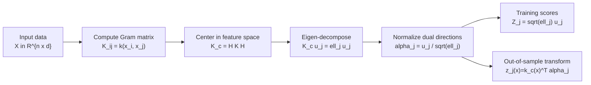
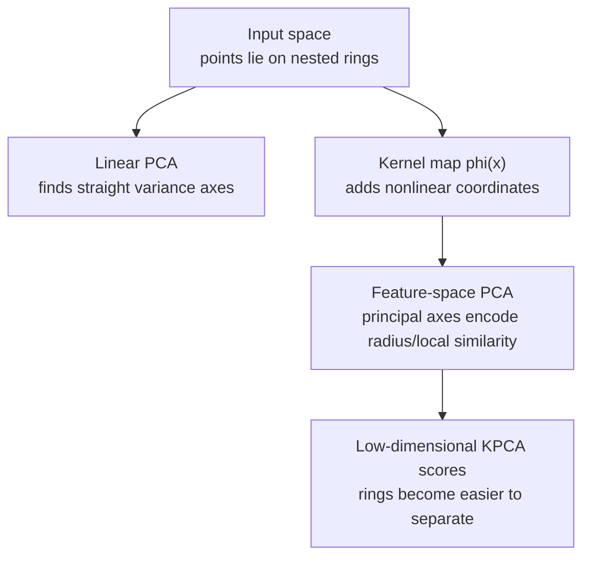

# Kernel PCA: Kernelized Eigenvectors, Centered Gram Matrices, and Nonlinear Components

Kernel PCA is the kernelized form of PCA: it performs ordinary PCA after mapping data through a nonlinear feature map $\phi$, but it avoids constructing $\phi(x)$ explicitly. The algorithm only needs inner products of the form

$$
K(x_i,x_j)=\langle \phi(x_i),\phi(x_j)\rangle_{\mathcal{H}},
$$

where $\mathcal{H}$ may be finite-dimensional, very high-dimensional, or infinite-dimensional.

The practical reason to use Kernel PCA is that linear PCA can only find linear variance directions in the input coordinates. Kernel PCA finds variance directions in a reproducing kernel Hilbert space, so curved structures such as rings, manifolds, saturating nonlinearities, and local similarity patterns can become linearly representable after the implicit map.



## 1. Notation and Setup

Let the training set be:

$$
X =
\begin{bmatrix}
x_1^\top \\
x_2^\top \\
\vdots \\
x_n^\top
\end{bmatrix}
\in \mathbb{R}^{n \times d},
\qquad
x_i \in \mathbb{R}^{d}.
$$

Kernel PCA assumes a feature map:

$$
\phi:\mathbb{R}^{d}\rightarrow \mathcal{H},
$$

where $\mathcal{H}$ is an inner-product space. The feature-space mean is:

$$
\mu_{\phi}
=
\frac{1}{n}\sum_{i=1}^{n}\phi(x_i).
$$

The centered feature vector is:

$$
\tilde{\phi}(x_i)
=
\phi(x_i)-\mu_{\phi}.
$$

Define the centered feature matrix implicitly as:

$$
\tilde{\Phi}
=
\begin{bmatrix}
\tilde{\phi}(x_1)^\top \\
\tilde{\phi}(x_2)^\top \\
\vdots \\
\tilde{\phi}(x_n)^\top
\end{bmatrix}.
$$

Ordinary PCA in feature space would compute eigenvectors of the feature-space covariance operator:

$$
C
=
\frac{1}{n}\sum_{i=1}^{n}
\tilde{\phi}(x_i)\tilde{\phi}(x_i)^\top
=
\frac{1}{n}\tilde{\Phi}^{\top}\tilde{\Phi}.
$$

The problem is that $\tilde{\Phi}$ is usually unavailable or too large. Kernel PCA works in the dual, using the centered Gram matrix:

$$
K_c
=
\tilde{\Phi}\tilde{\Phi}^{\top},
\qquad
(K_c)_{ij}
=
\langle \tilde{\phi}(x_i),\tilde{\phi}(x_j)\rangle_{\mathcal{H}}.
$$

## 2. From PCA to Kernel PCA

Linear PCA solves:

$$
Cw=\lambda w,
$$

where $w$ is a principal direction and $\lambda$ is the variance along that direction.

Feature-space PCA would solve:

$$
\frac{1}{n}\tilde{\Phi}^{\top}\tilde{\Phi}v
=
\lambda v.
$$

Any eigenvector $v$ with nonzero eigenvalue lies in the span of the centered training features. To see this, multiply the eigen-equation by $n$:

$$
\tilde{\Phi}^{\top}\tilde{\Phi}v
=
n\lambda v.
$$

If $\lambda \neq 0$, then:

$$
v
=
\frac{1}{n\lambda}
\tilde{\Phi}^{\top}\tilde{\Phi}v.
$$

The right-hand side is a linear combination of rows of $\tilde{\Phi}$, so:

$$
v
=
\sum_{i=1}^{n}\alpha_i \tilde{\phi}(x_i)
=
\tilde{\Phi}^{\top}\alpha,
\qquad
\alpha \in \mathbb{R}^{n}.
$$

Substitute this representation into the eigen-equation:

$$
\frac{1}{n}\tilde{\Phi}^{\top}\tilde{\Phi}\tilde{\Phi}^{\top}\alpha
=
\lambda \tilde{\Phi}^{\top}\alpha.
$$

Left-multiply by $\tilde{\Phi}$:

$$
\frac{1}{n}\tilde{\Phi}\tilde{\Phi}^{\top}\tilde{\Phi}\tilde{\Phi}^{\top}\alpha
=
\lambda \tilde{\Phi}\tilde{\Phi}^{\top}\alpha.
$$

Using $K_c=\tilde{\Phi}\tilde{\Phi}^{\top}$:

$$
\frac{1}{n}K_c^2\alpha
=
\lambda K_c\alpha.
$$

For nonzero components, this reduces to:

$$
K_c\alpha
=
n\lambda\alpha.
$$

It is common to write the Gram-matrix eigenvalue as:

$$
\ell = n\lambda.
$$

Then Kernel PCA solves:

$$
K_c\alpha
=
\ell\alpha.
$$

The feature-space variance associated with the component is:

$$
\lambda
=
\frac{\ell}{n}.
$$

The algorithm therefore replaces an eigenproblem in $\mathcal{H}$ with an $n \times n$ eigenproblem over training samples.

## 3. Centering the Kernel Matrix

Kernel PCA must center in feature space. We usually cannot compute $\mu_{\phi}$ directly, but we can center the Gram matrix.

Let:

$$
\mathbf{1}_n
=
\begin{bmatrix}
1 & 1 & \cdots & 1
\end{bmatrix}^{\top}
\in \mathbb{R}^{n},
$$

and define the centering matrix:

$$
H
=
I_n-\frac{1}{n}\mathbf{1}_n\mathbf{1}_n^{\top}.
$$

The centered Gram matrix is:

$$
K_c
=
H K H.
$$

Entrywise, this is:

$$
(K_c)_{ij}
=
K_{ij}
-
\frac{1}{n}\sum_{a=1}^{n}K_{aj}
-
\frac{1}{n}\sum_{b=1}^{n}K_{ib}
+
\frac{1}{n^2}\sum_{a=1}^{n}\sum_{b=1}^{n}K_{ab}.
$$

The four terms mean:

- $K_{ij}$: original feature-space inner product.
- Column mean: subtract the mean feature contribution from $x_j$.
- Row mean: subtract the mean feature contribution from $x_i$.
- Grand mean: add back the mean that was subtracted twice.

This is exactly the kernel version of:

$$
\tilde{\Phi}
=
H\Phi.
$$

Then:

$$
K_c
=
\tilde{\Phi}\tilde{\Phi}^{\top}
=
H\Phi\Phi^{\top}H
=
HKH.
$$

## 4. Normalization of Kernel Principal Directions

The feature-space principal direction is:

$$
v_j
=
\sum_{i=1}^{n}\alpha_{ji}\tilde{\phi}(x_i)
=
\tilde{\Phi}^{\top}\alpha_j.
$$

For PCA, we require unit-norm principal directions:

$$
\lVert v_j\rVert_{\mathcal{H}}^2=1.
$$

Compute:

$$
\lVert v_j\rVert_{\mathcal{H}}^2
=
\alpha_j^{\top}
\tilde{\Phi}\tilde{\Phi}^{\top}
\alpha_j
=
\alpha_j^{\top}K_c\alpha_j.
$$

If $u_j$ is a Euclidean unit eigenvector of $K_c$:

$$
K_cu_j=\ell_j u_j,
\qquad
u_j^\top u_j=1,
$$

then:

$$
\alpha_j
=
\frac{u_j}{\sqrt{\ell_j}}
$$

gives:

$$
\alpha_j^\top K_c\alpha_j
=
\frac{1}{\ell_j}
u_j^\top K_cu_j
=
\frac{1}{\ell_j}
u_j^\top \ell_j u_j
=
1.
$$

This normalization is a common implementation pitfall. The eigenvectors returned by numerical linear algebra libraries are normalized in $\mathbb{R}^n$, but Kernel PCA needs the corresponding feature-space direction to have unit norm.

## 5. Projection Coordinates

The $j$-th Kernel PCA coordinate of a training point $x_i$ is:

$$
z_{ij}
=
\langle v_j,\tilde{\phi}(x_i)\rangle_{\mathcal{H}}.
$$

Substitute $v_j=\tilde{\Phi}^{\top}\alpha_j$:

$$
z_{ij}
=
\sum_{a=1}^{n}\alpha_{ja}
\langle \tilde{\phi}(x_a),\tilde{\phi}(x_i)\rangle_{\mathcal{H}}
=
(K_c\alpha_j)_i.
$$

Using $K_cu_j=\ell_j u_j$ and $\alpha_j=u_j/\sqrt{\ell_j}$:

$$
z_{ij}
=
\left(K_c\frac{u_j}{\sqrt{\ell_j}}\right)_i
=
\sqrt{\ell_j}(u_j)_i.
$$

Therefore the training embedding matrix for the top $m$ components is:

$$
Z
=
\begin{bmatrix}
\sqrt{\ell_1}u_1 & \sqrt{\ell_2}u_2 & \cdots & \sqrt{\ell_m}u_m
\end{bmatrix}
\in \mathbb{R}^{n \times m}.
$$

Some libraries return this quantity directly from `fit_transform`. Internally they may store normalized eigenvectors, unnormalized eigenvectors, or a scaled version, but the mathematical projection above is the invariant object.

## 6. Out-of-Sample Extension

For a new point $x$, compute the kernel vector against the training set:

$$
k(x)
=
\begin{bmatrix}
K(x_1,x) \\
K(x_2,x) \\
\vdots \\
K(x_n,x)
\end{bmatrix}.
$$

This vector must be centered using the training centering statistics:

$$
k_c(x)_i
=
K(x_i,x)
-
\frac{1}{n}\sum_{b=1}^{n}K(x_i,x_b)
-
\frac{1}{n}\sum_{a=1}^{n}K(x_a,x)
+
\frac{1}{n^2}\sum_{a=1}^{n}\sum_{b=1}^{n}K(x_a,x_b).
$$

Then:

$$
z_j(x)
=
\langle v_j,\tilde{\phi}(x)\rangle_{\mathcal{H}}
=
k_c(x)^\top \alpha_j
=
\frac{k_c(x)^\top u_j}{\sqrt{\ell_j}}.
$$

For a batch $X_{\text{new}}$ with kernel matrix $K_{\text{new}} \in \mathbb{R}^{q \times n}$, where:

$$
(K_{\text{new}})_{ri}
=
K(x_{\text{new},r},x_i),
$$

the centered batch kernel is:

$$
K_{\text{new},c}
=
K_{\text{new}}
-
\mathbf{1}_q \bar{K}_{\text{train-rows}}^{\top}
-
\bar{k}_{\text{new}}\mathbf{1}_n^{\top}
+
\bar{K}_{\text{all}}\mathbf{1}_q\mathbf{1}_n^{\top},
$$

where:

$$
\bar{K}_{\text{train-rows},i}
=
\frac{1}{n}\sum_{a=1}^{n}K(x_a,x_i),
$$

$$
\bar{k}_{\text{new},r}
=
\frac{1}{n}\sum_{i=1}^{n}K(x_{\text{new},r},x_i),
$$

and:

$$
\bar{K}_{\text{all}}
=
\frac{1}{n^2}\sum_{a=1}^{n}\sum_{b=1}^{n}K(x_a,x_b).
$$

The embedding is:

$$
Z_{\text{new}}
=
K_{\text{new},c}U_m\operatorname{diag}
\left(
\frac{1}{\sqrt{\ell_1}},
\ldots,
\frac{1}{\sqrt{\ell_m}}
\right).
$$

## 7. Common Kernels

| Kernel | Formula | Notes |
| --- | --- | --- |
| Linear | $K(x,y)=x^\top y$ | Recovers ordinary PCA up to the dual formulation and centering convention. |
| Polynomial | $K(x,y)=(\gamma x^\top y+c_0)^p$ | Represents interactions up to degree $p$ when parameters make the kernel positive semidefinite. |
| RBF / Gaussian | $K(x,y)=\exp(-\gamma\lVert x-y\rVert_2^2)$ | Infinite-dimensional feature map; locality controlled by $\gamma$. |
| Sigmoid | $K(x,y)=\tanh(\gamma x^\top y+c_0)$ | Related to neural-network activations but not positive semidefinite for all parameters. |
| Cosine | $K(x,y)=\frac{x^\top y}{\lVert x\rVert_2\lVert y\rVert_2}$ | Useful when angular similarity matters; zero vectors need special handling. |

A valid kernel for Kernel PCA should produce a symmetric positive semidefinite Gram matrix for every finite dataset:

$$
c^\top Kc \geq 0
\qquad
\text{for all}
\qquad
c\in\mathbb{R}^{n}.
$$

This condition ensures that the Gram matrix corresponds to inner products in some Hilbert space. If the chosen kernel or parameters produce an indefinite matrix, negative eigenvalues can appear and the PCA interpretation breaks down. In practice, tiny negative eigenvalues often arise from floating-point error and are clipped or discarded.

### Polynomial Kernel Example

For $x=(x_1,x_2)$, the degree-2 homogeneous polynomial kernel is:

$$
K(x,y)
=
(x^\top y)^2.
$$

Expanding:

$$
(x^\top y)^2
=
(x_1y_1+x_2y_2)^2
=
x_1^2y_1^2+2x_1x_2y_1y_2+x_2^2y_2^2.
$$

This is an inner product under:

$$
\phi(x)
=
\begin{bmatrix}
x_1^2 \\
\sqrt{2}x_1x_2 \\
x_2^2
\end{bmatrix}.
$$

because:

$$
\phi(x)^\top\phi(y)
=
x_1^2y_1^2
+
2x_1x_2y_1y_2
+
x_2^2y_2^2.
$$

The $\sqrt{2}$ coefficient is not decorative; it makes the explicit feature inner product exactly equal to the kernel expansion.

### RBF Kernel Scale

The RBF kernel is:

$$
K(x,y)
=
\exp(-\gamma\lVert x-y\rVert_2^2).
$$

It is also written as:

$$
K(x,y)
=
\exp\left(-\frac{\lVert x-y\rVert_2^2}{2\sigma^2}\right),
$$

with:

$$
\gamma=\frac{1}{2\sigma^2}.
$$

Large $\gamma$ means small $\sigma$: similarity decays quickly, so the embedding becomes very local. Small $\gamma$ means large $\sigma$: most samples look similar, and the centered kernel can become low-signal.

## 8. Step-by-Step Execution

Given $X\in\mathbb{R}^{n\times d}$ and target dimension $m$:

1. Choose a kernel $K(\cdot,\cdot)$ and its hyperparameters.
2. Build the Gram matrix:

$$
K_{ij}=K(x_i,x_j).
$$

3. Center the Gram matrix:

$$
K_c=HKH.
$$

4. Symmetrize numerically:

$$
K_c \leftarrow \frac{1}{2}(K_c+K_c^\top).
$$

5. Solve:

$$
K_cu_j=\ell_j u_j.
$$

6. Sort eigenpairs by descending $\ell_j$.
7. Discard eigenvalues that are nonpositive or below numerical tolerance.
8. Normalize directions:

$$
\alpha_j=\frac{u_j}{\sqrt{\ell_j}}.
$$

9. Compute training coordinates:

$$
Z_j=\sqrt{\ell_j}u_j.
$$

10. For new samples, center the new-train kernel matrix with training statistics and multiply by $\alpha_j$.

## 9. Worked Example with Full Intermediate Calculations

Consider three one-dimensional points:

$$
x_1=-1,
\qquad
x_2=0,
\qquad
x_3=1.
$$

Use the degree-2 polynomial kernel:

$$
K(x,y)=(xy+1)^2.
$$

The uncentered Gram matrix is:

$$
K
=
\begin{bmatrix}
(-1\cdot -1+1)^2 & (-1\cdot 0+1)^2 & (-1\cdot 1+1)^2 \\
(0\cdot -1+1)^2 & (0\cdot 0+1)^2 & (0\cdot 1+1)^2 \\
(1\cdot -1+1)^2 & (1\cdot 0+1)^2 & (1\cdot 1+1)^2
\end{bmatrix}
=
\begin{bmatrix}
4 & 1 & 0 \\
1 & 1 & 1 \\
0 & 1 & 4
\end{bmatrix}.
$$

Row means are:

$$
\bar{K}_{1\cdot}=\frac{5}{3},
\qquad
\bar{K}_{2\cdot}=1,
\qquad
\bar{K}_{3\cdot}=\frac{5}{3}.
$$

The grand mean is:

$$
\bar{K}_{\cdot\cdot}
=
\frac{1}{9}
(4+1+0+1+1+1+0+1+4)
=
\frac{13}{9}.
$$

Centering gives:

$$
K_c
=
\frac{1}{9}
\begin{bmatrix}
19 & -2 & -17 \\
-2 & 4 & -2 \\
-17 & -2 & 19
\end{bmatrix}.
$$

Check one entry:

$$
(K_c)_{13}
=
K_{13}
-
\bar{K}_{1\cdot}
-
\bar{K}_{\cdot 3}
+
\bar{K}_{\cdot\cdot}
=
0-\frac{5}{3}-\frac{5}{3}+\frac{13}{9}
=
-\frac{17}{9}.
$$

The eigenvectors and eigenvalues are:

$$
u_1
=
\frac{1}{\sqrt{2}}
\begin{bmatrix}
1 \\
0 \\
-1
\end{bmatrix},
\qquad
\ell_1=4,
$$

$$
u_2
=
\frac{1}{\sqrt{6}}
\begin{bmatrix}
1 \\
-2 \\
1
\end{bmatrix},
\qquad
\ell_2=\frac{2}{3},
$$

and:

$$
u_3
=
\frac{1}{\sqrt{3}}
\begin{bmatrix}
1 \\
1 \\
1
\end{bmatrix},
\qquad
\ell_3=0.
$$

The zero eigenvalue corresponds to the centered all-ones direction and is discarded.

The first component training scores are:

$$
Z_1
=
\sqrt{\ell_1}u_1
=
2
\cdot
\frac{1}{\sqrt{2}}
\begin{bmatrix}
1 \\
0 \\
-1
\end{bmatrix}
=
\begin{bmatrix}
\sqrt{2} \\
0 \\
-\sqrt{2}
\end{bmatrix}.
$$

The second component training scores are:

$$
Z_2
=
\sqrt{\frac{2}{3}}
\cdot
\frac{1}{\sqrt{6}}
\begin{bmatrix}
1 \\
-2 \\
1
\end{bmatrix}
=
\frac{1}{3}
\begin{bmatrix}
1 \\
-2 \\
1
\end{bmatrix}.
$$

Thus:

$$
Z
=
\begin{bmatrix}
\sqrt{2} & \frac{1}{3} \\
0 & -\frac{2}{3} \\
-\sqrt{2} & \frac{1}{3}
\end{bmatrix}.
$$

The first component separates $-1$ and $1$ by odd symmetry; the second separates the center point from both endpoints by even symmetry. This illustrates why nonlinear components are not merely rotated input axes: they correspond to variance directions in the feature basis induced by the kernel.

## 10. Why Kernel PCA Helps on Concentric Circles

For concentric circles, the class-relevant coordinate is approximately radius:

$$
r^2=x_1^2+x_2^2.
$$

Linear PCA sees only directions of the form:

$$
w^\top x=w_1x_1+w_2x_2.
$$

No linear projection can directly encode radius because radius is quadratic. A polynomial kernel of degree 2 can represent quadratic terms, and an RBF kernel can represent local radial similarity patterns. Kernel PCA can therefore produce coordinates where inner and outer rings separate along one of the leading nonlinear components.



Kernel PCA is still unsupervised. It does not know which ring label matters; it preserves high-variance feature-space structure. If the nonlinear structure is low variance or dominated by noise, supervised kernel methods or metric learning may be more appropriate.

## 11. Python Implementation from Scratch

The implementation below uses only NumPy. It supports linear, polynomial, and RBF kernels, stores centering statistics for out-of-sample transforms, and normalizes eigenvectors correctly.

```python
import numpy as np


class KernelPCAFromScratch:
    def __init__(
        self,
        n_components=2,
        kernel="rbf",
        gamma=None,
        degree=3,
        coef0=1.0,
        eig_tol=1e-12,
    ):
        self.n_components = n_components
        self.kernel = kernel
        self.gamma = gamma
        self.degree = degree
        self.coef0 = coef0
        self.eig_tol = eig_tol

    def _kernel(self, X, Y):
        X = np.asarray(X, dtype=float)
        Y = np.asarray(Y, dtype=float)

        if self.kernel == "linear":
            return X @ Y.T

        gamma = self.gamma
        if gamma is None:
            gamma = 1.0 / X.shape[1]

        if self.kernel == "poly":
            return (gamma * (X @ Y.T) + self.coef0) ** self.degree

        if self.kernel == "rbf":
            X_norm2 = np.sum(X * X, axis=1)[:, None]
            Y_norm2 = np.sum(Y * Y, axis=1)[None, :]
            dist2 = X_norm2 + Y_norm2 - 2.0 * (X @ Y.T)
            dist2 = np.maximum(dist2, 0.0)  # protect against tiny negative roundoff
            return np.exp(-gamma * dist2)

        raise ValueError(f"unknown kernel: {self.kernel}")

    def _center_train_kernel(self, K):
        self.K_fit_rows_ = K.mean(axis=0)
        self.K_fit_all_ = K.mean()
        K_centered = K - self.K_fit_rows_[None, :] - self.K_fit_rows_[:, None] + self.K_fit_all_
        return 0.5 * (K_centered + K_centered.T)

    def fit(self, X):
        self.X_fit_ = np.asarray(X, dtype=float)
        K = self._kernel(self.X_fit_, self.X_fit_)
        Kc = self._center_train_kernel(K)

        # eigh is for real symmetric matrices and returns eigenvalues ascending.
        eigvals, eigvecs = np.linalg.eigh(Kc)
        order = np.argsort(eigvals)[::-1]
        eigvals = eigvals[order]
        eigvecs = eigvecs[:, order]

        positive = eigvals > self.eig_tol
        eigvals = eigvals[positive]
        eigvecs = eigvecs[:, positive]

        if self.n_components is not None:
            eigvals = eigvals[: self.n_components]
            eigvecs = eigvecs[:, : self.n_components]

        self.eigenvalues_ = eigvals
        self.eigenvectors_ = eigvecs
        self.alphas_ = eigvecs / np.sqrt(eigvals)[None, :]
        self.X_transformed_fit_ = eigvecs * np.sqrt(eigvals)[None, :]
        return self

    def transform(self, X):
        X = np.asarray(X, dtype=float)
        K_new = self._kernel(X, self.X_fit_)

        # Center new-vs-train kernels using training Gram statistics.
        K_new_centered = (
            K_new
            - self.K_fit_rows_[None, :]
            - K_new.mean(axis=1)[:, None]
            + self.K_fit_all_
        )
        return K_new_centered @ self.alphas_

    def fit_transform(self, X):
        self.fit(X)
        return self.X_transformed_fit_
```

Example usage:

```python
import numpy as np

X = np.array([[-1.0], [0.0], [1.0]])

kpca = KernelPCAFromScratch(
    n_components=2,
    kernel="poly",
    gamma=1.0,
    degree=2,
    coef0=1.0,
)

Z = kpca.fit_transform(X)
print(kpca.eigenvalues_)
print(Z)
```

Expected eigenvalues are approximately:

```text
[4.0, 0.6666666667]
```

The signs of columns may differ from the hand calculation because eigenvectors are sign-indeterminate: if $u$ is an eigenvector, then $-u$ is also an eigenvector.

## 12. Equivalent scikit-learn Implementation

```python
from sklearn.decomposition import KernelPCA

kpca = KernelPCA(
    n_components=2,
    kernel="rbf",
    gamma=15.0,
    eigen_solver="auto",
    fit_inverse_transform=False,
)

X_kpca = kpca.fit_transform(X)
X_new_kpca = kpca.transform(X_new)
```

Important arguments:

- `n_components`: number of nonlinear components to keep.
- `kernel`: built-in kernel name such as `"linear"`, `"poly"`, `"rbf"`, `"sigmoid"`, `"cosine"`, `"precomputed"`, or a callable.
- `gamma`: coefficient for RBF, polynomial, and sigmoid kernels; if unspecified, scikit-learn uses a feature-count based default for these kernels.
- `degree`: polynomial degree.
- `coef0`: independent term for polynomial and sigmoid kernels.
- `eigen_solver`: solver strategy; dense eigendecomposition is exact but expensive, while ARPACK or randomized methods can be cheaper for a small number of components.
- `fit_inverse_transform`: fits an approximate pre-image map for reconstruction.
- `alpha`: ridge regularization strength used by the learned inverse transform.

Internally, a typical `KernelPCA.fit` performs these operations:

1. Validate and store the training data.
2. Compute pairwise kernels using a function equivalent to `pairwise_kernels`.
3. Center the Gram matrix, equivalent to `KernelCenterer`.
4. Solve the symmetric eigenproblem with a dense LAPACK routine, an iterative ARPACK routine, or a randomized eigensolver depending on size and settings.
5. Sort and optionally remove zero eigenvalues.
6. Store eigenvalues, eigenvectors, and training data for later `transform`.

The scikit-learn `inverse_transform` is not a true inverse of $\phi$ because $\phi^{-1}$ usually does not exist. Instead, it learns an approximate pre-image map from Kernel PCA coordinates back to input coordinates using kernel ridge regression.

## 13. Kernel PCA with SciPy Eigensolvers

For larger $n$, computing all eigenpairs is wasteful if only $m \ll n$ components are needed. A SciPy-style implementation can use dense or truncated solvers.

```python
import numpy as np
from scipy.linalg import eigh
from scipy.sparse.linalg import eigsh


def top_kernel_eigenpairs(Kc, n_components, solver="dense"):
    Kc = 0.5 * (Kc + Kc.T)
    n = Kc.shape[0]

    if solver == "dense":
        # subset_by_index selects the largest n_components eigenvalues
        # because eigh returns them in ascending order.
        lo = max(0, n - n_components)
        eigvals, eigvecs = eigh(Kc, subset_by_index=[lo, n - 1])
        order = np.argsort(eigvals)[::-1]
        return eigvals[order], eigvecs[:, order]

    if solver == "arpack":
        eigvals, eigvecs = eigsh(Kc, k=n_components, which="LA")
        order = np.argsort(eigvals)[::-1]
        return eigvals[order], eigvecs[:, order]

    raise ValueError("solver must be 'dense' or 'arpack'")
```

Dense eigendecomposition costs cubic time in $n$. Truncated iterative solvers avoid computing all eigenvectors but still require matrix-vector products with $K_c$, and the full Gram matrix may still dominate memory unless approximations are used.

## 14. Inverse Transform and the Pre-Image Problem

Linear PCA has an explicit reconstruction:

$$
\hat{x}
=
\mu + W_m z.
$$

Kernel PCA generally does not, because $z$ is a coordinate in feature space and there may be no $x$ such that:

$$
\phi(x)
=
\mu_{\phi}+\sum_{j=1}^{m}z_jv_j.
$$

This is the pre-image problem. A common approximation learns a regression map:

$$
g:\mathbb{R}^{m}\rightarrow\mathbb{R}^{d}
$$

from training pairs:

$$
(z_i,x_i).
$$

Kernel ridge regression solves:

$$
\min_G
\lVert KG-X\rVert_F^2
+
\alpha \operatorname{tr}(G^\top K G),
$$

where $K$ is a kernel matrix in the low-dimensional Kernel PCA score space. The solution has the form:

$$
G
=
(K+\alpha I)^{-1}X.
$$

Then for a new score vector $z$, reconstruction is:

$$
\hat{x}
=
k_z^\top G,
$$

where $k_z$ contains similarities between $z$ and the training scores. This is useful for denoising and visualization, but it is an approximation rather than a guaranteed inverse.

## 15. Complexity

Let $n$ be the number of samples, $d$ the input dimension, and $m$ the number of retained components.

| Operation | Time | Space | Notes |
| --- | --- | --- | --- |
| Linear kernel Gram matrix | $O(n^2d)$ | $O(n^2)$ | Matrix multiply. |
| RBF Gram matrix | $O(n^2d)$ | $O(n^2)$ | Pairwise squared distances. |
| Center Gram matrix | $O(n^2)$ | $O(n^2)$ | Can be done in place. |
| Dense eigendecomposition | $O(n^3)$ | $O(n^2)$ | Main bottleneck for exact KPCA. |
| Truncated eigensolver | roughly $O(t n^2)$ | $O(n^2)$ | $t$ depends on convergence and spectral gap. |
| Transform $q$ new samples | $O(qnd+qnm)$ | $O(qn)$ | Kernel computation plus projection. |

Kernel PCA scales with samples rather than features. This is useful when $d$ is huge but $n$ is moderate; it is problematic when $n$ is large.

## 16. Numerical Stability and Implementation Pitfalls

### Centering Must Be Consistent

Training and test kernels must be centered with the same training statistics. Re-centering a test batch by its own mean changes the coordinate system and produces inconsistent embeddings.

### Symmetry Should Be Enforced

Floating-point distance calculations can make $K_c$ slightly asymmetric. Before calling a symmetric eigensolver, use:

$$
K_c \leftarrow \frac{1}{2}(K_c+K_c^\top).
$$

### Handle Tiny Negative Eigenvalues

For positive semidefinite kernels, negative eigenvalues should not appear mathematically. Numerically, values such as:

$$
-10^{-12}
$$

can appear. Discard or clip small negative eigenvalues. Large negative eigenvalues usually indicate an indefinite kernel, bad parameters, or severe numerical issues.

### Do Not Divide by Zero Eigenvalues

The normalization:

$$
\alpha_j=\frac{u_j}{\sqrt{\ell_j}}
$$

is invalid when $\ell_j=0$. Remove zero and near-zero components before computing $\alpha_j$.

### Feature Scaling Matters

Distance-based kernels are sensitive to feature scales. If one feature has variance $10^6$ and another has variance $1$, the RBF kernel is dominated by the first feature unless inputs are standardized.

### Gamma Can Collapse the Kernel

For RBF kernels:

- Very small $\gamma$: $K_{ij}\approx 1$ for most pairs, and after centering there may be little signal.
- Very large $\gamma$: $K\approx I$, so most points become nearly orthogonal; embeddings can overfit sample identity.

A useful diagnostic is the distribution of off-diagonal kernel values. If all are nearly $0$ or all are nearly $1$, $\gamma$ is usually poorly scaled.

### Sign and Rotation Ambiguities

Eigenvector signs are arbitrary. If eigenvalues are repeated or nearly repeated, the basis within that eigenspace can rotate. Downstream code should not rely on exact component signs.

### Kernel PCA Is Not a Classifier

Kernel PCA may reveal class structure, but labels are not used. If the objective is supervised separation, compare against kernel SVMs, kernel LDA, supervised contrastive learning, or metric learning.

## 17. Edge Cases and Limitations

- Duplicate samples can create rank deficiency and zero eigenvalues.
- Constant or near-constant kernels lead to nearly all-zero centered Gram matrices.
- Non-PSD kernels can produce negative eigenvalues and invalid variance interpretations.
- Out-of-sample transforms require storing training data or enough information to compute kernels against training points.
- Reconstruction is approximate and can be ill-posed.
- Large datasets require approximations because $O(n^2)$ memory is often the hard limit.

Common approximations include:

- Nyström approximation.
- Random Fourier features for shift-invariant kernels.
- Landmark-based Kernel PCA.
- Incomplete Cholesky factorization.
- Mini-batch approximations in explicit random-feature space.

## 18. Connections to Related ML Concepts

### PCA

Linear PCA is recovered with the linear kernel:

$$
K(x,y)=x^\top y.
$$

Kernel PCA is then dual PCA on the centered Gram matrix. The nonzero eigenvalues of the primal covariance and the dual Gram matrix differ by a factor of $n$:

$$
\ell_j=n\lambda_j.
$$

### Classical Multidimensional Scaling

Classical MDS also eigen-decomposes a centered similarity matrix. When similarities come from inner products, it is essentially PCA in dual form. Kernel PCA generalizes this by allowing nonlinear kernels.

### Spectral Clustering

Both Kernel PCA and spectral clustering decompose matrices built from pairwise similarities. The difference is the operator: Kernel PCA decomposes a centered Gram matrix, while spectral clustering usually decomposes a graph Laplacian or normalized affinity operator.

### Kernel SVMs and Kernel Ridge Regression

Kernel PCA, kernel SVMs, and kernel ridge regression all rely on the same kernel trick. Kernel PCA is unsupervised and decomposes feature-space covariance; kernel SVMs optimize a supervised margin objective; kernel ridge regression solves a supervised regularized least-squares problem.

### Autoencoders

Kernel PCA can be seen as a fixed-kernel nonlinear representation method. Autoencoders learn the feature map from data. Kernel PCA has a clearer eigenproblem and less optimization instability, but it scales poorly with $n$ and does not learn task-adaptive features.

## 19. Practical Checklist

1. Standardize input features before RBF, polynomial, sigmoid, or cosine kernels.
2. Start with RBF unless domain structure suggests another kernel.
3. Tune $\gamma$ by downstream validation, not by visual appeal alone.
4. Inspect the centered eigenvalue spectrum.
5. Drop nonpositive eigenvalues.
6. Use dense eigendecomposition for small to medium $n$ when exactness matters.
7. Use ARPACK, randomized solvers, Nyström, or random features for larger $n$.
8. Remember that `fit_transform(X)` and `transform(X)` can differ numerically if centering or scaling is implemented incorrectly.
9. Treat inverse transforms as approximate pre-images.

## 20. Minimal End-to-End Example

```python
import numpy as np
from sklearn.datasets import make_circles
from sklearn.decomposition import KernelPCA, PCA
from sklearn.preprocessing import StandardScaler
from sklearn.pipeline import make_pipeline


X, y = make_circles(
    n_samples=1000,
    factor=0.3,
    noise=0.05,
    random_state=0,
)

linear_pca = make_pipeline(
    StandardScaler(),
    PCA(n_components=2),
)

rbf_kpca = make_pipeline(
    StandardScaler(),
    KernelPCA(
        n_components=2,
        kernel="rbf",
        gamma=15.0,
        eigen_solver="auto",
    ),
)

Z_pca = linear_pca.fit_transform(X)
Z_kpca = rbf_kpca.fit_transform(X)
```

The pipeline matters: `StandardScaler` is fitted only on the training data in a proper train-validation split, preventing data leakage and making the RBF distance scale meaningful.

## 21. References for Deeper Reading

- Bernhard Scholkopf, Alexander Smola, and Klaus-Robert Muller, "Nonlinear Component Analysis as a Kernel Eigenvalue Problem", Neural Computation, 1998.
- Bernhard Scholkopf, Alexander Smola, and Klaus-Robert Muller, "Kernel Principal Component Analysis", ICANN, 1997.
- Bernhard Scholkopf and Alexander J. Smola, "Learning with Kernels", MIT Press, 2002.
- John Shawe-Taylor and Nello Cristianini, "Kernel Methods for Pattern Analysis", Cambridge University Press, 2004.
- scikit-learn documentation: `sklearn.decomposition.KernelPCA`, `sklearn.preprocessing.KernelCenterer`, and the Kernel PCA examples.
- SciPy documentation: `scipy.linalg.eigh` and `scipy.sparse.linalg.eigsh` for dense and truncated symmetric eigenproblems.

