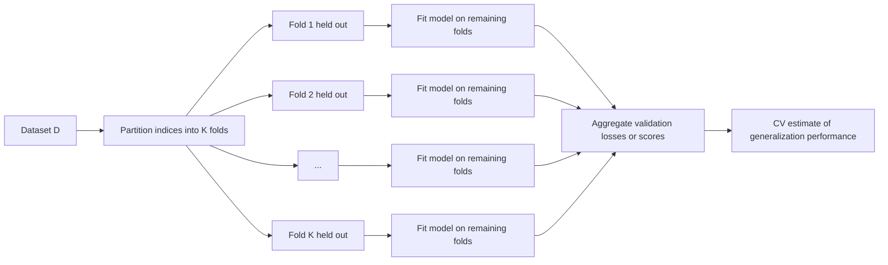
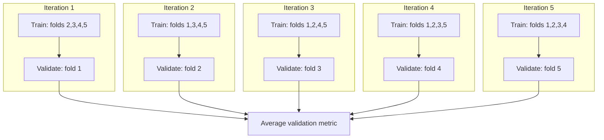
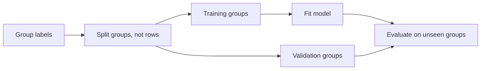
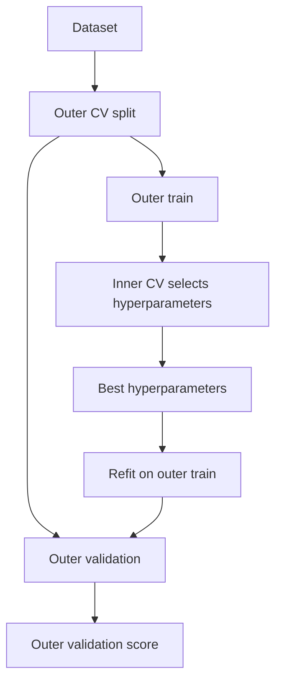
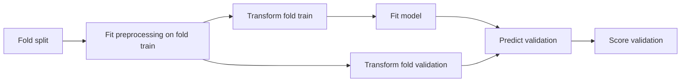
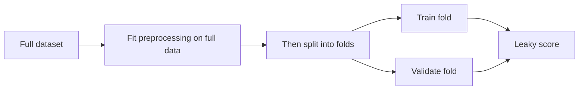
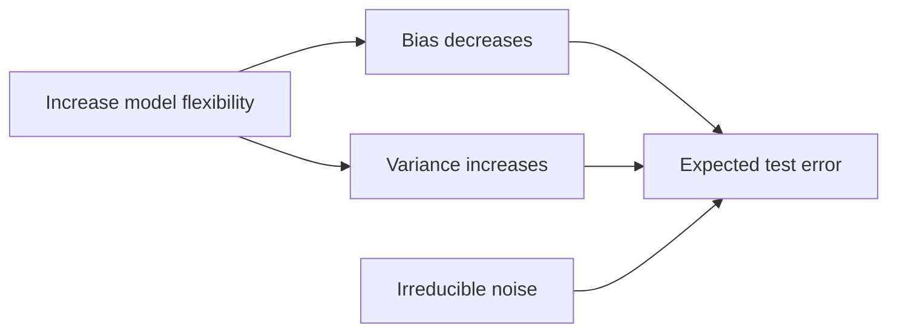
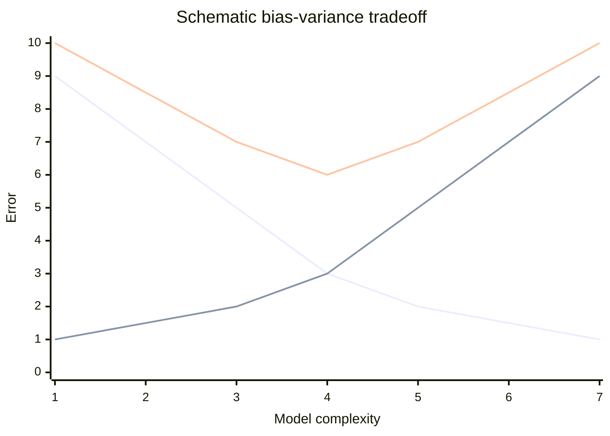

# K-Fold Cross-Validation and the Bias-Variance Tradeoff

K-fold cross-validation is a resampling estimator for out-of-sample performance. Instead of trusting one train/test split, it trains the same learning procedure on $K$ different training subsets and evaluates on the held-out fold each time.

The bias-variance tradeoff describes how prediction error decomposes into error from systematic approximation, error from sensitivity to the sampled training set, and irreducible noise. Cross-validation is one of the main practical tools for observing that tradeoff while choosing model classes, hyperparameters, and preprocessing pipelines.



## 1. Problem Setup

Let the dataset be

$$
D_n=\{z_i\}_{i=1}^{n}
=
\{(x_i,y_i)\}_{i=1}^{n},
\qquad
z_i \overset{\mathrm{iid}}{\sim} P.
$$

Let a learning algorithm $\mathcal{A}$ map a training set $D$ to a fitted predictor:

$$
\hat{f}_D = \mathcal{A}(D).
$$

For a loss function $\ell(\hat{y},y)$, the population risk of the fitted predictor is

$$
R(\hat{f}_D)
=
\mathbb{E}_{(X,Y)\sim P}
\left[
\ell(\hat{f}_D(X),Y)
\right].
$$

The true risk is unavailable because $P$ is unknown. The training loss

$$
\hat{R}_{\mathrm{train}}(\hat{f}_{D_n})
=
\frac{1}{n}\sum_{i=1}^{n}
\ell(\hat{f}_{D_n}(x_i),y_i)
$$

is usually optimistically biased because the model was fit on the same observations used for evaluation. Cross-validation replaces that in-sample evaluation with repeated out-of-sample evaluations.

The goal is not to estimate the performance of one particular fold model. The goal is to estimate the performance of the learning procedure $\mathcal{A}$ when trained on data drawn from the same process.

## 2. K-Fold Cross-Validation

### 2.1 Definition

Partition the index set $\{1,\dots,n\}$ into $K$ disjoint validation folds:

$$
I_1,\dots,I_K,
\qquad
I_j\cap I_k=\varnothing \text{ for } j\neq k,
\qquad
\bigcup_{k=1}^{K}I_k=\{1,\dots,n\}.
$$

The $k$-th validation set is

$$
D_{I_k}=\{z_i:i\in I_k\},
$$

and the corresponding training set is

$$
D_{-I_k}=\{z_i:i\notin I_k\}.
$$

Train a model on $D_{-I_k}$:

$$
\hat{f}^{(k)}
=
\mathcal{A}(D_{-I_k}).
$$

The fold loss is

$$
\hat{R}_k
=
\frac{1}{|I_k|}
\sum_{i\in I_k}
\ell(\hat{f}^{(k)}(x_i),y_i).
$$

The weighted K-fold cross-validation risk estimate is

$$
\hat{R}_{\mathrm{CV}}
=
\sum_{k=1}^{K}
\frac{|I_k|}{n}\hat{R}_k
=
\frac{1}{n}
\sum_{k=1}^{K}
\sum_{i\in I_k}
\ell(\hat{f}^{(k)}(x_i),y_i).
$$

When all folds have equal size, this reduces to the simple average:

$$
\hat{R}_{\mathrm{CV}}
=
\frac{1}{K}\sum_{k=1}^{K}\hat{R}_k.
$$

For a score such as accuracy, higher is better:

$$
\hat{S}_{\mathrm{CV}}
=
\sum_{k=1}^{K}
\frac{|I_k|}{n}\hat{S}_k.
$$

Losses and scores should not be mixed. Minimize losses, maximize scores.

### 2.2 Step-by-Step Execution

For $K=5$:

1. Shuffle the indices if the data order has no semantic meaning and reproducibility is desired.
2. Split indices into five folds with sizes differing by at most one.
3. For fold $k=1$:
   - use fold $1$ as validation,
   - train on folds $2,3,4,5$,
   - compute the validation metric.
4. Repeat with folds $2,3,4,5$ held out in turn.
5. Aggregate the five validation scores.
6. After model selection, refit the chosen pipeline on all $n$ samples.



### 2.3 Worked Example

Suppose a 5-fold classification experiment gives:

| Fold | Validation accuracy |
|---:|---:|
| 1 | $0.91$ |
| 2 | $0.89$ |
| 3 | $0.93$ |
| 4 | $0.90$ |
| 5 | $0.92$ |

The mean cross-validation accuracy is

$$
\bar{s}
=
\frac{0.91+0.89+0.93+0.90+0.92}{5}
=
\frac{4.55}{5}
=
0.91.
$$

The sample standard deviation across folds is

$$
s
=
\sqrt{
\frac{1}{K-1}
\sum_{k=1}^{K}(s_k-\bar{s})^2
}.
$$

Here,

$$
\begin{aligned}
s^2
&=
\frac{1}{4}
\left[
(0.91-0.91)^2
+(0.89-0.91)^2
+(0.93-0.91)^2
+(0.90-0.91)^2
+(0.92-0.91)^2
\right] \\
&=
\frac{1}{4}
\left[
0
+0.0004
+0.0004
+0.0001
+0.0001
\right] \\
&=
0.00025,
\end{aligned}
$$

so

$$
s=\sqrt{0.00025}=0.0158.
$$

It is common to report

$$
0.91 \pm 0.016,
$$

but this is only a descriptive fold-to-fold variation. It is not a fully unbiased uncertainty estimate for the CV estimator because fold scores are dependent: the training sets overlap heavily.

## 3. What K Controls

With $K$ folds, each validation set has about $n/K$ samples and each training set has about

$$
n\left(1-\frac{1}{K}\right)
$$

samples.

Increasing $K$ has two direct effects:

| Choice | Training size per fold | Validation size per fold | Compute | Typical behavior |
|---:|---:|---:|---:|---|
| small $K$ | smaller | larger | lower | more pessimistic for models needing data |
| large $K$ | larger | smaller | higher | lower training-size bias, noisier fold scores |
| $K=n$ | $n-1$ | $1$ | highest | leave-one-out CV |

Common values are $K=5$ and $K=10$. They are pragmatic defaults, not mathematical constants.

### 3.1 Leave-One-Out Cross-Validation

Leave-one-out cross-validation is the special case $K=n$. The estimator is

$$
\hat{R}_{\mathrm{LOOCV}}
=
\frac{1}{n}
\sum_{i=1}^{n}
\ell(\hat{f}^{(-i)}(x_i),y_i),
$$

where $\hat{f}^{(-i)}$ is trained on all samples except $i$.

LOOCV uses nearly all data for training in each fit, but it can be expensive and can have high variance as a model-selection criterion. For some linear smoothers, LOOCV can be computed without fitting $n$ separate models.

For ordinary least squares with design matrix $X\in\mathbb{R}^{n\times p}$, fitted values are

$$
\hat{y}=Hy,
\qquad
H=X(X^\top X)^{-1}X^\top.
$$

The diagonal value $h_{ii}$ is the leverage of observation $i$. The LOOCV residual has the closed form

$$
y_i-\hat{y}^{(-i)}_i
=
\frac{y_i-\hat{y}_i}{1-h_{ii}}.
$$

Therefore the LOOCV mean squared error is

$$
\mathrm{LOOCV}
=
\frac{1}{n}
\sum_{i=1}^{n}
\left(
\frac{y_i-\hat{y}_i}{1-h_{ii}}
\right)^2.
$$

This formula exposes a numerical and statistical issue: high-leverage points with $h_{ii}\approx 1$ can dominate LOOCV.

## 4. Stratified, Grouped, and Time-Series Variants

### 4.1 Stratified K-Fold

For classification, stratified K-fold approximately preserves class proportions in each fold. If a binary dataset has class prior

$$
\hat{\pi}
=
\frac{1}{n}\sum_{i=1}^{n}\mathbb{1}(y_i=1),
$$

then stratification attempts to make each fold satisfy

$$
\hat{\pi}_k
=
\frac{1}{|I_k|}
\sum_{i\in I_k}
\mathbb{1}(y_i=1)
\approx
\hat{\pi}.
$$

This matters when classes are imbalanced. Without stratification, a small validation fold can accidentally contain too few minority examples, making metrics such as recall, precision, ROC AUC, or PR AUC unstable or undefined.

### 4.2 Group K-Fold

If samples are correlated within a group, random K-fold can leak information. Examples:

- multiple medical scans from the same patient,
- multiple transactions from the same customer,
- multiple crops from the same original image,
- repeated measurements from the same physical device.

Group K-fold assigns entire groups to folds:

$$
g_i=g_j
\implies
i,j \in I_k
\text{ for the same validation fold } k
\text{ or both outside it}.
$$

The constraint is that no group may appear in both training and validation for a given split.



### 4.3 Time-Series Split

For temporal data, ordinary shuffled K-fold is usually invalid because it trains on future data and tests on the past. A time-series split preserves chronological order:

$$
\max\{t_i:i\in I_{\mathrm{train}}^{(k)}\}
<
\min\{t_i:i\in I_{\mathrm{valid}}^{(k)}\}.
$$

An expanding-window scheme looks like:

| Split | Train interval | Validation interval |
|---:|---|---|
| 1 | $1,\dots,t_1$ | $t_1+1,\dots,t_2$ |
| 2 | $1,\dots,t_2$ | $t_2+1,\dots,t_3$ |
| 3 | $1,\dots,t_3$ | $t_3+1,\dots,t_4$ |

If labels are delayed or features contain rolling statistics, a temporal gap may be required:

$$
\max(t_{\mathrm{train}}) + \Delta
<
\min(t_{\mathrm{valid}}).
$$

## 5. Cross-Validation for Model Selection

Let $\lambda$ denote a hyperparameter, such as regularization strength, tree depth, or number of neighbors. Cross-validation estimates

$$
\hat{R}_{\mathrm{CV}}(\lambda)
=
\frac{1}{n}
\sum_{k=1}^{K}
\sum_{i\in I_k}
\ell
\left(
\hat{f}^{(k)}_{\lambda}(x_i),
y_i
\right).
$$

The selected hyperparameter is

$$
\hat{\lambda}
=
\arg\min_{\lambda\in\Lambda}
\hat{R}_{\mathrm{CV}}(\lambda).
$$

For a score $S$, replace $\arg\min$ with $\arg\max$.

After selecting $\hat{\lambda}$, train the final model on all data:

$$
\hat{f}_{\mathrm{final}}
=
\mathcal{A}_{\hat{\lambda}}(D_n).
$$

The CV score used for selection is not an unbiased estimate of the final selected model's performance. The minimum over many noisy estimates is optimistically biased:

$$
\mathbb{E}
\left[
\min_{\lambda\in\Lambda}
\hat{R}_{\mathrm{CV}}(\lambda)
\right]
\leq
\min_{\lambda\in\Lambda}
\mathbb{E}
\left[
\hat{R}_{\mathrm{CV}}(\lambda)
\right].
$$

For a less biased performance estimate after tuning, use nested cross-validation:



Nested CV has:

- outer folds for estimating generalization,
- inner folds for choosing hyperparameters.

The outer validation fold must not influence preprocessing, feature selection, threshold tuning, early stopping, or hyperparameter selection.

## 6. Data Leakage and Pipelines

A preprocessing transform must be fit inside each training fold only. Consider standardization:

$$
\mu_j
=
\frac{1}{m}
\sum_{i\in I_{\mathrm{train}}}x_{ij},
\qquad
\sigma_j^2
=
\frac{1}{m}
\sum_{i\in I_{\mathrm{train}}}(x_{ij}-\mu_j)^2.
$$

The validation point is transformed as

$$
\tilde{x}_{ij}
=
\frac{x_{ij}-\mu_j}{\sigma_j+\epsilon}.
$$

If $\mu_j$ and $\sigma_j$ are computed using all data before CV, validation information enters the training process. This is leakage.

The same rule applies to:

- imputation,
- feature selection,
- PCA,
- target encoding,
- oversampling and undersampling,
- text vocabulary construction,
- image normalization statistics,
- calibration and threshold tuning.

Correct execution:



Incorrect execution:



## 7. Cross-Validation from Scratch in Python

The following implementation is intentionally minimal but handles several important details:

- fold sizes differ by at most one,
- optional shuffling is reproducible,
- estimators are cloned per fold,
- scores are weighted by validation fold size.

```python
from __future__ import annotations

from dataclasses import dataclass
from typing import Callable, Iterable
import copy
import numpy as np


Array = np.ndarray
Metric = Callable[[Array, Array], float]


def kfold_indices(
    n_samples: int,
    n_splits: int = 5,
    *,
    shuffle: bool = False,
    random_state: int | None = None,
) -> Iterable[tuple[Array, Array]]:
    """Yield train and validation indices for K-fold CV."""
    if not 2 <= n_splits <= n_samples:
        raise ValueError("n_splits must satisfy 2 <= n_splits <= n_samples")

    indices = np.arange(n_samples)
    if shuffle:
        rng = np.random.default_rng(random_state)
        rng.shuffle(indices)

    fold_sizes = np.full(n_splits, n_samples // n_splits, dtype=int)
    fold_sizes[: n_samples % n_splits] += 1

    current = 0
    for fold_size in fold_sizes:
        start, stop = current, current + fold_size
        valid_idx = indices[start:stop]
        train_idx = np.concatenate([indices[:start], indices[stop:]])
        yield train_idx, valid_idx
        current = stop


@dataclass
class CVResult:
    fold_scores: Array
    mean: float
    std: float
    weighted_mean: float


def cross_validate_from_scratch(
    estimator,
    X: Array,
    y: Array,
    metric: Metric,
    *,
    n_splits: int = 5,
    shuffle: bool = True,
    random_state: int | None = 0,
) -> CVResult:
    """Evaluate an estimator with K-fold CV.

    The estimator must implement fit(X, y) and predict(X).
    The metric must return a scalar where larger is better.
    """
    X = np.asarray(X)
    y = np.asarray(y)

    fold_scores: list[float] = []
    fold_weights: list[int] = []

    for train_idx, valid_idx in kfold_indices(
        len(X),
        n_splits,
        shuffle=shuffle,
        random_state=random_state,
    ):
        model = copy.deepcopy(estimator)
        model.fit(X[train_idx], y[train_idx])
        pred = model.predict(X[valid_idx])

        fold_scores.append(metric(y[valid_idx], pred))
        fold_weights.append(len(valid_idx))

    scores = np.asarray(fold_scores, dtype=float)
    weights = np.asarray(fold_weights, dtype=float)

    return CVResult(
        fold_scores=scores,
        mean=float(scores.mean()),
        std=float(scores.std(ddof=1)) if n_splits > 1 else 0.0,
        weighted_mean=float(np.average(scores, weights=weights)),
    )


def accuracy_score_from_scratch(y_true: Array, y_pred: Array) -> float:
    y_true = np.asarray(y_true)
    y_pred = np.asarray(y_pred)
    return float(np.mean(y_true == y_pred))
```

### 7.1 Scratch Stratified K-Fold

For classification, stratification can be implemented by splitting indices class-by-class and distributing each class across folds.

```python
import numpy as np


def stratified_kfold_indices(
    y: Array,
    n_splits: int = 5,
    *,
    shuffle: bool = False,
    random_state: int | None = None,
) -> Iterable[tuple[Array, Array]]:
    """Yield stratified train and validation indices."""
    y = np.asarray(y)
    n_samples = len(y)
    if not 2 <= n_splits <= n_samples:
        raise ValueError("n_splits must satisfy 2 <= n_splits <= n_samples")

    rng = np.random.default_rng(random_state)
    folds: list[list[int]] = [[] for _ in range(n_splits)]

    for cls in np.unique(y):
        cls_indices = np.flatnonzero(y == cls)
        if shuffle:
            rng.shuffle(cls_indices)

        for j, idx in enumerate(cls_indices):
            folds[j % n_splits].append(int(idx))

    all_indices = np.arange(n_samples)
    for fold in folds:
        valid_idx = np.asarray(sorted(fold), dtype=int)
        valid_mask = np.zeros(n_samples, dtype=bool)
        valid_mask[valid_idx] = True
        train_idx = all_indices[~valid_mask]
        yield train_idx, valid_idx
```

This simple round-robin algorithm is close to the core idea used by production libraries, though mature implementations also handle deterministic ordering, edge cases, and API guarantees carefully.

### 7.2 Equivalent scikit-learn Implementations

```python
from sklearn.datasets import make_classification
from sklearn.model_selection import StratifiedKFold, cross_val_score
from sklearn.pipeline import Pipeline
from sklearn.preprocessing import StandardScaler
from sklearn.linear_model import LogisticRegression


X, y = make_classification(
    n_samples=500,
    n_features=20,
    n_informative=8,
    n_redundant=4,
    weights=[0.85, 0.15],
    random_state=0,
)

cv = StratifiedKFold(n_splits=5, shuffle=True, random_state=0)

pipe = Pipeline(
    steps=[
        ("scale", StandardScaler()),
        ("model", LogisticRegression(max_iter=2000)),
    ]
)

scores = cross_val_score(
    estimator=pipe,
    X=X,
    y=y,
    scoring="accuracy",
    cv=cv,
    n_jobs=-1,
)

print(scores)
print(scores.mean(), scores.std(ddof=1))
```

Internally, `cross_val_score` is a convenience wrapper around a broader validation routine:

1. It resolves the splitter from `cv`. For classification with an integer `cv`, scikit-learn uses stratified folds by default for suitable classifier targets; otherwise it uses ordinary K-fold.
2. It clones the estimator for each split so fitted state does not leak between folds.
3. It calls `fit` on the training indices.
4. It calls the selected scorer on validation indices.
5. It returns one score per split.

`Pipeline` is critical because each transform's `fit` runs only on the training part of the current split. The validation fold only receives `transform`.

### 7.3 Grid Search with Nested CV

```python
from sklearn.model_selection import GridSearchCV, cross_val_score
from sklearn.svm import SVC


inner_cv = StratifiedKFold(n_splits=5, shuffle=True, random_state=1)
outer_cv = StratifiedKFold(n_splits=5, shuffle=True, random_state=2)

pipe = Pipeline(
    steps=[
        ("scale", StandardScaler()),
        ("svc", SVC()),
    ]
)

param_grid = {
    "svc__C": [0.1, 1.0, 10.0],
    "svc__gamma": ["scale", 0.01, 0.1],
    "svc__kernel": ["rbf"],
}

search = GridSearchCV(
    estimator=pipe,
    param_grid=param_grid,
    scoring="accuracy",
    cv=inner_cv,
    n_jobs=-1,
)

outer_scores = cross_val_score(
    search,
    X,
    y,
    scoring="accuracy",
    cv=outer_cv,
    n_jobs=-1,
)

print(outer_scores.mean(), outer_scores.std(ddof=1))
```

The outer call clones `GridSearchCV`. Inside each outer training fold, grid search performs its own inner CV. The outer validation fold is not seen until the selected inner model is refit and evaluated.

## 8. Bias-Variance Tradeoff

### 8.1 Data-Generating Assumptions

For regression under squared error, assume

$$
Y=f^\star(X)+\varepsilon,
$$

with

$$
\mathbb{E}[\varepsilon\mid X=x]=0,
\qquad
\operatorname{Var}(\varepsilon\mid X=x)=\sigma^2(x).
$$

Let a random training set $D_n$ produce predictor

$$
\hat{f}_{D_n}(x).
$$

The randomness in $\hat{f}_{D_n}(x)$ comes from the randomness of the training sample. The randomness in $Y$ comes from the irreducible noise at the test point.

### 8.2 Derivation from First Principles

At a fixed input $x$, the expected squared prediction error is

$$
\mathbb{E}_{D_n,Y\mid x}
\left[
\left(Y-\hat{f}_{D_n}(x)\right)^2
\right].
$$

Substitute $Y=f^\star(x)+\varepsilon$:

$$
\mathbb{E}
\left[
\left(f^\star(x)+\varepsilon-\hat{f}_{D_n}(x)\right)^2
\right].
$$

Add and subtract the average prediction

$$
\bar{f}(x)
=
\mathbb{E}_{D_n}[\hat{f}_{D_n}(x)].
$$

Then

$$
f^\star(x)+\varepsilon-\hat{f}_{D_n}(x)
=
\left(f^\star(x)-\bar{f}(x)\right)
+\left(\bar{f}(x)-\hat{f}_{D_n}(x)\right)
+\varepsilon.
$$

Define

$$
a=f^\star(x)-\bar{f}(x),
\qquad
b=\bar{f}(x)-\hat{f}_{D_n}(x),
\qquad
c=\varepsilon.
$$

The squared error is

$$
(a+b+c)^2
=
a^2+b^2+c^2+2ab+2ac+2bc.
$$

Taking expectation:

$$
\mathbb{E}[(a+b+c)^2]
=
a^2+\mathbb{E}[b^2]+\mathbb{E}[c^2]
+2a\mathbb{E}[b]
+2a\mathbb{E}[c]
+2\mathbb{E}[bc].
$$

Now use the assumptions:

$$
\mathbb{E}_{D_n}[b]
=
\bar{f}(x)-\mathbb{E}_{D_n}[\hat{f}_{D_n}(x)]
=0,
$$

$$
\mathbb{E}[\varepsilon\mid X=x]=0,
$$

and the test noise is independent of the training-set randomness conditional on $x$, so

$$
\mathbb{E}[bc]=0.
$$

Therefore

$$
\mathbb{E}_{D_n,Y\mid x}
\left[
\left(Y-\hat{f}_{D_n}(x)\right)^2
\right]
=
\underbrace{
\left(
f^\star(x)-\mathbb{E}_{D_n}[\hat{f}_{D_n}(x)]
\right)^2
}_{\mathrm{Bias}^2(x)}
+
\underbrace{
\mathbb{E}_{D_n}
\left[
\left(
\hat{f}_{D_n}(x)
-\mathbb{E}_{D_n}[\hat{f}_{D_n}(x)]
\right)^2
\right]
}_{\mathrm{Variance}(x)}
+
\underbrace{
\sigma^2(x)
}_{\mathrm{Irreducible\ noise}}.
$$

Integrated over the test input distribution:

$$
\mathbb{E}_{X,D_n,Y}
\left[
\left(Y-\hat{f}_{D_n}(X)\right)^2
\right]
=
\mathbb{E}_X[\mathrm{Bias}^2(X)]
+
\mathbb{E}_X[\mathrm{Variance}(X)]
+
\mathbb{E}_X[\sigma^2(X)].
$$

### 8.3 Interpretation

Bias measures systematic error:

$$
\mathrm{Bias}(x)
=
\mathbb{E}_{D_n}[\hat{f}_{D_n}(x)]-f^\star(x).
$$

High bias means the learning algorithm's average prediction misses the target function. This usually happens when the hypothesis class is too restricted, the features are insufficient, or regularization is too strong.

Variance measures sensitivity to the sampled dataset:

$$
\mathrm{Variance}(x)
=
\mathbb{E}_{D_n}
\left[
\left(
\hat{f}_{D_n}(x)
-\mathbb{E}_{D_n}[\hat{f}_{D_n}(x)]
\right)^2
\right].
$$

High variance means different training samples lead to very different predictions. This usually happens when the model class is flexible relative to sample size, the data are noisy, or regularization is too weak.

Irreducible error is not fixed by choosing a better model:

$$
\sigma^2(x)
=
\operatorname{Var}(Y\mid X=x).
$$

It reflects label noise, unobserved variables, measurement error, and inherent stochasticity.



## 9. Worked Bias-Variance Example

Suppose the true function at a fixed $x$ is

$$
f^\star(x)=10,
$$

and three possible training sets produce predictions:

$$
\hat{f}_{D_1}(x)=8,
\qquad
\hat{f}_{D_2}(x)=12,
\qquad
\hat{f}_{D_3}(x)=10.
$$

The average prediction is

$$
\bar{f}(x)
=
\frac{8+12+10}{3}
=10.
$$

The bias is

$$
\mathrm{Bias}(x)=\bar{f}(x)-f^\star(x)=10-10=0.
$$

The variance is

$$
\mathrm{Variance}(x)
=
\frac{1}{3}
\left[
(8-10)^2+(12-10)^2+(10-10)^2
\right]
=
\frac{8}{3}
\approx 2.667.
$$

If the conditional noise variance is $\sigma^2(x)=1$, the expected squared prediction error is

$$
0^2+2.667+1=3.667.
$$

Now consider another algorithm with predictions:

$$
7,\quad 7,\quad 7.
$$

Then

$$
\bar{f}(x)=7,
\qquad
\mathrm{Bias}(x)=7-10=-3,
\qquad
\mathrm{Bias}^2(x)=9,
$$

and

$$
\mathrm{Variance}(x)=0.
$$

With the same irreducible noise,

$$
9+0+1=10.
$$

The second algorithm is perfectly stable but systematically wrong. Low variance alone is not enough.

## 10. Bias and Variance Across Model Complexity

The classic pattern is:

| Model regime | Training error | Validation error | Bias | Variance |
|---|---:|---:|---:|---:|
| underfit | high | high | high | low |
| balanced | moderate | low | moderate | moderate |
| overfit | very low | high | low | high |



This chart is schematic. Real deep learning often shows more complicated behavior because optimization, implicit regularization, data augmentation, overparameterization, and representation learning alter the simple U-shaped picture.

## 11. Connecting Cross-Validation to Bias-Variance

Cross-validation estimates validation performance along a model-complexity path:

$$
\lambda_1,\lambda_2,\dots,\lambda_m.
$$

For a regularization parameter $\lambda$, larger $\lambda$ often means a simpler effective model:

$$
\lambda \uparrow
\implies
\mathrm{Bias} \uparrow,
\qquad
\mathrm{Variance} \downarrow.
$$

Smaller $\lambda$ often means a more flexible model:

$$
\lambda \downarrow
\implies
\mathrm{Bias} \downarrow,
\qquad
\mathrm{Variance} \uparrow.
$$

In ridge regression,

$$
\hat{\beta}_{\lambda}
=
(X^\top X+\lambda I)^{-1}X^\top y.
$$

The smoother matrix is

$$
S_{\lambda}
=
X(X^\top X+\lambda I)^{-1}X^\top.
$$

The effective degrees of freedom are

$$
\mathrm{df}(\lambda)
=
\operatorname{tr}(S_{\lambda}).
$$

As $\lambda$ increases, $\mathrm{df}(\lambda)$ decreases, usually increasing bias and decreasing variance.

## 12. Numerical Stability and Edge Cases

### 12.1 Cross-Validation Edge Cases

- If $K>n$, K-fold is undefined.
- If a class has fewer than $K$ examples, stratified K-fold cannot place that class in every fold.
- If data are sorted by label, unshuffled ordinary K-fold can create single-class folds.
- If groups are highly imbalanced, group K-fold may produce uneven fold sizes.
- If samples are temporally correlated, shuffled CV overestimates deployment performance.
- If the metric is undefined for a fold, the split strategy or metric needs adjustment.
- If preprocessing is done before splitting, the CV estimate is contaminated.

### 12.2 Metric Stability

Accuracy can hide poor minority-class performance. For imbalanced classification, evaluate metrics such as:

$$
\mathrm{Recall}
=
\frac{\mathrm{TP}}{\mathrm{TP}+\mathrm{FN}},
$$

$$
\mathrm{Precision}
=
\frac{\mathrm{TP}}{\mathrm{TP}+\mathrm{FP}},
$$

$$
F_1
=
\frac{2\cdot \mathrm{Precision}\cdot \mathrm{Recall}}
{\mathrm{Precision}+\mathrm{Recall}}.
$$

For probabilistic classifiers, log loss is often more informative:

$$
\mathrm{LogLoss}
=
-\frac{1}{n}
\sum_{i=1}^{n}
\sum_{c=1}^{C}
\mathbb{1}(y_i=c)\log p_{\theta}(y=c\mid x_i).
$$

Use clipping for numerical stability:

$$
\tilde{p}_{ic}
=
\min(\max(p_{ic},\epsilon),1-\epsilon).
$$

### 12.3 Fold Standard Errors

A tempting standard error estimate is

$$
\frac{s}{\sqrt{K}},
$$

where $s$ is the sample standard deviation of fold scores. This treats fold scores as independent, but they are not independent because the training sets overlap. It can be useful as a rough descriptive quantity, but it should not be overinterpreted as a rigorous confidence interval.

Repeated K-fold CV reduces dependence on one random partition:

$$
\hat{R}_{\mathrm{repeated}}
=
\frac{1}{M}
\sum_{m=1}^{M}
\hat{R}_{\mathrm{CV}}^{(m)}.
$$

It improves empirical stability but multiplies compute by $M$.

## 13. Complexity

Let:

- $T_{\mathrm{fit}}(m,d)$ be the cost of fitting on $m$ samples and $d$ features,
- $T_{\mathrm{pred}}(q,d)$ be the cost of predicting $q$ validation samples,
- $S_{\mathrm{model}}$ be the memory required by one fitted model.

For K-fold CV:

$$
T_{\mathrm{CV}}
=
\sum_{k=1}^{K}
\left[
T_{\mathrm{fit}}(n-|I_k|,d)
+T_{\mathrm{pred}}(|I_k|,d)
\right].
$$

For equal folds:

$$
T_{\mathrm{CV}}
\approx
K\cdot
T_{\mathrm{fit}}
\left(
n\left(1-\frac{1}{K}\right),
d
\right)
+T_{\mathrm{pred}}(n,d).
$$

If folds run sequentially, peak memory is roughly

$$
O(S_{\mathrm{model}} + nd).
$$

If folds run in parallel with $J$ workers, peak model memory can increase to

$$
O(J\cdot S_{\mathrm{model}} + nd).
$$

Nested CV with $K_{\mathrm{outer}}$ outer folds, $K_{\mathrm{inner}}$ inner folds, and $M$ hyperparameter settings costs approximately

$$
K_{\mathrm{outer}}
\left[
M K_{\mathrm{inner}} T_{\mathrm{fit}}
+T_{\mathrm{fit}}
\right].
$$

The final $T_{\mathrm{fit}}$ term is the refit on each outer training fold after hyperparameter selection.

## 14. Common Implementation Pitfalls

- Averaging unweighted fold metrics when fold sizes differ and the metric is an average per sample.
- Reporting validation performance from hyperparameter search as if it were an unbiased final test estimate.
- Performing feature selection or scaling outside the CV loop.
- Using ordinary K-fold for grouped, repeated-measure, or time-ordered data.
- Forgetting to fix random seeds when comparing models.
- Reusing the same estimator object without cloning or resetting fitted state.
- Oversampling before splitting instead of inside each training fold.
- Choosing $K$ so large that validation metrics become unstable or expensive.
- Comparing models on different CV splits when paired splits would reduce comparison noise.
- Ignoring failed folds, undefined metrics, or convergence warnings.

## 15. Practical Heuristics

Use:

- `StratifiedKFold` for most classification tasks with independent samples.
- `KFold(shuffle=True)` for iid regression data when order carries no meaning.
- `GroupKFold` when samples from the same group must not cross train/validation boundaries.
- `TimeSeriesSplit` or blocked backtesting for temporal data.
- nested CV when the goal is an honest estimate after hyperparameter tuning.
- a final untouched test set when the dataset is large enough and the result will be reported externally.

Reduce high bias by:

- increasing model flexibility,
- adding informative features,
- reducing regularization,
- training longer if optimization underfit is the issue,
- improving representation learning.

Reduce high variance by:

- adding data,
- increasing regularization,
- using simpler models,
- using bagging or ensembling,
- reducing noisy or leaking features,
- using stronger augmentation for appropriate domains.

## 16. Library API Notes

The most relevant scikit-learn objects are:

| Object | Purpose |
|---|---|
| `KFold` | ordinary K-fold splitting |
| `StratifiedKFold` | class-proportion-preserving classification folds |
| `GroupKFold` | keeps groups separated across train/validation |
| `TimeSeriesSplit` | chronological splits for ordered samples |
| `cross_val_score` | returns one score per split for one metric |
| `cross_validate` | supports multiple metrics and timing output |
| `GridSearchCV` | exhaustive hyperparameter search with CV |
| `RandomizedSearchCV` | sampled hyperparameter search with CV |
| `Pipeline` | prevents preprocessing leakage across folds |

The key internal pattern is always:

```python
for train_idx, valid_idx in cv.split(X, y, groups):
    estimator_k = clone(estimator)
    estimator_k.fit(X[train_idx], y[train_idx])
    score_k = scorer(estimator_k, X[valid_idx], y[valid_idx])
```

Everything else is API machinery around splitter construction, scorer validation, parameter routing, parallel execution, error handling, and result aggregation.

## 17. References and Further Reading

- Trevor Hastie, Robert Tibshirani, and Jerome Friedman, [*The Elements of Statistical Learning*](https://hastie.su.domains/ElemStatLearn/), especially chapters on model assessment, selection, and bias-variance decomposition.
- Ron Kohavi, ["A Study of Cross-Validation and Bootstrap for Accuracy Estimation and Model Selection"](https://www.ijcai.org/Proceedings/95-2/Papers/016.pdf), IJCAI 1995.
- Yoshua Bengio and Yves Grandvalet, ["No Unbiased Estimator of the Variance of K-Fold Cross-Validation"](https://jmlr.org/papers/v5/grandvalet04a.html), JMLR 2004.
- scikit-learn User Guide, ["Cross-validation: evaluating estimator performance"](https://scikit-learn.org/stable/modules/cross_validation.html).
- scikit-learn API documentation for [`KFold`](https://scikit-learn.org/stable/modules/generated/sklearn.model_selection.KFold.html), [`StratifiedKFold`](https://scikit-learn.org/stable/modules/generated/sklearn.model_selection.StratifiedKFold.html), [`GroupKFold`](https://scikit-learn.org/stable/modules/generated/sklearn.model_selection.GroupKFold.html), [`TimeSeriesSplit`](https://scikit-learn.org/stable/modules/generated/sklearn.model_selection.TimeSeriesSplit.html), [`cross_val_score`](https://scikit-learn.org/stable/modules/generated/sklearn.model_selection.cross_val_score.html), and [`GridSearchCV`](https://scikit-learn.org/stable/modules/generated/sklearn.model_selection.GridSearchCV.html).
- Gareth James, Daniela Witten, Trevor Hastie, Robert Tibshirani, and Jonathan Taylor, [*An Introduction to Statistical Learning*](https://www.statlearning.com/), chapters on resampling methods and model flexibility.
