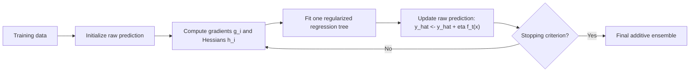
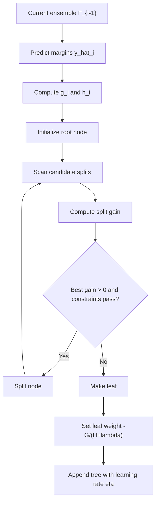
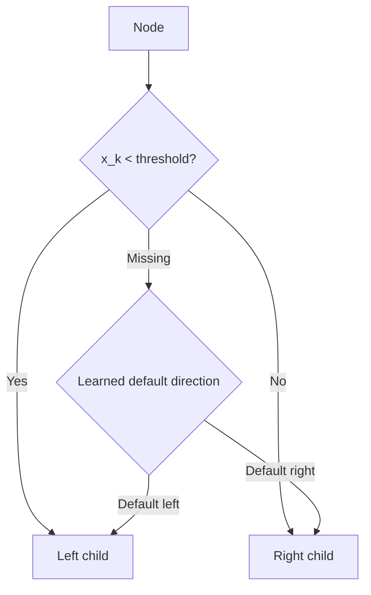

# XGBoost: Extreme Gradient Boosting

XGBoost is a regularized, second-order gradient boosting system for additive tree ensembles. Its practical importance comes from a tight combination of modeling ideas and systems ideas: Newton-style boosting, explicit tree-complexity penalties, shrinkage, row and column subsampling, sparsity-aware split finding, histogram-based split search, cache-aware computation, and out-of-core/distributed training.

For tabular supervised learning, XGBoost is often a strong baseline because it can model nonlinear feature interactions, does not require feature scaling, handles missing values natively, and exposes regularization knobs that directly control tree complexity.



## 1. From Boosting to XGBoost

### 1.1 Additive Tree Model

Let the training set be

$$
D=\{(x_i,y_i)\}_{i=1}^{n},
\qquad
x_i \in \mathbb{R}^{d}.
$$

XGBoost builds an additive model

$$
\hat{y}_i^{(K)}
=
\phi(x_i)
=
\sum_{k=1}^{K} f_k(x_i),
\qquad
f_k \in \mathcal{F},
$$

where each $f_k$ is a regression tree. For classification, $\hat{y}_i$ is usually the raw margin or logit, not the probability. For binary logistic classification,

$$
p_i
=
\sigma(\hat{y}_i)
=
\frac{1}{1+\exp(-\hat{y}_i)}.
$$

A tree maps an input to a leaf index and then returns the weight of that leaf:

$$
f(x)=w_{q(x)},
\qquad
q:\mathbb{R}^{d}\to\{1,\dots,T\},
\qquad
w \in \mathbb{R}^{T}.
$$

Here:

- $q(x)$ is the tree structure.
- $T$ is the number of leaves.
- $w_j$ is the prediction value stored at leaf $j$.

The model is additive, so training one new tree changes the current prediction by adding a function:

$$
\hat{y}_i^{(t)}
=
\hat{y}_i^{(t-1)}
+
\eta f_t(x_i),
$$

where $\eta \in (0,1]$ is the learning rate, also called shrinkage.

### 1.2 Why Sequential Error Correction Works

In squared-error regression, residual fitting is literal. If

$$
\ell(y,\hat{y})
=
\frac{1}{2}(y-\hat{y})^2,
$$

then the derivative with respect to the current prediction is

$$
\frac{\partial \ell(y_i,\hat{y}_i)}{\partial \hat{y}_i}
=
\hat{y}_i-y_i.
$$

The negative gradient is

$$
-g_i
=
y_i-\hat{y}_i,
$$

which is exactly the residual. A new tree that predicts residuals moves the ensemble in a descent direction for squared error.

For general differentiable losses, residuals are replaced by negative gradients. XGBoost goes further: it also uses the second derivative, so each tree is fit using a local second-order approximation of the objective.

## 2. Regularized Objective

At boosting round $t$, XGBoost chooses a new tree $f_t$ by minimizing

$$
\mathcal{L}^{(t)}
=
\sum_{i=1}^{n}
\ell\left(y_i,\hat{y}_i^{(t-1)}+f_t(x_i)\right)
+
\Omega(f_t),
$$

where $\ell$ is the task loss and $\Omega$ penalizes tree complexity.

The standard tree regularizer is

$$
\Omega(f)
=
\gamma T
+
\frac{1}{2}\lambda
\sum_{j=1}^{T}w_j^2.
$$

The terms mean:

- $\gamma T$ penalizes the number of leaves. A split must improve the objective by at least roughly $\gamma$ to be worthwhile.
- $\lambda$ is L2 regularization on leaf weights.
- $T$ is the number of leaves.
- $w_j$ is the score assigned to leaf $j$.

With optional L1 regularization,

$$
\Omega(f)
=
\gamma T
+
\frac{1}{2}\lambda
\sum_{j=1}^{T}w_j^2
+
\alpha \sum_{j=1}^{T}|w_j|.
$$

### 2.1 Second-Order Taylor Expansion

The exact objective is difficult to optimize over tree structures. XGBoost approximates each loss term around the current prediction $\hat{y}_i^{(t-1)}$.

Define

$$
g_i
=
\left[
\frac{\partial \ell(y_i,\hat{y})}{\partial \hat{y}}
\right]_{\hat{y}=\hat{y}_i^{(t-1)}},
\qquad
h_i
=
\left[
\frac{\partial^2 \ell(y_i,\hat{y})}{\partial \hat{y}^2}
\right]_{\hat{y}=\hat{y}_i^{(t-1)}}.
$$

Using the second-order Taylor approximation,

$$
\ell\left(y_i,\hat{y}_i^{(t-1)}+f_t(x_i)\right)
\approx
\ell\left(y_i,\hat{y}_i^{(t-1)}\right)
+
g_i f_t(x_i)
+
\frac{1}{2}h_i f_t(x_i)^2.
$$

Substituting into the round objective gives

$$
\mathcal{L}^{(t)}
\approx
\sum_{i=1}^{n}
\left[
\ell\left(y_i,\hat{y}_i^{(t-1)}\right)
+
g_i f_t(x_i)
+
\frac{1}{2}h_i f_t(x_i)^2
\right]
+
\Omega(f_t).
$$

The previous-round loss term does not depend on the candidate tree, so it can be dropped during tree search:

$$
\tilde{\mathcal{L}}^{(t)}
=
\sum_{i=1}^{n}
\left[
g_i f_t(x_i)
+
\frac{1}{2}h_i f_t(x_i)^2
\right]
+
\Omega(f_t).
$$

This is the key internal objective optimized by XGBoost's tree builder.

### 2.2 Leaf-Wise Objective

Let $I_j$ be the set of training indices assigned to leaf $j$:

$$
I_j
=
\{i:q(x_i)=j\}.
$$

Because $f_t(x_i)=w_{q(x_i)}$, group the objective by leaves:

$$
\tilde{\mathcal{L}}^{(t)}
=
\sum_{j=1}^{T}
\left[
\left(\sum_{i\in I_j}g_i\right)w_j
+
\frac{1}{2}
\left(\sum_{i\in I_j}h_i+\lambda\right)w_j^2
\right]
+
\gamma T.
$$

Define sufficient statistics for each leaf:

$$
G_j
=
\sum_{i\in I_j}g_i,
\qquad
H_j
=
\sum_{i\in I_j}h_i.
$$

Then

$$
\tilde{\mathcal{L}}^{(t)}
=
\sum_{j=1}^{T}
\left[
G_j w_j
+
\frac{1}{2}(H_j+\lambda)w_j^2
\right]
+
\gamma T.
$$

For a fixed tree structure $q$, the optimal leaf weight is found by differentiating with respect to $w_j$:

$$
\frac{\partial}{\partial w_j}
\left[
G_j w_j
+
\frac{1}{2}(H_j+\lambda)w_j^2
\right]
=
G_j+(H_j+\lambda)w_j.
$$

Set the derivative to zero:

$$
G_j+(H_j+\lambda)w_j=0.
$$

Therefore

$$
w_j^{*}
=
-
\frac{G_j}{H_j+\lambda}.
$$

The denominator contains curvature plus regularization. Large positive $\lambda$ shrinks leaf scores toward zero, reducing variance.

Substitute $w_j^{*}$ back into the leaf objective:

$$
G_j w_j^{*}
+
\frac{1}{2}(H_j+\lambda)(w_j^{*})^2
=
-
\frac{1}{2}
\frac{G_j^2}{H_j+\lambda}.
$$

So the optimal value for a fixed tree structure is

$$
\tilde{\mathcal{L}}^{(t)}(q)
=
-
\frac{1}{2}
\sum_{j=1}^{T}
\frac{G_j^2}{H_j+\lambda}
+
\gamma T.
$$

Equivalently, the tree quality score is

$$
\mathrm{Score}(q)
=
\frac{1}{2}
\sum_{j=1}^{T}
\frac{G_j^2}{H_j+\lambda}
-
\gamma T.
$$

XGBoost searches for splits that increase this score.

### 2.3 Split Gain

Suppose a candidate split divides a node into left and right children. Let the parent statistics be

$$
G = G_L + G_R,
\qquad
H = H_L + H_R.
$$

The gain from the split is

$$
\mathrm{Gain}
=
\frac{1}{2}
\left[
\frac{G_L^2}{H_L+\lambda}
+
\frac{G_R^2}{H_R+\lambda}
-
\frac{G^2}{H+\lambda}
\right]
-
\gamma.
$$

The split is accepted only if the gain is positive and other constraints are satisfied, such as minimum child weight, maximum depth, monotonic constraints, or interaction constraints.

Intuitively:

- The parent term measures how well one leaf can explain the node.
- The two child terms measure how well two separate leaves can explain the same samples.
- The split is useful only if the improvement exceeds the extra leaf penalty $\gamma$.

### 2.4 L1-Regularized Leaf Weights

With L1 regularization, the per-leaf objective becomes

$$
G_jw_j
+
\frac{1}{2}(H_j+\lambda)w_j^2
+
\alpha |w_j|.
$$

Define the soft-thresholding operator

$$
S(G,\alpha)
=
\begin{cases}
G-\alpha, & G>\alpha, \\
G+\alpha, & G<-\alpha, \\
0, & |G|\le \alpha.
\end{cases}
$$

Then

$$
w_j^{*}
=
-
\frac{S(G_j,\alpha)}{H_j+\lambda}.
$$

If $|G_j|\le\alpha$, the optimal leaf weight is exactly zero. This can make some leaves contribute no update, which is a form of sparsity in leaf outputs.

## 3. Loss Functions and Gradients

XGBoost's tree-building core only needs $(g_i,h_i)$ for each sample. Different tasks plug in different derivatives.

### 3.1 Squared Error Regression

Use

$$
\ell(y,\hat{y})
=
\frac{1}{2}(y-\hat{y})^2.
$$

Then

$$
g_i
=
\hat{y}_i-y_i,
\qquad
h_i
=
1.
$$

For squared error, XGBoost becomes Newton-boosted residual fitting with regularized tree leaves.

### 3.2 Binary Logistic Loss

Let $\hat{y}_i$ be the raw logit and

$$
p_i
=
\sigma(\hat{y}_i)
=
\frac{1}{1+\exp(-\hat{y}_i)}.
$$

The negative log-likelihood is

$$
\ell(y_i,\hat{y}_i)
=
-
y_i\log p_i
-
(1-y_i)\log(1-p_i),
\qquad
y_i\in\{0,1\}.
$$

Using

$$
\frac{\partial p_i}{\partial \hat{y}_i}
=
p_i(1-p_i),
$$

the first derivative is

$$
g_i
=
\frac{\partial \ell}{\partial \hat{y}_i}
=
p_i-y_i.
$$

The second derivative is

$$
h_i
=
\frac{\partial^2 \ell}{\partial \hat{y}_i^2}
=
p_i(1-p_i).
$$

Thus, for classification, each tree is fit to Newton-adjusted classification errors. Confident examples have small Hessian, so their influence on later Newton updates is reduced.

### 3.3 Multiclass Softmax

For $C$ classes, XGBoost maintains one raw margin per class:

$$
\hat{y}_{ic},
\qquad
c=1,\dots,C.
$$

The softmax probability is

$$
p_{ic}
=
\frac{\exp(\hat{y}_{ic})}
{\sum_{r=1}^{C}\exp(\hat{y}_{ir})}.
$$

For one-hot labels $y_{ic}$, the cross-entropy gradient is

$$
g_{ic}
=
p_{ic}-y_{ic}.
$$

The full Hessian is a $C\times C$ matrix per example:

$$
\frac{\partial^2 \ell_i}
{\partial \hat{y}_{ic}\partial \hat{y}_{ir}}
=
p_{ic}(\mathbf{1}_{c=r}-p_{ir}).
$$

Tree boosting implementations often use diagonal or upper-bound approximations so the same scalar-Hessian tree machinery can be reused efficiently.

## 4. Step-by-Step Training Execution

At a high level, one boosting round executes:

1. Compute current predictions $\hat{y}_i^{(t-1)}$ for all rows.
2. Compute gradients $g_i$ and Hessians $h_i$ from the task loss.
3. Build a candidate tree greedily:
   - start with one root node containing all sampled rows,
   - evaluate possible splits using accumulated $(G,H)$ statistics,
   - choose the split with maximum positive gain,
   - recurse until stopping constraints are hit.
4. Compute optimal leaf weights $w_j^{*}$.
5. Add the new tree to the ensemble with shrinkage:

$$
\hat{y}_i^{(t)}
=
\hat{y}_i^{(t-1)}
+
\eta w_{q_t(x_i)}^{*}.
$$

6. Evaluate validation metric and apply early stopping if configured.



## 5. Worked Numerical Example: One Regression Tree

Consider one boosting round for squared-error regression. Suppose the current predictions and labels are:

| Row | $y_i$ | $\hat{y}_i^{(t-1)}$ | $x_i$ |
|---:|---:|---:|---:|
| 1 | $10$ | $8$ | $1$ |
| 2 | $12$ | $9$ | $2$ |
| 3 | $20$ | $18$ | $5$ |
| 4 | $24$ | $19$ | $6$ |

For

$$
\ell(y,\hat{y})=\frac{1}{2}(y-\hat{y})^2,
$$

we have

$$
g_i=\hat{y}_i-y_i,
\qquad
h_i=1.
$$

So:

| Row | $g_i$ | $h_i$ |
|---:|---:|---:|
| 1 | $-2$ | $1$ |
| 2 | $-3$ | $1$ |
| 3 | $-2$ | $1$ |
| 4 | $-5$ | $1$ |

Assume

$$
\lambda=1,
\qquad
\gamma=0.
$$

For the unsplit root:

$$
G=-2-3-2-5=-12,
\qquad
H=4.
$$

The root score term is

$$
\frac{G^2}{H+\lambda}
=
\frac{144}{5}
=
28.8.
$$

Now evaluate a split $x<3.5$. Left rows are $\{1,2\}$ and right rows are $\{3,4\}$:

$$
G_L=-2-3=-5,
\qquad
H_L=2,
$$

$$
G_R=-2-5=-7,
\qquad
H_R=2.
$$

The gain is

$$
\begin{aligned}
\mathrm{Gain}
&=
\frac{1}{2}
\left[
\frac{G_L^2}{H_L+\lambda}
+
\frac{G_R^2}{H_R+\lambda}
-
\frac{G^2}{H+\lambda}
\right] \\
&=
\frac{1}{2}
\left[
\frac{25}{3}
+
\frac{49}{3}
-
\frac{144}{5}
\right] \\
&=
\frac{1}{2}
\left[
8.3333+16.3333-28.8
\right] \\
&=
-2.0667.
\end{aligned}
$$

This split is harmful under the regularized second-order objective.

Try split $x<5.5$. Left rows are $\{1,2,3\}$ and right row is $\{4\}$:

$$
G_L=-7,
\qquad
H_L=3,
\qquad
G_R=-5,
\qquad
H_R=1.
$$

Then

$$
\begin{aligned}
\mathrm{Gain}
&=
\frac{1}{2}
\left[
\frac{49}{4}
+
\frac{25}{2}
-
\frac{144}{5}
\right] \\
&=
\frac{1}{2}
\left[
12.25+12.5-28.8
\right] \\
&=
-2.025.
\end{aligned}
$$

No split improves the objective. The best tree is a stump with one leaf:

$$
w^{*}
=
-
\frac{G}{H+\lambda}
=
-
\frac{-12}{5}
=
2.4.
$$

If $\eta=0.1$, each prediction increases by

$$
\eta w^{*}=0.24.
$$

The update is deliberately small because shrinkage trades slower fitting for better generalization.

## 6. Worked Numerical Example: Logistic Leaf Weight

Suppose a binary classifier starts with raw margin $0$ for every row. Then

$$
p_i=\sigma(0)=0.5.
$$

For four labels

$$
y=[1,1,0,1],
$$

the gradients are

$$
g_i=p_i-y_i=[-0.5,-0.5,0.5,-0.5],
$$

and the Hessians are

$$
h_i=p_i(1-p_i)=0.25.
$$

For a candidate leaf containing all four rows:

$$
G=-0.5-0.5+0.5-0.5=-1.0,
$$

$$
H=4 \times 0.25=1.0.
$$

With $\lambda=1$:

$$
w^{*}
=
-
\frac{G}{H+\lambda}
=
-
\frac{-1}{2}
=
0.5.
$$

With $\eta=0.3$, the raw margin update is

$$
\Delta \hat{y}=0.15.
$$

The new probability is

$$
\sigma(0.15)
=
\frac{1}{1+\exp(-0.15)}
\approx
0.5374.
$$

The probability moved upward because the leaf contains more positive labels than negative labels.

## 7. Split-Finding Algorithms

### 7.1 Exact Greedy Split Search

For each node and feature:

1. Sort rows by feature value.
2. Sweep candidate thresholds from left to right.
3. Maintain prefix sums $G_L,H_L$.
4. Compute right sums by subtraction:

$$
G_R=G-G_L,
\qquad
H_R=H-H_L.
$$

5. Compute split gain for each threshold.
6. Choose the best valid threshold.

The exact method is accurate but expensive because sorting or maintaining sorted column blocks dominates large datasets.

For a dense matrix with $n$ rows, $d$ features, and depth-limited trees, exact split search is roughly

$$
O(dn\log n)
$$

for sorting plus repeated linear scans. With pre-sorted columns, scans are cheaper after preprocessing, but memory costs increase.

### 7.2 Approximate Split Search

The approximate method proposes candidate thresholds from quantiles of feature values. XGBoost uses Hessian-weighted quantile sketches because Hessians act like local curvature weights. A threshold that separates high-curvature examples can matter more than one that separates low-curvature examples.

The weighted rank of a feature value $z$ is conceptually

$$
r(z)
=
\frac{1}{\sum_i h_i}
\sum_{i:x_{ik}<z}h_i.
$$

Candidate thresholds are chosen so weighted ranks are approximately evenly spaced. This keeps split search tractable while preserving important curvature structure.

### 7.3 Histogram Split Search

Modern XGBoost commonly uses histogram-based training for speed. Each continuous feature is binned into at most $B$ discrete bins. During tree construction, the algorithm accumulates gradient and Hessian sums per bin:

$$
G_b=\sum_{i:\mathrm{bin}(x_{ik})=b}g_i,
\qquad
H_b=\sum_{i:\mathrm{bin}(x_{ik})=b}h_i.
$$

Split search scans bin prefixes instead of raw sorted values.


If there are $B$ bins, split scanning per feature per node is roughly

$$
O(B)
$$

instead of

$$
O(n_{\mathrm{node}}\log n_{\mathrm{node}})
$$

or a raw-value scan over many unique thresholds. Histogram building is roughly linear in the number of nonmissing feature entries processed.

### 7.4 Missing Value Routing

For a candidate split on feature $k$, some rows may have missing values. XGBoost learns a default direction for missing values.

For each split candidate, it evaluates two options:

1. Send missing rows left.
2. Send missing rows right.

The direction with larger gain becomes the split's default direction.



This is not imputation. The model uses missingness as part of split behavior. If missingness is predictive, the default direction can exploit it.

## 8. Why XGBoost Often Improves Accuracy

### 8.1 Sequential Error Correction

Each new tree is trained against the current model's derivatives. Early trees capture large, simple structure; later trees refine remaining systematic errors.

### 8.2 Newton-Style Optimization

Classical gradient boosting often uses only $g_i$. XGBoost's default tree objective also uses $h_i$, giving curvature-aware updates:

$$
w_j^{*}
=
-
\frac{G_j}{H_j+\lambda}.
$$

If curvature is high, the denominator is larger and the update is smaller. If curvature is low, the update can be larger, subject to regularization and constraints.

### 8.3 Explicit Regularization

The parameters $\lambda$, $\alpha$, and $\gamma$ directly regularize leaf weights and tree size. This is more targeted than merely limiting depth.

### 8.4 Shrinkage

The learning rate $\eta$ scales every tree:

$$
F_t(x)=F_{t-1}(x)+\eta f_t(x).
$$

Smaller $\eta$ requires more trees but usually reduces overfitting because the model follows a smoother optimization path.

### 8.5 Row and Column Subsampling

Row subsampling trains each tree on a random subset of examples. Column subsampling trains each tree or split using a random subset of features. These reduce correlation between trees and often improve generalization, similar in spirit to random forests, while preserving boosting's sequential correction.

### 8.6 Pruning and Stopping

XGBoost grows trees greedily but avoids splits that do not improve the regularized objective. Constraints such as `max_depth`, `min_child_weight`, `gamma`, and early stopping prevent trees or ensembles from continuing after useful signal is exhausted.

## 9. Important Hyperparameters

| Parameter | Mathematical role | Practical effect |
|---|---|---|
| `n_estimators` / `num_boost_round` | Number of additive trees $K$ | More capacity and compute |
| `learning_rate` / `eta` | Shrinkage multiplier $\eta$ | Smaller values need more trees |
| `max_depth` | Maximum tree depth | Controls interaction order and variance |
| `min_child_weight` | Minimum child Hessian sum | Prevents leaves with too little effective sample weight |
| `gamma` | Leaf-count penalty threshold | Requires larger split gain |
| `reg_lambda` / `lambda` | L2 penalty on leaf weights | Shrinks leaf outputs |
| `reg_alpha` / `alpha` | L1 penalty on leaf weights | Can zero small leaf outputs |
| `subsample` | Row sampling rate | Reduces variance and training cost |
| `colsample_bytree` | Feature sampling per tree | Reduces feature over-reliance |
| `colsample_bylevel` | Feature sampling per tree level | Adds structured randomness |
| `colsample_bynode` | Feature sampling per split | Stronger split-level randomness |
| `tree_method` | Split algorithm | `hist` is usually fastest for large tabular data |
| `max_bin` | Histogram bin count | Larger bins increase precision and cost |
| `scale_pos_weight` | Positive-class gradient scaling | Useful for imbalanced binary classification |

### 9.1 Tuning Interactions

Important interactions:

- Smaller `learning_rate` usually requires larger `n_estimators`.
- Larger `max_depth` often requires stronger `reg_lambda`, `gamma`, `subsample`, or `colsample_bytree`.
- Larger `min_child_weight` makes the model more conservative.
- Larger `max_bin` can improve split precision but increases memory and runtime.
- `scale_pos_weight` changes the optimization objective, so classification thresholds and probability calibration should be checked afterward.

## 10. From-Scratch Python Implementation

The implementation below is intentionally small. It supports squared-error regression with second-order split gains, L2 regularization, shrinkage, maximum depth, and minimum child weight. It is not optimized and does not implement histograms, sparse matrices, categorical splits, monotonic constraints, or parallelism.

```python
from __future__ import annotations

from dataclasses import dataclass
import numpy as np


@dataclass
class Node:
    """A regression tree node used by the toy XGBoost implementation."""

    value: float
    feature: int | None = None
    threshold: float | None = None
    left: "Node | None" = None
    right: "Node | None" = None

    @property
    def is_leaf(self) -> bool:
        return self.feature is None


class MiniXGBRegressor:
    def __init__(
        self,
        n_estimators: int = 50,
        learning_rate: float = 0.1,
        max_depth: int = 3,
        reg_lambda: float = 1.0,
        gamma: float = 0.0,
        min_child_weight: float = 1.0,
    ) -> None:
        self.n_estimators = n_estimators
        self.learning_rate = learning_rate
        self.max_depth = max_depth
        self.reg_lambda = reg_lambda
        self.gamma = gamma
        self.min_child_weight = min_child_weight
        self.base_score_: float | None = None
        self.trees_: list[Node] = []

    def fit(self, X: np.ndarray, y: np.ndarray) -> "MiniXGBRegressor":
        X = np.asarray(X, dtype=float)
        y = np.asarray(y, dtype=float)

        # For squared error, the optimal constant is the mean target.
        self.base_score_ = float(np.mean(y))
        pred = np.full(y.shape, self.base_score_, dtype=float)
        self.trees_ = []

        for _ in range(self.n_estimators):
            grad = pred - y
            hess = np.ones_like(y)
            tree = self._build_tree(X, grad, hess, depth=0)
            update = self._predict_tree(X, tree)
            pred += self.learning_rate * update
            self.trees_.append(tree)

        return self

    def predict(self, X: np.ndarray) -> np.ndarray:
        if self.base_score_ is None:
            raise RuntimeError("Model must be fitted before prediction.")

        X = np.asarray(X, dtype=float)
        pred = np.full(X.shape[0], self.base_score_, dtype=float)
        for tree in self.trees_:
            pred += self.learning_rate * self._predict_tree(X, tree)
        return pred

    def _leaf_weight(self, grad: np.ndarray, hess: np.ndarray) -> float:
        G = float(np.sum(grad))
        H = float(np.sum(hess))
        return -G / (H + self.reg_lambda)

    def _gain(
        self,
        G_left: float,
        H_left: float,
        G_right: float,
        H_right: float,
    ) -> float:
        G = G_left + G_right
        H = H_left + H_right
        return 0.5 * (
            (G_left**2) / (H_left + self.reg_lambda)
            + (G_right**2) / (H_right + self.reg_lambda)
            - (G**2) / (H + self.reg_lambda)
        ) - self.gamma

    def _best_split(
        self,
        X: np.ndarray,
        grad: np.ndarray,
        hess: np.ndarray,
    ) -> tuple[int | None, float | None, float]:
        n_samples, n_features = X.shape
        best_feature = None
        best_threshold = None
        best_gain = 0.0

        for feature in range(n_features):
            order = np.argsort(X[:, feature], kind="mergesort")
            x_sorted = X[order, feature]
            g_sorted = grad[order]
            h_sorted = hess[order]

            G_total = float(np.sum(g_sorted))
            H_total = float(np.sum(h_sorted))
            G_left = 0.0
            H_left = 0.0

            for pos in range(n_samples - 1):
                G_left += float(g_sorted[pos])
                H_left += float(h_sorted[pos])

                if x_sorted[pos] == x_sorted[pos + 1]:
                    continue

                H_right = H_total - H_left
                if H_left < self.min_child_weight or H_right < self.min_child_weight:
                    continue

                G_right = G_total - G_left
                gain = self._gain(G_left, H_left, G_right, H_right)

                if gain > best_gain:
                    best_gain = gain
                    best_feature = feature
                    best_threshold = float((x_sorted[pos] + x_sorted[pos + 1]) / 2.0)

        return best_feature, best_threshold, best_gain

    def _build_tree(
        self,
        X: np.ndarray,
        grad: np.ndarray,
        hess: np.ndarray,
        depth: int,
    ) -> Node:
        value = self._leaf_weight(grad, hess)

        if depth >= self.max_depth:
            return Node(value=value)

        feature, threshold, gain = self._best_split(X, grad, hess)
        if feature is None or threshold is None or gain <= 0.0:
            return Node(value=value)

        left_mask = X[:, feature] < threshold
        right_mask = ~left_mask

        left = self._build_tree(X[left_mask], grad[left_mask], hess[left_mask], depth + 1)
        right = self._build_tree(X[right_mask], grad[right_mask], hess[right_mask], depth + 1)

        return Node(
            value=value,
            feature=feature,
            threshold=threshold,
            left=left,
            right=right,
        )

    def _predict_one(self, x: np.ndarray, node: Node) -> float:
        while not node.is_leaf:
            if x[node.feature] < node.threshold:  # type: ignore[index, operator]
                node = node.left  # type: ignore[assignment]
            else:
                node = node.right  # type: ignore[assignment]
        return node.value

    def _predict_tree(self, X: np.ndarray, tree: Node) -> np.ndarray:
        return np.array([self._predict_one(row, tree) for row in X], dtype=float)
```

Example usage:

```python
import numpy as np

X = np.array(
    [
        [1.0],
        [2.0],
        [3.0],
        [5.0],
        [6.0],
        [7.0],
    ]
)
y = np.array([1.2, 1.8, 2.6, 5.1, 5.8, 7.2])

model = MiniXGBRegressor(
    n_estimators=20,
    learning_rate=0.2,
    max_depth=2,
    reg_lambda=1.0,
)
model.fit(X, y)

print(model.predict(np.array([[4.0], [8.0]])))
```

### 10.1 What the Toy Implementation Omits

The real library is substantially more sophisticated:

- It uses optimized data structures such as `DMatrix` or quantile data structures.
- It supports many objectives by accepting custom gradient and Hessian functions.
- It implements exact, approximate, and histogram tree methods.
- It handles sparsity and missing values using learned default directions.
- It supports parallel split evaluation, GPU training, external memory, distributed training, constraints, callbacks, ranking objectives, and calibrated scikit-learn wrappers.

## 11. Library Implementations

### 11.1 XGBoost Native API

```python
import numpy as np
import xgboost as xgb
from sklearn.datasets import make_regression
from sklearn.model_selection import train_test_split
from sklearn.metrics import mean_squared_error

X, y = make_regression(
    n_samples=5000,
    n_features=20,
    noise=10.0,
    random_state=0,
)

X_train, X_valid, y_train, y_valid = train_test_split(
    X,
    y,
    test_size=0.2,
    random_state=0,
)

dtrain = xgb.DMatrix(X_train, label=y_train)
dvalid = xgb.DMatrix(X_valid, label=y_valid)

params = {
    "objective": "reg:squarederror",
    "tree_method": "hist",
    "max_depth": 4,
    "eta": 0.05,
    "lambda": 1.0,
    "alpha": 0.0,
    "subsample": 0.8,
    "colsample_bytree": 0.8,
    "eval_metric": "rmse",
}

booster = xgb.train(
    params=params,
    dtrain=dtrain,
    num_boost_round=2000,
    evals=[(dtrain, "train"), (dvalid, "valid")],
    early_stopping_rounds=50,
    verbose_eval=False,
)

pred = booster.predict(dvalid, iteration_range=(0, booster.best_iteration + 1))
rmse = np.sqrt(mean_squared_error(y_valid, pred))
print(rmse)
```

Internally:

- `DMatrix` stores data and metadata in a layout optimized for XGBoost's tree builders.
- `objective` selects the gradient and Hessian formulas.
- `tree_method="hist"` bins continuous features and accumulates gradient/Hessian histograms.
- `xgb.train` repeatedly calls the booster update routine, which computes derivatives, builds a tree, updates margins, and evaluates metrics.
- `early_stopping_rounds` tracks validation metric improvement and records `best_iteration`.

### 11.2 Scikit-Learn API

```python
from xgboost import XGBClassifier
from sklearn.datasets import make_classification
from sklearn.model_selection import train_test_split
from sklearn.metrics import roc_auc_score

X, y = make_classification(
    n_samples=10000,
    n_features=30,
    n_informative=10,
    n_redundant=5,
    weights=[0.8, 0.2],
    random_state=0,
)

X_train, X_valid, y_train, y_valid = train_test_split(
    X,
    y,
    test_size=0.2,
    stratify=y,
    random_state=0,
)

clf = XGBClassifier(
    n_estimators=1000,
    learning_rate=0.03,
    max_depth=4,
    min_child_weight=5,
    subsample=0.8,
    colsample_bytree=0.8,
    reg_lambda=2.0,
    objective="binary:logistic",
    eval_metric="auc",
    tree_method="hist",
    random_state=0,
)

clf.fit(
    X_train,
    y_train,
    eval_set=[(X_valid, y_valid)],
    verbose=False,
)

proba = clf.predict_proba(X_valid)[:, 1]
auc = roc_auc_score(y_valid, proba)
print(auc)
```

The scikit-learn wrapper adapts XGBoost to the estimator interface:

- `fit` builds a `DMatrix` internally unless data is already in an accepted optimized form.
- `predict_proba` applies the objective's inverse link, such as sigmoid for binary logistic.
- Constructor names such as `reg_lambda` and `learning_rate` map to native parameter names such as `lambda` and `eta`.
- The fitted object exposes `get_booster()` when lower-level booster inspection is needed.

### 11.3 Custom Objective

A custom objective returns gradient and Hessian arrays.

```python
import numpy as np
import xgboost as xgb


def squared_log_error_obj(predt: np.ndarray, dtrain: xgb.DMatrix):
    """Custom objective for a simplified squared log error.

    This example assumes predt > -1. Production code should clip predt
    away from -1 for numerical safety.
    """
    y = dtrain.get_label()
    pred_log = np.log1p(predt)
    y_log = np.log1p(y)

    grad = (pred_log - y_log) / (predt + 1.0)
    hess = (1.0 - pred_log + y_log) / ((predt + 1.0) ** 2)
    return grad, hess
```

The tree builder does not need to know the semantic meaning of the objective. It only consumes the returned derivative arrays and applies the same gain and leaf-weight formulas.

## 12. Feature Importance

XGBoost can report feature importance using several definitions:

| Importance type | Meaning | Pitfall |
|---|---|---|
| `weight` | Number of times a feature is used in splits | Biased toward high-cardinality features |
| `gain` | Average training-objective gain from splits using the feature | Can overstate rare but high-gain splits |
| `cover` | Average Hessian mass affected by splits using the feature | Objective-dependent |
| `total_gain` | Sum of gains over all splits using the feature | Correlated with split frequency |
| `total_cover` | Sum of cover over all splits using the feature | Correlated with feature usage |

Feature importance from split statistics is not causal. Correlated features can share or hide importance. For more reliable interpretation, use permutation importance, SHAP values, partial dependence, accumulated local effects, or domain-specific ablation studies.

## 13. XGBoost vs Random Forest

| Aspect | Random Forest | XGBoost |
|---|---|---|
| Ensemble style | Bagging | Boosting |
| Tree dependency | Trees independent | Trees sequential |
| Main variance control | Bootstrap and feature randomness | Shrinkage, regularization, subsampling |
| Tree strength | Usually deep trees | Usually shallow or medium-depth trees |
| Objective optimization | No explicit differentiable loss optimization across trees | Explicit additive loss minimization |
| Missing values | Implementation-dependent | Native learned default directions |
| Parallelism | Easy across trees | Parallelism mostly inside tree construction |
| Overfitting behavior | Often robust by default | Powerful but requires tuning |

Random forests reduce variance by averaging many decorrelated high-variance trees. XGBoost reduces bias and variance by sequentially adding regularized trees that correct the current model's errors.

## 14. XGBoost vs Classical Gradient Boosting

| Aspect | Classical gradient boosting | XGBoost |
|---|---|---|
| Derivative order | Often first-order | Second-order by default for many objectives |
| Tree objective | Fit pseudo-residuals | Optimize regularized Taylor objective |
| Leaf weights | Often line search or residual averages | Closed form from $G,H$ statistics |
| Regularization | Depth, learning rate, subsampling | Adds $\gamma$, $\lambda$, $\alpha$, child Hessian constraints |
| Missing values | Often preprocessing required | Learned default directions |
| Systems design | Usually simpler | Parallel, cache-aware, sparse-aware, histogram/GPU options |

## 15. Complexity

Let:

- $n$ be the number of rows.
- $d$ be the number of features.
- $K$ be the number of trees.
- $L$ be the approximate number of leaves per tree.
- $B$ be the number of histogram bins.
- $\mathrm{nnz}$ be the number of nonmissing entries.

### 15.1 Training

For exact greedy split search, a rough bound per tree is

$$
O(dn\log n + Ldn)
$$

depending on sorting strategy and tree depth.

For histogram training, the dominant cost is usually histogram construction and split scanning:

$$
O(K(\mathrm{nnz}+LdB)).
$$

This is a simplified expression; real performance depends on sparsity, cache locality, thread count, bin reuse, histogram subtraction, row sampling, column sampling, and hardware.

### 15.2 Prediction

For one row, prediction traverses each tree from root to leaf. If tree depth is at most $D$, prediction cost is

$$
O(KD).
$$

For $m$ rows:

$$
O(mKD).
$$

### 15.3 Memory

Memory includes:

- training matrix or compressed matrix representation,
- gradient and Hessian arrays of size $O(n)$,
- histograms of size roughly $O(dB)$ per active node or cached node set,
- tree structures of size $O(KL)$.

Histogram methods reduce split-search memory relative to exact sorted-value methods, but large $d$, large `max_bin`, and many active nodes can still be expensive.

## 16. Numerical Stability

### 16.1 Logistic Sigmoid

Naive sigmoid can overflow for large negative margins:

$$
\sigma(z)=\frac{1}{1+\exp(-z)}.
$$

A stable implementation uses branches:

```python
import numpy as np


def stable_sigmoid(z):
    z = np.asarray(z)
    out = np.empty_like(z, dtype=float)

    pos = z >= 0
    out[pos] = 1.0 / (1.0 + np.exp(-z[pos]))

    exp_z = np.exp(z[~pos])
    out[~pos] = exp_z / (1.0 + exp_z)
    return out
```

### 16.2 Small Hessians

For logistic loss,

$$
h_i=p_i(1-p_i).
$$

When $p_i$ is close to $0$ or $1$, $h_i$ is close to zero. The denominator

$$
H_j+\lambda
$$

must not become too small. `reg_lambda` and `min_child_weight` help prevent unstable large leaf weights.

### 16.3 Extreme Class Imbalance

With severe imbalance, gradients from the majority class can dominate. `scale_pos_weight` rescales positive examples for binary logistic objectives, but it also changes probability calibration. After using it, inspect calibration curves or use calibration methods if probabilities matter.

### 16.4 Floating-Point Accumulation

Histogram training repeatedly accumulates gradient and Hessian sums. Different thread schedules or hardware can slightly change floating-point summation order. Small nondeterminism may appear even with fixed seeds, especially on GPU or distributed training.

## 17. Edge Cases and Pitfalls

### 17.1 Data Leakage

Target encoding, imputation, scaling, feature selection, and cross-validation must be fit inside each training fold. Leakage can make XGBoost look unrealistically strong.

### 17.2 Too Many Trees Without Early Stopping

Boosting can eventually fit noise. Use validation monitoring:

$$
\mathrm{best\_iteration}
=
\arg\min_t \mathrm{ValidationLoss}(t).
$$

Then use only trees up to that iteration for prediction.

### 17.3 Misinterpreting Raw Margins

For binary logistic models, raw predictions are logits:

$$
\hat{y}=\log\frac{p}{1-p}.
$$

Probabilities require sigmoid transformation:

$$
p=\sigma(\hat{y}).
$$

### 17.4 Poor Probability Calibration

High ranking metrics such as AUC do not imply calibrated probabilities. Deep boosted ensembles can be overconfident. Use calibration validation when probabilities drive decisions.

### 17.5 High-Cardinality Categorical Features

One-hot encoding can create sparse high-dimensional data; ordinal encoding can impose fake order. Modern XGBoost has categorical-feature support, but behavior depends on version, parameter settings, and data interface. Always validate categorical handling in the installed library version.

### 17.6 Extrapolation

Tree ensembles are piecewise constant. Outside the observed feature range, predictions usually follow the leaf values reached by boundary splits. XGBoost is not a natural extrapolator for smooth trends beyond the training domain.

### 17.7 Correlated Features

If two features are strongly correlated, the model may split on either. Feature importance can be unstable across seeds or folds even when predictive performance is stable.

### 17.8 Objective-Metric Mismatch

Training `binary:logistic` optimizes log loss, not AUC, F1, or business utility. Evaluation metrics can guide early stopping, but the differentiable objective still controls gradient computation.

## 18. Implementation Pitfalls

Common mistakes:

- Treating `n_estimators` as independent of `learning_rate`.
- Using test data for early stopping.
- Forgetting stratification for imbalanced classification validation splits.
- Comparing models using different preprocessing leakage boundaries.
- Reporting feature importance without checking correlated alternatives.
- Using default probability threshold $0.5$ when class imbalance or asymmetric costs require threshold tuning.
- Setting `max_depth` high and compensating only with more trees.
- Ignoring `best_iteration` after early stopping.
- Passing labels encoded incorrectly for objective choice.
- Assuming missing-value handling removes the need to understand missingness mechanisms.

## 19. Connections to Related ML Concepts

### 19.1 Newton's Method

The leaf formula

$$
w^{*}
=
-
\frac{G}{H+\lambda}
$$

is a regularized Newton step aggregated over samples in a leaf. The numerator is total gradient; the denominator is total curvature plus damping.

### 19.2 Functional Gradient Descent

Boosting performs optimization in function space:

$$
F_t
=
F_{t-1}
+
\eta f_t.
$$

The weak learner $f_t$ approximates a descent direction in the space of trees.

### 19.3 Additive Models

XGBoost is an additive model, but its basis functions are learned trees rather than fixed basis functions:

$$
F(x)
=
\sum_{t=1}^{K} f_t(x).
$$

### 19.4 Random Forests and Bagging

Random forests average independent trees to reduce variance. XGBoost builds dependent trees to reduce the current objective. Subsampling gives XGBoost some variance-reduction behavior, but its core mechanism remains boosting.

### 19.5 Generalized Linear Models

For logistic regression, the model is linear in features:

$$
\hat{y}=w^\top x+b.
$$

For XGBoost logistic classification, the logit is a sum of trees:

$$
\hat{y}
=
\sum_{t=1}^{K}f_t(x).
$$

Both can optimize log loss, but the function class is very different.

### 19.6 SHAP

Tree SHAP is commonly used with XGBoost because tree structure enables efficient exact or approximate Shapley-value computation for tree ensembles. SHAP explains model predictions, not causal effects.

## 20. References and Deeper Reading

- Tianqi Chen and Carlos Guestrin, "XGBoost: A Scalable Tree Boosting System", KDD 2016.
- XGBoost documentation: "Introduction to Boosted Trees".
- XGBoost documentation: "Tree Methods".
- XGBoost documentation: "XGBoost Parameters".
- Jerome H. Friedman, "Greedy Function Approximation: A Gradient Boosting Machine", 2001.
- Trevor Hastie, Robert Tibshirani, and Jerome Friedman, "The Elements of Statistical Learning", chapters on additive models, trees, and boosting.
- Christopher M. Bishop, "Pattern Recognition and Machine Learning", sections on logistic regression and ensemble methods.
