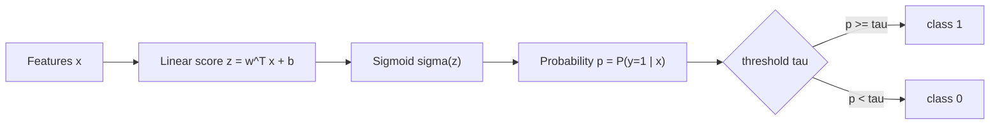
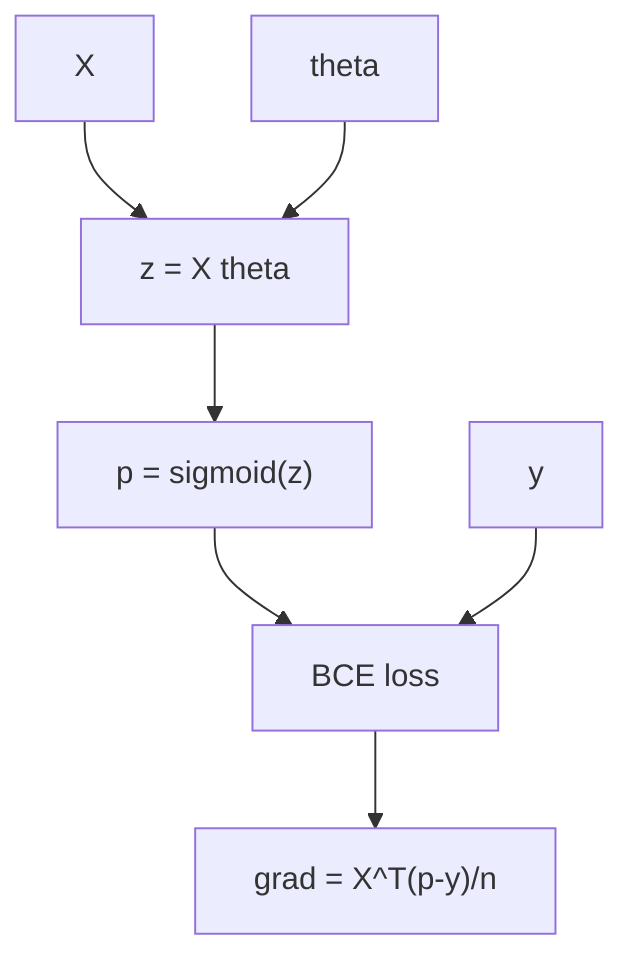
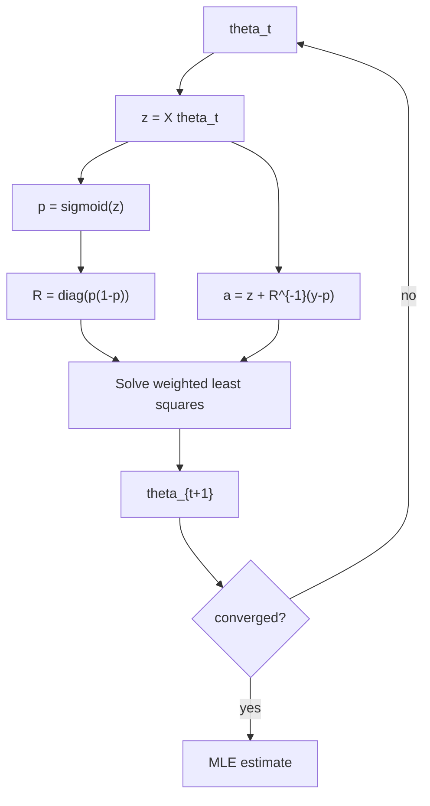

# Logistic Regression

Logistic regression is a linear probabilistic classifier. It models the conditional probability of a binary label by making the **log-odds** linear in the input features, then mapping that real-valued score into $[0,1]$ with the logistic sigmoid.

For binary labels $y_i \in \{0,1\}$ and features $x_i \in \mathbb{R}^{d}$, the model is

$$
p_i
=
P(y_i=1 \mid x_i; w,b)
=
\sigma(z_i),
\qquad
z_i = w^\top x_i + b,
\qquad
\sigma(z)=\frac{1}{1+\exp(-z)}.
$$

Despite the word "regression", the usual use is classification. The name comes from fitting a regression model to the logit, not from predicting an unrestricted continuous target.



## 1. Why Linear Regression Is Not the Right Model

A linear probability model would set

$$
P(y=1\mid x) \approx w^\top x + b.
$$

This has three serious problems:

1. The right-hand side is unbounded, so it can produce values below $0$ or above $1$.
2. The error distribution is not homoscedastic Gaussian. For $y \sim \operatorname{Bernoulli}(p)$,

$$
\operatorname{Var}(y\mid x)=p(1-p),
$$

which depends on $x$ through $p$.

3. Squared-error fitting does not correspond to the Bernoulli likelihood and typically gives poorly calibrated probabilities near $0$ and $1$.

Logistic regression fixes the first issue by modeling a transformed probability:

$$
\operatorname{logit}(p)
=
\log\left(\frac{p}{1-p}\right)
=
w^\top x+b.
$$

Solving this equation for $p$ gives the sigmoid.

Starting from

$$
\log\left(\frac{p}{1-p}\right)=z,
$$

exponentiate both sides:

$$
\frac{p}{1-p}=\exp(z).
$$

Then

$$
p=\exp(z)(1-p)
=
\exp(z)-p\exp(z),
$$

so

$$
p(1+\exp(z))=\exp(z),
$$

and therefore

$$
p
=
\frac{\exp(z)}{1+\exp(z)}
=
\frac{1}{1+\exp(-z)}
=
\sigma(z).
$$

The logit link maps $p \in (0,1)$ to $z \in \mathbb{R}$, so a linear model can be used without violating probability bounds.

## 2. Odds, Log-Odds, and Coefficient Interpretation

The **odds** of success are

$$
\operatorname{odds}(y=1\mid x)
=
\frac{p}{1-p}.
$$

If $p=0.8$, then

$$
\frac{p}{1-p}
=
\frac{0.8}{0.2}
=
4.
$$

The event is four times as likely as the non-event.

Logistic regression assumes

$$
\log\left(\frac{p}{1-p}\right)
=
b+\sum_{j=1}^{d}w_j x_j.
$$

For a one-unit increase in feature $x_j$, holding all other features fixed, the log-odds change by $w_j$:

$$
\Delta \log\left(\frac{p}{1-p}\right)=w_j.
$$

Exponentiating gives an odds multiplier:

$$
\frac{\operatorname{odds}(x_j+1)}{\operatorname{odds}(x_j)}
=
\exp(w_j).
$$

So:

- $w_j=0$ means no change in odds.
- $w_j>0$ means the odds increase by a factor of $\exp(w_j)$.
- $w_j<0$ means the odds decrease by a factor of $\exp(w_j)$.

This interpretation is exact for log-odds, but the corresponding change in probability is not constant. Because the sigmoid saturates, the same logit shift changes probability more near $p=0.5$ than near $p=0$ or $p=1$.

## 3. Step-by-Step Inference

Given a fitted model with parameters $w$ and $b$:

1. Compute the raw score:

$$
z=w^\top x+b.
$$

2. Convert the score to a probability:

$$
p=\sigma(z)=\frac{1}{1+\exp(-z)}.
$$

3. Convert probability to a class using threshold $\tau$:

$$
\hat{y}
=
\mathbf{1}\{p \ge \tau\}.
$$

The common threshold is $\tau=0.5$, but this is not mathematically required. If false positives and false negatives have different costs, the optimal threshold generally changes.

For costs $C_{\mathrm{FP}}$ and $C_{\mathrm{FN}}$, predict class $1$ when the expected cost of predicting $1$ is less than predicting $0$:

$$
C_{\mathrm{FP}}P(y=0\mid x)
<
C_{\mathrm{FN}}P(y=1\mid x).
$$

Since $P(y=1\mid x)=p$, this becomes

$$
C_{\mathrm{FP}}(1-p)<C_{\mathrm{FN}}p.
$$

Solving for $p$:

$$
p > \frac{C_{\mathrm{FP}}}{C_{\mathrm{FP}}+C_{\mathrm{FN}}}.
$$

Thus the Bayes decision threshold is

$$
\tau^\star
=
\frac{C_{\mathrm{FP}}}{C_{\mathrm{FP}}+C_{\mathrm{FN}}}.
$$

When false negatives are much more expensive, $\tau^\star$ becomes smaller, making the classifier more willing to predict class $1$.

## 4. Bernoulli Likelihood from First Principles

For a binary target,

$$
y_i \sim \operatorname{Bernoulli}(p_i),
$$

with probability mass function

$$
P(y_i\mid x_i;w,b)
=
p_i^{y_i}(1-p_i)^{1-y_i}.
$$

This compact expression works because:

- If $y_i=1$, then $p_i^{y_i}(1-p_i)^{1-y_i}=p_i$.
- If $y_i=0$, then $p_i^{y_i}(1-p_i)^{1-y_i}=1-p_i$.

Assuming examples are conditionally independent given parameters, the likelihood is

$$
L(w,b)
=
\prod_{i=1}^{n}
p_i^{y_i}(1-p_i)^{1-y_i}.
$$

The log-likelihood is

$$
\ell(w,b)
=
\log L(w,b)
=
\sum_{i=1}^{n}
\left[
y_i \log p_i
+
(1-y_i)\log(1-p_i)
\right].
$$

Maximum likelihood estimation chooses

$$
(w^\star,b^\star)
=
\arg\max_{w,b}\ell(w,b).
$$

Equivalently, minimize the negative average log-likelihood:

$$
J(w,b)
=
-\frac{1}{n}
\sum_{i=1}^{n}
\left[
y_i \log p_i
+
(1-y_i)\log(1-p_i)
\right].
$$

This is the binary cross-entropy or log-loss.

## 5. Why Log-Loss Has This Shape

For one observation, the loss is

$$
\mathcal{L}(p,y)
=
-y\log p-(1-y)\log(1-p).
$$

If $y=1$:

$$
\mathcal{L}(p,1)=-\log p.
$$

If $y=0$:

$$
\mathcal{L}(p,0)=-\log(1-p).
$$

The loss heavily penalizes confident wrong predictions:

| True label | Predicted$p$ |                Loss |
| ---------: | -----------: | ------------------: |
|        $1$ |        $0.9$ | $-\log(0.9)=0.1053$ |
|        $1$ |        $0.5$ | $-\log(0.5)=0.6931$ |
|        $1$ |        $0.1$ | $-\log(0.1)=2.3026$ |
|        $0$ |        $0.1$ | $-\log(0.9)=0.1053$ |
|        $0$ |        $0.9$ | $-\log(0.1)=2.3026$ |

As $p \to 0$ for a positive example or $p \to 1$ for a negative example, the loss diverges to infinity.

## 6. Gradient Derivation

Let the design matrix be

$$
X \in \mathbb{R}^{n\times d},
\qquad
w \in \mathbb{R}^{d},
\qquad
y \in \{0,1\}^{n}.
$$

Absorb the intercept into the matrix by defining

$$
\tilde{x}_i =
\begin{bmatrix}
1 \\
x_i
\end{bmatrix},
\qquad
\theta =
\begin{bmatrix}
b \\
w
\end{bmatrix},
\qquad
z_i=\tilde{x}_i^\top\theta.
$$

The sigmoid derivative is

$$
\frac{d\sigma(z)}{dz}
=
\frac{d}{dz}(1+\exp(-z))^{-1}.
$$

Using the chain rule:

$$
\frac{d\sigma(z)}{dz}
=
-(1+\exp(-z))^{-2}(-\exp(-z))
=
\frac{\exp(-z)}{(1+\exp(-z))^2}.
$$

Now write

$$
\sigma(z)=\frac{1}{1+\exp(-z)},
\qquad
1-\sigma(z)=\frac{\exp(-z)}{1+\exp(-z)}.
$$

Therefore

$$
\sigma'(z)
=
\sigma(z)(1-\sigma(z)).
$$

For one example, the negative log-likelihood is

$$
\mathcal{L}_i(\theta)
=
-y_i\log p_i-(1-y_i)\log(1-p_i),
\qquad
p_i=\sigma(z_i).
$$

Differentiate with respect to $z_i$:

$$
\frac{\partial \mathcal{L}_i}{\partial z_i}
=
-y_i\frac{1}{p_i}\frac{\partial p_i}{\partial z_i}
-
(1-y_i)\frac{1}{1-p_i}\left(-\frac{\partial p_i}{\partial z_i}\right).
$$

Substitute $\partial p_i/\partial z_i=p_i(1-p_i)$:

$$
\frac{\partial \mathcal{L}_i}{\partial z_i}
=
-y_i(1-p_i)+(1-y_i)p_i.
$$

Expand:

$$
\frac{\partial \mathcal{L}_i}{\partial z_i}
=
-y_i+y_i p_i+p_i-y_i p_i
=
p_i-y_i.
$$

Then by the chain rule,

$$
\frac{\partial \mathcal{L}_i}{\partial \theta}
=
\frac{\partial \mathcal{L}_i}{\partial z_i}
\frac{\partial z_i}{\partial \theta}
=
(p_i-y_i)\tilde{x}_i.
$$

For average loss,

$$
\nabla_\theta J(\theta)
=
\frac{1}{n}
\sum_{i=1}^{n}
(p_i-y_i)\tilde{x}_i.
$$

In vector form:

$$
\nabla_\theta J(\theta)
=
\frac{1}{n}
\tilde{X}^\top(p-y),
$$

where

$$
p=\sigma(\tilde{X}\theta)
$$

is applied elementwise.

The clean residual-like term $p-y$ is the main reason logistic regression is easy to optimize.



## 7. Hessian, Convexity, and Newton Updates

The gradient is

$$
\nabla_\theta J(\theta)
=
\frac{1}{n}\tilde{X}^\top(p-y).
$$

Differentiate again. Since

$$
\frac{\partial p_i}{\partial z_i}
=
p_i(1-p_i),
$$

define the diagonal weight matrix

$$
R
=
\operatorname{diag}\left(p_1(1-p_1),\dots,p_n(1-p_n)\right).
$$

The Hessian is

$$
H(\theta)
=
\nabla_\theta^2 J(\theta)
=
\frac{1}{n}\tilde{X}^\top R \tilde{X}.
$$

For any vector $v$,

$$
v^\top H v
=
\frac{1}{n}v^\top\tilde{X}^\top R\tilde{X}v
=
\frac{1}{n}(\tilde{X}v)^\top R(\tilde{X}v)
=
\frac{1}{n}
\sum_{i=1}^{n}
p_i(1-p_i)(\tilde{x}_i^\top v)^2
\ge
0.
$$

Therefore the unregularized logistic loss is convex. It is strictly convex only if $\tilde{X}$ has full column rank and the data are not in a degenerate separable regime that prevents a finite optimum.

Newton's method updates

$$
\theta_{t+1}
=
\theta_t-H(\theta_t)^{-1}\nabla_\theta J(\theta_t).
$$

In practice one solves the linear system

$$
H(\theta_t)\Delta_t=\nabla_\theta J(\theta_t)
$$

and sets

$$
\theta_{t+1}=\theta_t-\Delta_t,
$$

without explicitly forming $H^{-1}$.

## 8. IRLS: Iteratively Reweighted Least Squares

Newton's method for logistic regression can be written as a sequence of weighted least-squares problems.

At iteration $t$, define

$$
z=\tilde{X}\theta_t,
\qquad
p=\sigma(z),
\qquad
R=\operatorname{diag}(p_i(1-p_i)).
$$

The Newton update solves

$$
\tilde{X}^\top R\tilde{X}\theta_{t+1}
=
\tilde{X}^\top R a,
$$

where the pseudo-response is

$$
a
=
z+R^{-1}(y-p).
$$

Derivation:

Newton update:

$$
\theta_{t+1}
=
\theta_t-(\tilde{X}^\top R\tilde{X})^{-1}\tilde{X}^\top(p-y).
$$

Multiply both sides by $\tilde{X}^\top R\tilde{X}$:

$$
\tilde{X}^\top R\tilde{X}\theta_{t+1}
=
\tilde{X}^\top R\tilde{X}\theta_t-\tilde{X}^\top(p-y).
$$

Since $z=\tilde{X}\theta_t$,

$$
\tilde{X}^\top R\tilde{X}\theta_t
=
\tilde{X}^\top R z.
$$

Also,

$$
-\tilde{X}^\top(p-y)
=
\tilde{X}^\top(y-p)
=
\tilde{X}^\top R R^{-1}(y-p).
$$

Thus

$$
\tilde{X}^\top R\tilde{X}\theta_{t+1}
=
\tilde{X}^\top R\left[z+R^{-1}(y-p)\right]
=
\tilde{X}^\top R a.
$$

So each IRLS step solves

$$
\theta_{t+1}
=
\arg\min_\theta
\frac{1}{2}
(a-\tilde{X}\theta)^\top R(a-\tilde{X}\theta).
$$

Intuitively, IRLS locally approximates the curved Bernoulli log-likelihood with a quadratic bowl and solves the weighted least-squares problem induced by that local approximation.



## 9. Gradient Descent Training

Batch gradient descent uses

$$
\theta_{t+1}
=
\theta_t-\eta
\frac{1}{n}\tilde{X}^\top(p-y),
$$

where $\eta>0$ is the learning rate.

Full training loop:

1. Add an intercept column to $X$.
2. Initialize $\theta$.
3. Compute logits $z=\tilde{X}\theta$.
4. Compute probabilities $p=\sigma(z)$.
5. Compute log-loss.
6. Compute gradient $\tilde{X}^\top(p-y)/n$.
7. Update parameters.
8. Stop when the loss change, gradient norm, or parameter change is small.

Gradient descent is simple and memory-light, but first-order methods can be slow when features are poorly scaled or highly correlated. Newton and quasi-Newton methods often converge in fewer iterations but have higher per-iteration cost.

## 10. Worked Binary Example

Suppose one feature is hours studied:

$$
x =
\begin{bmatrix}
0 \\
1 \\
2
\end{bmatrix},
\qquad
y =
\begin{bmatrix}
0 \\
0 \\
1
\end{bmatrix}.
$$

Use intercept and slope:

$$
\theta =
\begin{bmatrix}
b \\
w
\end{bmatrix}.
$$

Let the current parameters be

$$
b=-1,
\qquad
w=1.
$$

The augmented design matrix is

$$
\tilde{X}
=
\begin{bmatrix}
1 & 0 \\
1 & 1 \\
1 & 2
\end{bmatrix}.
$$

Logits:

$$
z=\tilde{X}\theta
=
\begin{bmatrix}
-1 \\
0 \\
1
\end{bmatrix}.
$$

Probabilities:

$$
p
=
\sigma(z)
\approx
\begin{bmatrix}
0.2689 \\
0.5000 \\
0.7311
\end{bmatrix}.
$$

Residuals in probability space:

$$
p-y
=
\begin{bmatrix}
0.2689 \\
0.5000 \\
-0.2689
\end{bmatrix}.
$$

Gradient:

$$
\nabla_\theta J
=
\frac{1}{3}\tilde{X}^\top(p-y).
$$

Compute the intercept component:

$$
\frac{1}{3}(0.2689+0.5000-0.2689)
=
0.1667.
$$

Compute the slope component:

$$
\frac{1}{3}
\left[
0(0.2689)+1(0.5000)+2(-0.2689)
\right]
=
\frac{-0.0378}{3}
\approx
-0.0126.
$$

So

$$
\nabla_\theta J
\approx
\begin{bmatrix}
0.1667 \\
-0.0126
\end{bmatrix}.
$$

With learning rate $\eta=0.5$:

$$
\theta_{\mathrm{new}}
=
\theta-\eta\nabla_\theta J
\approx
\begin{bmatrix}
-1 \\
1
\end{bmatrix}
-
0.5
\begin{bmatrix}
0.1667 \\
-0.0126
\end{bmatrix}
=
\begin{bmatrix}
-1.0834 \\
1.0063
\end{bmatrix}.
$$

The intercept decreases because the model overpredicts positives overall; the slope increases slightly because the positive example at $x=2$ is still underpredicted relative to label $1$.

## 11. Regularized Logistic Regression

Regularization controls variance, improves conditioning, and prevents coefficient blow-up in nearly separable data.

### 11.1 L2 Regularization

The L2-regularized objective is

$$
J_{\lambda}(\theta)
=
-\frac{1}{n}
\sum_{i=1}^{n}
\left[
y_i\log p_i+(1-y_i)\log(1-p_i)
\right]
+
\frac{\lambda}{2}\lVert w\rVert_2^2.
$$

Usually the intercept $b$ is not penalized. If $\theta=[b,w^\top]^\top$, define

$$
D=
\operatorname{diag}(0,1,1,\dots,1).
$$

Then

$$
J_{\lambda}(\theta)
=
J(\theta)+\frac{\lambda}{2}\theta^\top D\theta.
$$

Gradient:

$$
\nabla_\theta J_{\lambda}
=
\frac{1}{n}\tilde{X}^\top(p-y)+\lambda D\theta.
$$

Hessian:

$$
\nabla_\theta^2 J_{\lambda}
=
\frac{1}{n}\tilde{X}^\top R\tilde{X}+\lambda D.
$$

L2 regularization makes the objective strongly convex in the penalized directions when $\lambda>0$, improving numerical conditioning.

### 11.2 L1 Regularization

The L1-regularized objective is

$$
J_{\lambda}(\theta)
=
J(\theta)+\lambda\lVert w\rVert_1.
$$

L1 is not differentiable at $w_j=0$. Its subgradient is

$$
\partial |w_j|
=
\begin{cases}
\{1\}, & w_j>0, \\
[-1,1], & w_j=0, \\
\{-1\}, & w_j<0.
\end{cases}
$$

L1 can produce sparse coefficients, which is useful for high-dimensional linear models. It typically requires coordinate descent, proximal gradient, or specialized solvers such as LIBLINEAR or SAGA.

### 11.3 Elastic Net

Elastic net combines L1 and L2:

$$
J_{\lambda,\alpha}(\theta)
=
J(\theta)
+
\lambda
\left[
\alpha\lVert w\rVert_1
+
\frac{1-\alpha}{2}\lVert w\rVert_2^2
\right],
\qquad
\alpha \in [0,1].
$$

It is useful when features are correlated and pure L1 selection is unstable.

## 12. Complete NumPy Implementation from Scratch

This implementation supports:

- numerically stable sigmoid
- binary cross-entropy with clipping
- optional L2 regularization
- intercept
- batch gradient descent
- probability and class prediction

```python
import numpy as np


class BinaryLogisticRegressionGD:
    def __init__(self, lr=0.1, max_iter=1000, l2=0.0, tol=1e-8, fit_intercept=True):
        self.lr = lr
        self.max_iter = max_iter
        self.l2 = l2
        self.tol = tol
        self.fit_intercept = fit_intercept
        self.theta_ = None
        self.loss_history_ = []

    @staticmethod
    def _sigmoid(z):
        """Stable sigmoid for scalar or ndarray input."""
        z = np.asarray(z, dtype=np.float64)
        out = np.empty_like(z)

        pos = z >= 0
        neg = ~pos

        # For z >= 0: exp(-z) is safe.
        out[pos] = 1.0 / (1.0 + np.exp(-z[pos]))

        # For z < 0: rewrite to avoid overflow in exp(-z).
        exp_z = np.exp(z[neg])
        out[neg] = exp_z / (1.0 + exp_z)
        return out

    def _add_intercept(self, X):
        X = np.asarray(X, dtype=np.float64)
        if not self.fit_intercept:
            return X
        ones = np.ones((X.shape[0], 1), dtype=X.dtype)
        return np.hstack([ones, X])

    def _loss_and_grad(self, X_aug, y):
        n = X_aug.shape[0]
        z = X_aug @ self.theta_
        p = self._sigmoid(z)

        eps = np.finfo(np.float64).eps
        p_clip = np.clip(p, eps, 1.0 - eps)

        data_loss = -np.mean(y * np.log(p_clip) + (1.0 - y) * np.log(1.0 - p_clip))

        grad = (X_aug.T @ (p - y)) / n

        if self.l2 > 0.0:
            penalty_mask = np.ones_like(self.theta_)
            if self.fit_intercept:
                penalty_mask[0] = 0.0

            data_loss += 0.5 * self.l2 * np.sum((penalty_mask * self.theta_) ** 2)
            grad += self.l2 * penalty_mask * self.theta_

        return data_loss, grad

    def fit(self, X, y):
        X_aug = self._add_intercept(X)
        y = np.asarray(y, dtype=np.float64)

        if not np.all((y == 0.0) | (y == 1.0)):
            raise ValueError("Binary logistic regression expects labels encoded as 0/1.")

        self.theta_ = np.zeros(X_aug.shape[1], dtype=np.float64)
        prev_loss = np.inf

        for _ in range(self.max_iter):
            loss, grad = self._loss_and_grad(X_aug, y)
            self.loss_history_.append(loss)

            self.theta_ -= self.lr * grad

            if abs(prev_loss - loss) < self.tol:
                break
            prev_loss = loss

        return self

    def decision_function(self, X):
        X_aug = self._add_intercept(X)
        return X_aug @ self.theta_

    def predict_proba(self, X):
        p1 = self._sigmoid(self.decision_function(X))
        return np.column_stack([1.0 - p1, p1])

    def predict(self, X, threshold=0.5):
        return (self.predict_proba(X)[:, 1] >= threshold).astype(int)
```

Example usage:

```python
X = np.array([[0.0], [1.0], [2.0], [3.0], [4.0]])
y = np.array([0, 0, 0, 1, 1])

model = BinaryLogisticRegressionGD(lr=0.5, max_iter=5000, l2=1e-3)
model.fit(X, y)

print(model.theta_)
print(model.predict_proba([[1.5], [3.5]]))
print(model.predict([[1.5], [3.5]]))
```

## 13. Newton / IRLS Implementation from Scratch

Newton's method is more expensive per iteration but usually requires far fewer iterations.

```python
import numpy as np


class BinaryLogisticRegressionNewton:
    def __init__(self, max_iter=50, l2=0.0, tol=1e-8, fit_intercept=True):
        self.max_iter = max_iter
        self.l2 = l2
        self.tol = tol
        self.fit_intercept = fit_intercept
        self.theta_ = None

    @staticmethod
    def _sigmoid(z):
        z = np.asarray(z, dtype=np.float64)
        out = np.empty_like(z)
        pos = z >= 0
        out[pos] = 1.0 / (1.0 + np.exp(-z[pos]))
        exp_z = np.exp(z[~pos])
        out[~pos] = exp_z / (1.0 + exp_z)
        return out

    def _add_intercept(self, X):
        X = np.asarray(X, dtype=np.float64)
        if not self.fit_intercept:
            return X
        return np.hstack([np.ones((X.shape[0], 1)), X])

    def fit(self, X, y):
        X_aug = self._add_intercept(X)
        y = np.asarray(y, dtype=np.float64)
        n, d = X_aug.shape

        self.theta_ = np.zeros(d, dtype=np.float64)
        penalty_mask = np.ones(d, dtype=np.float64)
        if self.fit_intercept:
            penalty_mask[0] = 0.0

        for _ in range(self.max_iter):
            z = X_aug @ self.theta_
            p = self._sigmoid(z)

            grad = (X_aug.T @ (p - y)) / n
            grad += self.l2 * penalty_mask * self.theta_

            r = p * (1.0 - p)
            hessian = (X_aug.T * r) @ X_aug / n
            hessian += self.l2 * np.diag(penalty_mask)

            # Solve H delta = grad instead of computing inv(H) @ grad.
            delta = np.linalg.solve(hessian, grad)
            self.theta_ -= delta

            if np.linalg.norm(delta, ord=2) < self.tol:
                break

        return self

    def predict_proba(self, X):
        X_aug = self._add_intercept(X)
        p1 = self._sigmoid(X_aug @ self.theta_)
        return np.column_stack([1.0 - p1, p1])

    def predict(self, X, threshold=0.5):
        return (self.predict_proba(X)[:, 1] >= threshold).astype(int)
```

Important implementation detail:

$$
\tilde{X}^\top R\tilde{X}
$$

is computed as

```python
(X_aug.T * r) @ X_aug
```

instead of explicitly constructing the dense diagonal matrix $R$. This saves memory and is faster.

## 14. Equivalent Library Implementations

### 14.1 scikit-learn

```python
from sklearn.linear_model import LogisticRegression
from sklearn.preprocessing import StandardScaler
from sklearn.pipeline import make_pipeline

clf = make_pipeline(
    StandardScaler(),
    LogisticRegression(
        C=1.0,
        solver="lbfgs",
        max_iter=1000,
    ),
)

clf.fit(X_train, y_train)
proba = clf.predict_proba(X_test)
pred = clf.predict(X_test)
```

Internally, `LogisticRegression` minimizes a regularized logistic objective using numerical optimization. Important details:

- `C` is the inverse regularization strength. Smaller `C` means stronger regularization.
- `lbfgs`, `newton-cg`, `newton-cholesky`, and `sag` support L2 or no regularization in the primal formulation.
- `liblinear` supports L1 and L2 for binary classification and is often useful for smaller datasets.
- `saga` supports L1, L2, and elastic net and can scale well to large datasets.
- For multiclass problems, most solvers optimize the multinomial loss directly; `liblinear` uses one-vs-rest decomposition.

The key internal operations are still the same:

$$
z=Xw+b,
\qquad
p=\sigma(z),
\qquad
\nabla J=\frac{1}{n}X^\top(p-y)+\lambda w.
$$

The solver choice changes how the optimization problem is solved, not the probabilistic model.

### 14.2 SciPy `expit`

```python
import numpy as np
from scipy.special import expit, logit

z = np.array([-1000.0, -1.0, 0.0, 1.0, 1000.0])
p = expit(z)
print(p)
print(logit(p[1:-1]))
```

`scipy.special.expit` is the logistic sigmoid implemented as a vectorized universal function. Conceptually it computes

$$
\operatorname{expit}(z)=\frac{1}{1+\exp(-z)}.
$$

In numerical code, prefer `expit` or a stable sigmoid implementation over the naive expression when logits can be large in magnitude.

### 14.3 statsmodels

```python
import statsmodels.api as sm

X_with_const = sm.add_constant(X_train)
logit_model = sm.Logit(y_train, X_with_const)
result = logit_model.fit()

print(result.params)
print(result.summary())
```

`statsmodels` is often preferred when the goal is statistical inference: coefficient standard errors, Wald tests, confidence intervals, likelihood-ratio tests, and detailed model summaries.

For a maximum likelihood estimate $\hat{\theta}$, the asymptotic covariance is based on the inverse observed information:

$$
\widehat{\operatorname{Cov}}(\hat{\theta})
\approx
\left(\tilde{X}^\top \hat{R}\tilde{X}\right)^{-1},
$$

up to convention-dependent scaling. The standard error of coefficient $j$ is the square root of the $j$th diagonal entry.

## 15. Multiclass Logistic Regression: Softmax Regression

For $K$ classes, use one parameter vector per class:

$$
W \in \mathbb{R}^{d\times K},
\qquad
b \in \mathbb{R}^{K}.
$$

Class logits:

$$
s_k = w_k^\top x+b_k.
$$

Softmax probabilities:

$$
P(y=k\mid x)
=
\frac{\exp(s_k)}
{\sum_{j=1}^{K}\exp(s_j)}.
$$

For one-hot target vector $y_i \in \{0,1\}^{K}$, the multiclass cross-entropy is

$$
\mathcal{L}_i
=
-
\sum_{k=1}^{K}
y_{ik}\log p_{ik}.
$$

The gradient with respect to class logits is

$$
\frac{\partial \mathcal{L}_i}{\partial s_{ik}}
=
p_{ik}-y_{ik}.
$$

Thus the matrix gradient is

$$
\nabla_W J
=
\frac{1}{n}X^\top(P-Y),
\qquad
\nabla_b J
=
\frac{1}{n}\sum_{i=1}^{n}(p_i-y_i).
$$

This mirrors binary logistic regression: prediction minus target.

Numerically stable softmax subtracts the row maximum:

$$
\operatorname{softmax}(s)_k
=
\frac{\exp(s_k-c)}
{\sum_{j=1}^{K}\exp(s_j-c)},
\qquad
c=\max_j s_j.
$$

Subtracting $c$ leaves probabilities unchanged because the numerator and denominator are multiplied by the same constant $\exp(-c)$.

```python
import numpy as np


def stable_softmax(S):
    shifted = S - np.max(S, axis=1, keepdims=True)
    exp_shifted = np.exp(shifted)
    return exp_shifted / np.sum(exp_shifted, axis=1, keepdims=True)


def multiclass_loss_and_grad(X, y, W, b, l2=0.0):
    n = X.shape[0]
    scores = X @ W + b
    P = stable_softmax(scores)

    Y = np.eye(W.shape[1])[y]

    eps = np.finfo(np.float64).eps
    loss = -np.mean(np.sum(Y * np.log(np.clip(P, eps, 1.0)), axis=1))
    loss += 0.5 * l2 * np.sum(W * W)

    dS = (P - Y) / n
    grad_W = X.T @ dS + l2 * W
    grad_b = np.sum(dS, axis=0)
    return loss, grad_W, grad_b
```

## 16. Decision Boundary Geometry

With threshold $\tau=0.5$:

$$
\hat{y}=1
\iff
\sigma(w^\top x+b)\ge 0.5.
$$

Since sigmoid is monotone increasing:

$$
\sigma(z)\ge 0.5
\iff
z\ge 0.
$$

Therefore the decision boundary is

$$
w^\top x+b=0.
$$

For two features:

$$
w_1x_1+w_2x_2+b=0.
$$

If $w_2\ne 0$:

$$
x_2
=
-\frac{w_1}{w_2}x_1-\frac{b}{w_2}.
$$

Changing the threshold changes the boundary. Predict class $1$ when

$$
\sigma(z)\ge \tau.
$$

Apply logit to both sides:

$$
z \ge \log\left(\frac{\tau}{1-\tau}\right).
$$

So the threshold-adjusted boundary is

$$
w^\top x+b
=
\log\left(\frac{\tau}{1-\tau}\right).
$$

The boundary remains linear in feature space, but it shifts with $\tau$.

## 17. Numerical Stability

### 17.1 Sigmoid Overflow

The naive sigmoid

```python
1.0 / (1.0 + np.exp(-z))
```

can overflow when $z$ is very negative because $\exp(-z)$ becomes enormous.

Stable implementation:

$$
\sigma(z)
=
\begin{cases}
\frac{1}{1+\exp(-z)}, & z\ge 0, \\
\frac{\exp(z)}{1+\exp(z)}, & z<0.
\end{cases}
$$

### 17.2 Stable Binary Cross-Entropy from Logits

Instead of computing

$$
-y\log\sigma(z)-(1-y)\log(1-\sigma(z)),
$$

use the stable logit form:

$$
\mathcal{L}(z,y)
=
\max(z,0)-yz+\log(1+\exp(-|z|)).
$$

Derivation:

For $y\in\{0,1\}$,

$$
\mathcal{L}(z,y)
=
\log(1+\exp(z))-yz.
$$

The term $\log(1+\exp(z))$ is unstable for large positive $z$. Use

$$
\log(1+\exp(z))
=
\max(z,0)+\log(1+\exp(-|z|)).
$$

Thus:

$$
\mathcal{L}(z,y)
=
\max(z,0)-yz+\log(1+\exp(-|z|)).
$$

Python:

```python
def binary_cross_entropy_from_logits(z, y):
    z = np.asarray(z, dtype=np.float64)
    y = np.asarray(y, dtype=np.float64)
    return np.maximum(z, 0.0) - y * z + np.log1p(np.exp(-np.abs(z)))
```

### 17.3 Complete Separation

If the data are linearly separable, unregularized logistic regression has no finite maximum likelihood estimate. The likelihood can keep improving as $\lVert w\rVert \to \infty$ while the decision boundary remains separating.

For separable data, if there exists $\theta$ such that

$$
y_i=1 \Rightarrow \tilde{x}_i^\top\theta>0,
\qquad
y_i=0 \Rightarrow \tilde{x}_i^\top\theta<0,
$$

then scaling $\theta$ by $c\to\infty$ drives probabilities toward perfect confidence:

$$
\sigma(c\tilde{x}_i^\top\theta)\to 1
\quad \text{for positives},
\qquad
\sigma(c\tilde{x}_i^\top\theta)\to 0
\quad \text{for negatives}.
$$

The negative log-likelihood approaches $0$, but no finite parameter vector attains it. L2 regularization fixes this by making very large weights costly.

## 18. Complexity

Let $n$ be the number of examples and $d$ the number of features after adding an intercept.

| Method                 |              Per-iteration time |                                 Memory | Notes                                              |
| ---------------------- | ------------------------------: | -------------------------------------: | -------------------------------------------------- |
| Batch gradient descent |                         $O(nd)$ |                       $O(d)$ plus data | Cheap iterations, may need many iterations         |
| SGD / mini-batch SGD   |      $O(bd)$ for batch size $b$ |                 $O(d)$ plus batch/data | Scales well, noisier convergence                   |
| Newton / IRLS          |                   $O(nd^2+d^3)$ |                               $O(d^2)$ | Forms/solves Hessian; good when$d$ is moderate     |
| L-BFGS                 |             roughly$O(nd + md)$ |                                $O(md)$ | Stores$m$ curvature vectors; common default        |
| SAG/SAGA               | roughly$O(d)$ per sample update | $O(nd)$ gradient memory for dense form | Useful for large datasets; feature scaling matters |

For sparse $X$, replace $nd$ by the number of nonzero entries where the implementation preserves sparsity.

## 19. Edge Cases and Pitfalls

### 19.1 Feature Scaling

Logistic regression with gradient-based solvers is sensitive to feature scale. If one feature has values around $10^6$ and another around $10^{-2}$, the objective contours become badly conditioned, slowing optimization.

Standardization:

$$
x_{ij}^{\mathrm{std}}
=
\frac{x_{ij}-\mu_j}{s_j}.
$$

Do not fit $\mu_j$ and $s_j$ on the test set. In scikit-learn, use a `Pipeline` so preprocessing is learned only from training folds during cross-validation.

### 19.2 Class Imbalance

With severe imbalance, accuracy can be misleading. Important tools:

- class weights
- threshold tuning
- precision-recall curves
- ROC-AUC and PR-AUC
- calibration curves

Weighted log-loss:

$$
J(\theta)
=
-\frac{1}{\sum_i \alpha_i}
\sum_{i=1}^{n}
\alpha_i
\left[
y_i\log p_i+(1-y_i)\log(1-p_i)
\right].
$$

The gradient becomes

$$
\nabla_\theta J
=
\frac{1}{\sum_i \alpha_i}
\tilde{X}^\top
\left[
\alpha \odot (p-y)
\right],
$$

where $\odot$ denotes elementwise multiplication.

### 19.3 Correlated Features

Highly correlated features make coefficients unstable. Predictions may remain stable while individual coefficients change substantially. L2 regularization helps by distributing weight across correlated predictors. L1 may arbitrarily select one feature from a correlated group.

### 19.4 Outliers and High-Leverage Points

A point with extreme feature values can strongly affect the fitted boundary because logits depend linearly on $x$. Standardization, robust preprocessing, clipping, and regularization can help, but logistic regression is not inherently robust to leverage points.

### 19.5 Probability Calibration

Logistic regression is often well calibrated when the logit-linear assumption is reasonable and regularization is appropriate. But under model misspecification, strong regularization, label shift, or class imbalance, probabilities can be miscalibrated. Calibration methods include Platt scaling and isotonic regression.

### 19.6 Dummy Variable Trap

For one-hot categorical features, including all $K$ levels plus an intercept creates exact linear dependence. Drop one category or remove the intercept. Regularized solvers may still produce a solution, but coefficient interpretation becomes non-identifiable.

## 20. Limitations

Logistic regression has a linear decision boundary in the original feature space. It cannot learn XOR-like patterns without feature transformations.

Example XOR labels:

| $x_1$ | $x_2$ | $y$ |
| ----: | ----: | --: |
|     0 |     0 |   0 |
|     0 |     1 |   1 |
|     1 |     0 |   1 |
|     1 |     1 |   0 |

No single line separates the positive and negative points. Add an interaction feature $x_1x_2$:

$$
z=b+w_1x_1+w_2x_2+w_3x_1x_2.
$$

Then logistic regression can model XOR-like structure in the transformed feature space. This connects logistic regression to kernel methods, generalized additive models, and neural networks: all expand or learn the feature representation before applying a linear classifier.

## 21. Connections to Related ML Concepts

### 21.1 Generalized Linear Models

Logistic regression is a generalized linear model with:

- Bernoulli response distribution
- logit link
- linear predictor $\eta=w^\top x+b$

The canonical link for Bernoulli is the logit, which is why the gradient and Hessian take simple forms.

### 21.2 Maximum Entropy

Binary logistic regression is also a maximum entropy classifier. Among distributions satisfying empirical feature-moment constraints, it chooses the conditional distribution with maximum entropy. This provides another route to the exponential-family form.

### 21.3 Neural Networks

A single sigmoid neuron trained with binary cross-entropy is logistic regression:

$$
\hat{y}
=
\sigma(w^\top x+b).
$$

Neural networks become more expressive by learning nonlinear feature maps before the final logistic or softmax layer:

$$
\hat{y}
=
\sigma(w^\top h_\phi(x)+b).
$$

### 21.4 Linear SVMs

Logistic regression and linear SVMs both learn linear decision boundaries. They differ mainly in loss:

$$
\text{logistic loss: }
\log(1+\exp(-y' z)),
\qquad
y'\in\{-1,1\},
$$

$$
\text{hinge loss: }
\max(0,1-y'z).
$$

Logistic regression produces probabilities directly; SVM margins need calibration to become probabilities.

### 21.5 Naive Bayes

Naive Bayes is generative: it models $P(x\mid y)$ and $P(y)$. Logistic regression is discriminative: it models $P(y\mid x)$ directly. With enough data and correct feature representation, discriminative models often achieve lower asymptotic classification error; generative models can perform well with less data when their assumptions are approximately correct.

## 22. Minimal Testing Checklist

For a from-scratch implementation, test:

```python
def test_sigmoid_extreme_values():
    z = np.array([-1000.0, 0.0, 1000.0])
    p = BinaryLogisticRegressionGD._sigmoid(z)
    assert np.all(np.isfinite(p))
    assert p[0] == 0.0
    assert p[1] == 0.5
    assert p[2] == 1.0


def test_gradient_shape():
    X = np.random.randn(7, 3)
    y = np.array([0, 1, 0, 1, 1, 0, 1])
    model = BinaryLogisticRegressionGD(max_iter=1)
    X_aug = model._add_intercept(X)
    model.theta_ = np.zeros(X_aug.shape[1])
    loss, grad = model._loss_and_grad(X_aug, y)
    assert np.isscalar(loss)
    assert grad.shape == model.theta_.shape


def test_probability_rows_sum_to_one():
    X = np.array([[0.0], [1.0], [2.0]])
    y = np.array([0, 0, 1])
    model = BinaryLogisticRegressionGD(max_iter=20).fit(X, y)
    proba = model.predict_proba(X)
    assert np.allclose(proba.sum(axis=1), 1.0)
```

Avoid brittle tests that expect exact coefficients on separable data. Regularization, solver tolerance, and feature scaling can all change coefficient values while preserving predictions.

## 23. Summary

Logistic regression is a convex probabilistic classifier built from three pieces:

$$
z=w^\top x+b,
\qquad
p=\sigma(z),
\qquad
J=-\frac{1}{n}\sum_i
\left[
y_i\log p_i+(1-y_i)\log(1-p_i)
\right].
$$

Its most important internal identity is

$$
\frac{\partial \mathcal{L}_i}{\partial z_i}
=
p_i-y_i.
$$

This gives the vectorized gradient:

$$
\nabla_\theta J
=
\frac{1}{n}\tilde{X}^\top(p-y).
$$

The Hessian is

$$
H
=
\frac{1}{n}\tilde{X}^\top R\tilde{X},
\qquad
R_{ii}=p_i(1-p_i),
$$

which proves convexity and leads directly to Newton/IRLS training. Regularization is essential in high dimensions, correlated-feature settings, and separable or nearly separable datasets.

## 24. References for Deeper Reading

- scikit-learn documentation: `sklearn.linear_model.LogisticRegression` - https://scikit-learn.org/stable/modules/generated/sklearn.linear_model.LogisticRegression.html
- SciPy documentation: `scipy.special.expit` - https://docs.scipy.org/doc/scipy/reference/generated/scipy.special.expit.html
- scikit-learn source: logistic regression implementation - https://github.com/scikit-learn/scikit-learn/blob/main/sklearn/linear_model/_logistic.py
- Christopher M. Bishop, _Pattern Recognition and Machine Learning_, Section 4.3 - https://link.springer.com/book/9780387310732
- Trevor Hastie, Robert Tibshirani, and Jerome Friedman, _The Elements of Statistical Learning_, Chapter 4 - https://hastie.su.domains/ElemStatLearn/
- Kevin P. Murphy, _Machine Learning: A Probabilistic Perspective_, logistic regression and generalized linear models
- David W. Hosmer, Stanley Lemeshow, and Rodney X. Sturdivant, _Applied Logistic Regression_
