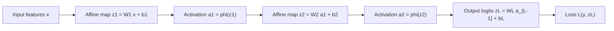
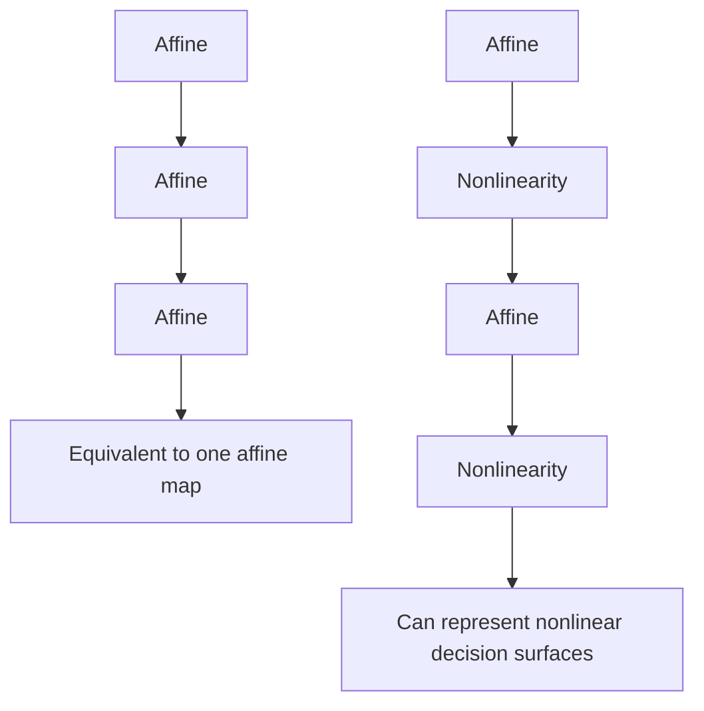
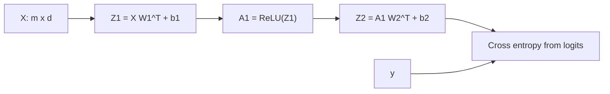
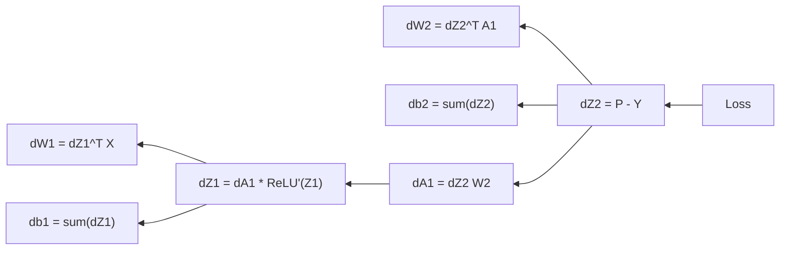

# Artificial Neural Networks

Artificial Neural Networks (ANNs), in the modern supervised-learning sense, are parameterized function classes built by composing affine maps with nonlinear activation functions. A fully connected feedforward neural network is also called a **multi-layer perceptron** (MLP), although modern MLPs are trained with differentiable losses and backpropagation rather than the original perceptron learning rule.

The core object is a function

$$
f_\theta:\mathbb{R}^{d_0}\rightarrow\mathbb{R}^{d_L},
$$

where $\theta$ contains all trainable weights and biases. In classification, the final output is usually interpreted as logits, probabilities, or class scores. In regression, it is usually interpreted directly as a real-valued prediction.



The important point is not biological analogy. The useful abstraction is **differentiable function composition** plus **gradient-based optimization**.

## 1. From a Single Neuron to an Affine Layer

### 1.1 Scalar Neuron

Given an input vector $x\in\mathbb{R}^{d}$, a neuron computes

$$
z
=
w^\top x+b
=
\sum_{j=1}^{d}w_jx_j+b,
$$

then applies a nonlinear function $\phi$:

$$
a=\phi(z).
$$

Terms:

- $x_j$ is feature $j$.
- $w_j$ controls how strongly feature $j$ affects the pre-activation.
- $b$ is an intercept. It lets the decision boundary shift away from the origin.
- $z$ is the **pre-activation**, **logit**, or **raw score**, depending on context.
- $a$ is the **activation**.

If $\phi$ is the identity, the neuron is just a linear model. The nonlinearity is what lets a network represent non-affine functions.

### 1.2 Bias and the Geometry of a Decision Boundary

For a binary linear classifier with prediction rule

$$
\hat{y}
=
\mathbf{1}\{w^\top x+b\geq 0\},
$$

the boundary is the hyperplane

$$
w^\top x+b=0.
$$

If $b=0$, every boundary must pass through the origin. If $b\neq 0$, the boundary can translate. The signed distance from a point $x$ to the hyperplane is

$$
\frac{w^\top x+b}{\lVert w\rVert_2}.
$$

Thus $b$ changes the threshold independently of the feature weights.

### 1.3 Vectorized Affine Layer

A layer with $d_{\text{in}}$ inputs and $d_{\text{out}}$ neurons uses

$$
W\in\mathbb{R}^{d_{\text{out}}\times d_{\text{in}}},
\qquad
b\in\mathbb{R}^{d_{\text{out}}}.
$$

For one example,

$$
z=Wx+b,
\qquad
a=\phi(z).
$$

For a mini-batch $X\in\mathbb{R}^{m\times d_{\text{in}}}$, using row-major examples,

$$
Z=XW^\top+\mathbf{1}b^\top,
\qquad
A=\phi(Z),
$$

where $\mathbf{1}\in\mathbb{R}^{m}$ is an all-ones vector. In implementation, broadcasting usually handles $\mathbf{1}b^\top$.

## 2. Why Nonlinear Activations Are Necessary

Consider two consecutive affine layers with no nonlinear activation:

$$
h=W_1x+b_1,
\qquad
o=W_2h+b_2.
$$

Substitute $h$:

$$
o
=
W_2(W_1x+b_1)+b_2
=
(W_2W_1)x+(W_2b_1+b_2).
$$

This is another affine map. By induction, any stack of affine layers without nonlinearities collapses to

$$
o=W_{\mathrm{eff}}x+b_{\mathrm{eff}}.
$$

So depth alone is not enough. A deep network becomes useful when affine transformations are interleaved with nonlinear functions.



## 3. Common Activation Functions

### 3.1 Sigmoid

$$
\sigma(z)=\frac{1}{1+\exp(-z)}.
$$

Derivative:

$$
\frac{d\sigma}{dz}
=
\sigma(z)(1-\sigma(z)).
$$

Derivation:

$$
\sigma(z)=(1+\exp(-z))^{-1}.
$$

Then

$$
\frac{d\sigma}{dz}
=
-(1+\exp(-z))^{-2}(-\exp(-z))
=
\frac{\exp(-z)}{(1+\exp(-z))^2}.
$$

Since

$$
\sigma(z)=\frac{1}{1+\exp(-z)}
$$

and

$$
1-\sigma(z)=\frac{\exp(-z)}{1+\exp(-z)},
$$

we get

$$
\frac{d\sigma}{dz}
=
\sigma(z)(1-\sigma(z)).
$$

Sigmoid is useful for binary output probabilities, but it is usually a poor hidden-layer activation in deep networks because $\sigma'(z)\leq 1/4$ and becomes tiny when $z$ is very positive or very negative.

### 3.2 Tanh

$$
\tanh(z)=\frac{\exp(z)-\exp(-z)}{\exp(z)+\exp(-z)}.
$$

Derivative:

$$
\frac{d}{dz}\tanh(z)=1-\tanh^2(z).
$$

Tanh is zero-centered, which helps hidden activations compared with sigmoid, but it also saturates.

### 3.3 ReLU

$$
\operatorname{ReLU}(z)=\max(0,z).
$$

Derivative, except at $z=0$:

$$
\frac{d}{dz}\operatorname{ReLU}(z)
=
\begin{cases}
1, & z>0,\\
0, & z<0.
\end{cases}
$$

At $z=0$, ReLU is not differentiable. Implementations choose a subgradient, commonly $0$.

ReLU is computationally cheap and avoids saturation on the positive side. Its main failure mode is the **dead ReLU** problem: if a neuron receives negative pre-activations for nearly all data, its gradient can remain zero and it may stop learning.

### 3.4 Leaky ReLU and GELU

Leaky ReLU keeps a small negative slope:

$$
\operatorname{LeakyReLU}_\alpha(z)
=
\begin{cases}
z, & z\geq 0,\\
\alpha z, & z<0,
\end{cases}
\qquad
0<\alpha\ll 1.
$$

This reduces the dead-neuron risk.

GELU is common in transformer MLP blocks:

$$
\operatorname{GELU}(z)
=
z\Phi(z),
$$

where $\Phi$ is the standard normal CDF. It gates values smoothly according to their magnitude.

### 3.5 Softmax

For logits $z\in\mathbb{R}^{K}$,

$$
\operatorname{softmax}(z)_k
=
\frac{\exp(z_k)}{\sum_{j=1}^{K}\exp(z_j)}.
$$

Softmax produces a categorical distribution:

$$
p_k\geq 0,
\qquad
\sum_{k=1}^{K}p_k=1.
$$

Softmax is invariant to adding the same constant to every logit:

$$
\operatorname{softmax}(z+c\mathbf{1})
=
\operatorname{softmax}(z).
$$

For numerical stability, use

$$
p_k
=
\frac{\exp(z_k-z_{\max})}{\sum_{j=1}^{K}\exp(z_j-z_{\max})},
\qquad
z_{\max}=\max_j z_j.
$$

This avoids overflow in $\exp(z_k)$.

## 4. Feedforward Network Notation

Let the network have $L$ parameterized layers. Define

$$
a^{(0)}=x.
$$

For hidden layers $\ell=1,\dots,L-1$,

$$
z^{(\ell)}
=
W^{(\ell)}a^{(\ell-1)}+b^{(\ell)},
$$

$$
a^{(\ell)}
=
\phi^{(\ell)}(z^{(\ell)}).
$$

For the output layer,

$$
z^{(L)}
=
W^{(L)}a^{(L-1)}+b^{(L)}.
$$

The model output depends on the task:

- Regression: $\hat{y}=z^{(L)}$.
- Binary classification: $p=\sigma(z^{(L)})$.
- Multi-class classification: $p=\operatorname{softmax}(z^{(L)})$.

For a mini-batch:

$$
A^{(0)}=X.
$$

For layer $\ell$:

$$
Z^{(\ell)}
=
A^{(\ell-1)}(W^{(\ell)})^\top+\mathbf{1}(b^{(\ell)})^\top,
$$

$$
A^{(\ell)}
=
\phi^{(\ell)}(Z^{(\ell)}).
$$

The row-major convention is common in NumPy, scikit-learn, and most PyTorch examples.

## 5. Loss Functions from Likelihood Principles

### 5.1 Squared Error for Gaussian Regression

Assume

$$
y_i=f_\theta(x_i)+\epsilon_i,
\qquad
\epsilon_i\sim\mathcal{N}(0,\sigma^2).
$$

Then

$$
p(y_i\mid x_i;\theta)
=
\frac{1}{\sqrt{2\pi\sigma^2}}
\exp\left(
-\frac{(y_i-f_\theta(x_i))^2}{2\sigma^2}
\right).
$$

The negative log-likelihood over $n$ examples is

$$
-\sum_{i=1}^{n}\log p(y_i\mid x_i;\theta)
=
\frac{n}{2}\log(2\pi\sigma^2)
+
\frac{1}{2\sigma^2}\sum_{i=1}^{n}(y_i-f_\theta(x_i))^2.
$$

If $\sigma^2$ is fixed, minimizing this is equivalent to minimizing mean squared error:

$$
\mathcal{L}_{\mathrm{MSE}}
=
\frac{1}{n}\sum_{i=1}^{n}(y_i-\hat{y}_i)^2.
$$

### 5.2 Binary Cross-Entropy

For binary classification,

$$
y_i\in\{0,1\},
\qquad
p_i=P(y_i=1\mid x_i;\theta).
$$

The Bernoulli likelihood is

$$
p(y_i\mid x_i;\theta)
=
p_i^{y_i}(1-p_i)^{1-y_i}.
$$

Taking the negative log:

$$
\ell_i
=
-\log p(y_i\mid x_i;\theta)
=
-y_i\log p_i-(1-y_i)\log(1-p_i).
$$

Thus

$$
\mathcal{L}_{\mathrm{BCE}}
=
-\frac{1}{n}\sum_{i=1}^{n}
\left[
y_i\log p_i+(1-y_i)\log(1-p_i)
\right].
$$

If $p_i=\sigma(s_i)$ where $s_i$ is a logit, the numerically stable BCE-with-logits form is

$$
\ell_i
=
\max(s_i,0)-s_i y_i+\log(1+\exp(-|s_i|)).
$$

This avoids explicitly computing $\log(\sigma(s_i))$ and $\log(1-\sigma(s_i))$, which can underflow near $0$ and $1$.

### 5.3 Multi-Class Cross-Entropy

For $K$ mutually exclusive classes, labels can be represented as one-hot vectors:

$$
y_i\in\{0,1\}^{K},
\qquad
\sum_{k=1}^{K}y_{ik}=1.
$$

With softmax probabilities

$$
p_{ik}
=
\frac{\exp(z_{ik})}{\sum_{j=1}^{K}\exp(z_{ij})},
$$

the categorical likelihood is

$$
p(y_i\mid x_i;\theta)
=
\prod_{k=1}^{K}p_{ik}^{y_{ik}}.
$$

The negative log-likelihood is

$$
\ell_i
=
-\sum_{k=1}^{K}y_{ik}\log p_{ik}.
$$

If the true class is $c_i$, this reduces to

$$
\ell_i=-\log p_{i c_i}.
$$

Using logits directly:

$$
\ell_i
=
-z_{i c_i}
+
\log\left(\sum_{j=1}^{K}\exp(z_{ij})\right).
$$

The stable version uses log-sum-exp:

$$
\log\left(\sum_{j=1}^{K}\exp(z_{ij})\right)
=
m_i+
\log\left(\sum_{j=1}^{K}\exp(z_{ij}-m_i)\right),
\qquad
m_i=\max_j z_{ij}.
$$

This is why mature libraries typically combine `log_softmax` and negative log-likelihood into a single cross-entropy function.

## 6. Forward Propagation: Step-by-Step Execution

For a two-layer network with one hidden layer:

$$
z^{(1)}=W^{(1)}x+b^{(1)},
\qquad
a^{(1)}=\phi(z^{(1)}),
$$

$$
z^{(2)}=W^{(2)}a^{(1)}+b^{(2)},
\qquad
p=\operatorname{softmax}(z^{(2)}).
$$

Execution:

1. Load one mini-batch $X$ and labels $y$.
2. Compute hidden pre-activations $Z^{(1)}$.
3. Apply hidden activation to get $A^{(1)}$.
4. Compute output logits $Z^{(2)}$.
5. Convert logits to probabilities only if needed for metrics or interpretation.
6. Compute loss directly from logits for numerical stability.
7. Store intermediate tensors needed for backpropagation.



## 7. Backpropagation from First Principles

Backpropagation is reverse-mode automatic differentiation applied to a computational graph. It efficiently computes gradients of a scalar loss with respect to many parameters.

### 7.1 Chain Rule on a Scalar Composition

If

$$
u=g(x),
\qquad
v=h(u),
\qquad
\mathcal{L}=r(v),
$$

then

$$
\frac{d\mathcal{L}}{dx}
=
\frac{d\mathcal{L}}{dv}
\frac{dv}{du}
\frac{du}{dx}.
$$

Backpropagation repeatedly applies this rule from the loss backward to earlier variables.

### 7.2 Local Gradients for an Affine Layer

For a single example:

$$
z=Wa+b.
$$

Suppose the upstream gradient is

$$
\delta_z
=
\frac{\partial \mathcal{L}}{\partial z}
\in\mathbb{R}^{d_{\text{out}}}.
$$

Elementwise,

$$
z_i=\sum_{j=1}^{d_{\text{in}}}W_{ij}a_j+b_i.
$$

Weight gradient:

$$
\frac{\partial \mathcal{L}}{\partial W_{ij}}
=
\frac{\partial \mathcal{L}}{\partial z_i}
\frac{\partial z_i}{\partial W_{ij}}
=
\delta_{z,i}a_j.
$$

Matrix form:

$$
\frac{\partial \mathcal{L}}{\partial W}
=
\delta_z a^\top.
$$

Bias gradient:

$$
\frac{\partial \mathcal{L}}{\partial b_i}
=
\delta_{z,i},
\qquad
\frac{\partial \mathcal{L}}{\partial b}
=
\delta_z.
$$

Input activation gradient:

$$
\frac{\partial \mathcal{L}}{\partial a_j}
=
\sum_{i=1}^{d_{\text{out}}}
\frac{\partial \mathcal{L}}{\partial z_i}
\frac{\partial z_i}{\partial a_j}
=
\sum_{i=1}^{d_{\text{out}}}\delta_{z,i}W_{ij}.
$$

Matrix form:

$$
\frac{\partial \mathcal{L}}{\partial a}
=
W^\top\delta_z.
$$

### 7.3 Mini-Batch Affine Gradients

With row-major mini-batch tensors:

$$
Z=AW^\top+\mathbf{1}b^\top.
$$

Let

$$
D_Z=\frac{\partial \mathcal{L}}{\partial Z}\in\mathbb{R}^{m\times d_{\text{out}}}.
$$

Then

$$
\frac{\partial \mathcal{L}}{\partial W}
=
D_Z^\top A,
$$

$$
\frac{\partial \mathcal{L}}{\partial b}
=
\sum_{i=1}^{m}D_{Z,i:},
$$

$$
\frac{\partial \mathcal{L}}{\partial A}
=
D_Z W.
$$

If the loss is averaged over the batch, $D_Z$ already includes the factor $1/m$, or the gradients above should be divided by $m$.

### 7.4 Activation Backward Pass

For

$$
a=\phi(z),
$$

the gradient is elementwise:

$$
\frac{\partial \mathcal{L}}{\partial z}
=
\frac{\partial \mathcal{L}}{\partial a}
\odot
\phi'(z),
$$

where $\odot$ denotes Hadamard product.

For ReLU:

$$
\frac{\partial \mathcal{L}}{\partial z}
=
\frac{\partial \mathcal{L}}{\partial a}
\odot
\mathbf{1}\{z>0\}.
$$

### 7.5 Softmax plus Cross-Entropy Gradient

For one example, define

$$
p_k=\frac{\exp(z_k)}{\sum_{j=1}^{K}\exp(z_j)},
\qquad
\ell=-\sum_{k=1}^{K}y_k\log p_k.
$$

First rewrite the loss:

$$
\ell
=
-\sum_{k=1}^{K}y_k
\left[
z_k-\log\left(\sum_{j=1}^{K}\exp(z_j)\right)
\right].
$$

Because $\sum_k y_k=1$,

$$
\ell
=
-\sum_{k=1}^{K}y_k z_k
+
\log\left(\sum_{j=1}^{K}\exp(z_j)\right).
$$

Differentiate with respect to logit $z_r$:

$$
\frac{\partial \ell}{\partial z_r}
=
-y_r
+
\frac{\exp(z_r)}{\sum_{j=1}^{K}\exp(z_j)}
=
p_r-y_r.
$$

Thus

$$
\frac{\partial \ell}{\partial z}
=
p-y.
$$

For a batch-mean loss:

$$
D_Z
=
\frac{P-Y}{m}.
$$

This compact result is one reason softmax-cross-entropy is convenient.



## 8. Worked Example: One Forward and Backward Pass

Consider one input:

$$
x=
\begin{bmatrix}
2\\
-1
\end{bmatrix},
\qquad
y=
\begin{bmatrix}
1\\
0
\end{bmatrix}.
$$

Use a 2-2-2 network:

$$
W^{(1)}
=
\begin{bmatrix}
0.1 & 0.2\\
-0.3 & 0.4
\end{bmatrix},
\qquad
b^{(1)}
=
\begin{bmatrix}
0.0\\
0.1
\end{bmatrix}.
$$

$$
W^{(2)}
=
\begin{bmatrix}
0.2 & -0.5\\
0.3 & 0.1
\end{bmatrix},
\qquad
b^{(2)}
=
\begin{bmatrix}
0.0\\
0.0
\end{bmatrix}.
$$

Hidden pre-activation:

$$
z^{(1)}
=
W^{(1)}x+b^{(1)}
=
\begin{bmatrix}
0.1(2)+0.2(-1)+0\\
-0.3(2)+0.4(-1)+0.1
\end{bmatrix}
=
\begin{bmatrix}
0\\
-0.9
\end{bmatrix}.
$$

Apply ReLU:

$$
a^{(1)}
=
\operatorname{ReLU}(z^{(1)})
=
\begin{bmatrix}
0\\
0
\end{bmatrix}.
$$

Output logits:

$$
z^{(2)}
=
W^{(2)}a^{(1)}+b^{(2)}
=
\begin{bmatrix}
0\\
0
\end{bmatrix}.
$$

Softmax:

$$
p_1
=
\frac{\exp(0)}{\exp(0)+\exp(0)}
=
0.5,
\qquad
p_2=0.5.
$$

Cross-entropy loss:

$$
\ell
=
-\log p_1
=
-\log(0.5)
\approx
0.6931.
$$

Output gradient:

$$
\delta^{(2)}
=
p-y
=
\begin{bmatrix}
0.5\\
0.5
\end{bmatrix}
-
\begin{bmatrix}
1\\
0
\end{bmatrix}
=
\begin{bmatrix}
-0.5\\
0.5
\end{bmatrix}.
$$

Output weight gradient:

$$
\frac{\partial \ell}{\partial W^{(2)}}
=
\delta^{(2)}(a^{(1)})^\top
=
\begin{bmatrix}
-0.5\\
0.5
\end{bmatrix}
\begin{bmatrix}
0 & 0
\end{bmatrix}
=
\begin{bmatrix}
0 & 0\\
0 & 0
\end{bmatrix}.
$$

Output bias gradient:

$$
\frac{\partial \ell}{\partial b^{(2)}}
=
\begin{bmatrix}
-0.5\\
0.5
\end{bmatrix}.
$$

Backpropagate to hidden activation:

$$
\frac{\partial \ell}{\partial a^{(1)}}
=
(W^{(2)})^\top\delta^{(2)}
=
\begin{bmatrix}
0.2 & 0.3\\
-0.5 & 0.1
\end{bmatrix}
\begin{bmatrix}
-0.5\\
0.5
\end{bmatrix}
=
\begin{bmatrix}
0.05\\
0.30
\end{bmatrix}.
$$

ReLU derivative at $z^{(1)}=[0,-0.9]^\top$ depends on the chosen subgradient at $0$. If the implementation uses $0$ at $0$:

$$
\mathbf{1}\{z^{(1)}>0\}
=
\begin{bmatrix}
0\\
0
\end{bmatrix}.
$$

So

$$
\delta^{(1)}
=
\frac{\partial \ell}{\partial z^{(1)}}
=
\begin{bmatrix}
0\\
0
\end{bmatrix}.
$$

Then

$$
\frac{\partial \ell}{\partial W^{(1)}}=0,
\qquad
\frac{\partial \ell}{\partial b^{(1)}}=0.
$$

This example exposes a practical pitfall: a ReLU hidden layer can produce zero activations and zero hidden gradients. In real networks, random initialization and many examples usually prevent every hidden unit from dying, but poor initialization or excessive learning rates can make this happen.

## 9. Gradient Descent and Parameter Updates

Training minimizes an empirical risk:

$$
J(\theta)
=
\frac{1}{n}\sum_{i=1}^{n}\ell(f_\theta(x_i),y_i)
+
\lambda R(\theta),
$$

where $R(\theta)$ is an optional regularizer.

Gradient descent updates:

$$
\theta_{t+1}
=
\theta_t-\eta\nabla_\theta J(\theta_t).
$$

Here $\eta>0$ is the learning rate.

### 9.1 Batch, Stochastic, and Mini-Batch Gradients

Full-batch gradient:

$$
\nabla_\theta J(\theta)
=
\frac{1}{n}\sum_{i=1}^{n}
\nabla_\theta \ell_i(\theta).
$$

Mini-batch estimate with batch $B$:

$$
g_B(\theta)
=
\frac{1}{|B|}\sum_{i\in B}
\nabla_\theta \ell_i(\theta).
$$

If the batch is sampled uniformly, then

$$
\mathbb{E}[g_B(\theta)]
=
\nabla_\theta J(\theta)
$$

ignoring regularization or including it exactly. Mini-batch SGD uses a noisy but cheaper gradient estimate.

### 9.2 Momentum

Momentum accumulates a velocity:

$$
v_{t+1}
=
\mu v_t+g_t,
$$

$$
\theta_{t+1}
=
\theta_t-\eta v_{t+1}.
$$

The parameter $\mu\in[0,1)$ controls how much past gradients influence the current step. Momentum damps oscillations in directions with alternating gradients and accelerates in directions where gradients agree.

### 9.3 Adam

Adam keeps exponential moving averages of first and second moments:

$$
m_t=\beta_1m_{t-1}+(1-\beta_1)g_t,
$$

$$
v_t=\beta_2v_{t-1}+(1-\beta_2)g_t\odot g_t.
$$

Bias correction:

$$
\hat{m}_t=\frac{m_t}{1-\beta_1^t},
\qquad
\hat{v}_t=\frac{v_t}{1-\beta_2^t}.
$$

Update:

$$
\theta_t
=
\theta_{t-1}
-
\eta
\frac{\hat{m}_t}{\sqrt{\hat{v}_t}+\epsilon}.
$$

Adam adapts the step size per parameter. It is convenient and robust for many problems, but it is not a substitute for correct scaling, stable initialization, and appropriate regularization.

## 10. Initialization from Variance Preservation

Poor initialization causes activations or gradients to explode or vanish. A useful design principle is to keep variance roughly constant across layers.

Assume a linear pre-activation

$$
z_i=\sum_{j=1}^{d_{\text{in}}}W_{ij}a_j.
$$

Assume:

- $W_{ij}$ are independent with mean $0$ and variance $\operatorname{Var}(W_{ij})$.
- $a_j$ are independent with mean $0$ and variance $\operatorname{Var}(a_j)$.
- $W_{ij}$ and $a_j$ are independent.

Then

$$
\operatorname{Var}(z_i)
=
\sum_{j=1}^{d_{\text{in}}}
\operatorname{Var}(W_{ij}a_j)
=
d_{\text{in}}
\operatorname{Var}(W_{ij})
\operatorname{Var}(a_j).
$$

To keep

$$
\operatorname{Var}(z_i)\approx\operatorname{Var}(a_j),
$$

choose

$$
\operatorname{Var}(W_{ij})
\approx
\frac{1}{d_{\text{in}}}.
$$

### 10.1 Xavier/Glorot Initialization

For tanh-like activations, Xavier initialization balances forward and backward variance using

$$
\operatorname{Var}(W_{ij})
=
\frac{2}{d_{\text{in}}+d_{\text{out}}}.
$$

For a uniform distribution $U[-r,r]$,

$$
\operatorname{Var}(W)=\frac{r^2}{3}.
$$

Setting this equal to $2/(d_{\text{in}}+d_{\text{out}})$ gives

$$
r
=
\sqrt{\frac{6}{d_{\text{in}}+d_{\text{out}}}}.
$$

### 10.2 He/Kaiming Initialization

For ReLU, roughly half of activations are zero under symmetric inputs. A common approximation is

$$
\operatorname{Var}(\operatorname{ReLU}(z))
\approx
\frac{1}{2}\operatorname{Var}(z).
$$

To compensate:

$$
\operatorname{Var}(W_{ij})
=
\frac{2}{d_{\text{in}}}.
$$

For normal initialization:

$$
W_{ij}\sim\mathcal{N}\left(0,\frac{2}{d_{\text{in}}}\right).
$$

This is the default logic behind many ReLU-oriented initializers.

## 11. Regularization

### 11.1 L2 Penalty and Weight Decay

Add a penalty:

$$
J(\theta)
=
\mathcal{L}(\theta)
+
\frac{\lambda}{2}\sum_{\ell}\lVert W^{(\ell)}\rVert_F^2.
$$

Gradient:

$$
\nabla_{W^{(\ell)}}J
=
\nabla_{W^{(\ell)}}\mathcal{L}
+
\lambda W^{(\ell)}.
$$

SGD update:

$$
W_{t+1}
=
W_t-\eta(\nabla_W\mathcal{L}+\lambda W_t)
=
(1-\eta\lambda)W_t-\eta\nabla_W\mathcal{L}.
$$

This shrinks weights toward zero, which can reduce overfitting and improve conditioning.

### 11.2 Dropout

During training, dropout samples a mask

$$
M_j\sim\operatorname{Bernoulli}(q),
$$

where $q$ is the keep probability. In inverted dropout:

$$
\tilde{a}
=
\frac{M\odot a}{q}.
$$

Then

$$
\mathbb{E}[\tilde{a}_j]
=
\frac{\mathbb{E}[M_j]a_j}{q}
=
a_j.
$$

At inference, no scaling is needed because training already preserved the activation expectation.

### 11.3 Early Stopping

Early stopping monitors validation loss and keeps the parameters from the best validation checkpoint. It acts as implicit regularization because training is stopped before the model fully adapts to training-set noise.

## 12. Python Implementation from Scratch

The following implementation trains a two-layer MLP for multi-class classification using NumPy. It intentionally implements forward propagation, stable softmax cross-entropy, backpropagation, L2 regularization, mini-batching, and SGD.

```python
import numpy as np


def relu(z):
    return np.maximum(z, 0.0)


def relu_backward(dout, z):
    # Subgradient convention: derivative at z == 0 is 0.
    return dout * (z > 0)


def softmax_cross_entropy_with_logits(logits, y):
    """
    logits: shape (m, k)
    y: integer class labels, shape (m,)

    Returns:
        loss: scalar mean cross-entropy
        dlogits: gradient of loss with respect to logits, shape (m, k)
    """
    m = logits.shape[0]

    shifted = logits - np.max(logits, axis=1, keepdims=True)
    exp_scores = np.exp(shifted)
    probs = exp_scores / np.sum(exp_scores, axis=1, keepdims=True)

    correct_log_probs = -np.log(probs[np.arange(m), y] + 1e-15)
    loss = np.mean(correct_log_probs)

    dlogits = probs.copy()
    dlogits[np.arange(m), y] -= 1.0
    dlogits /= m

    return loss, dlogits


class TwoLayerMLP:
    def __init__(self, input_dim, hidden_dim, num_classes, seed=0):
        rng = np.random.default_rng(seed)

        # He initialization for ReLU hidden layer.
        self.W1 = rng.normal(0.0, np.sqrt(2.0 / input_dim), size=(hidden_dim, input_dim))
        self.b1 = np.zeros(hidden_dim)

        # Smaller output initialization is often adequate for logits.
        self.W2 = rng.normal(0.0, np.sqrt(2.0 / hidden_dim), size=(num_classes, hidden_dim))
        self.b2 = np.zeros(num_classes)

    def forward(self, X):
        Z1 = X @ self.W1.T + self.b1
        A1 = relu(Z1)
        logits = A1 @ self.W2.T + self.b2

        cache = {
            "X": X,
            "Z1": Z1,
            "A1": A1,
            "logits": logits,
        }
        return logits, cache

    def loss_and_grads(self, X, y, l2=0.0):
        logits, cache = self.forward(X)
        data_loss, dlogits = softmax_cross_entropy_with_logits(logits, y)

        reg_loss = 0.5 * l2 * (np.sum(self.W1 * self.W1) + np.sum(self.W2 * self.W2))
        loss = data_loss + reg_loss

        A1 = cache["A1"]
        Z1 = cache["Z1"]

        dW2 = dlogits.T @ A1 + l2 * self.W2
        db2 = np.sum(dlogits, axis=0)

        dA1 = dlogits @ self.W2
        dZ1 = relu_backward(dA1, Z1)

        dW1 = dZ1.T @ X + l2 * self.W1
        db1 = np.sum(dZ1, axis=0)

        grads = {
            "W1": dW1,
            "b1": db1,
            "W2": dW2,
            "b2": db2,
        }
        return loss, grads

    def step(self, grads, lr):
        self.W1 -= lr * grads["W1"]
        self.b1 -= lr * grads["b1"]
        self.W2 -= lr * grads["W2"]
        self.b2 -= lr * grads["b2"]

    def predict(self, X):
        logits, _ = self.forward(X)
        return np.argmax(logits, axis=1)


def train(model, X, y, epochs=200, batch_size=32, lr=1e-2, l2=1e-4, seed=0):
    rng = np.random.default_rng(seed)
    n = X.shape[0]

    for epoch in range(epochs):
        indices = rng.permutation(n)
        X_shuffled = X[indices]
        y_shuffled = y[indices]

        for start in range(0, n, batch_size):
            end = start + batch_size
            X_batch = X_shuffled[start:end]
            y_batch = y_shuffled[start:end]

            loss, grads = model.loss_and_grads(X_batch, y_batch, l2=l2)
            model.step(grads, lr=lr)

        if epoch % 50 == 0 or epoch == epochs - 1:
            full_loss, _ = model.loss_and_grads(X, y, l2=l2)
            acc = np.mean(model.predict(X) == y)
            print(f"epoch={epoch:03d} loss={full_loss:.4f} acc={acc:.3f}")


# Example synthetic non-linear dataset.
if __name__ == "__main__":
    rng = np.random.default_rng(42)
    n_per_class = 100
    angles = np.linspace(0, 2 * np.pi, n_per_class, endpoint=False)

    X0 = np.c_[np.cos(angles), np.sin(angles)] + 0.10 * rng.normal(size=(n_per_class, 2))
    X1 = 2.0 * np.c_[np.cos(angles), np.sin(angles)] + 0.10 * rng.normal(size=(n_per_class, 2))
    X = np.vstack([X0, X1])
    y = np.array([0] * n_per_class + [1] * n_per_class)

    # Standardization improves optimization.
    X = (X - X.mean(axis=0)) / X.std(axis=0)

    model = TwoLayerMLP(input_dim=2, hidden_dim=16, num_classes=2, seed=1)
    train(model, X, y, epochs=300, batch_size=32, lr=0.05, l2=1e-4)
```

### 12.1 Gradient Check

A gradient check compares the analytic gradient to a finite-difference approximation:

$$
\frac{\partial J}{\partial \theta_j}
\approx
\frac{J(\theta_j+\epsilon)-J(\theta_j-\epsilon)}{2\epsilon}.
$$

```python
def gradient_check_one_param(model, X, y, param_name, index, eps=1e-5):
    param = getattr(model, param_name)

    old_value = param[index]

    param[index] = old_value + eps
    loss_plus, _ = model.loss_and_grads(X, y)

    param[index] = old_value - eps
    loss_minus, _ = model.loss_and_grads(X, y)

    param[index] = old_value

    numeric_grad = (loss_plus - loss_minus) / (2 * eps)
    _, grads = model.loss_and_grads(X, y)
    analytic_grad = grads[param_name][index]

    rel_error = abs(numeric_grad - analytic_grad) / max(
        1e-12,
        abs(numeric_grad) + abs(analytic_grad),
    )
    return numeric_grad, analytic_grad, rel_error
```

Important details:

- Use double precision for gradient checks when possible.
- Disable dropout, data augmentation, and randomness.
- Use a small network and a small batch.
- Avoid checking exactly at ReLU kink points where $z=0$.

## 13. Equivalent Library Implementations

### 13.1 scikit-learn

```python
from sklearn.neural_network import MLPClassifier
from sklearn.pipeline import make_pipeline
from sklearn.preprocessing import StandardScaler


clf = make_pipeline(
    StandardScaler(),
    MLPClassifier(
        hidden_layer_sizes=(16,),
        activation="relu",
        solver="adam",
        alpha=1e-4,
        batch_size=32,
        learning_rate_init=1e-3,
        max_iter=500,
        random_state=0,
    ),
)

clf.fit(X_train, y_train)
pred = clf.predict(X_test)
```

Internally, `MLPClassifier` builds a feedforward network with dense weight matrices. For classification, it minimizes log-loss. The `activation` argument chooses the hidden activation, while the output activation is chosen according to the task. `solver="adam"` uses adaptive first-order optimization. `solver="sgd"` uses stochastic gradient descent with optional momentum. `solver="lbfgs"` uses a quasi-Newton optimizer and can work well on smaller datasets.

Practical note: scikit-learn MLPs are convenient for tabular baselines, but they are not intended for large-scale deep learning workflows requiring GPUs, custom layers, mixed precision, distributed training, or complex training loops.

### 13.2 PyTorch

```python
import torch
from torch import nn
from torch.utils.data import DataLoader, TensorDataset


class TorchMLP(nn.Module):
    def __init__(self, input_dim, hidden_dim, num_classes):
        super().__init__()
        self.net = nn.Sequential(
            nn.Linear(input_dim, hidden_dim),
            nn.ReLU(),
            nn.Linear(hidden_dim, num_classes),
        )

    def forward(self, x):
        return self.net(x)


model = TorchMLP(input_dim=2, hidden_dim=16, num_classes=2)
optimizer = torch.optim.AdamW(model.parameters(), lr=1e-3, weight_decay=1e-4)
criterion = nn.CrossEntropyLoss()

train_ds = TensorDataset(
    torch.tensor(X_train, dtype=torch.float32),
    torch.tensor(y_train, dtype=torch.long),
)
loader = DataLoader(train_ds, batch_size=32, shuffle=True)

for epoch in range(100):
    model.train()
    for xb, yb in loader:
        logits = model(xb)
        loss = criterion(logits, yb)

        optimizer.zero_grad(set_to_none=True)
        loss.backward()
        optimizer.step()
```

Important internal mechanics:

- `nn.Linear(in_features, out_features)` stores a weight matrix of shape `(out_features, in_features)` and a bias of shape `(out_features,)`. It computes $XW^\top+b$ for batched inputs.
- `nn.ReLU()` applies $\max(0,z)$ elementwise and autograd records enough information to multiply the upstream gradient by the ReLU mask during backpropagation.
- `nn.CrossEntropyLoss()` expects raw logits, not softmax probabilities. Internally it is equivalent to `LogSoftmax` followed by negative log-likelihood loss, implemented stably with log-sum-exp.
- `loss.backward()` performs reverse-mode autodiff over the dynamic computation graph created during the forward pass.
- `optimizer.step()` reads accumulated `.grad` tensors and updates parameters.
- `optimizer.zero_grad()` is necessary because PyTorch accumulates gradients by default.

### 13.3 TensorFlow/Keras

```python
import tensorflow as tf


model = tf.keras.Sequential([
    tf.keras.layers.Input(shape=(2,)),
    tf.keras.layers.Dense(16, activation="relu"),
    tf.keras.layers.Dense(2),
])

model.compile(
    optimizer=tf.keras.optimizers.AdamW(learning_rate=1e-3, weight_decay=1e-4),
    loss=tf.keras.losses.SparseCategoricalCrossentropy(from_logits=True),
    metrics=["accuracy"],
)

model.fit(X_train, y_train, batch_size=32, epochs=100, validation_split=0.2)
```

`from_logits=True` is the Keras equivalent of telling the loss function to apply the stable softmax-cross-entropy computation internally.

## 14. Time and Space Complexity

For a dense layer with mini-batch size $m$, input width $d_{\text{in}}$, and output width $d_{\text{out}}$:

Forward affine computation:

$$
O(m d_{\text{in}} d_{\text{out}}).
$$

Activation:

$$
O(m d_{\text{out}}).
$$

Backward pass:

- $D_Z^\top A$ costs $O(m d_{\text{in}}d_{\text{out}})$.
- $D_ZW$ costs $O(m d_{\text{in}}d_{\text{out}})$.
- Bias and activation gradients are lower order.

So training a dense layer is approximately a small constant factor more expensive than inference.

For an $L$-layer dense MLP:

$$
O\left(
m\sum_{\ell=1}^{L}
d_{\ell-1}d_{\ell}
\right)
$$

per forward pass, and the same order for backward pass.

Parameter memory:

$$
O\left(
\sum_{\ell=1}^{L}
d_{\ell-1}d_{\ell}
\right).
$$

Activation memory for backpropagation:

$$
O\left(
m\sum_{\ell=1}^{L}d_{\ell}
\right).
$$

Optimizers add memory. Adam stores two extra moment tensors per parameter, so optimizer state is roughly twice the parameter memory, excluding gradients.

## 15. Numerical Stability

### 15.1 Softmax Overflow

Naive softmax can overflow:

$$
\exp(1000)=\infty
$$

in standard floating-point arithmetic. Always subtract the row-wise maximum before exponentiating:

```python
shifted = logits - logits.max(axis=1, keepdims=True)
probs = np.exp(shifted) / np.exp(shifted).sum(axis=1, keepdims=True)
```

### 15.2 Log of Zero

When computing probabilities explicitly, values can round to $0$. Then $\log(0)$ gives $-\infty$. Prefer logits-based losses. If probabilities are unavoidable, clip:

```python
eps = 1e-15
probs = np.clip(probs, eps, 1.0 - eps)
```

Clipping is a fallback, not a replacement for stable logit losses.

### 15.3 Exploding Gradients

Gradients can grow rapidly in deep networks, especially with poor initialization or recurrent computation. Mitigations include:

- variance-preserving initialization,
- normalization layers,
- residual connections,
- gradient clipping,
- smaller learning rates.

### 15.4 Vanishing Gradients

If many derivatives have magnitude below $1$, products of Jacobians shrink:

$$
\left\lVert
\prod_{\ell=1}^{L}J^{(\ell)}
\right\rVert
$$

can become tiny as $L$ grows. Sigmoid and tanh saturation worsen this because their derivatives approach $0$ at large $|z|$. ReLU-like activations, residual connections, and normalization help.

### 15.5 Mixed Precision

Float16 and bfloat16 improve throughput on accelerators but reduce precision. Common safeguards include:

- keeping master weights or optimizer states in float32,
- using loss scaling for float16,
- computing reductions such as softmax normalization carefully,
- watching for `NaN` and `Inf` values.

## 16. Edge Cases and Implementation Pitfalls

### 16.1 Passing Softmax Probabilities into Cross-Entropy

Many library cross-entropy functions expect logits. Passing probabilities applies softmax or log-softmax again, changing the loss and weakening gradients.

Correct PyTorch usage:

```python
logits = model(x)
loss = torch.nn.functional.cross_entropy(logits, y)
```

Usually incorrect:

```python
probs = torch.softmax(model(x), dim=1)
loss = torch.nn.functional.cross_entropy(probs, y)
```

### 16.2 Wrong Label Shape or Encoding

Sparse class labels:

$$
y_i\in\{0,\dots,K-1\}
$$

are used by losses such as PyTorch `CrossEntropyLoss` and Keras `SparseCategoricalCrossentropy`.

One-hot labels:

$$
y_i\in\{0,1\}^{K}
$$

are used by categorical cross-entropy variants. Mixing them silently or semi-silently can produce wrong training.

### 16.3 Missing Feature Scaling

MLPs are sensitive to feature scale because gradient magnitudes depend on input magnitudes. Standardization is usually important for tabular inputs:

$$
x'_j=\frac{x_j-\mu_j}{\sigma_j}.
$$

Tree models do not usually require this, but dense neural networks often do.

### 16.4 Bad Learning Rate

If $\eta$ is too large, training loss may diverge or oscillate. If it is too small, training may appear stuck. A simple diagnostic is to overfit a tiny subset. If the network cannot fit a tiny clean subset, suspect implementation bugs, optimization settings, label issues, or insufficient model capacity.

### 16.5 Gradient Accumulation Bugs

In PyTorch, gradients accumulate until cleared. Forgetting `optimizer.zero_grad()` changes the effective update.

### 16.6 Train/Eval Mode Bugs

Dropout and batch normalization behave differently in training and inference. Use:

```python
model.train()
# training loop

model.eval()
# validation or inference
```

### 16.7 Data Leakage

Fit preprocessing statistics on training data only. For example, do not compute standardization mean and variance on train plus test data.

### 16.8 Class Imbalance

Accuracy can be misleading under imbalance. Options include class-weighted loss, resampling, threshold tuning, AUROC, AUPRC, F1, recall at fixed precision, and calibration analysis.

## 17. Limitations of Dense Feedforward ANNs

Dense MLPs are universal approximators under broad conditions, but this does not mean they are always efficient or easy to train.

Key limitations:

- They ignore spatial locality unless features encode it manually.
- They can require many parameters for high-dimensional structured inputs.
- They are sensitive to scaling, initialization, architecture, and optimization.
- They can overfit small datasets.
- Their internal representations are harder to interpret than linear models or shallow trees.
- They do not naturally encode permutation, translation, graph, or sequence structure.

This is why specialized architectures exist:

- CNNs exploit locality and translation structure.
- RNNs and transformers model sequences.
- GNNs model relational graph structure.
- Residual networks improve very deep optimization.
- Normalizing flows, VAEs, and diffusion models define generative mechanisms.

## 18. Connections to Related ML Concepts

### 18.1 Logistic Regression

A neural network with no hidden layer and sigmoid output is logistic regression:

$$
p(y=1\mid x)=\sigma(w^\top x+b).
$$

Thus logistic regression is a one-layer neural network with a Bernoulli likelihood.

### 18.2 Multinomial Logistic Regression

A network with no hidden layer and softmax output is multinomial logistic regression:

$$
p(y=k\mid x)
=
\frac{\exp(w_k^\top x+b_k)}
{\sum_{j=1}^{K}\exp(w_j^\top x+b_j)}.
$$

Adding hidden layers replaces the linear logits with learned nonlinear features.

### 18.3 Kernel Methods

An MLP learns a feature map:

$$
h_\theta(x)=a^{(L-1)}.
$$

The last linear layer acts on this learned representation. Kernel methods use fixed or implicitly defined feature maps; neural networks learn the representation from data.

### 18.4 Matrix Factorization and Embeddings

An embedding layer is a lookup table. If token $i$ is represented by a one-hot vector $e_i$, then

$$
E^\top e_i
$$

selects column $i$ of an embedding matrix. This is just a linear layer applied to sparse one-hot input, implemented as indexed lookup for efficiency.

### 18.5 Automatic Differentiation

Backpropagation is not a training algorithm by itself. It computes gradients. An optimizer such as SGD, Adam, or L-BFGS uses those gradients to update parameters.

## 19. Practical Debugging Checklist

Use this order when an ANN fails to train:

1. Verify input and label shapes.
2. Check that labels match the loss function.
3. Standardize continuous features.
4. Start with a tiny dataset and confirm the model can overfit it.
5. Print initial loss and compare with expected random baseline. For $K$ balanced classes, initial cross-entropy should be near $\log K$.
6. Check for `NaN` and `Inf` in activations, logits, loss, and gradients.
7. Lower the learning rate by factors of $10$ if the loss diverges.
8. Check that gradients are nonzero and have plausible scale.
9. Remove regularization temporarily if underfitting.
10. Add regularization, early stopping, or data augmentation if overfitting.

## 20. References and Deeper Reading

- Ian Goodfellow, Yoshua Bengio, and Aaron Courville, *Deep Learning*, especially Chapter 6 on deep feedforward networks: <https://www.deeplearningbook.org/>
- Stanford CS231n notes on neural networks and backpropagation: <https://cs231n.github.io/neural-networks-1/> and <https://cs231n.github.io/optimization-2/>
- PyTorch documentation for `torch.nn.Linear`, `torch.nn.CrossEntropyLoss`, autograd, and optimizers: <https://docs.pytorch.org/>
- scikit-learn documentation for supervised neural network models and `MLPClassifier`: <https://scikit-learn.org/stable/modules/neural_networks_supervised.html>
- Xavier Glorot and Yoshua Bengio, "Understanding the difficulty of training deep feedforward neural networks", AISTATS 2010: <https://proceedings.mlr.press/v9/glorot10a.html>
- Kaiming He, Xiangyu Zhang, Shaoqing Ren, and Jian Sun, "Delving Deep into Rectifiers", ICCV 2015: <https://arxiv.org/abs/1502.01852>
- Diederik P. Kingma and Jimmy Ba, "Adam: A Method for Stochastic Optimization", ICLR 2015: <https://arxiv.org/abs/1412.6980>
