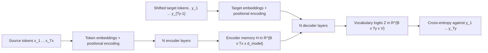
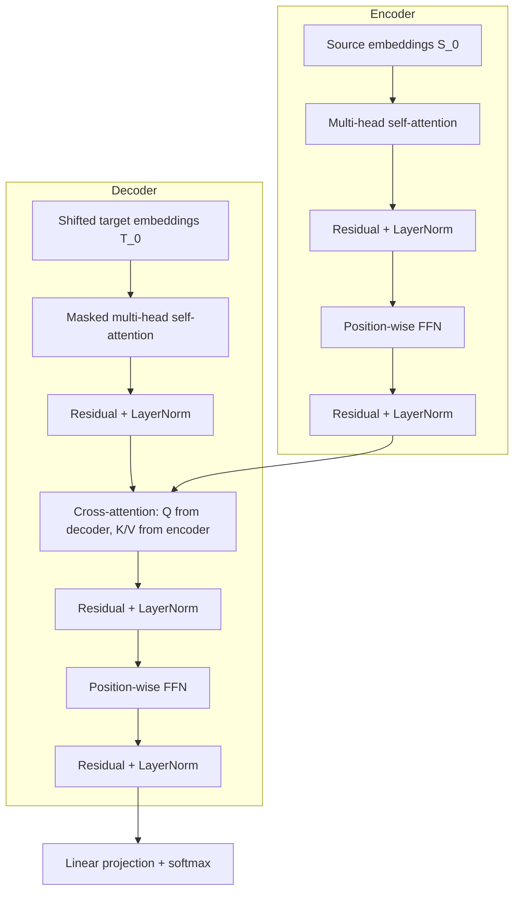
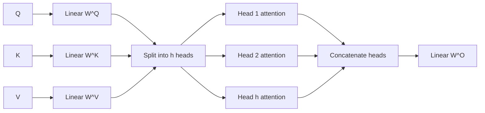
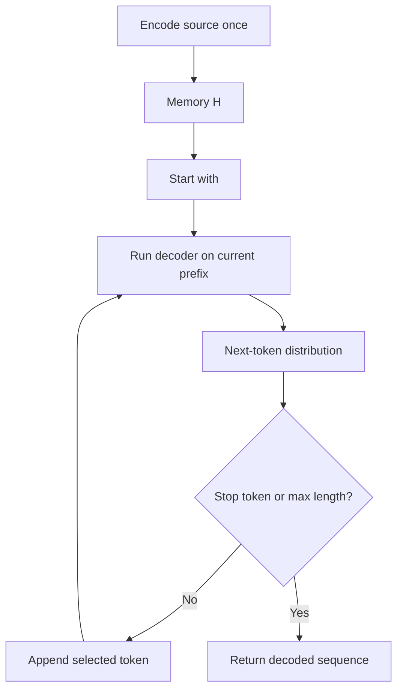
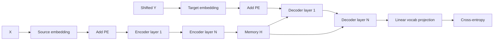

# Encoder-Decoder Transformer Architecture

The encoder-decoder Transformer is a sequence-to-sequence architecture for learning a conditional distribution

$$
p_\theta(y_{1:T_y}\mid x_{1:T_x}),
$$

where $x_{1:T_x}$ is a source sequence and $y_{1:T_y}$ is a target sequence. The original Transformer replaced recurrence and convolution with attention, while preserving the encoder-decoder decomposition that was already common in neural machine translation.

The central idea is:

- the **encoder** converts every source token into a contextual memory vector;
- the **decoder** generates target tokens autoregressively;
- **cross-attention** lets each decoder position query the encoder memory.

This chapter focuses on the original encoder-decoder Transformer and its modern implementation details, not on encoder-only or decoder-only variants.



## 1. Problem Setup

Let the source sequence be

$$
x_{1:T_x}=(x_1,\dots,x_{T_x}),
\qquad
x_i\in\{1,\dots,V_x\},
$$

and let the target sequence be

$$
y_{1:T_y}=(y_1,\dots,y_{T_y}),
\qquad
y_t\in\{1,\dots,V_y\}.
$$

The model factorizes the conditional distribution autoregressively:

$$
p_\theta(y_{1:T_y}\mid x_{1:T_x})
=
\prod_{t=1}^{T_y}
p_\theta(y_t\mid y_{<t},x_{1:T_x}).
$$

This factorization is not optional for left-to-right generation. At inference time, $y_t$ is unknown until sampled or selected, so the model may condition only on earlier target tokens and the source sequence.

For a mini-batch:

$$
X\in\mathbb{N}^{B\times T_x},
\qquad
Y\in\mathbb{N}^{B\times T_y},
$$

where $B$ is batch size. The common row-major tensor convention in PyTorch with `batch_first=True` is:

$$
\text{hidden states}\in\mathbb{R}^{B\times T\times d_{\text{model}}}.
$$

The original Transformer used $d_{\text{model}}=512$, $h=8$ attention heads, $d_k=d_v=64$, $d_{\text{ff}}=2048$, $N=6$ encoder layers, and $N=6$ decoder layers.

## 2. High-Level Execution

The forward pass during training is:

1. Tokenize and pad source and target sequences.
2. Build masks:
   - source padding mask;
   - target padding mask;
   - target causal mask.
3. Embed source tokens and add positional encodings.
4. Pass source states through the encoder stack to produce memory $H$.
5. Shift target tokens right. The decoder input is usually

   $$
   \tilde{Y}=(\texttt{<bos>},y_1,\dots,y_{T_y-1}).
   $$

6. Embed shifted target tokens and add positional encodings.
7. Pass target states through the decoder stack:
   - masked target self-attention;
   - cross-attention over encoder memory;
   - position-wise feed-forward network.
8. Project decoder states to vocabulary logits.
9. Compute token-level cross-entropy against the unshifted target $Y$.



## 3. Embeddings and Positional Encoding

### 3.1 Token Embeddings

The input token id $x_i$ is represented by selecting a row from an embedding matrix:

$$
E_x\in\mathbb{R}^{V_x\times d_{\text{model}}},
\qquad
e_i=E_x[x_i]\in\mathbb{R}^{d_{\text{model}}}.
$$

For a batch:

$$
E_x[X]\in\mathbb{R}^{B\times T_x\times d_{\text{model}}}.
$$

Many implementations scale embeddings before adding positions:

$$
s_i=\sqrt{d_{\text{model}}}\,E_x[x_i]+p_i.
$$

The scaling keeps the learned embedding magnitude comparable to positional encodings at initialization.

### 3.2 Sinusoidal Positional Encoding

Self-attention without positional information is permutation equivariant. If the model sees only a set of token embeddings, it cannot distinguish "dog bites man" from "man bites dog" except through token identity and learned distributional artifacts.

The original Transformer used deterministic sinusoidal encodings:

$$
PE_{(pos,2i)}
=
\sin\left(
\frac{pos}{10000^{2i/d_{\text{model}}}}
\right),
$$

$$
PE_{(pos,2i+1)}
=
\cos\left(
\frac{pos}{10000^{2i/d_{\text{model}}}}
\right),
$$

where:

- $pos$ is the integer position;
- $i$ indexes a pair of embedding dimensions;
- low dimensions vary quickly and high dimensions vary slowly.

The model receives:

$$
S_0 = \operatorname{Dropout}\left(\sqrt{d_{\text{model}}}\operatorname{Embed}(X)+PE_{1:T_x}\right).
$$

Intuition: every position is encoded as a vector of waves at different frequencies. A relative offset can be represented by linear combinations because sine and cosine obey angle addition identities:

$$
\sin(a+b)=\sin(a)\cos(b)+\cos(a)\sin(b),
$$

$$
\cos(a+b)=\cos(a)\cos(b)-\sin(a)\sin(b).
$$

This makes relative-position information accessible to linear projections.

### 3.3 Worked Positional Encoding Example

Let $d_{\text{model}}=4$ and $pos=3$. For $i=0$:

$$
10000^{2i/d_{\text{model}}}=10000^0=1.
$$

Thus:

$$
PE_{(3,0)}=\sin(3)\approx 0.1411,
\qquad
PE_{(3,1)}=\cos(3)\approx -0.9900.
$$

For $i=1$:

$$
10000^{2/d_{\text{model}}}=10000^{1/2}=100.
$$

Thus:

$$
PE_{(3,2)}=\sin(0.03)\approx 0.0300,
\qquad
PE_{(3,3)}=\cos(0.03)\approx 0.9996.
$$

The complete vector is approximately:

$$
PE_3\approx [0.1411,-0.9900,0.0300,0.9996].
$$

## 4. Scaled Dot-Product Attention

Attention maps a set of queries, keys, and values to weighted sums of values.

For one head:

$$
Q\in\mathbb{R}^{B\times T_q\times d_k},
\qquad
K\in\mathbb{R}^{B\times T_k\times d_k},
\qquad
V\in\mathbb{R}^{B\times T_k\times d_v}.
$$

The attention logits are:

$$
A
=
\frac{QK^\top}{\sqrt{d_k}},
$$

where the transpose is applied over the sequence and feature axes inside each batch:

$$
A\in\mathbb{R}^{B\times T_q\times T_k}.
$$

With an additive mask $M$:

$$
\tilde{A}_{b,t,j}=A_{b,t,j}+M_{b,t,j},
$$

where valid positions use $0$ and disallowed positions use a large negative value such as $-\infty$.

The attention weights are:

$$
P_{b,t,j}
=
\frac{\exp(\tilde{A}_{b,t,j})}
{\sum_{\ell=1}^{T_k}\exp(\tilde{A}_{b,t,\ell})}.
$$

The output is:

$$
O=PV,
\qquad
O\in\mathbb{R}^{B\times T_q\times d_v}.
$$

### 4.1 Why Divide by $\sqrt{d_k}$?

Assume the query and key components are independent random variables with:

$$
\mathbb{E}[q_r]=0,
\qquad
\mathbb{E}[k_r]=0,
\qquad
\operatorname{Var}(q_r)=1,
\qquad
\operatorname{Var}(k_r)=1.
$$

The unscaled dot product is:

$$
q^\top k
=
\sum_{r=1}^{d_k}q_rk_r.
$$

Since the terms are independent and have mean zero:

$$
\operatorname{Var}(q^\top k)
=
\sum_{r=1}^{d_k}\operatorname{Var}(q_rk_r).
$$

Also:

$$
\operatorname{Var}(q_rk_r)
=
\mathbb{E}[q_r^2k_r^2]-\mathbb{E}[q_rk_r]^2
=
\mathbb{E}[q_r^2]\mathbb{E}[k_r^2]
=
1.
$$

Therefore:

$$
\operatorname{Var}(q^\top k)=d_k.
$$

Dividing by $\sqrt{d_k}$ gives:

$$
\operatorname{Var}\left(\frac{q^\top k}{\sqrt{d_k}}\right)=1.
$$

Without this scaling, logits grow with $d_k$, softmax saturates, attention becomes nearly one-hot early in training, and gradients through the softmax become small.

### 4.2 Softmax Jacobian and Saturation

For a vector $z\in\mathbb{R}^n$:

$$
\sigma_i(z)=\frac{e^{z_i}}{\sum_j e^{z_j}}.
$$

The derivative is:

$$
\frac{\partial \sigma_i}{\partial z_j}
=
\sigma_i(\delta_{ij}-\sigma_j).
$$

If one probability is close to $1$ and the rest are close to $0$, most entries of the Jacobian are close to $0$. Scaled attention is partly a variance-control mechanism for keeping softmax in a useful regime.

### 4.3 Worked Attention Example

Let:

$$
q=[1,0],
\qquad
k_1=[1,0],
\qquad
k_2=[0,1],
\qquad
k_3=[1,1],
$$

and:

$$
v_1=[10,0],
\qquad
v_2=[0,10],
\qquad
v_3=[5,5].
$$

With $d_k=2$, logits are:

$$
\frac{q^\top k_1}{\sqrt{2}}=\frac{1}{\sqrt{2}}\approx0.7071,
$$

$$
\frac{q^\top k_2}{\sqrt{2}}=0,
\qquad
\frac{q^\top k_3}{\sqrt{2}}=\frac{1}{\sqrt{2}}\approx0.7071.
$$

The softmax denominator is:

$$
e^{0.7071}+e^0+e^{0.7071}
\approx
2.028+1+2.028
=
5.056.
$$

Weights:

$$
p\approx[0.401,0.198,0.401].
$$

Output:

$$
o
=
0.401[10,0]+0.198[0,10]+0.401[5,5]
\approx
[6.015,3.985].
$$

The query retrieves a mixture of values, biased toward keys aligned with $q$.

## 5. Multi-Head Attention

One attention head computes one similarity space. Multi-head attention learns several projections of the same hidden states:

$$
\operatorname{head}_r
=
\operatorname{Attention}(QW_r^Q,KW_r^K,VW_r^V),
$$

where:

$$
W_r^Q\in\mathbb{R}^{d_{\text{model}}\times d_k},
\qquad
W_r^K\in\mathbb{R}^{d_{\text{model}}\times d_k},
\qquad
W_r^V\in\mathbb{R}^{d_{\text{model}}\times d_v}.
$$

The heads are concatenated and projected:

$$
\operatorname{MHA}(Q,K,V)
=
\operatorname{Concat}(\operatorname{head}_1,\dots,\operatorname{head}_h)W^O,
$$

with:

$$
W^O\in\mathbb{R}^{hd_v\times d_{\text{model}}}.
$$

Usually:

$$
d_k=d_v=\frac{d_{\text{model}}}{h}.
$$

The total parameter count for the four dense projections is approximately:

$$
4d_{\text{model}}^2,
$$

ignoring biases, because the query, key, value, and output projections each map $d_{\text{model}}$ to $d_{\text{model}}$ when all heads are packed together.



## 6. Encoder Layer

An encoder layer maps:

$$
S^{(\ell-1)}\in\mathbb{R}^{B\times T_x\times d_{\text{model}}}
\quad\mapsto\quad
S^{(\ell)}\in\mathbb{R}^{B\times T_x\times d_{\text{model}}}.
$$

In the original post-norm form:

$$
U^{(\ell)}
=
\operatorname{LayerNorm}
\left(
S^{(\ell-1)}
+
\operatorname{Dropout}
\left(
\operatorname{MHA}
\left(
S^{(\ell-1)},S^{(\ell-1)},S^{(\ell-1)}
\right)
\right)
\right),
$$

$$
S^{(\ell)}
=
\operatorname{LayerNorm}
\left(
U^{(\ell)}
+
\operatorname{Dropout}
\left(
\operatorname{FFN}(U^{(\ell)})
\right)
\right).
$$

Modern large models often use pre-norm:

$$
U^{(\ell)}
=
S^{(\ell-1)}
+
\operatorname{MHA}
\left(
\operatorname{LayerNorm}(S^{(\ell-1)}),
\operatorname{LayerNorm}(S^{(\ell-1)}),
\operatorname{LayerNorm}(S^{(\ell-1)})
\right),
$$

$$
S^{(\ell)}
=
U^{(\ell)}
+
\operatorname{FFN}
\left(
\operatorname{LayerNorm}(U^{(\ell)})
\right).
$$

Pre-norm usually improves optimization stability for deeper networks because the residual path provides a cleaner gradient route.

### 6.1 Position-Wise Feed-Forward Network

The feed-forward block is applied independently to every token position:

$$
\operatorname{FFN}(z)
=
W_2\phi(W_1z+b_1)+b_2,
$$

where:

$$
W_1\in\mathbb{R}^{d_{\text{ff}}\times d_{\text{model}}},
\qquad
W_2\in\mathbb{R}^{d_{\text{model}}\times d_{\text{ff}}}.
$$

In batch form:

$$
Z\in\mathbb{R}^{B\times T\times d_{\text{model}}}
\quad\Rightarrow\quad
\operatorname{FFN}(Z)\in\mathbb{R}^{B\times T\times d_{\text{model}}}.
$$

There is no communication across token positions inside the FFN. Communication happens in attention; nonlinear channel mixing happens in the FFN.

### 6.2 Layer Normalization

For a hidden vector $z\in\mathbb{R}^{d_{\text{model}}}$ at one batch item and one token position:

$$
\mu
=
\frac{1}{d_{\text{model}}}
\sum_{j=1}^{d_{\text{model}}}z_j,
$$

$$
\sigma^2
=
\frac{1}{d_{\text{model}}}
\sum_{j=1}^{d_{\text{model}}}(z_j-\mu)^2,
$$

$$
\operatorname{LayerNorm}(z)_j
=
\gamma_j
\frac{z_j-\mu}{\sqrt{\sigma^2+\epsilon}}
+
\beta_j.
$$

LayerNorm normalizes across features, not across batch examples. This is important for variable-length sequences and autoregressive decoding, where batch statistics would be awkward and potentially leak information.

## 7. Decoder Layer

A decoder layer maps:

$$
T^{(\ell-1)}\in\mathbb{R}^{B\times T_y\times d_{\text{model}}}
\quad\mapsto\quad
T^{(\ell)}\in\mathbb{R}^{B\times T_y\times d_{\text{model}}},
$$

conditioned on encoder memory:

$$
H=S^{(N)}\in\mathbb{R}^{B\times T_x\times d_{\text{model}}}.
$$

In post-norm form:

$$
A^{(\ell)}
=
\operatorname{LayerNorm}
\left(
T^{(\ell-1)}
+
\operatorname{MHA}_{\text{masked}}
\left(
T^{(\ell-1)},T^{(\ell-1)},T^{(\ell-1)}
\right)
\right),
$$

$$
C^{(\ell)}
=
\operatorname{LayerNorm}
\left(
A^{(\ell)}
+
\operatorname{MHA}_{\text{cross}}
\left(
A^{(\ell)},H,H
\right)
\right),
$$

$$
T^{(\ell)}
=
\operatorname{LayerNorm}
\left(
C^{(\ell)}
+
\operatorname{FFN}(C^{(\ell)})
\right).
$$

The three sublayers have distinct roles:

- masked self-attention lets target positions use previous generated tokens;
- cross-attention lets target positions retrieve source-side information;
- the FFN applies nonlinear feature transformations independently at each target position.

### 7.1 Causal Mask

For target self-attention, position $t$ must not attend to positions $j>t$. The causal mask is:

$$
M_{t,j}
=
\begin{cases}
0, & j\leq t,\\
-\infty, & j>t.
\end{cases}
$$

For $T_y=5$:

$$
M=
\begin{bmatrix}
0 & -\infty & -\infty & -\infty & -\infty\\
0 & 0 & -\infty & -\infty & -\infty\\
0 & 0 & 0 & -\infty & -\infty\\
0 & 0 & 0 & 0 & -\infty\\
0 & 0 & 0 & 0 & 0
\end{bmatrix}.
$$

After adding this mask, the softmax assigns exactly zero probability to future positions in exact arithmetic.

### 7.2 Padding Masks

Padding tokens are artificial sequence fillers. They should not be attended to as keys. For a source mask:

$$
P_{b,j}
=
\begin{cases}
0, & X_{b,j}\neq \texttt{<pad>},\\
-\infty, & X_{b,j}= \texttt{<pad>}.
\end{cases}
$$

This mask is broadcast across query positions:

$$
\tilde{A}_{b,t,j}=A_{b,t,j}+P_{b,j}.
$$

For target self-attention, the effective mask is the sum of the padding mask and the causal mask.

## 8. Output Projection and Loss

The final decoder hidden state is:

$$
T^{(N)}\in\mathbb{R}^{B\times T_y\times d_{\text{model}}}.
$$

Vocabulary logits are computed by:

$$
Z=T^{(N)}W_{\text{vocab}}+b_{\text{vocab}},
$$

where:

$$
W_{\text{vocab}}\in\mathbb{R}^{d_{\text{model}}\times V_y},
\qquad
b_{\text{vocab}}\in\mathbb{R}^{V_y}.
$$

The probability of token $v$ at position $t$ is:

$$
p_\theta(y_t=v\mid y_{<t},x)
=
\frac{\exp(Z_{t,v})}{\sum_{u=1}^{V_y}\exp(Z_{t,u})}.
$$

The negative log-likelihood for one example is:

$$
\mathcal{L}(\theta)
=
-
\sum_{t=1}^{T_y}
\log p_\theta(y_t\mid y_{<t},x).
$$

For a padded batch, use an indicator $m_{b,t}$ that is $1$ for real target tokens and $0$ for padding:

$$
\mathcal{L}(\theta)
=
-
\frac{
\sum_{b=1}^{B}\sum_{t=1}^{T_y}
m_{b,t}\log p_\theta(y_{b,t}\mid y_{b,<t},x_b)
}{
\sum_{b=1}^{B}\sum_{t=1}^{T_y}m_{b,t}
}.
$$

### 8.1 Teacher Forcing

During training, the decoder receives the true previous token:

$$
\tilde{y}_t=y_{t-1}.
$$

During inference, the decoder receives its own previous prediction:

$$
\tilde{y}_t=\hat{y}_{t-1}.
$$

This mismatch is called exposure bias. It is one reason generation quality depends strongly on decoding strategy, data quality, and sequence-level evaluation.

## 9. Inference

Inference computes:

$$
\hat{y}_t
=
\arg\max_v p_\theta(v\mid \hat{y}_{<t},x)
$$

for greedy decoding, or maintains multiple candidate prefixes for beam search.



### 9.1 Greedy Decoding

Greedy decoding is:

$$
\hat{y}_t
=
\operatorname*{arg\,max}_{v}Z_{t,v}.
$$

It is fast but locally optimal. A token that looks best at step $t$ can make all later completions worse.

### 9.2 Beam Search

Beam search keeps the top $K$ partial hypotheses. The score of a hypothesis $y_{1:t}$ is:

$$
s(y_{1:t})
=
\sum_{\tau=1}^{t}\log p_\theta(y_\tau\mid y_{<\tau},x).
$$

Because raw log-probability favors shorter sequences, a length penalty is often used:

$$
s_{\text{norm}}(y_{1:t})
=
\frac{s(y_{1:t})}{\left(\frac{5+t}{6}\right)^\alpha}.
$$

Beam search is common in translation and summarization, but it can produce dull outputs in open-ended generation if the model distribution is miscalibrated or the beam is too wide.

## 10. Computational Graph

The encoder-decoder Transformer is a differentiable composition:



Backpropagation flows through:

- target embedding and decoder self-attention from the language-modeling part of the loss;
- cross-attention into encoder memory;
- encoder self-attention and source embeddings;
- output projection and tied embeddings if weight tying is used.

## 11. Python From Scratch with NumPy

The following implementation is intentionally small. It implements inference-style forward components, not a training framework with automatic differentiation.

```python
import math
import numpy as np


def softmax(x, axis=-1):
    """Numerically stable softmax."""
    x_max = np.max(x, axis=axis, keepdims=True)
    exp_x = np.exp(x - x_max)
    return exp_x / np.sum(exp_x, axis=axis, keepdims=True)


def sinusoidal_positional_encoding(max_len, d_model):
    pe = np.zeros((max_len, d_model), dtype=np.float32)
    positions = np.arange(max_len, dtype=np.float32)[:, None]
    dims = np.arange(0, d_model, 2, dtype=np.float32)[None, :]
    div = np.power(10000.0, dims / d_model)
    pe[:, 0::2] = np.sin(positions / div)
    pe[:, 1::2] = np.cos(positions / div)
    return pe


def layer_norm(x, gamma, beta, eps=1e-5):
    mean = np.mean(x, axis=-1, keepdims=True)
    var = np.mean((x - mean) ** 2, axis=-1, keepdims=True)
    return gamma * (x - mean) / np.sqrt(var + eps) + beta


def attention(q, k, v, mask=None):
    """Scaled dot-product attention.

    q: (B, H, Tq, D)
    k: (B, H, Tk, D)
    v: (B, H, Tk, Dv)
    mask: broadcastable to (B, H, Tq, Tk), with 0 for valid and -inf for invalid.
    """
    d_k = q.shape[-1]
    scores = np.matmul(q, np.swapaxes(k, -1, -2)) / math.sqrt(d_k)
    if mask is not None:
        scores = scores + mask
    weights = softmax(scores, axis=-1)
    return np.matmul(weights, v), weights


class Linear:
    def __init__(self, in_dim, out_dim, rng):
        limit = math.sqrt(6.0 / (in_dim + out_dim))
        self.w = rng.uniform(-limit, limit, size=(in_dim, out_dim)).astype(np.float32)
        self.b = np.zeros((out_dim,), dtype=np.float32)

    def __call__(self, x):
        return x @ self.w + self.b


class MultiHeadAttention:
    def __init__(self, d_model, num_heads, rng):
        assert d_model % num_heads == 0
        self.d_model = d_model
        self.num_heads = num_heads
        self.d_head = d_model // num_heads
        self.q_proj = Linear(d_model, d_model, rng)
        self.k_proj = Linear(d_model, d_model, rng)
        self.v_proj = Linear(d_model, d_model, rng)
        self.o_proj = Linear(d_model, d_model, rng)

    def split_heads(self, x):
        b, t, d = x.shape
        x = x.reshape(b, t, self.num_heads, self.d_head)
        return np.transpose(x, (0, 2, 1, 3))

    def merge_heads(self, x):
        b, h, t, d = x.shape
        x = np.transpose(x, (0, 2, 1, 3))
        return x.reshape(b, t, h * d)

    def __call__(self, q, k, v, mask=None):
        qh = self.split_heads(self.q_proj(q))
        kh = self.split_heads(self.k_proj(k))
        vh = self.split_heads(self.v_proj(v))
        out, weights = attention(qh, kh, vh, mask=mask)
        out = self.merge_heads(out)
        return self.o_proj(out), weights


class FeedForward:
    def __init__(self, d_model, d_ff, rng):
        self.fc1 = Linear(d_model, d_ff, rng)
        self.fc2 = Linear(d_ff, d_model, rng)

    def __call__(self, x):
        return self.fc2(np.maximum(self.fc1(x), 0.0))


class EncoderLayer:
    def __init__(self, d_model, num_heads, d_ff, rng):
        self.self_attn = MultiHeadAttention(d_model, num_heads, rng)
        self.ffn = FeedForward(d_model, d_ff, rng)
        self.g1 = np.ones((d_model,), dtype=np.float32)
        self.b1 = np.zeros((d_model,), dtype=np.float32)
        self.g2 = np.ones((d_model,), dtype=np.float32)
        self.b2 = np.zeros((d_model,), dtype=np.float32)

    def __call__(self, x, src_mask=None):
        # Pre-norm form.
        z = layer_norm(x, self.g1, self.b1)
        attn_out, _ = self.self_attn(z, z, z, mask=src_mask)
        x = x + attn_out
        z = layer_norm(x, self.g2, self.b2)
        x = x + self.ffn(z)
        return x


class DecoderLayer:
    def __init__(self, d_model, num_heads, d_ff, rng):
        self.self_attn = MultiHeadAttention(d_model, num_heads, rng)
        self.cross_attn = MultiHeadAttention(d_model, num_heads, rng)
        self.ffn = FeedForward(d_model, d_ff, rng)
        self.g1 = np.ones((d_model,), dtype=np.float32)
        self.b1 = np.zeros((d_model,), dtype=np.float32)
        self.g2 = np.ones((d_model,), dtype=np.float32)
        self.b2 = np.zeros((d_model,), dtype=np.float32)
        self.g3 = np.ones((d_model,), dtype=np.float32)
        self.b3 = np.zeros((d_model,), dtype=np.float32)

    def __call__(self, x, memory, tgt_mask=None, memory_mask=None):
        z = layer_norm(x, self.g1, self.b1)
        self_out, _ = self.self_attn(z, z, z, mask=tgt_mask)
        x = x + self_out

        z = layer_norm(x, self.g2, self.b2)
        cross_out, _ = self.cross_attn(z, memory, memory, mask=memory_mask)
        x = x + cross_out

        z = layer_norm(x, self.g3, self.b3)
        x = x + self.ffn(z)
        return x


def make_padding_mask(token_ids, pad_id):
    # Returns shape (B, 1, 1, T), broadcastable over heads and query positions.
    invalid = (token_ids == pad_id)[:, None, None, :]
    return np.where(invalid, -1e9, 0.0).astype(np.float32)


def make_causal_mask(length):
    # Shape (1, 1, T, T).
    upper = np.triu(np.ones((length, length), dtype=bool), k=1)
    return np.where(upper[None, None, :, :], -1e9, 0.0).astype(np.float32)


class TinyTransformer:
    def __init__(
        self,
        src_vocab,
        tgt_vocab,
        d_model=32,
        num_heads=4,
        d_ff=64,
        num_layers=2,
        max_len=128,
        pad_id=0,
        seed=0,
    ):
        rng = np.random.default_rng(seed)
        self.pad_id = pad_id
        self.d_model = d_model
        self.src_embed = rng.normal(0.0, 0.02, size=(src_vocab, d_model)).astype(np.float32)
        self.tgt_embed = rng.normal(0.0, 0.02, size=(tgt_vocab, d_model)).astype(np.float32)
        self.pe = sinusoidal_positional_encoding(max_len, d_model)
        self.encoder = [
            EncoderLayer(d_model, num_heads, d_ff, rng)
            for _ in range(num_layers)
        ]
        self.decoder = [
            DecoderLayer(d_model, num_heads, d_ff, rng)
            for _ in range(num_layers)
        ]
        self.out = Linear(d_model, tgt_vocab, rng)

    def encode(self, src_ids):
        b, tx = src_ids.shape
        x = self.src_embed[src_ids] * math.sqrt(self.d_model)
        x = x + self.pe[:tx][None, :, :]
        src_mask = make_padding_mask(src_ids, self.pad_id)
        for layer in self.encoder:
            x = layer(x, src_mask=src_mask)
        return x, src_mask

    def decode(self, tgt_in_ids, memory, src_mask):
        b, ty = tgt_in_ids.shape
        x = self.tgt_embed[tgt_in_ids] * math.sqrt(self.d_model)
        x = x + self.pe[:ty][None, :, :]
        tgt_pad = make_padding_mask(tgt_in_ids, self.pad_id)
        tgt_mask = tgt_pad + make_causal_mask(ty)
        for layer in self.decoder:
            x = layer(x, memory, tgt_mask=tgt_mask, memory_mask=src_mask)
        return x

    def __call__(self, src_ids, tgt_in_ids):
        memory, src_mask = self.encode(src_ids)
        dec = self.decode(tgt_in_ids, memory, src_mask)
        return self.out(dec)


if __name__ == "__main__":
    model = TinyTransformer(src_vocab=20, tgt_vocab=30)
    src = np.array([[4, 5, 6, 0, 0]], dtype=np.int64)
    tgt_in = np.array([[1, 7, 8, 9]], dtype=np.int64)
    logits = model(src, tgt_in)
    print(logits.shape)  # (1, 4, 30)
```

### 11.1 Cross-Entropy from Logits

Library cross-entropy functions usually combine `log_softmax` and negative log-likelihood. This is more stable than computing softmax first.

```python
def cross_entropy_from_logits(logits, target_ids, pad_id=0):
    """Mean CE over non-pad targets.

    logits: (B, T, V)
    target_ids: (B, T)
    """
    max_logits = np.max(logits, axis=-1, keepdims=True)
    log_probs = logits - max_logits - np.log(
        np.sum(np.exp(logits - max_logits), axis=-1, keepdims=True)
    )
    token_logp = np.take_along_axis(
        log_probs,
        target_ids[..., None],
        axis=-1,
    )[..., 0]
    mask = (target_ids != pad_id).astype(np.float32)
    return -np.sum(mask * token_logp) / np.maximum(np.sum(mask), 1.0)
```

## 12. PyTorch Implementation

PyTorch provides `nn.Transformer`, `nn.TransformerEncoder`, `nn.TransformerDecoder`, and `nn.MultiheadAttention`. The high-level `nn.Transformer` implements the original encoder-decoder structure, but it does not include token embeddings, positional encodings, or the final vocabulary projection.

```python
import math
import torch
import torch.nn as nn


class PositionalEncoding(nn.Module):
    def __init__(self, d_model, max_len=5000, dropout=0.1):
        super().__init__()
        self.dropout = nn.Dropout(dropout)

        pe = torch.zeros(max_len, d_model)
        position = torch.arange(max_len, dtype=torch.float32).unsqueeze(1)
        div_term = torch.exp(
            torch.arange(0, d_model, 2, dtype=torch.float32)
            * (-math.log(10000.0) / d_model)
        )
        pe[:, 0::2] = torch.sin(position * div_term)
        pe[:, 1::2] = torch.cos(position * div_term)
        self.register_buffer("pe", pe.unsqueeze(0))

    def forward(self, x):
        # x: (B, T, D)
        x = x + self.pe[:, : x.size(1)]
        return self.dropout(x)


class Seq2SeqTransformer(nn.Module):
    def __init__(
        self,
        src_vocab_size,
        tgt_vocab_size,
        pad_id,
        d_model=512,
        nhead=8,
        num_encoder_layers=6,
        num_decoder_layers=6,
        dim_feedforward=2048,
        dropout=0.1,
    ):
        super().__init__()
        self.pad_id = pad_id
        self.d_model = d_model
        self.src_embed = nn.Embedding(src_vocab_size, d_model, padding_idx=pad_id)
        self.tgt_embed = nn.Embedding(tgt_vocab_size, d_model, padding_idx=pad_id)
        self.pos = PositionalEncoding(d_model, dropout=dropout)
        self.transformer = nn.Transformer(
            d_model=d_model,
            nhead=nhead,
            num_encoder_layers=num_encoder_layers,
            num_decoder_layers=num_decoder_layers,
            dim_feedforward=dim_feedforward,
            dropout=dropout,
            batch_first=True,
            norm_first=True,
        )
        self.generator = nn.Linear(d_model, tgt_vocab_size)

    def make_masks(self, src, tgt_in):
        src_key_padding_mask = src.eq(self.pad_id)
        tgt_key_padding_mask = tgt_in.eq(self.pad_id)
        tgt_len = tgt_in.size(1)
        tgt_mask = nn.Transformer.generate_square_subsequent_mask(
            tgt_len,
            device=tgt_in.device,
        )
        return src_key_padding_mask, tgt_key_padding_mask, tgt_mask

    def forward(self, src, tgt_in):
        src_key_padding_mask, tgt_key_padding_mask, tgt_mask = self.make_masks(src, tgt_in)

        src_emb = self.pos(self.src_embed(src) * math.sqrt(self.d_model))
        tgt_emb = self.pos(self.tgt_embed(tgt_in) * math.sqrt(self.d_model))

        out = self.transformer(
            src=src_emb,
            tgt=tgt_emb,
            tgt_mask=tgt_mask,
            src_key_padding_mask=src_key_padding_mask,
            tgt_key_padding_mask=tgt_key_padding_mask,
            memory_key_padding_mask=src_key_padding_mask,
        )
        return self.generator(out)


def training_step(model, src, tgt, optimizer, pad_id):
    # tgt: (<bos>, tokens..., <eos>) in each row after padding.
    tgt_in = tgt[:, :-1]
    tgt_out = tgt[:, 1:]

    logits = model(src, tgt_in)
    loss = nn.functional.cross_entropy(
        logits.reshape(-1, logits.size(-1)),
        tgt_out.reshape(-1),
        ignore_index=pad_id,
    )

    optimizer.zero_grad(set_to_none=True)
    loss.backward()
    torch.nn.utils.clip_grad_norm_(model.parameters(), max_norm=1.0)
    optimizer.step()
    return loss.item()
```

### 12.1 What `nn.MultiheadAttention` Does Internally

At a high level, `nn.MultiheadAttention` performs these steps:

1. Applies learned linear projections to input query, key, and value tensors.
2. Reshapes each projected tensor from:

   $$
   (B,T,d_{\text{model}})
   $$

   to:

   $$
   (B,h,T,d_{\text{head}}).
   $$

3. Computes scaled dot-product attention for each head.
4. Applies attention dropout during training if configured.
5. Concatenates heads back to:

   $$
   (B,T,d_{\text{model}}).
   $$

6. Applies the output projection.

Modern PyTorch dispatches to optimized scaled-dot-product attention kernels when shape, dtype, device, and mask conditions allow it. Conceptually, however, the operation remains:

$$
\operatorname{softmax}
\left(
\frac{QK^\top}{\sqrt{d_k}}+M
\right)V.
$$

### 12.2 Greedy Decoding in PyTorch

```python
@torch.no_grad()
def greedy_decode(model, src, bos_id, eos_id, max_len):
    model.eval()
    batch_size = src.size(0)
    generated = torch.full(
        (batch_size, 1),
        bos_id,
        dtype=torch.long,
        device=src.device,
    )

    for _ in range(max_len - 1):
        logits = model(src, generated)
        next_token = logits[:, -1, :].argmax(dim=-1, keepdim=True)
        generated = torch.cat([generated, next_token], dim=1)
        if torch.all(next_token.squeeze(1).eq(eos_id)):
            break

    return generated
```

This simple implementation recomputes the full decoder prefix at every step. Production decoders cache previous key/value projections for decoder self-attention, reducing per-step work.

## 13. Complexity

Let:

- $B$ be batch size;
- $T_x$ be source length;
- $T_y$ be target length;
- $d=d_{\text{model}}$;
- $h$ be number of heads;
- $d_{\text{ff}}$ be feed-forward width.

For one encoder layer:

$$
\text{self-attention time}
=
O(BT_x^2d + BT_xd^2),
$$

where $BT_x^2d$ comes from attention score/value products and $BT_xd^2$ comes from projections.

The FFN cost is:

$$
O(BT_xdd_{\text{ff}}).
$$

For one decoder layer:

$$
\text{masked self-attention time}
=
O(BT_y^2d + BT_yd^2),
$$

$$
\text{cross-attention time}
=
O(BT_yT_xd + B(T_x+T_y)d^2),
$$

$$
\text{FFN time}
=
O(BT_ydd_{\text{ff}}).
$$

Attention memory for weights is:

$$
O(BhT_qT_k).
$$

This quadratic sequence-length term is the main bottleneck for long-context encoder-decoder models.

## 14. Numerical Stability

### 14.1 Stable Softmax

Compute:

$$
\operatorname{softmax}(z)_i
=
\frac{\exp(z_i-c)}{\sum_j\exp(z_j-c)},
\qquad
c=\max_j z_j.
$$

Subtracting $c$ does not change the result because the same positive constant divides numerator and denominator, but it prevents overflow.

### 14.2 Mask Values

Using `-inf` is mathematically clean, but some fused kernels and half-precision paths prefer large finite negatives such as `-1e4` or `-1e9`. Pitfalls:

- if all keys for a query are masked, softmax produces `NaN`;
- in float16, very large negative constants may underflow to `-inf`;
- mask dtype and shape conventions differ across libraries.

### 14.3 Mixed Precision

Float16 and bfloat16 improve throughput but increase sensitivity to:

- softmax overflow or underflow;
- LayerNorm epsilon choices;
- loss scaling;
- very long sequence attention logits.

Modern frameworks often compute reductions such as softmax and LayerNorm in higher precision internally.

### 14.4 Residual Scaling and Normalization

Very deep Transformers are sensitive to residual stream magnitude. Common stabilizers include:

- pre-norm layers;
- gradient clipping;
- learning-rate warmup;
- careful initialization;
- dropout on attention weights and residual branches.

## 15. Edge Cases and Implementation Pitfalls

### 15.1 Off-by-One Target Shifting

Training input:

$$
(\texttt{<bos>},y_1,\dots,y_{T-1})
$$

Training target:

$$
(y_1,\dots,y_{T-1},\texttt{<eos>}).
$$

If the shift is wrong, the model may learn to copy the current token rather than predict the next token.

### 15.2 Missing Causal Mask

Without the causal mask, the decoder can see future target tokens during training. Training loss becomes misleadingly low, but inference fails because future tokens are unavailable.

### 15.3 Padding Leakage

If source padding is not masked in cross-attention, target positions can attend to pad embeddings. If target padding is not ignored in the loss, the model is optimized to predict pad tokens.

### 15.4 Shape Conventions

Common conventions:

- PyTorch legacy Transformer: $(T,B,D)$ by default;
- PyTorch with `batch_first=True`: $(B,T,D)$;
- attention kernels often use $(B,H,T,D_h)$ internally.

Most Transformer bugs are silent shape bugs: outputs have plausible dimensions but masks broadcast incorrectly.

### 15.5 Dropout During Evaluation

Call `model.eval()` before validation or decoding. Dropout in attention, FFN, or embeddings changes predictions if left active.

### 15.6 Weight Tying

Many language models tie the output projection matrix to the target embedding matrix:

$$
W_{\text{vocab}}=E_y^\top.
$$

This reduces parameters and can improve generalization, but requires equal embedding and output dimensions.

## 16. Limitations

The encoder-decoder Transformer has several structural costs:

- **Quadratic attention memory:** self-attention over length $T$ costs $O(T^2)$ attention weights per layer.
- **Autoregressive inference:** decoder training is parallel over target positions, but generation is sequential over output length.
- **Data hunger:** high-capacity sequence models require substantial data or pretraining.
- **Length extrapolation:** absolute positional encodings can generalize poorly far beyond trained lengths.
- **Exposure bias:** teacher-forced training differs from free-running inference.
- **Hallucination risk:** the decoder can generate fluent target text not supported by the source, especially in summarization and question answering.

## 17. Encoder-Only, Decoder-Only, and Encoder-Decoder Models

| Architecture | Attention pattern | Typical objective | Strong use cases | Example families |
| --- | --- | --- | --- | --- |
| Encoder-only | Bidirectional self-attention | masked-token or discriminative losses | classification, retrieval, tagging | BERT, RoBERTa |
| Decoder-only | Causal self-attention | next-token prediction | open-ended generation, chat, code | GPT-style models, LLaMA-style models |
| Encoder-decoder | source bidirectional, target causal, cross-attention | conditional generation | translation, summarization, text-to-text tasks | original Transformer, T5, BART |

The encoder-decoder form is especially natural when the input and output are both sequences but have different lengths, modalities, or vocabularies.

## 18. Connections to Related Concepts

### 18.1 Classical Seq2Seq and Additive Attention

Earlier neural machine translation systems encoded a source sentence with an RNN and decoded with another RNN. Additive attention improved the fixed-vector bottleneck by allowing the decoder to attend over all encoder states. The Transformer keeps the alignment idea but replaces recurrent state transitions with parallel self-attention.

### 18.2 Memory Retrieval View

In cross-attention:

$$
Q=T_{\text{decoder}}W^Q,
\qquad
K=HW^K,
\qquad
V=HW^V.
$$

The decoder query asks: "given my current target prefix state, which source positions are useful?" The keys define address vectors for source positions, and values provide retrieved content.

### 18.3 Graph Neural Network View

Self-attention can be interpreted as message passing on a complete directed graph over tokens:

$$
h_i'
=
\sum_j \alpha_{ij}W^Vh_j.
$$

Unlike a fixed graph, attention learns input-dependent edge weights $\alpha_{ij}$.

### 18.4 Conditional Language Modeling

The decoder is a language model conditioned on source memory:

$$
p_\theta(y_t\mid y_{<t},x)
$$

rather than an unconditional language model:

$$
p_\theta(y_t\mid y_{<t}).
$$

Cross-attention is the mechanism that injects the conditioning signal.

## 19. Complete Minimal Training Skeleton

This skeleton omits tokenization and dataset code, but shows the critical sequence shifting and masking structure.

```python
import torch
from torch.utils.data import DataLoader


def train_epoch(model, dataloader: DataLoader, optimizer, pad_id, device):
    model.train()
    total_loss = 0.0
    total_batches = 0

    for batch in dataloader:
        src = batch["src"].to(device)  # (B, Tx)
        tgt = batch["tgt"].to(device)  # (B, Ty), includes <bos> and <eos>

        tgt_in = tgt[:, :-1]
        tgt_out = tgt[:, 1:]

        logits = model(src, tgt_in)
        loss = torch.nn.functional.cross_entropy(
            logits.reshape(-1, logits.size(-1)),
            tgt_out.reshape(-1),
            ignore_index=pad_id,
        )

        optimizer.zero_grad(set_to_none=True)
        loss.backward()
        torch.nn.utils.clip_grad_norm_(model.parameters(), 1.0)
        optimizer.step()

        total_loss += loss.item()
        total_batches += 1

    return total_loss / max(total_batches, 1)
```

## 20. Worked Mini Forward Pass

Suppose:

$$
B=1,\quad T_x=3,\quad T_y=2,\quad d_{\text{model}}=4,\quad h=2.
$$

Then each head has:

$$
d_k=d_v=\frac{4}{2}=2.
$$

Source hidden states:

$$
S_0\in\mathbb{R}^{1\times3\times4}.
$$

After projection and splitting heads:

$$
Q,K,V\in\mathbb{R}^{1\times2\times3\times2}.
$$

Encoder self-attention scores per layer have shape:

$$
QK^\top\in\mathbb{R}^{1\times2\times3\times3}.
$$

After attention and merging heads:

$$
O\in\mathbb{R}^{1\times3\times4}.
$$

Decoder shifted target states:

$$
T_0\in\mathbb{R}^{1\times2\times4}.
$$

Masked target self-attention scores:

$$
\mathbb{R}^{1\times2\times2\times2}.
$$

Cross-attention uses decoder queries and encoder keys:

$$
Q_{\text{dec}}\in\mathbb{R}^{1\times2\times2\times2},
\qquad
K_{\text{enc}}\in\mathbb{R}^{1\times2\times3\times2}.
$$

Cross-attention scores:

$$
Q_{\text{dec}}K_{\text{enc}}^\top
\in
\mathbb{R}^{1\times2\times2\times3}.
$$

After output projection to a target vocabulary of size $V_y=10$:

$$
Z\in\mathbb{R}^{1\times2\times10}.
$$

This shape audit is a practical debugging tool: if masks or projections do not broadcast to these dimensions, the model is not implementing encoder-decoder attention correctly.

## 21. Summary

An encoder-decoder Transformer models conditional sequence generation by combining:

- bidirectional self-attention over the source;
- causal self-attention over the target prefix;
- cross-attention from target states to source memory;
- position-wise nonlinear feed-forward blocks;
- residual connections and LayerNorm;
- token-level maximum-likelihood training with teacher forcing.

The architecture is powerful because it separates source understanding from target generation while keeping both sides fully differentiable and highly parallel during training. Its main engineering challenge is that attention is memory-intensive and mask handling is easy to get subtly wrong.

## 22. References and Deeper Reading

- Vaswani et al., "Attention Is All You Need", 2017: https://arxiv.org/abs/1706.03762
- Rush, "The Annotated Transformer": https://nlp.seas.harvard.edu/annotated-transformer/
- PyTorch `torch.nn.Transformer` documentation: https://docs.pytorch.org/docs/stable/generated/torch.nn.Transformer.html
- Bahdanau, Cho, and Bengio, "Neural Machine Translation by Jointly Learning to Align and Translate", 2014: https://arxiv.org/abs/1409.0473
- Raffel et al., "Exploring the Limits of Transfer Learning with a Unified Text-to-Text Transformer", 2020: https://arxiv.org/abs/1910.10683
- Lewis et al., "BART: Denoising Sequence-to-Sequence Pre-training for Natural Language Generation, Translation, and Comprehension", 2020: https://arxiv.org/abs/1910.13461
- Ba, Kiros, and Hinton, "Layer Normalization", 2016: https://arxiv.org/abs/1607.06450
- Kingma and Ba, "Adam: A Method for Stochastic Optimization", 2014: https://arxiv.org/abs/1412.6980
