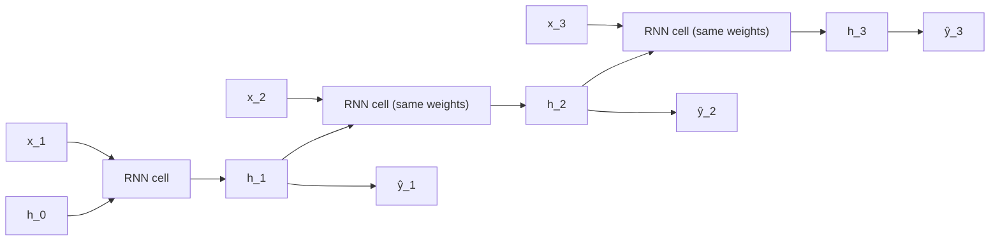
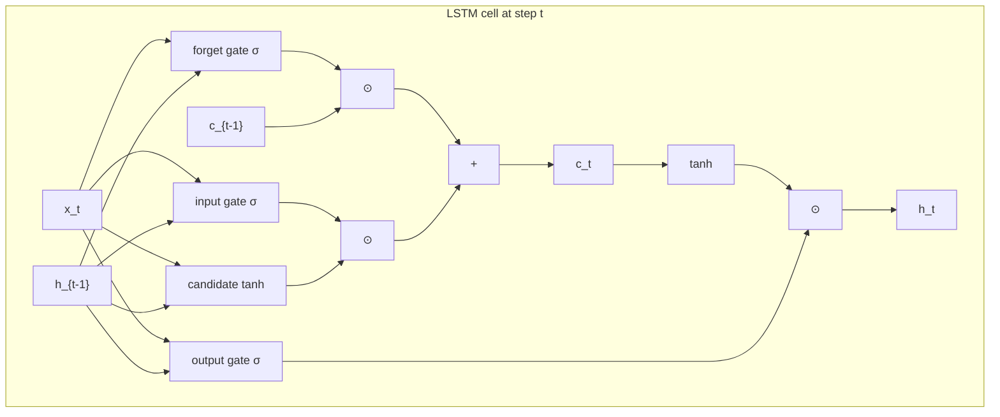
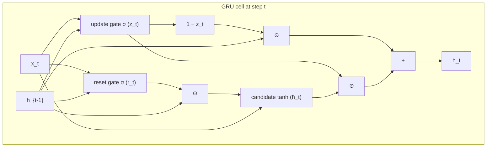

# **Sequence Models: RNN, LSTM, and GRU**

Feedforward networks and CNNs assume a fixed-size input and no ordering dependence across the batch dimension. Many problems — language modeling, time series forecasting, speech, DNA sequences, sensor streams — have variable-length inputs where **order and history matter**: the output at step $t$ depends on everything seen before $t$. Recurrent architectures solve this by carrying a **hidden state** forward through time, turning a sequence-to-sequence mapping into a repeated application of a single parametric cell.

This chapter covers the vanilla RNN, why it fails on long sequences, and the two gated architectures — LSTM and GRU — that fixed it and dominated sequence modeling until attention-only architectures (Chapter 037) took over.

---

## **1. Formal Setup**

An input sequence is

$$
x_1, x_2, \dots, x_T, \qquad x_t \in \mathbb{R}^{d_x}
$$

A recurrent model maintains a hidden state $h_t \in \mathbb{R}^{d_h}$ updated by a shared transition function $f_\theta$:

$$
h_t = f_\theta(h_{t-1}, x_t), \qquad h_0 = \mathbf{0} \text{ (or learned)}
$$

An output head reads $h_t$ (or a subset of steps) to produce predictions:

$$
\hat{y}_t = g_\phi(h_t)
$$

The crucial property is **parameter sharing across time**: the same $\theta$ is reused at every step, so the model can generalize to sequences longer than any seen during training and has a parameter count independent of $T$.

### **Three Sequence-to-Sequence Regimes**

| Regime                   | Input           | Output                                    | Example                                                  |
| ------------------------ | --------------- | ----------------------------------------- | -------------------------------------------------------- |
| Many-to-one              | $x_1,\dots,x_T$ | one$\hat y$ at step $T$                   | sentiment classification                                 |
| Many-to-many (aligned)   | $x_1,\dots,x_T$ | $\hat y_1,\dots,\hat y_T$                 | POS tagging, per-frame labeling                          |
| Many-to-many (unaligned) | $x_1,\dots,x_T$ | $\hat y_1,\dots,\hat y_{T'}$, $T' \neq T$ | machine translation (needs encoder–decoder, Chapter 037) |

---

## **2. Vanilla (Elman) RNN**

### **2.1 Forward Equations**

$$
a_t = W_{xh} x_t + W_{hh} h_{t-1} + b_h
$$

$$
h_t = \tanh(a_t)
$$

$$
\hat{y}_t = W_{hy} h_t + b_y
$$

with parameters

$$
W_{xh} \in \mathbb{R}^{d_h \times d_x}, \quad W_{hh} \in \mathbb{R}^{d_h \times d_h}, \quad W_{hy} \in \mathbb{R}^{d_y \times d_h}
$$

shared across all $t = 1,\dots,T$.



The diagram "unrolls" the recurrence into a deep feedforward computational graph with $T$ layers that all share weights — this is the view needed for backpropagation.

### **2.2 Loss and Backpropagation Through Time (BPTT)**

For many-to-many prediction with per-step loss $\mathcal{L}_t$ (e.g., cross-entropy of $\hat y_t$ against $y_t$):

$$
\mathcal{L} = \sum_{t=1}^{T} \mathcal{L}_t
$$

Gradients with respect to shared weights sum contributions from every time step. For $W_{hh}$:

$$
\frac{\partial \mathcal{L}}{\partial W_{hh}}
=
\sum_{t=1}^{T}
\frac{\partial \mathcal{L}_t}{\partial W_{hh}}
$$

Each term itself sums over all earlier steps because $h_t$ depends on $W_{hh}$ both directly (at step $t$) and indirectly through $h_{t-1}$:

$$
\frac{\partial \mathcal{L}_t}{\partial W_{hh}}
=
\sum_{k=1}^{t}
\frac{\partial \mathcal{L}_t}{\partial h_t}
\left(
\prod_{j=k+1}^{t}
\frac{\partial h_j}{\partial h_{j-1}}
\right)
\frac{\partial h_k}{\partial W_{hh}}
\bigg|_{\text{explicit at step } k}
$$

The Jacobian of one transition is

$$
\frac{\partial h_j}{\partial h_{j-1}}
=
\operatorname{diag}\left(1 - \tanh^2(a_j)\right) W_{hh}
$$

This is the term that makes RNNs hard to train, derived next.

### **2.3 The Vanishing / Exploding Gradient Problem — First-Principles Derivation**

Define the Jacobian product across a span of $t-k$ steps:

$$
\frac{\partial h_t}{\partial h_k}
=
\prod_{j=k+1}^{t}
\frac{\partial h_j}{\partial h_{j-1}}
=
\prod_{j=k+1}^{t}
D_j W_{hh},
\qquad
D_j = \operatorname{diag}\left(1-\tanh^2(a_j)\right)
$$

Take norms and use submultiplicativity:

$$
\left\| \frac{\partial h_t}{\partial h_k} \right\|
\le
\prod_{j=k+1}^{t}
\|D_j\| \, \|W_{hh}\|
$$

Since $\tanh' \in (0,1]$, $\|D_j\| \le 1$, so the bound is governed by $\|W_{hh}\|^{t-k}$ (its largest singular value, $\sigma_{\max}$):

$$
\left\| \frac{\partial h_t}{\partial h_k} \right\|
\lesssim
\sigma_{\max}(W_{hh})^{\,t-k}
$$

- If $\sigma_{\max}(W_{hh}) < 1$: the product **shrinks geometrically** in $t-k$ → **vanishing gradients**. Long-range dependencies get essentially zero gradient signal, so the model cannot learn them.
- If $\sigma_{\max}(W_{hh}) > 1$: the product **grows geometrically** → **exploding gradients**, causing numerical overflow and unstable updates.
- A narrow regime near $\sigma_{\max} \approx 1$ is required for stable long-range gradient flow, and even then, $\tanh$ saturation (where $D_j \to 0$ in saturated regions) tends to push effective norms toward $0$ over long spans. This is the theoretical result of Bengio et al. (1994) and Pascanu et al. (2013).

**Intuition:** every step multiplies the backpropagated error signal by roughly the same matrix. Repeated multiplication by anything other than an orthogonal/identity-like operator is an exponential map — exactly like computing $\lambda^n$ for eigenvalue $\lambda$. This is a generic property of iterated linear (or near-linear) maps, not a quirk of a particular weight initialization.

**Consequence:** vanilla RNNs can model dependencies over tens of steps in practice, but reliably fail beyond roughly 10–20 steps on tasks that actually require long-range memory, motivating gated architectures.

### **2.4 Worked BPTT Example (Scalar, 2 Steps)**

Let all quantities be scalars: $w = W_{hh} = 1.5$, $u = W_{xh} = 1.0$, $b_h = 0$, $h_0 = 0$.

Inputs: $x_1 = 1$, $x_2 = 1$.

**Forward:**

$$
a_1 = u x_1 + w h_0 = 1, \qquad h_1 = \tanh(1) = 0.7616
$$

$$
a_2 = u x_2 + w h_1 = 1 + 1.5(0.7616) = 2.1424, \qquad h_2 = \tanh(2.1424) = 0.9727
$$

Suppose the loss only depends on $h_2$: $\mathcal{L} = \tfrac12 (h_2 - y)^2$ with target $y=0$, so $\partial \mathcal{L}/\partial h_2 = h_2 = 0.9727$.

**Backward** (chain rule through the unrolled graph):

$$
\frac{\partial h_2}{\partial a_2} = 1 - h_2^2 = 1 - 0.9461 = 0.0539
$$

$$
\frac{\partial \mathcal{L}}{\partial a_2} = 0.9727 \times 0.0539 = 0.0524
$$

Gradient at $w$ from the **direct** path at step 2 ($a_2 = u x_2 + w h_1$):

$$
\frac{\partial a_2}{\partial w}\bigg|_{\text{direct}} = h_1 = 0.7616
\;\Rightarrow\;
\text{contribution} = 0.0524 \times 0.7616 = 0.0399
$$

Gradient flowing further back through $h_1$ (indirect path, $a_2 = \dots + w h_1$, and $h_1$ itself depends on $w$):

$$
\frac{\partial a_2}{\partial h_1} = w = 1.5
\;\Rightarrow\;
\frac{\partial \mathcal{L}}{\partial h_1} = 0.0524 \times 1.5 = 0.0786
$$

$$
\frac{\partial h_1}{\partial a_1} = 1 - h_1^2 = 1 - 0.5800 = 0.4200
\;\Rightarrow\;
\frac{\partial \mathcal{L}}{\partial a_1} = 0.0786 \times 0.4200 = 0.0330
$$

$$
\frac{\partial a_1}{\partial w}\bigg|_{\text{direct}} = h_0 = 0
\;\Rightarrow\;
\text{contribution} = 0
$$

$$
\frac{\partial \mathcal{L}}{\partial w} = 0.0399 + 0 = 0.0399
$$

Even in just two steps you can see the pattern: the gradient contribution from step 1 already vanished because $h_0=0$; with a nonzero $h_0$ (or more steps) each additional step multiplies in another factor of $(1-h^2)w$, which is $< 1$ here whenever $|h|$ is large (saturated tanh), illustrating the shrink/grow mechanism from §2.3 numerically.

---

## **3. Long Short-Term Memory (LSTM)**

### **3.1 Motivation**

The core fix (Hochreiter & Schmidhuber, 1997) is to introduce a **cell state** $c_t$ that is updated **additively** rather than through a repeated matrix multiplication + squashing nonlinearity. If the recurrence for $c_t$ is close to $c_t \approx c_{t-1} + (\text{something})$, then

$$
\frac{\partial c_t}{\partial c_{t-1}} \approx 1
$$

and gradients can flow across many steps without geometric decay. Three sigmoid **gates** ($\in [0,1]$, acting as soft binary switches) control what is written to, erased from, and read out of this cell state.

### **3.2 Gate Equations**

At each step $t$, given input $x_t$ and previous hidden/cell state $(h_{t-1}, c_{t-1})$:

$$
f_t = \sigma\left(W_f [h_{t-1}, x_t] + b_f\right) \qquad \text{(forget gate)}
$$

$$
i_t = \sigma\left(W_i [h_{t-1}, x_t] + b_i\right) \qquad \text{(input gate)}
$$

$$
o_t = \sigma\left(W_o [h_{t-1}, x_t] + b_o\right) \qquad \text{(output gate)}
$$

$$
\tilde{c}_t = \tanh\left(W_c [h_{t-1}, x_t] + b_c\right) \qquad \text{(candidate cell content)}
$$

$$
c_t = f_t \odot c_{t-1} + i_t \odot \tilde{c}_t \qquad \text{(cell state update)}
$$

$$
h_t = o_t \odot \tanh(c_t) \qquad \text{(hidden state / output)}
$$

where $[h_{t-1}, x_t]$ denotes concatenation, $\odot$ is elementwise (Hadamard) product, and $\sigma$ is the logistic sigmoid. Each gate has its own weight matrix $W_{\{f,i,o,c\}} \in \mathbb{R}^{d_h \times (d_h+d_x)}$ and bias $b_{\{f,i,o,c\}} \in \mathbb{R}^{d_h}$.

**Term-by-term meaning:**

- $f_t$: how much of the old memory $c_{t-1}$ to keep (near $1$) or erase (near $0$), per channel.
- $i_t$: how much of the new candidate $\tilde c_t$ to write in.
- $\tilde c_t$: what new information _could_ be written, computed with $\tanh$ so it's bounded in $[-1,1]$ and can add or subtract from the cell.
- $o_t$: how much of the (squashed) cell content to expose as the hidden state used by the next step and by the output head.



### **3.3 Why the Cell State Preserves Gradients**

Differentiate the recurrence $c_t = f_t \odot c_{t-1} + i_t \odot \tilde c_t$ with respect to $c_{t-1}$, treating gate values as locally constant (the dominant term; gates also depend on $c_{t-1}$ only indirectly through $h_{t-1}$, a secondary effect):

$$
\frac{\partial c_t}{\partial c_{t-1}} \approx \operatorname{diag}(f_t)
$$

Across a span from $k$ to $t$:

$$
\frac{\partial c_t}{\partial c_k}
\approx
\prod_{j=k+1}^{t} \operatorname{diag}(f_j)
$$

This is now a product of numbers in $[0,1]$ **without an accompanying $W_{hh}$ multiplied in every step**. If the forget gate learns to sit near $1$ for a channel that must remember something over a long horizon, that channel's gradient path has $\prod f_j \approx 1$ — no geometric decay. This is the mechanistic reason LSTMs can learn dependencies over hundreds of steps: the model can _choose_, per channel and per time step, to make the recurrent Jacobian close to the identity, whereas the vanilla RNN has no such freedom (the Jacobian is forced to be $D_j W_{hh}$ every step).

Note this does not eliminate vanishing gradients in general — if $f_t \to 0$ (deliberately forgetting), that channel's history is deliberately and correctly cut off. It removes the _forced_, _uncontllable_ decay of the vanilla RNN and replaces it with a _learned, gated_ decay.

### **3.4 Worked Numeric Example (One LSTM Step)**

Let $d_h = 1$ (scalar cell/hidden state) for a fully worked step. Suppose combined weight-times-input-plus-bias pre-activations (i.e., $W_\bullet[h_{t-1},x_t]+b_\bullet$) evaluate to:

$$
z_f = 2.0, \quad z_i = -1.0, \quad z_o = 1.0, \quad z_c = 0.5
$$

$$
f_t = \sigma(2.0) = 0.8808, \qquad i_t = \sigma(-1.0) = 0.2689
$$

$$
o_t = \sigma(1.0) = 0.7311, \qquad \tilde c_t = \tanh(0.5) = 0.4621
$$

Given previous cell state $c_{t-1} = 1.0$:

$$
c_t = f_t \cdot c_{t-1} + i_t \cdot \tilde c_t = (0.8808)(1.0) + (0.2689)(0.4621) = 0.8808 + 0.1243 = 1.0051
$$

$$
h_t = o_t \cdot \tanh(c_t) = 0.7311 \cdot \tanh(1.0051) = 0.7311 \cdot 0.7635 = 0.5583
$$

Interpretation: the forget gate is nearly open ($0.88$, keep most of the old memory), the input gate is mostly closed ($0.27$, write a little new information), and the output gate exposes about $73\%$ of the squashed cell content as the visible hidden state.

---

## **4. Gated Recurrent Unit (GRU)**

### **4.1 Motivation and Equations**

Cho et al. (2014) proposed a simplification with two gates instead of three, and no separate cell state — only $h_t$:

$$
z_t = \sigma\left(W_z [h_{t-1}, x_t] + b_z\right) \qquad \text{(update gate)}
$$

$$
r_t = \sigma\left(W_r [h_{t-1}, x_t] + b_r\right) \qquad \text{(reset gate)}
$$

$$
\tilde{h}_t = \tanh\left(W_h [r_t \odot h_{t-1}, x_t] + b_h\right) \qquad \text{(candidate state)}
$$

$$
h_t = (1 - z_t) \odot h_{t-1} + z_t \odot \tilde{h}_t \qquad \text{(convex-combination update)}
$$

**Term-by-term meaning:**

- $r_t$: how much of the previous hidden state to use when computing the _candidate_. $r_t \to 0$ lets the candidate ignore the past and behave like a fresh computation from $x_t$ alone.
- $z_t$: interpolation coefficient between keeping the old state ($1-z_t$) and adopting the new candidate ($z_t$) — this plays the combined role of LSTM's forget and input gates, but tied together as a single convex combination instead of two independent gates.



### **4.2 Gradient Flow in GRU**

Differentiating the update rule with respect to $h_{t-1}$ (again treating gates as locally constant, the dominant term):

$$
\frac{\partial h_t}{\partial h_{t-1}} \approx \operatorname{diag}(1-z_t) + \operatorname{diag}(z_t)\frac{\partial \tilde h_t}{\partial h_{t-1}}
$$

When $z_t \to 0$, $\partial h_t/\partial h_{t-1} \to I$ — an exact identity path, giving the same additive-gradient-highway benefit as the LSTM's forget gate. This is the shared mechanism behind both architectures: **a learned, per-channel gate that can produce a near-identity Jacobian** breaks the forced exponential decay of the vanilla RNN.

### **4.3 LSTM vs GRU**

| Aspect                                    | LSTM                                           | GRU                                                                                    |
| ----------------------------------------- | ---------------------------------------------- | -------------------------------------------------------------------------------------- |
| States carried between steps              | $h_t$, $c_t$ (two)                             | $h_t$ (one)                                                                            |
| Gates                                     | forget, input, output (3)                      | update, reset (2)                                                                      |
| Parameters (per layer, roughly)           | $4(d_h d_x + d_h^2 + d_h)$                     | $3(d_h d_x + d_h^2 + d_h)$                                                             |
| Explicit memory cell separate from output | yes                                            | no                                                                                     |
| Typical empirical result                  | Slightly better on some large/long-range tasks | Comparable accuracy, faster, fewer parameters, easier to tune on smaller datasets      |
| When to prefer                            | Very long-range dependencies, large datasets   | Compute/memory-constrained, smaller datasets, similar accuracy needed with less tuning |

Empirically (Chung et al., 2014; Jozefowicz et al., 2015) neither architecture dominates uniformly — the practical choice is usually GRU-first-try for efficiency, LSTM if extra capacity or the separate memory cell empirically helps on the specific task.

---

## **5. Deep and Bidirectional Variants**

### **5.1 Stacking Layers**

Multiple recurrent layers can be stacked, where layer $\ell$'s hidden sequence becomes layer $\ell+1$'s input sequence:

$$
h_t^{(\ell)} = \text{Cell}^{(\ell)}\left(h_{t-1}^{(\ell)}, h_t^{(\ell-1)}\right), \qquad h_t^{(0)} = x_t
$$

Depth increases representational capacity but compounds vanishing/exploding risk across both time and depth; residual/highway connections and careful initialization help.

### **5.2 Bidirectional RNNs**

A forward pass and a backward pass are run independently, then concatenated:

$$
\overrightarrow{h}_t = \text{Cell}_{\rightarrow}(\overrightarrow{h}_{t-1}, x_t), \qquad
\overleftarrow{h}_t = \text{Cell}_{\leftarrow}(\overleftarrow{h}_{t+1}, x_t)
$$

$$
h_t = \left[\overrightarrow{h}_t \Vert \overleftarrow{h}_t\right]
$$

This requires the **entire sequence** to be available upfront (non-causal), so it is used for encoding (e.g., tagging, classification) but not for autoregressive generation, where only the past is available at inference time.

---

## **6. Step-by-Step Execution (Full Sequence)**

1. Initialize $h_0$ (and $c_0$ for LSTM) — typically zeros, sometimes learned.
2. For $t = 1, \dots, T$:
   a. Concatenate or otherwise combine $x_t$ with $h_{t-1}$.
   b. Compute gate pre-activations via matrix multiplications ($W_\bullet[h_{t-1},x_t]+b_\bullet$).
   c. Apply nonlinearities ($\sigma$, $\tanh$) to get gates/candidates.
   d. Update state(s): $h_t$ (RNN/GRU) or $(c_t, h_t)$ (LSTM).
   e. Optionally compute $\hat y_t = g_\phi(h_t)$ and per-step loss.
3. Sum losses across valid (non-padded) time steps.
4. Backpropagate through the unrolled graph (BPTT), accumulating gradients for shared weights across all $t$.
5. Clip gradient norm (standard practice, §8) before the optimizer step.
6. Update parameters (Adam is standard for RNNs).

---

## **7. Python Implementation From Scratch**

The code below implements forward and backward passes with NumPy only, to expose the exact mechanics BPTT performs. It intentionally avoids autograd.

### **7.1 Vanilla RNN Cell — Forward and BPTT**

```python
import numpy as np


def sigmoid(x):
    """Numerically stable logistic sigmoid."""
    out = np.empty_like(x, dtype=np.float64)
    pos = x >= 0
    out[pos] = 1.0 / (1.0 + np.exp(-x[pos]))
    exp_x = np.exp(x[~pos])
    out[~pos] = exp_x / (1.0 + exp_x)
    return out


class VanillaRNN:
    def __init__(self, d_x, d_h, seed=0):
        rng = np.random.default_rng(seed)
        scale = 1.0 / np.sqrt(d_h)
        self.Wxh = rng.uniform(-scale, scale, size=(d_h, d_x))
        self.Whh = rng.uniform(-scale, scale, size=(d_h, d_h))
        self.bh = np.zeros(d_h)
        self.d_h = d_h

    def forward(self, xs):
        """xs: list of length T, each shape (d_x,). Returns hs (T+1, d_h) incl. h0."""
        T = len(xs)
        hs = np.zeros((T + 1, self.d_h))
        a_cache = np.zeros((T, self.d_h))
        for t in range(T):
            a = self.Wxh @ xs[t] + self.Whh @ hs[t] + self.bh
            hs[t + 1] = np.tanh(a)
            a_cache[t] = a
        return hs, a_cache

    def backward(self, xs, hs, dhs_from_output):
        """
        dhs_from_output[t]: gradient of loss w.r.t. h_{t+1} coming directly
        from the output head at step t (0-indexed), shape (T, d_h).
        Implements full BPTT, accumulating the recurrent gradient dh_next.
        """
        T = len(xs)
        dWxh = np.zeros_like(self.Wxh)
        dWhh = np.zeros_like(self.Whh)
        dbh = np.zeros_like(self.bh)
        dh_next = np.zeros(self.d_h)  # gradient flowing back from t+1 -> t

        for t in reversed(range(T)):
            dh = dhs_from_output[t] + dh_next          # total gradient at h_{t+1}
            da = dh * (1 - hs[t + 1] ** 2)              # tanh' = 1 - tanh^2
            dWxh += np.outer(da, xs[t])
            dWhh += np.outer(da, hs[t])                 # hs[t] is h_{t-1} in 1-indexed notation
            dbh += da
            dh_next = self.Whh.T @ da                    # gradient handed to step t-1

        return dWxh, dWhh, dbh
```

`dh_next` accumulating across the reversed loop **is** BPTT: at each step it carries $\partial \mathcal{L}/\partial h_{t}$ backward, exactly implementing the chain-rule product from §2.2/§2.3.

### **7.2 LSTM Cell — Forward Pass**

```python
class LSTMCell:
    def __init__(self, d_x, d_h, seed=0):
        rng = np.random.default_rng(seed)
        scale = 1.0 / np.sqrt(d_h)
        concat_dim = d_x + d_h
        # Stack the four gates' weights into one matrix multiply for efficiency.
        self.W = rng.uniform(-scale, scale, size=(4 * d_h, concat_dim))
        self.b = np.zeros(4 * d_h)
        # Forget-gate bias initialized to 1.0 is a well-known trick (see §8).
        self.b[d_h:2 * d_h] = 1.0
        self.d_h = d_h

    def forward(self, xs):
        T = len(xs)
        d_h = self.d_h
        h = np.zeros(d_h)
        c = np.zeros(d_h)
        hs, cs, gates_cache = [h.copy()], [c.copy()], []

        for t in range(T):
            z = self.W @ np.concatenate([xs[t], h]) + self.b
            i = sigmoid(z[0:d_h])
            f = sigmoid(z[d_h:2 * d_h])
            o = sigmoid(z[2 * d_h:3 * d_h])
            c_tilde = np.tanh(z[3 * d_h:4 * d_h])

            c = f * c + i * c_tilde
            h = o * np.tanh(c)

            hs.append(h.copy())
            cs.append(c.copy())
            gates_cache.append((i, f, o, c_tilde))

        return hs, cs, gates_cache
```

Stacking the four gate weight matrices into a single `(4*d_h, concat_dim)` matrix and doing one matrix multiply per step is exactly what production implementations (cuDNN, PyTorch) do — it turns four small GEMMs into one larger, more efficient GEMM.

### **7.3 GRU Cell — Forward Pass**

```python
class GRUCell:
    def __init__(self, d_x, d_h, seed=0):
        rng = np.random.default_rng(seed)
        scale = 1.0 / np.sqrt(d_h)
        concat_dim = d_x + d_h
        self.Wzr = rng.uniform(-scale, scale, size=(2 * d_h, concat_dim))  # update, reset
        self.bzr = np.zeros(2 * d_h)
        self.Wh = rng.uniform(-scale, scale, size=(d_h, concat_dim))       # candidate
        self.bh = np.zeros(d_h)
        self.d_h = d_h

    def forward(self, xs):
        T = len(xs)
        d_h = self.d_h
        h = np.zeros(d_h)
        hs = [h.copy()]

        for t in range(T):
            zr = sigmoid(self.Wzr @ np.concatenate([xs[t], h]) + self.bzr)
            z, r = zr[0:d_h], zr[d_h:2 * d_h]

            h_tilde = np.tanh(self.Wh @ np.concatenate([xs[t], r * h]) + self.bh)
            h = (1 - z) * h + z * h_tilde
            hs.append(h.copy())

        return hs
```

### **7.4 Toy End-to-End Run**

```python
d_x, d_h, T = 3, 4, 5
rng = np.random.default_rng(1)
xs = [rng.normal(size=d_x) for _ in range(T)]

rnn = VanillaRNN(d_x, d_h, seed=2)
hs, a_cache = rnn.forward(xs)
dhs_from_output = rng.normal(size=(T, d_h)) * 0.1  # pretend gradient from a loss
dWxh, dWhh, dbh = rnn.backward(xs, hs, dhs_from_output)

lstm = LSTMCell(d_x, d_h, seed=3)
lstm_hs, lstm_cs, gates = lstm.forward(xs)

gru = GRUCell(d_x, d_h, seed=4)
gru_hs = gru.forward(xs)

print("RNN final hidden state:", hs[-1])
print("LSTM final hidden state:", lstm_hs[-1])
print("GRU final hidden state:", gru_hs[-1])
```

---

## **8. Equivalent Implementation With PyTorch**

```python
import torch
from torch import nn

d_x, d_h, T, batch = 3, 4, 5, 2
x = torch.randn(T, batch, d_x)  # (seq_len, batch, input_size), batch_first=False by default

rnn = nn.RNN(input_size=d_x, hidden_size=d_h, nonlinearity="tanh")
lstm = nn.LSTM(input_size=d_x, hidden_size=d_h)
gru = nn.GRU(input_size=d_x, hidden_size=d_h)

out_rnn, h_n = rnn(x)                      # out_rnn: (T, batch, d_h); h_n: (1, batch, d_h)
out_lstm, (h_n_l, c_n_l) = lstm(x)         # LSTM also returns final cell state c_n_l
out_gru, h_n_g = gru(x)
```

**What happens internally:**

- `nn.LSTM`'s learnable parameters are `weight_ih_l0` of shape `(4*d_h, d_x)` and `weight_hh_l0` of shape `(4*d_h, d_h)`, exactly the stacked-gate layout used in §7.2 — the four gates $(i, f, g, o)$ (PyTorch's internal order is input, forget, cell/candidate, output) are computed with one matrix multiply each for the input and hidden contributions, then split into four chunks.
- On CUDA, `nn.LSTM`/`nn.GRU` dispatch to **cuDNN's fused RNN kernels**, which fuse the elementwise gate nonlinearities and the recurrent matrix multiplies across time steps into a small number of kernel launches instead of one Python-level step per time step — this is why native `nn.LSTM` is dramatically faster than a hand-written per-step Python loop, even though the math is identical to §7.2.
- `batch_first=True` only changes the expected tensor layout `(batch, seq, feature)`; the underlying recurrence is unaffected.
- `num_layers > 1` stacks cells as in §5.1; `bidirectional=True` runs the two directions of §5.2 and concatenates.

### **8.1 Packing Variable-Length Sequences**

```python
from torch.nn.utils.rnn import pack_padded_sequence, pad_packed_sequence

lengths = torch.tensor([5, 3])  # batch of 2, second sequence padded to length 5
packed = pack_padded_sequence(x, lengths, batch_first=False, enforce_sorted=False)
packed_out, (h_n, c_n) = lstm(packed)
out, out_lengths = pad_packed_sequence(packed_out)
```

`pack_padded_sequence` reorders and flattens the batch so that, at each time step, cuDNN only processes the sequences that are still "alive" (not past their true length) — this avoids wasting compute on padding and, more importantly, prevents padded positions from corrupting the hidden state that feeds into later steps or the final `h_n`/`c_n`.

### **8.2 Gradient Clipping**

```python
loss.backward()
torch.nn.utils.clip_grad_norm_(lstm.parameters(), max_norm=5.0)
optimizer.step()
```

`clip_grad_norm_` rescales the gradient vector so its global $L_2$ norm does not exceed `max_norm`, directly mitigating the exploding-gradient failure mode derived in §2.3, without touching direction.

---

## **9. Complexity**

Let $T$ = sequence length, $d_x$ = input dim, $d_h$ = hidden dim, $B$ = batch size, $G$ = gates per cell ($1$ for vanilla RNN, $3$ for LSTM, $2$ for GRU — GRU's candidate uses a 3rd matrix but on a $d_h$-sized output, folded into the count below for clarity).

**Time complexity per step:** the gate pre-activations require $O(B(d_h d_x + d_h^2))$ per gate; with $G$ (or $G{+}1$ for cell candidates) gate matrices this is

$$
O\left(T \cdot B \cdot G \cdot (d_h d_x + d_h^2)\right)
$$

over a full sequence. Unlike a Transformer's self-attention ($O(T^2 d_h)$), recurrent cost is **linear in $T$**, but the $T$ sequential steps cannot be parallelized across time (only across batch and feature dimensions), which is the central compute trade-off with attention-based sequence models (Chapter 037).

**Space complexity:** storing all intermediate activations for BPTT (all gate values, cell states, hidden states at every step) is

$$
O(T \cdot B \cdot G \cdot d_h)
$$

This is why very long sequences (thousands of steps) are memory-expensive to backpropagate through in full; **truncated BPTT** (splitting the sequence into chunks and detaching the hidden state between chunks) trades gradient accuracy over long spans for bounded memory.

**Parameter count** (single layer, no bias-term double counting): vanilla RNN $\approx d_h(d_x+d_h)$; LSTM $\approx 4d_h(d_x+d_h+1)$; GRU $\approx 3d_h(d_x+d_h+1)$.

---

## **10. Numerical Stability, Edge Cases, and Pitfalls**

- **Exploding gradients:** always clip gradient norm for RNN/LSTM/GRU training; without it, occasional large gradients from long sequences can destabilize training in a single step.
- **Vanishing gradients despite gating:** if the forget gate is initialized near $0$, the LSTM behaves like it has no memory from step one and can fail to learn long-range dependence before the gate biases move. **Standard fix:** initialize the forget-gate bias to $1$–$2$ (as in §7.2) so gates start "open," biasing the model toward remembering by default (Jozefowicz et al., 2015).
- **Saturating gates:** once $\sigma$ or $\tanh$ saturate (inputs far from $0$), local gradients $\sigma'(z) = \sigma(z)(1-\sigma(z))$ and $1-\tanh^2$ approach $0$, silently killing gradient flow through gate _parameters_ even if the cell-state path is fine. Careful weight initialization and layer/recurrent normalization mitigate this.
- **Padding corruption:** naively running an RNN over zero-padded sequences without masking lets padded (fake) time steps update the hidden state, corrupting the "true" final state — always use `pack_padded_sequence` or explicit masking.
- **Teacher forcing vs. exposure bias:** during training, feeding the ground-truth $y_{t-1}$ (instead of the model's own prediction $\hat y_{t-1}$) as input at step $t$ speeds up convergence but creates a train/inference mismatch (**exposure bias**) since at inference only $\hat y_{t-1}$ is available. Scheduled sampling interpolates between the two during training.
- **Non-reproducible cuDNN kernels:** cuDNN's fused RNN kernels may use algorithms whose floating-point summation order is non-deterministic across runs unless deterministic mode is explicitly requested, which can trade speed for exact reproducibility.
- **Bidirectional leakage in autoregressive settings:** using a bidirectional RNN for a task where the model must predict step $t$ using only steps $<t$ (e.g., language modeling) leaks future information through the backward pass — bidirectional RNNs are only valid for offline/encoding tasks with the whole sequence available.
- **Long-term dependency ceiling:** even LSTM/GRU degrade past on the order of hundreds to low thousands of steps in practice; extremely long-range dependencies are one of the main reasons attention/Transformer architectures (Chapter 037) superseded pure recurrence for large-scale sequence modeling — self-attention gives an $O(1)$-hop path between any two positions instead of $O(T)$ sequential hops.
- **Initialization of $W_{hh}$:** orthogonal initialization of the recurrent weight matrix keeps $\sigma_{\max}(W_{hh}) \approx 1$ at the start of training, directly targeting the stability condition derived in §2.3.

---

## **11. Connections to Related ML Concepts**

- **Residual/highway networks:** the LSTM's $c_t = f_t \odot c_{t-1} + i_t \odot \tilde c_t$ is structurally a _gated skip connection_ — the same additive-identity-path idea that motivated ResNets, but gated adaptively per channel and per time step instead of fixed at $1$.
- **State-space models (S4, Mamba):** modern linear state-space sequence models are, in one view, a return to (near-)linear recurrences like the vanilla RNN, but engineered (via structured, diagonalizable transition matrices and parallel-scan algorithms) to be both parallelizable across time and numerically stable over very long sequences — addressing the exact §2.3 trade-off from a different angle.
- **Attention and Transformers (Chapter 037):** attention gives direct, $O(1)$-hop connections between any two sequence positions, sidestepping the vanishing-gradient-over-many-hops problem entirely, at the cost of quadratic-in-$T$ compute instead of linear.
- **Markov chains / HMMs:** a vanilla RNN generalizes a first-order Markov transition function to a continuous, learned, high-dimensional state; unlike an HMM, the RNN's hidden state is not restricted to a small discrete set of interpretable states.
- **BPTT as unrolled backpropagation:** BPTT is not a distinct algorithm — it is ordinary backpropagation applied to the unrolled computational graph in §2.1's diagram, where weights are tied (shared) across "layers" (time steps); the tied-weight gradient accumulation in §2.2 is the general rule for any parameter shared across multiple nodes in a computational graph.

---

## **12. References for Deeper Reading**

- Sepp Hochreiter and Jürgen Schmidhuber, "Long Short-Term Memory", Neural Computation, 1997. https://www.bioinf.jku.at/publications/older/2604.pdf
- Kyunghyun Cho et al., "Learning Phrase Representations using RNN Encoder-Decoder for Statistical Machine Translation", EMNLP 2014. https://arxiv.org/abs/1406.1078
- Junyoung Chung et al., "Empirical Evaluation of Gated Recurrent Neural Networks on Sequence Modeling", 2014. https://arxiv.org/abs/1412.3555
- Razvan Pascanu, Tomas Mikolov, Yoshua Bengio, "On the Difficulty of Training Recurrent Neural Networks", ICML 2013. https://arxiv.org/abs/1211.5063
- Yoshua Bengio, Patrice Simard, Paolo Frasconi, "Learning Long-Term Dependencies with Gradient Descent is Difficult", IEEE Trans. Neural Networks, 1994.
- Rafal Jozefowicz, Wojciech Zaremba, Ilya Sutskever, "An Empirical Exploration of Recurrent Network Architectures", ICML 2015 (forget-gate bias initialization).
- PyTorch documentation, `torch.nn.LSTM` and `torch.nn.GRU`. https://pytorch.org/docs/stable/generated/torch.nn.LSTM.html
- Christopher Olah, "Understanding LSTM Networks" (visual walkthrough). https://colah.github.io/posts/2015-08-Understanding-LSTMs/
