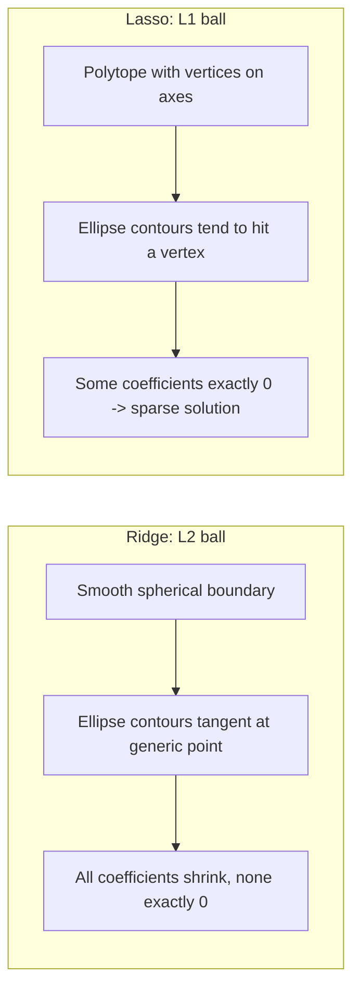
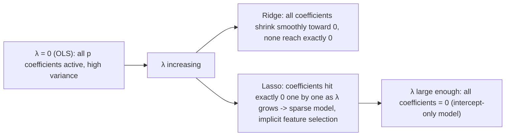

# **Ridge, Lasso, and Elastic Net: Regularized Linear Regression**

Ordinary least squares (OLS) minimizes training error only. With many or correlated features, relatively little data, or noisy targets, OLS coefficients have high variance and generalize poorly — small changes in the training set can swing $\hat\beta$ wildly. Regularization adds a penalty on coefficient magnitude to trade a controlled amount of bias for a large reduction in variance, and — for Lasso/Elastic Net — performs feature selection as a side effect of the penalty's geometry.

---

## **1. Setup**

Design matrix $X \in \mathbb{R}^{n \times p}$ (assume centered/standardized columns), target $y \in \mathbb{R}^n$, coefficients $\beta \in \mathbb{R}^p$ (intercept handled separately by centering, so it's omitted from the penalty). OLS solves

$$
\hat\beta_{\text{OLS}} = \arg\min_\beta \; \|y - X\beta\|_2^2
$$

with closed form $\hat\beta_{\text{OLS}} = (X^\top X)^{-1} X^\top y$ when $X^\top X$ is invertible. When $p > n$, or columns are collinear, $X^\top X$ is singular or near-singular, and $(X^\top X)^{-1}$ blows up small perturbations in $y$ into large swings in $\hat\beta$ — this is the variance problem regularization targets.

---

## **2. Ridge Regression ($L_2$ Penalty)**

### **2.1 Objective and Closed Form**

$$
\hat\beta_{\text{ridge}} = \arg\min_\beta \; \|y - X\beta\|_2^2 + \lambda \|\beta\|_2^2, \qquad \lambda \ge 0
$$

Differentiate and set to zero:

$$
\nabla_\beta \left[ (y-X\beta)^\top(y-X\beta) + \lambda \beta^\top\beta \right] = -2X^\top(y - X\beta) + 2\lambda\beta = 0
$$

$$
X^\top X \beta + \lambda \beta = X^\top y
\;\Longrightarrow\;
\boxed{\hat\beta_{\text{ridge}} = (X^\top X + \lambda I)^{-1} X^\top y}
$$

**Why this fixes the invertibility problem:** adding $\lambda I$ shifts every eigenvalue of $X^\top X$ up by $\lambda$. If $X^\top X = U\Lambda U^\top$ (eigendecomposition, $\Lambda = \operatorname{diag}(d_1,\dots,d_p)$), then

$$
(X^\top X + \lambda I)^{-1} = U (\Lambda + \lambda I)^{-1} U^\top, \qquad \text{eigenvalues } \frac{1}{d_j + \lambda}
$$

Even if some $d_j = 0$ (exact collinearity), $1/(d_j+\lambda)$ stays finite for $\lambda > 0$ — the matrix is always invertible, and directions with small $d_j$ (which OLS would amplify enormously) are shrunk toward zero rather than blown up.

### **2.2 Bayesian Interpretation**

Ridge is the MAP estimate under a Gaussian prior. With likelihood $y \mid X,\beta \sim \mathcal N(X\beta, \sigma^2 I)$ and prior $\beta \sim \mathcal N(0, \tau^2 I)$:

$$
\log p(\beta \mid y) \propto -\frac{1}{2\sigma^2}\|y-X\beta\|_2^2 - \frac{1}{2\tau^2}\|\beta\|_2^2
$$

Maximizing this is equivalent to minimizing $\|y-X\beta\|_2^2 + \frac{\sigma^2}{\tau^2}\|\beta\|_2^2$, i.e., $\lambda = \sigma^2/\tau^2$. A tighter (smaller $\tau^2$) prior belief that coefficients are near zero corresponds to a larger $\lambda$.

### **2.3 Effective Degrees of Freedom and Bias–Variance**

The ridge hat matrix is $H_\lambda = X(X^\top X+\lambda I)^{-1}X^\top$, with

$$
\operatorname{df}(\lambda) = \operatorname{tr}(H_\lambda) = \sum_{j=1}^p \frac{d_j^2}{d_j^2 + \lambda}
$$

(using the SVD singular values $d_j$ of $X$). As $\lambda \to 0$, $\operatorname{df} \to p$ (OLS, high variance); as $\lambda \to \infty$, $\operatorname{df} \to 0$ (all coefficients $\to 0$, maximum bias, zero variance). This is a direct, quantitative bias–variance dial.

### **2.4 Geometric Intuition**

Ridge solves the equivalent constrained form (Lagrangian duality) $\min \|y-X\beta\|_2^2$ s.t. $\|\beta\|_2^2 \le t$. The constraint region is a **ball** (sphere in $p$ dimensions) — the OLS loss contours (ellipses) touch this smooth, round boundary generically at a point with *all coordinates nonzero*. This is why ridge shrinks coefficients smoothly toward zero but essentially never sets them to exactly zero.

---

## **3. Lasso Regression ($L_1$ Penalty)**

### **3.1 Objective**

$$
\hat\beta_{\text{lasso}} = \arg\min_\beta \; \|y-X\beta\|_2^2 + \lambda \|\beta\|_1, \qquad \|\beta\|_1 = \sum_{j=1}^p |\beta_j|
$$

Unlike ridge, there is **no closed form** in general — $\|\beta\|_1$ is not differentiable at $\beta_j = 0$, so the stationarity condition is a subgradient condition, and the standard solver is **coordinate descent**.

### **3.2 Why $L_1$ Produces Exact Zeros — Geometric Argument**

The constrained form is $\min \|y-X\beta\|_2^2$ s.t. $\|\beta\|_1 \le t$. The constraint region is a **cross-polytope** (a diamond in 2D, an octahedron in 3D) with sharp **vertices and edges lying exactly on the coordinate axes/planes**. The elliptical loss contours, expanding outward from the OLS solution, generically first touch this polytope at a **corner**, and corners of an $L_1$ ball have most coordinates equal to exactly zero. This is the structural reason Lasso performs feature selection while ridge does not — it is purely about where a smooth, convex objective's level sets first meet a ball (round, §2.4) versus a polytope (cornered, here).



### **3.3 Coordinate Descent Derivation (Soft-Thresholding)**

Fix all coordinates except $\beta_j$ and minimize over $\beta_j$ alone. Write the partial residual excluding feature $j$:

$$
r_j = y - \sum_{k \ne j} X_k \beta_k
$$

Assume columns are standardized so $X_j^\top X_j = 1$ (common preprocessing for coordinate descent). The 1D objective in $\beta_j$ is

$$
h(\beta_j) = \|r_j - X_j \beta_j\|_2^2 + \lambda|\beta_j|
$$

Expand the smooth part and differentiate for $\beta_j \ne 0$ (where $|\beta_j|$ is differentiable):

$$
\frac{\partial}{\partial \beta_j}\|r_j - X_j\beta_j\|_2^2 = -2X_j^\top r_j + 2\beta_j
$$

Let $\rho_j = X_j^\top r_j$ (the correlation of feature $j$ with the current residual). The subgradient stationarity condition $0 \in \partial h(\beta_j)$ gives, for $\beta_j > 0$: $-2\rho_j + 2\beta_j + \lambda = 0 \Rightarrow \beta_j = \rho_j - \lambda/2$; symmetric for $\beta_j < 0$: $\beta_j = \rho_j + \lambda/2$; and for $\beta_j = 0$, the subgradient of $|\beta_j|$ ranges over $[-1,1]$, so $\beta_j=0$ is a valid stationary point whenever $|\rho_j| \le \lambda/2$. Combining all three cases gives the **soft-thresholding operator**:

$$
\hat\beta_j = S(\rho_j, \lambda/2) =
\begin{cases}
\rho_j - \lambda/2, & \rho_j > \lambda/2 \\
0, & |\rho_j| \le \lambda/2 \\
\rho_j + \lambda/2, & \rho_j < -\lambda/2
\end{cases}
= \operatorname{sign}(\rho_j)\left(|\rho_j| - \lambda/2\right)_+
$$

**Intuition:** if a feature's correlation with the residual is weaker than the penalty threshold $\lambda/2$, it is zeroed out entirely — this per-coordinate "kill small signals" rule, applied repeatedly across all coordinates until convergence, is exactly what produces sparse solutions and is the computational mechanism behind the geometric picture in §3.2.

### **3.4 Coordinate Descent Algorithm**

1. Standardize columns of $X$; center $y$.
2. Initialize $\beta = 0$ (or warm-start from a previous $\lambda$ on a regularization path).
3. Repeat until convergence:
   - For each $j = 1,\dots,p$:
     - Compute partial residual correlation $\rho_j = X_j^\top(y - X_{-j}\beta_{-j})$.
     - Update $\beta_j \leftarrow S(\rho_j, \lambda/2)$.
4. Return $\beta$.

This is the algorithm behind `glmnet` and scikit-learn's `Lasso`, run efficiently by maintaining the residual incrementally rather than recomputing $X_{-j}\beta_{-j}$ from scratch each time.

---

## **4. Elastic Net**

$$
\hat\beta_{\text{enet}} = \arg\min_\beta \; \|y-X\beta\|_2^2 + \lambda\left[\alpha\|\beta\|_1 + \frac{1-\alpha}{2}\|\beta\|_2^2\right], \qquad \alpha \in [0,1]
$$

$\alpha = 1$ recovers Lasso; $\alpha = 0$ recovers ridge (up to constant rescaling). Elastic Net addresses two Lasso weaknesses:

- **Grouped/correlated features:** given a group of highly correlated features, Lasso tends to arbitrarily pick one and zero out the rest; the added $L_2$ term encourages correlated features to be selected (or shrunk) **together** rather than arbitrarily.
- **$p > n$ selection cap:** plain Lasso can select at most $n$ nonzero coefficients when $p > n$ (a property of the $L_1$-constrained polytope's geometry in that regime); the $L_2$ component removes this cap.

The coordinate descent update generalizes the soft-threshold with an extra shrinkage factor:

$$
\hat\beta_j = \frac{S(\rho_j, \lambda\alpha/2)}{1 + \lambda(1-\alpha)}
$$

i.e., soft-threshold first, then shrink by the ridge-like denominator.

---

## **5. Worked Numeric Example**

Two standardized features, $n=4$ samples:

$$
X = \begin{bmatrix} 1 & 0 \\ 0 & 1 \\ -1 & 0 \\ 0 & -1 \end{bmatrix}, \qquad y = \begin{bmatrix} 2 \\ 0.1 \\ -2 \\ -0.1 \end{bmatrix}
$$

Here $X^\top X = 2I$ (orthogonal, standardized design), so $X_1^\top X_1 = X_2^\top X_2 = 2$ (not $1$ — rescale the formulas above by this factor for this toy example; equivalently use $\rho_j/2$ in place of $\rho_j$ below).

**OLS:** $\hat\beta_{\text{OLS}} = (X^\top X)^{-1}X^\top y$. Column correlations: $X_1^\top y = 1(2) + (-1)(-2) = 4$, $X_2^\top y = 1(0.1)+(-1)(-0.1) = 0.2$. So $\hat\beta_{\text{OLS}} = [4/2,\ 0.2/2] = [2.0,\ 0.1]$.

**Ridge** with $\lambda = 2$: $\hat\beta_j = \frac{X_j^\top y}{2+\lambda} = \frac{X_j^\top y}{4}$, giving $\hat\beta = [1.0,\ 0.05]$ — both shrink proportionally, neither hits zero.

**Lasso** with $\lambda = 2$ (threshold $\lambda/2 = 1$, applied to $\rho_j = X_j^\top y / 2$ due to the $X_j^\top X_j=2$ rescaling, so effectively threshold $1$ against $\rho_1=2,\ \rho_2=0.1$): $\hat\beta_1 = 2 - 1 = 1.0$ survives; $\hat\beta_2$: since $|0.1| \le 1$, $\hat\beta_2 = 0$ exactly. **Feature 2 is eliminated** — this is the sparsity ridge could never produce at any $\lambda$.

---

## **6. Regularization Path**



Plotting $\hat\beta_j(\lambda)$ against $\lambda$ (or $\log\lambda$) for every $j$ gives the **regularization path**: Lasso paths show piecewise-linear segments punctuated by coefficients dropping to exactly zero; ridge paths are smooth curves that asymptote to zero but never touch it.

---

## **7. Python Implementation From Scratch**

```python
import numpy as np


def ridge_closed_form(X, y, lam):
    """Closed-form ridge solution. Assumes X, y already centered."""
    p = X.shape[1]
    return np.linalg.solve(X.T @ X + lam * np.eye(p), X.T @ y)


def soft_threshold(rho, threshold):
    """S(rho, threshold) = sign(rho) * max(|rho| - threshold, 0)."""
    return np.sign(rho) * np.maximum(np.abs(rho) - threshold, 0.0)


def lasso_coordinate_descent(X, y, lam, n_iter=1000, tol=1e-8):
    """
    Coordinate descent for Lasso. Assumes X columns are standardized
    (each column has unit L2 norm squared per-sample is NOT required here;
    we normalize by the column's own squared norm explicitly, so this works
    for any column scaling).
    """
    n, p = X.shape
    beta = np.zeros(p)
    col_sq_norm = (X ** 2).sum(axis=0)  # X_j^T X_j for each column

    for iteration in range(n_iter):
        beta_old = beta.copy()
        residual = y - X @ beta  # full residual, updated incrementally below

        for j in range(p):
            # Add back feature j's own contribution to get the partial residual.
            residual += X[:, j] * beta[j]
            rho_j = X[:, j] @ residual

            beta[j] = soft_threshold(rho_j, lam / 2) / col_sq_norm[j] if col_sq_norm[j] > 0 else 0.0

            # Remove feature j's (new) contribution again before moving to j+1.
            residual -= X[:, j] * beta[j]

        if np.max(np.abs(beta - beta_old)) < tol:
            break

    return beta


def elastic_net_coordinate_descent(X, y, lam, alpha, n_iter=1000, tol=1e-8):
    """Coordinate descent for Elastic Net: alpha=1 -> Lasso, alpha=0 -> Ridge-like."""
    n, p = X.shape
    beta = np.zeros(p)
    col_sq_norm = (X ** 2).sum(axis=0)

    for iteration in range(n_iter):
        beta_old = beta.copy()
        residual = y - X @ beta

        for j in range(p):
            residual += X[:, j] * beta[j]
            rho_j = X[:, j] @ residual
            numerator = soft_threshold(rho_j, lam * alpha / 2)
            denom = col_sq_norm[j] + lam * (1 - alpha)
            beta[j] = numerator / denom if denom > 0 else 0.0
            residual -= X[:, j] * beta[j]

        if np.max(np.abs(beta - beta_old)) < tol:
            break

    return beta
```

The incremental residual update (`residual += ... ; ... ; residual -= ...`) avoids recomputing $X_{-j}\beta_{-j}$ from scratch on every coordinate update — this is the key efficiency trick that makes coordinate descent competitive: each coordinate update costs $O(n)$ instead of $O(np)$.

### **7.1 Toy Run**

```python
X = np.array([[1, 0], [0, 1], [-1, 0], [0, -1]], dtype=float)
y = np.array([2.0, 0.1, -2.0, -0.1])

print("OLS:   ", np.linalg.lstsq(X, y, rcond=None)[0])
print("Ridge: ", ridge_closed_form(X, y, lam=2.0))
print("Lasso: ", lasso_coordinate_descent(X, y, lam=2.0))
```

---

## **8. Equivalent Implementation With scikit-learn**

```python
from sklearn.linear_model import Ridge, Lasso, ElasticNet, LassoCV, RidgeCV
from sklearn.preprocessing import StandardScaler
from sklearn.pipeline import make_pipeline

ridge = make_pipeline(StandardScaler(), Ridge(alpha=2.0))       # alpha == lambda here
lasso = make_pipeline(StandardScaler(), Lasso(alpha=1.0))       # note: sklearn's alpha is lambda, not lambda/2
enet = make_pipeline(StandardScaler(), ElasticNet(alpha=1.0, l1_ratio=0.5))

ridge.fit(X, y)
lasso.fit(X, y)
enet.fit(X, y)
```

**Internals:**
- `Ridge` solves the closed form via Cholesky decomposition of $X^\top X + \lambda I$ by default (`solver="cholesky"`) for small/medium dense problems, or conjugate-gradient/SVD-based solvers for large or ill-conditioned problems — never explicitly forming and inverting $(X^\top X+\lambda I)^{-1}$ as a dense inverse in the numerically robust solver paths.
- `Lasso` and `ElasticNet` use **cyclic coordinate descent** (as derived in §3.3–3.4) with an active-set-like warm-start strategy along a `LassoCV`/path of $\lambda$ values, and use the duality gap between the primal and dual objective as the convergence criterion (`tol` controls this gap threshold), not a fixed iteration count.
- `LassoCV`/`RidgeCV` fit an entire regularization path efficiently by warm-starting each $\lambda$ from the previous (larger) $\lambda$'s solution, exploiting that adjacent solutions along the path are close.
- **Important convention mismatch:** scikit-learn's `alpha` parameter is $\lambda$ directly in $\frac{1}{2n}\|y-X\beta\|_2^2 + \alpha\|\beta\|_1$ (note the $\frac{1}{2n}$ scaling of the loss term), so numerical values of `alpha` are not directly comparable to the $\lambda$ used against an unscaled sum-of-squares loss as derived above — always check the exact objective a library optimizes before comparing hyperparameters across implementations.

---

## **9. Complexity**

| Method | Fit Time | Notes |
|---|---|---|
| Ridge (closed form) | $O(p^3 + np^2)$ | one matrix solve; $O(np^2 + p^3)$ dominated by forming/factoring $X^\top X$ |
| Ridge (SVD-based) | $O(np^2)$ ($p<n$) | reuses SVD across multiple $\lambda$ cheaply: $d_j^2/(d_j^2+\lambda)$ |
| Lasso/Elastic Net (coordinate descent) | $O(np)$ per full sweep, times sweeps to convergence | typically tens of sweeps; efficient for sparse $X$ since only nonzero entries touch the residual update |

Space is $O(np)$ to hold $X$ for all methods; ridge's closed form additionally needs $O(p^2)$ for $X^\top X$.

---

## **10. Numerical Stability, Edge Cases, Pitfalls**

- **Always standardize features before penalizing.** The $L_1$/$L_2$ penalty is applied uniformly across coefficients; if features are on different scales, the penalty implicitly penalizes some features far more than others in the original (unscaled) units.
- **Do not penalize the intercept.** Centering $y$ and $X$ (or fitting an unpenalized intercept term separately) avoids shrinking the mean prediction toward zero, which would bias all predictions.
- **$\lambda$ selection via cross-validation**, not training error — training error is monotonically non-decreasing in $\lambda$ for both methods, so it can never be used to pick $\lambda$ (it would always prefer $\lambda=0$, i.e., OLS).
- **Ridge with $p \gg n$:** still well-posed (the $+\lambda I$ guarantees invertibility) but does not perform feature selection — with thousands of irrelevant features, ridge keeps all of them with small nonzero weight, which can hurt interpretability even if predictive performance is fine.
- **Lasso instability under high collinearity:** among strongly correlated features, Lasso can flip which one it selects under small perturbations of the data — a known instability that Elastic Net's $L_2$ term directly mitigates.
- **Non-differentiability at zero:** naive gradient descent on the Lasso objective does not converge to exact zeros because the subgradient at $\beta_j = 0$ is not simply "$0$" — coordinate descent (§3.3) or proximal gradient methods (ISTA/FISTA), which explicitly use the soft-threshold operator as the proximal step, are required for the sparsity property to actually manifest numerically.
- **Convergence criterion:** iterating coordinate descent for a fixed number of steps without checking a real convergence criterion (duality gap or max coefficient change) can silently return under-converged, non-sparse solutions that look dense even though the true optimum is sparse.

---

## **11. Connections to Related ML Concepts**

- **Bayesian priors:** ridge $\Leftrightarrow$ Gaussian prior (§2.2); Lasso $\Leftrightarrow$ Laplace (double-exponential) prior on $\beta$, whose sharp peak at zero is the probabilistic mirror of the $L_1$ ball's corner geometry in §3.2.
- **Support Vector Machines:** the SVM's hinge-loss + $L_2$-margin objective is structurally the same "loss + $\|\beta\|_2^2$ penalty" template as ridge, just with a different loss function.
- **Proximal gradient methods:** the soft-threshold operator derived in §3.3 is exactly the proximal operator of the $L_1$ norm, $\operatorname{prox}_{\lambda\|\cdot\|_1}(v) = S(v,\lambda)$ — this generalizes to proximal gradient descent for any objective with a smooth loss plus a nonsmooth-but-simple penalty (group lasso, nuclear norm, total variation).
- **Feature selection / sparse recovery theory:** Lasso's ability to recover the true support of a sparse signal under compressed-sensing-style conditions (restricted isometry / irrepresentability conditions) connects it to compressed sensing.
- **Neural network regularization:** weight decay (adding $\lambda\|\theta\|_2^2$ to a neural net's loss) is literally ridge regularization applied to network weights; $L_1$ weight penalties for network pruning use the same soft-thresholding mechanism.

---

## **12. References for Deeper Reading**

- Arthur E. Hoerl and Robert W. Kennard, "Ridge Regression: Biased Estimation for Nonorthogonal Problems", Technometrics, 1970.
- Robert Tibshirani, "Regression Shrinkage and Selection via the Lasso", J. Royal Statistical Society B, 1996.
- Hui Zou and Trevor Hastie, "Regularization and Variable Selection via the Elastic Net", J. Royal Statistical Society B, 2005.
- Jerome Friedman, Trevor Hastie, Rob Tibshirani, "Regularization Paths for Generalized Linear Models via Coordinate Descent", Journal of Statistical Software, 2010 (the `glmnet` paper).
- Trevor Hastie, Robert Tibshirani, Jerome Friedman, *The Elements of Statistical Learning*, Chapter 3 (linear methods for regression).
- scikit-learn documentation, `linear_model.Lasso`, `linear_model.Ridge`, `linear_model.ElasticNet`. https://scikit-learn.org/stable/modules/linear_model.html
