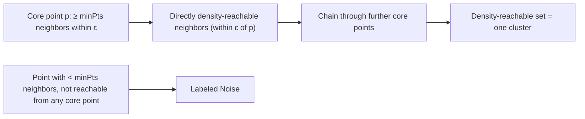

# **Gaussian Mixture Models and DBSCAN**

K-means (already in your notes) assigns every point to exactly one cluster using a hard, distance-based rule, and implicitly assumes clusters are round and similarly sized. Two important gaps remain: (1) **soft clustering** — expressing uncertainty about cluster membership and modeling clusters with different shapes/sizes/orientations, which **Gaussian Mixture Models (GMM)** solve; and (2) **density-based clustering** — discovering arbitrarily shaped clusters and explicitly labeling outliers as noise rather than forcing every point into a cluster, which **DBSCAN** solves. Both are standard responses to k-means' two structural limitations.

---

## **1. Gaussian Mixture Models**

### **1.1 Generative Model**

A GMM assumes data is generated by first picking one of $K$ components, then sampling from that component's Gaussian:

$$
z \sim \operatorname{Categorical}(\pi_1,\dots,\pi_K), \qquad x \mid z=k \sim \mathcal N(\mu_k, \Sigma_k)
$$

The marginal density of $x$ (integrating/summing out the unobserved cluster assignment $z$) is a weighted sum of Gaussians:

$$
p(x) = \sum_{k=1}^{K} \pi_k \, \mathcal N(x; \mu_k, \Sigma_k), \qquad \sum_{k=1}^K \pi_k = 1,\ \pi_k \ge 0
$$

where $\pi_k$ is the mixing weight (prior probability of component $k$), $\mu_k \in \mathbb{R}^d$ is its mean, $\Sigma_k \in \mathbb{R}^{d\times d}$ its covariance. Unlike k-means, each component has its own covariance, so clusters can be elliptical, differently scaled, and differently oriented.


### **1.2 Why Maximum Likelihood Has No Closed Form**

The log-likelihood of $n$ i.i.d. points is

$$
\ell(\theta) = \sum_{i=1}^{n} \log \left[ \sum_{k=1}^{K} \pi_k \, \mathcal N(x_i;\mu_k,\Sigma_k) \right]
$$

The $\log$ of a **sum** (over $k$) prevents the sum-of-logs simplification that makes single-Gaussian MLE closed-form — differentiating $\ell(\theta)$ with respect to $\mu_k$ or $\Sigma_k$ produces equations where every parameter appears inside every term's denominator (through the sum), coupling all $K$ components together. This is resolved with the **EM algorithm**, introducing the latent assignments as auxiliary variables.

### **1.3 Deriving EM for GMM From First Principles**

Introduce a distribution $q_i(z_i)$ over the latent assignment for each point $i$ and apply the same ELBO decomposition as the VAE chapter (§2.3 there), specialized to i.i.d. discrete latents:

$$
\log p(x_i) \ge \mathbb{E}_{q_i(z_i)}\left[\log p(x_i, z_i) - \log q_i(z_i)\right] = \operatorname{ELBO}_i(q_i,\theta)
$$

with equality iff $q_i(z_i) = p(z_i\mid x_i;\theta)$ (the true posterior). This gives the two EM steps:

**E-step:** fix $\theta$, set $q_i$ to the true posterior — the **responsibility** that component $k$ takes for point $i$:

$$
\gamma_{ik} \triangleq q_i(z_i=k) = p(z_i=k \mid x_i;\theta) = \frac{\pi_k\,\mathcal N(x_i;\mu_k,\Sigma_k)}{\sum_{j=1}^{K}\pi_j\,\mathcal N(x_i;\mu_j,\Sigma_j)}
$$

(direct application of Bayes' rule — no approximation is needed here because, unlike the VAE, the true posterior over a *discrete* $K$-way latent is trivial to compute exactly.)

**M-step:** fix $q_i=\gamma_{i\cdot}$, maximize the ELBO (now called the *expected complete-data log-likelihood*) over $\theta$:

$$
Q(\theta) = \sum_{i=1}^n \sum_{k=1}^K \gamma_{ik}\Big[\log\pi_k + \log\mathcal N(x_i;\mu_k,\Sigma_k)\Big]
$$

This **does** decouple across $k$ (no log-of-sum inside), so each parameter now has a closed-form update. Differentiate with respect to $\mu_k$:

$$
\frac{\partial Q}{\partial \mu_k} = \sum_{i=1}^n \gamma_{ik}\,\Sigma_k^{-1}(x_i-\mu_k) = 0
\;\Longrightarrow\;
\boxed{\mu_k = \frac{\sum_{i=1}^n \gamma_{ik}\,x_i}{\sum_{i=1}^n \gamma_{ik}}}
$$

a responsibility-weighted mean. Define $N_k \triangleq \sum_i \gamma_{ik}$ (effective number of points assigned to component $k$). Differentiating with respect to $\Sigma_k$ (using standard multivariate-Gaussian log-density derivative identities) gives:

$$
\boxed{\Sigma_k = \frac{1}{N_k}\sum_{i=1}^n \gamma_{ik}\,(x_i-\mu_k)(x_i-\mu_k)^\top}
$$

the responsibility-weighted covariance. Maximizing $\sum_k N_k \log\pi_k$ subject to $\sum_k\pi_k=1$ via a Lagrange multiplier $\lambda$: $\partial/\partial\pi_k\left[\sum_k N_k\log\pi_k - \lambda(\sum_k\pi_k-1)\right] = N_k/\pi_k - \lambda = 0 \Rightarrow \pi_k \propto N_k$; normalizing gives

$$
\boxed{\pi_k = \frac{N_k}{n}}
$$

### **1.4 Why EM Monotonically Improves Likelihood**

Because the E-step sets $q_i$ to make the ELBO **tight** ($\operatorname{ELBO}_i = \log p(x_i)$ exactly, per the VAE-chapter identity applied here), and the M-step only **increases** (or keeps equal) the ELBO by construction (it's a maximization step), the chain

$$
\log p(x;\theta^{(t)}) = \operatorname{ELBO}(\theta^{(t)}, q^{(t)}) \le \operatorname{ELBO}(\theta^{(t+1)}, q^{(t)}) \le \log p(x;\theta^{(t+1)})
$$

(first equality: E-step tightness; first inequality: M-step maximizes ELBO over $\theta$; second inequality: ELBO is always a lower bound) guarantees the observed-data log-likelihood **never decreases** across EM iterations. It can converge to a local (not necessarily global) maximum, since the overall log-likelihood surface is non-convex in $\theta$.

### **1.5 Relationship to K-Means**

K-means is the limit of EM for a GMM where all components share a common covariance $\Sigma_k = \epsilon I$ and $\epsilon \to 0$: the responsibilities $\gamma_{ik}$ become hard $0/1$ assignments (the softmax-like responsibility formula collapses to an argmin of squared distance), and the M-step mean update becomes exactly k-means' centroid update. This is why k-means can be seen as "hard EM" for an isotropic, equal-variance GMM — and explains precisely which of k-means' assumptions (spherical, equal-size clusters) a full GMM relaxes.

### **1.6 Worked Numeric Example (1D, 2 Components, One E-step)**

Let $K=2$ with current parameters $\pi_1=\pi_2=0.5$, $\mu_1=0,\ \sigma_1^2=1$, $\mu_2=4,\ \sigma_2^2=1$. For a new point $x=1$:

$$
\mathcal N(1;0,1) = \frac{1}{\sqrt{2\pi}}e^{-1/2} = 0.3989 \times 0.6065 = 0.2420
$$

$$
\mathcal N(1;4,1) = \frac{1}{\sqrt{2\pi}}e^{-9/2} = 0.3989 \times 0.0111 = 0.004432
$$

$$
\gamma_{1} = \frac{0.5(0.2420)}{0.5(0.2420)+0.5(0.004432)} = \frac{0.1210}{0.1210+0.002216} = 0.9820, \qquad \gamma_2 = 0.0180
$$

Point $x=1$ is assigned $98.2\%$ responsibility to component 1 and $1.8\%$ to component 2 — a genuinely soft assignment (k-means would give a hard $100\%/0\%$ split by nearest centroid).

### **1.7 Model Selection: Choosing $K$**

Unlike a hard rule, GMM's likelihood-based framework allows principled model comparison via penalized-likelihood criteria that trade off fit against complexity:

$$
\operatorname{BIC} = -2\hat\ell + p\log n, \qquad \operatorname{AIC} = -2\hat\ell + 2p
$$

where $p$ is the number of free parameters (grows with $K$, and with $\Sigma_k$'s parameterization — full covariance costs $O(d^2)$ per component versus $O(d)$ for diagonal). Sweep $K$ and pick the value minimizing BIC/AIC, rather than using the elbow-on-inertia heuristic from k-means (which does not have a probabilistic likelihood to penalize).

---

## **2. DBSCAN (Density-Based Spatial Clustering)**

### **2.1 Motivation**

Both k-means and GMM assume clusters are (possibly elliptical) convex blobs and force **every** point into some cluster. Real data often has non-convex, arbitrarily shaped clusters (e.g., interleaved spirals) and genuine outliers that don't belong to any cluster. DBSCAN defines clusters purely in terms of **local point density**, with no assumption on cluster shape, and explicitly labels sparse points as **noise**.

### **2.2 Core Definitions**

Given a distance metric, radius $\varepsilon$, and minimum count $\text{minPts}$:

$$
N_\varepsilon(p) = \{q \in \mathcal D : \operatorname{dist}(p,q) \le \varepsilon\}
$$

- **Core point:** $|N_\varepsilon(p)| \ge \text{minPts}$ (including $p$ itself).
- **Border point:** $|N_\varepsilon(p)| < \text{minPts}$, but $p \in N_\varepsilon(q)$ for some core point $q$.
- **Noise point:** neither core nor border — has no core point within $\varepsilon$ and is not dense enough itself.

**Density-reachability:** $q$ is *directly density-reachable* from core point $p$ if $q \in N_\varepsilon(p)$. *Density-reachable* is the transitive closure of this relation through a chain of core points. **Density-connected:** $p,q$ are density-connected if both are density-reachable from some common core point $o$.

A **cluster** is a maximal set of mutually density-connected points. This definition, not any centroid or shape prior, is what allows DBSCAN clusters to be arbitrarily shaped (e.g., a thin curved arc), since density-reachability only requires a chain of nearby dense regions, not proximity to any single reference point.



### **2.3 Algorithm**

1. Mark all points as unvisited.
2. For each unvisited point $p$:
   a. Mark $p$ visited; compute $N_\varepsilon(p)$.
   b. If $|N_\varepsilon(p)| < \text{minPts}$: temporarily label $p$ as **noise** (may later be reclaimed as a border point of another cluster).
   c. Else ($p$ is a core point): start a new cluster $C$; add $p$; **expand** $C$ by processing every point $q \in N_\varepsilon(p)$:
      - If $q$ is noise, reassign it to $C$ (border point).
      - If $q$ is unvisited, mark visited, compute $N_\varepsilon(q)$; add $q$ to $C$; if $q$ is also a core point, add its neighbors to the expansion queue (this is what propagates the cluster along chains of core points, implementing the transitive density-reachability from §2.2).
3. Continue until all points are visited. Remaining noise labels are final.

### **2.4 Worked Example**

1D points with $\varepsilon = 1.5$, $\text{minPts} = 3$:

$$
\{0, 0.5, 1, 1.2, 8, 8.3, 20\}
$$

- $N_\varepsilon(0) = \{0,0.5,1\}$ (size 3, all within $1.5$) → core.
- $N_\varepsilon(0.5) = \{0,0.5,1,1.2\}$ (size 4) → core.
- $N_\varepsilon(1) = \{0,0.5,1,1.2\}$ (size 4) → core.
- $N_\varepsilon(1.2) = \{0.5,1,1.2\}$ (size 3, since $|1.2-0|=1.2\le1.5$ too, so actually size 4) → core.
- These four points are all mutually density-reachable → **Cluster 1** = $\{0,0.5,1,1.2\}$.
- $N_\varepsilon(8) = \{8,8.3\}$ (size 2) → not core. $N_\varepsilon(8.3)=\{8,8.3\}$ (size 2) → not core. Neither is a core point and neither falls within $\varepsilon$ of any core point elsewhere → both labeled **noise** (with $\text{minPts}=3$, this pair is too sparse to form its own cluster).
- $N_\varepsilon(20) = \{20\}$ (size 1) → **noise**, clearly an outlier.

This illustrates DBSCAN's key qualitative difference from k-means/GMM: the isolated pair $\{8,8.3\}$ and the outlier $20$ are not forced into any cluster — they are explicitly flagged as not belonging anywhere, which neither k-means nor GMM can do (both must assign every point to its nearest/most likely component regardless of how far or sparse).

### **2.5 Choosing $\varepsilon$ and minPts**

- **minPts:** a common heuristic is $\text{minPts} \ge d+1$ (data dimension $d$), often $\text{minPts}=2d$ in practice; larger values produce smoother, more conservative (noise-tolerant) clusters.
- **$\varepsilon$:** the standard heuristic is the **k-distance plot** — for each point, compute the distance to its $k$-th nearest neighbor ($k=\text{minPts}-1$), sort these distances in decreasing order, and plot them; the "elbow" in this curve (where distance suddenly jumps) is a good $\varepsilon$ candidate, since it marks the transition from dense, in-cluster spacing to sparse, cross-cluster/noise spacing.

---

## **3. GMM vs. DBSCAN vs. K-Means**

| Aspect | K-Means | GMM | DBSCAN |
|---|---|---|---|
| Cluster shape | spherical (isotropic) | elliptical (per-component covariance) | arbitrary shape |
| Assignment | hard | soft (responsibilities) | hard, plus explicit **noise** label |
| Requires $K$ upfront | yes | yes (or via BIC/AIC sweep) | no — discovers cluster count from density |
| Handles outliers | no — every point assigned | no — every point assigned, though with low probability | yes — explicit noise class |
| Sensitive to | initialization, outliers, cluster size/shape assumption | initialization, covariance singularities (see pitfalls) | $\varepsilon$/minPts choice, varying density across clusters |
| Underlying model | hard EM special case | proper generative probabilistic model | non-parametric density connectivity, no generative model |

---

## **4. Python Implementation From Scratch**

### **4.1 GMM via EM**

```python
import numpy as np
from scipy.stats import multivariate_normal


def gmm_em(X, K, n_iter=100, tol=1e-6, seed=0):
    n, d = X.shape
    rng = np.random.default_rng(seed)

    # Initialize: random responsibilities-consistent means, identity covariances, uniform weights.
    means = X[rng.choice(n, K, replace=False)]
    covs = np.array([np.eye(d) for _ in range(K)])
    weights = np.full(K, 1.0 / K)

    log_likelihood_prev = -np.inf

    for iteration in range(n_iter):
        # --- E-step: compute responsibilities gamma[i, k] ---
        component_densities = np.zeros((n, K))
        for k in range(K):
            component_densities[:, k] = weights[k] * multivariate_normal.pdf(
                X, mean=means[k], cov=covs[k], allow_singular=True
            )
        total_density = component_densities.sum(axis=1, keepdims=True)
        gamma = component_densities / total_density  # responsibilities

        # --- M-step: closed-form updates ---
        N_k = gamma.sum(axis=0)  # effective count per component
        for k in range(K):
            means[k] = (gamma[:, k:k+1] * X).sum(axis=0) / N_k[k]
            diff = X - means[k]
            covs[k] = (gamma[:, k:k+1] * diff).T @ diff / N_k[k]
            covs[k] += 1e-6 * np.eye(d)  # regularize against singular covariance (see pitfalls)
        weights = N_k / n

        # --- Convergence check via observed-data log-likelihood ---
        log_likelihood = np.sum(np.log(total_density))
        if abs(log_likelihood - log_likelihood_prev) < tol:
            break
        log_likelihood_prev = log_likelihood

    return means, covs, weights, gamma


# Toy run: two well-separated 2D Gaussian blobs
rng = np.random.default_rng(1)
X1 = rng.normal(loc=[0, 0], scale=0.5, size=(100, 2))
X2 = rng.normal(loc=[4, 4], scale=0.5, size=(100, 2))
X = np.vstack([X1, X2])

means, covs, weights, gamma = gmm_em(X, K=2, seed=2)
print("Fitted means:\n", means)
print("Fitted weights:", weights)
```

### **4.2 DBSCAN from Scratch**

```python
import numpy as np


def region_query(X, point_idx, eps):
    dists = np.linalg.norm(X - X[point_idx], axis=1)
    return np.where(dists <= eps)[0]


def dbscan(X, eps, min_pts):
    n = X.shape[0]
    labels = np.full(n, -1)   # -1 = unvisited / eventually noise (0 conventionally reserved unused here)
    visited = np.zeros(n, dtype=bool)
    NOISE, cluster_id = 0, 0
    labels[:] = NOISE  # start everyone as "noise"; will be overwritten for clustered points
    cluster_id = 0

    for i in range(n):
        if visited[i]:
            continue
        visited[i] = True
        neighbors = region_query(X, i, eps)

        if len(neighbors) < min_pts:
            labels[i] = NOISE  # tentatively noise; may be reclaimed as a border point below
            continue

        cluster_id += 1
        labels[i] = cluster_id
        seeds = list(neighbors)

        j = 0
        while j < len(seeds):
            q = seeds[j]
            if not visited[q]:
                visited[q] = True
                q_neighbors = region_query(X, q, eps)
                if len(q_neighbors) >= min_pts:
                    seeds.extend(n_idx for n_idx in q_neighbors if n_idx not in seeds)
            if labels[q] == NOISE or labels[q] == -1:
                labels[q] = cluster_id
            j += 1

    return labels


# Toy run: two dense blobs plus scattered noise points
rng = np.random.default_rng(3)
blob1 = rng.normal(loc=[0, 0], scale=0.2, size=(30, 2))
blob2 = rng.normal(loc=[5, 5], scale=0.2, size=(30, 2))
noise_pts = rng.uniform(low=-3, high=8, size=(10, 2))
X = np.vstack([blob1, blob2, noise_pts])

labels = dbscan(X, eps=0.6, min_pts=5)
print("Cluster labels:", np.unique(labels, return_counts=True))
```

The `seeds.extend(... if n_idx not in seeds)` line is $O(n)$ per check (fine for the toy example); production implementations use a spatial index (§6) and a queue/set structure to avoid this quadratic-in-neighborhood-size membership check.

---

## **5. Equivalent Implementation With scikit-learn**

```python
from sklearn.mixture import GaussianMixture
from sklearn.cluster import DBSCAN
from sklearn.neighbors import NearestNeighbors
import numpy as np

# GMM
gmm = GaussianMixture(n_components=2, covariance_type="full", random_state=0)
gmm.fit(X)
soft_assignments = gmm.predict_proba(X)   # the gamma responsibilities from §1.3
hard_labels = gmm.predict(X)              # argmax of soft_assignments
bic_scores = [GaussianMixture(n_components=k, random_state=0).fit(X).bic(X) for k in range(1, 6)]

# DBSCAN
db = DBSCAN(eps=0.6, min_samples=5)
db_labels = db.fit_predict(X)             # -1 indicates noise
core_sample_mask = np.zeros_like(db_labels, dtype=bool)
core_sample_mask[db.core_sample_indices_] = True

# k-distance plot to choose eps
neighbors = NearestNeighbors(n_neighbors=5).fit(X)
distances, _ = neighbors.kneighbors(X)
k_distances = np.sort(distances[:, -1])[::-1]  # look for the "elbow" in this curve
```

**Internals:**
- `GaussianMixture` runs EM with several random initializations (`n_init`) by default and keeps the run with the best final log-likelihood, mitigating (not eliminating) the local-optimum issue from §1.4; `covariance_type` (`"full"`, `"diag"`, `"tied"`, `"spherical"`) directly controls the parameter count $p$ used in `.bic()`/`.aic()` — `"spherical"` with tied variance across components is exactly the k-means limit from §1.5.
- `DBSCAN.fit_predict` internally builds a spatial index (a `KDTree` or `BallTree`, chosen automatically based on dimensionality) to answer each `region_query` in sub-linear time rather than the $O(n)$ per-query scan in the from-scratch version above.
- `core_sample_indices_` exposes exactly the core-point set defined in §2.2, useful for diagnosing whether $\varepsilon$/`min_samples` produced a reasonable core/border/noise split.

---

## **6. Complexity**

| Method | Time | Space | Notes |
|---|---|---|---|
| GMM (EM) | $O(t \cdot n \cdot K \cdot d^2)$ | $O(nK + Kd^2)$ | $t$ = iterations to convergence; $d^2$ from full covariance; use `"diag"` covariance for $O(d)$ per component when $d$ is large |
| DBSCAN (naive) | $O(n^2)$ | $O(n)$ | brute-force region queries |
| DBSCAN (with spatial index) | $O(n\log n)$ typical (low-dimensional data) | $O(n)$ | KD-tree/ball-tree query cost degrades toward $O(n)$ per query in high dimensions (curse of dimensionality), pushing worst case back toward $O(n^2)$ |

---

## **7. Numerical Stability, Edge Cases, and Pitfalls**

**GMM:**
- **Singular covariance collapse:** if a component's responsibility concentrates on very few (or duplicate) points, $\Sigma_k$ can become singular or near-singular, sending $\mathcal N(x;\mu_k,\Sigma_k) \to \infty$ for points at $\mu_k$ and destabilizing the log-likelihood; standard fix is adding a small regularization term $\epsilon I$ to every covariance update (as in §4.1) or using `reg_covar` in scikit-learn.
- **Local optima:** EM only guarantees monotonic improvement (§1.4), not global optimality; always run multiple random restarts and keep the best log-likelihood.
- **Label switching:** component indices $1,\dots,K$ are arbitrary/interchangeable across different EM runs — comparing "cluster 1" across two fits is meaningless without matching components by, e.g., nearest mean.
- **Choosing covariance type:** `"full"` covariance has $O(Kd^2)$ parameters and can overfit with limited data or high $d$; `"diag"` or `"spherical"` trade shape flexibility for fewer parameters and better conditioning.
- **Numerically compute in log-space:** implementations should compute $\log \mathcal N(x;\mu,\Sigma)$ and use a log-sum-exp trick for the responsibility normalization, rather than exponentiating raw densities first (as the simplified from-scratch code above does for clarity) — this avoids underflow when densities are extremely small in high dimensions.

**DBSCAN:**
- **Varying density across true clusters:** a single global $(\varepsilon,\text{minPts})$ cannot simultaneously suit a dense cluster and a sparse cluster — the sparse one may be entirely labeled noise, or the dense one may merge with a nearby sparser region. (HDBSCAN/OPTICS relax this by working across a range of densities.)
- **High-dimensional data:** distance concentration (all pairwise distances become similar in high $d$) makes $\varepsilon$ hard to choose meaningfully and degrades the spatial-index speedup (§6) — DBSCAN is best suited to low/moderate-dimensional feature spaces, or requires a dimensionality-reduction preprocessing step first.
- **Border-point ambiguity:** a border point reachable from two different clusters' core points is assigned to whichever cluster's core point processes it first in the scan order — a mild, rarely consequential non-determinism.
- **Distance metric choice matters enormously:** since clustering is defined entirely through $\operatorname{dist}(p,q) \le \varepsilon$, unscaled features (e.g., one feature in the thousands, another in $[0,1]$) will make the dominant-scale feature entirely determine neighborhoods — always standardize features before DBSCAN, exactly as for k-means/GMM.

---

## **8. Connections to Related ML Concepts**

- **EM as a general algorithm:** the E/M-step derivation here is a direct instance of the same variational/ELBO principle used to derive the VAE's training objective — GMM is "EM with an exact, discrete E-step," VAE is "EM with an approximate, amortized E-step" (the encoder network) because the true posterior over a continuous, neural-network-defined latent is intractable.
- **Soft clustering and mixture models generally:** the GMM machinery generalizes directly to mixtures of any parametric family (mixture of Bernoullis, mixture of multinomials for topic modeling/document clustering), all trained with the identical E-step/M-step template.
- **K-means as hard EM:** already covered (§1.5) — this connects your existing K-Means chapter to this one explicitly.
- **Density estimation:** GMM is also a general-purpose parametric density estimator (not just a clustering tool) — $p(x)$ from a fitted GMM can be used directly for anomaly detection (low $p(x)$ → outlier) or as a generative model to sample new points.
- **Anomaly/outlier detection:** DBSCAN's noise label and GMM's low-likelihood scoring are two different principled routes to the same downstream task (flagging outliers), complementary to Isolation Forest/One-Class SVM approaches.
- **OPTICS and HDBSCAN:** direct extensions of DBSCAN that remove the single global $\varepsilon$ requirement by ordering points by reachability distance (OPTICS) or building a cluster hierarchy across all density thresholds simultaneously (HDBSCAN).

---

## **9. References for Deeper Reading**

- Arthur P. Dempster, Nan M. Laird, Donald B. Rubin, "Maximum Likelihood from Incomplete Data via the EM Algorithm", J. Royal Statistical Society B, 1977 (the original EM paper).
- Christopher M. Bishop, *Pattern Recognition and Machine Learning*, Chapter 9 (Mixture Models and EM).
- Martin Ester, Hans-Peter Kriegel, Jörg Sander, Xiaowei Xu, "A Density-Based Algorithm for Discovering Clusters in Large Spatial Databases with Noise", KDD 1996 (the original DBSCAN paper).
- Mihael Ankerst, Markus M. Breunig, Hans-Peter Kriegel, Jörg Sander, "OPTICS: Ordering Points To Identify the Clustering Structure", SIGMOD 1999.
- Ricardo J. G. B. Campello, Davoud Moulavi, Jörg Sander, "Density-Based Clustering Based on Hierarchical Density Estimates" (HDBSCAN), PAKDD 2013.
- scikit-learn documentation, `mixture.GaussianMixture` and `cluster.DBSCAN`. https://scikit-learn.org/stable/modules/mixture.html, https://scikit-learn.org/stable/modules/clustering.html#dbscan
