# **AdaBoost and Gradient Boosting**

Your existing Ensemble Learning and XGBoost chapters cover *why* combining models helps and *how* XGBoost implements boosting efficiently at scale, but skip the foundational boosting algorithms that motivate the whole family. Bagging (Random Forest) trains many independent models on resampled data and averages them to **reduce variance**. Boosting instead trains models **sequentially**, each one specifically targeting the previous ensemble's mistakes, to **reduce bias** — turning a collection of models barely better than random guessing ("weak learners") into an arbitrarily accurate ensemble. AdaBoost is the original, historically important instance; Gradient Boosting is the general framework that both explains AdaBoost as a special case and generalizes to arbitrary differentiable loss functions (which is what XGBoost then builds on).

---

## **1. AdaBoost (Adaptive Boosting)**

### **1.1 Setup**

Binary classification, $y_i \in \{-1,+1\}$, training set $\{(x_i,y_i)\}_{i=1}^n$. A **weak learner** is any classifier $h(x)\in\{-1,+1\}$ that does slightly better than random guessing (weighted error $< 0.5$) — canonically a **decision stump** (a depth-1 decision tree). AdaBoost maintains a distribution of weights $w_i$ over training examples, re-weighting after each round to emphasize previously misclassified points, and combines all weak learners into a weighted vote:

$$
H(x) = \operatorname{sign}\left(\sum_{m=1}^{M} \alpha_m h_m(x)\right)
$$

### **1.2 Algorithm**

1. Initialize weights uniformly: $w_i^{(1)} = 1/n$ for all $i$.
2. For $m = 1,\dots,M$:
   a. Fit weak learner $h_m$ to minimize the **weighted** classification error:
      $$
      \epsilon_m = \sum_{i=1}^n w_i^{(m)}\,\mathbb 1[h_m(x_i)\ne y_i]
      $$
   b. Compute the learner's weight (derived in §1.4):
      $$
      \alpha_m = \frac{1}{2}\log\frac{1-\epsilon_m}{\epsilon_m}
      $$
   c. Update example weights (derived in §1.4) and renormalize:
      $$
      w_i^{(m+1)} = \frac{w_i^{(m)}\exp\big(-\alpha_m y_i h_m(x_i)\big)}{Z_m}, \qquad Z_m = \sum_{i=1}^n w_i^{(m)}\exp(-\alpha_m y_i h_m(x_i))
      $$
3. Output $H(x) = \operatorname{sign}\left(\sum_m \alpha_m h_m(x)\right)$.

```mermaid
flowchart LR
    W1["Uniform weights w_i"] --> H1["Fit weak learner h_1"]
    H1 --> A1["Compute α_1 from weighted error ε_1"]
    A1 --> U1["Reweight: boost misclassified points"]
    U1 --> H2["Fit weak learner h_2 on new weights"]
    H2 --> A2["Compute α_2"]
    A2 --> U2["Reweight again"]
    U2 --> DOTS["... repeat M rounds ..."]
    DOTS --> COMBO["H(x) = sign(Σ α_m h_m(x))"]
```



**Intuition for the weight update:** $y_i h_m(x_i) = +1$ if $h_m$ classified $x_i$ correctly, $-1$ if wrong. So $\exp(-\alpha_m y_i h_m(x_i)) = e^{-\alpha_m}$ (shrink weight) for correctly classified points and $e^{+\alpha_m}$ (grow weight) for misclassified points — the next round's weak learner is fit on a distribution that has been explicitly rebalanced to emphasize exactly what the ensemble so far got wrong.

### **1.3 AdaBoost Minimizes Exponential Loss — Derivation**

AdaBoost is not an ad hoc reweighting heuristic; it is exact **forward stagewise additive modeling** minimizing the exponential loss

$$
L(y,f(x)) = \exp(-y f(x))
$$

Suppose after $m-1$ rounds the ensemble score is $f_{m-1}(x) = \sum_{k<m}\alpha_k h_k(x)$. At round $m$, we seek $(\alpha_m,h_m)$ minimizing the total exponential loss of the *updated* ensemble $f_{m-1}+\alpha_m h_m$, holding $f_{m-1}$ fixed (this greedy, one-term-at-a-time optimization is exactly what "forward stagewise" means):

$$
(\alpha_m,h_m) = \arg\min_{\alpha,h} \sum_{i=1}^n \exp\big(-y_i[f_{m-1}(x_i)+\alpha h(x_i)]\big)
= \arg\min_{\alpha,h} \sum_{i=1}^n \underbrace{\exp(-y_if_{m-1}(x_i))}_{\triangleq\ w_i^{(m)}} \exp(-\alpha y_ih(x_i))
$$

Define $w_i^{(m)} = \exp(-y_if_{m-1}(x_i))$ — this is precisely (up to normalization) the weight update rule in §1.2, now shown to arise naturally as the accumulated per-example loss from all previous rounds, not an arbitrary design choice. Split the sum into correctly and incorrectly classified points ($y_ih(x_i)=+1$ or $-1$):

$$
\sum_i w_i^{(m)} e^{-\alpha y_ih(x_i)} = e^{-\alpha}\sum_{i:\,h(x_i)=y_i} w_i^{(m)} + e^{\alpha}\sum_{i:\,h(x_i)\ne y_i} w_i^{(m)}
$$

Let $W = \sum_i w_i^{(m)}$ and weighted error $\epsilon = \frac{1}{W}\sum_{i:h(x_i)\ne y_i}w_i^{(m)}$. Then the objective is $W\big[e^{-\alpha}(1-\epsilon) + e^\alpha\epsilon\big]$. For **fixed $h$**, this is minimized over $h$ by minimizing $\epsilon$ (regardless of $\alpha>0$, since both terms scale monotonically with $\epsilon$ for $\alpha$ fixed and positive) — this justifies step 2a: fit $h_m$ to minimize weighted error directly.

### **1.4 Deriving the Optimal $\alpha_m$**

With $h_m$ fixed at its minimizing $\epsilon_m$, differentiate $W[e^{-\alpha}(1-\epsilon_m)+e^\alpha\epsilon_m]$ with respect to $\alpha$ and set to zero:

$$
-e^{-\alpha}(1-\epsilon_m) + e^\alpha \epsilon_m = 0 \;\Longrightarrow\; e^{2\alpha} = \frac{1-\epsilon_m}{\epsilon_m} \;\Longrightarrow\; \boxed{\alpha_m = \frac12\log\frac{1-\epsilon_m}{\epsilon_m}}
$$

This confirms step 2b exactly. Note the shape of $\alpha_m(\epsilon_m)$: as $\epsilon_m \to 0$ (an excellent weak learner), $\alpha_m\to\infty$ (trust it heavily); as $\epsilon_m\to 0.5$ (no better than random), $\alpha_m\to 0$ (ignore it); if $\epsilon_m > 0.5$ (worse than random), $\alpha_m<0$, effectively **flipping** the weak learner's predictions — this is why any classifier with weighted error bounded away from $0.5$ (in either direction) is usable.

### **1.5 Training Error Bound**

A classical result (Freund & Schapire, 1997) bounds the training error of the combined classifier:

$$
\frac{1}{n}\sum_{i=1}^n \mathbb 1[H(x_i)\ne y_i] \;\le\; \prod_{m=1}^{M} 2\sqrt{\epsilon_m(1-\epsilon_m)}
$$

Each factor $2\sqrt{\epsilon_m(1-\epsilon_m)} < 1$ whenever $\epsilon_m \ne 0.5$ (i.e., whenever the weak learner is even slightly better than random), so the training error decreases **exponentially** in the number of rounds $M$ as long as every weak learner clears the "better than random" bar — this is the formal justification for the name "boosting": arbitrarily weak learners, combined correctly, produce an arbitrarily accurate ensemble on the training set.

### **1.6 Worked Numeric Example**

5 points, current weights uniform $w_i=0.2$. Suppose weak learner $h_1$ misclassifies exactly 1 of 5 points, so $\epsilon_1 = 0.2$.

$$
\alpha_1 = \tfrac12\log\frac{1-0.2}{0.2} = \tfrac12\log(4) = \tfrac12(1.3863) = 0.6931
$$

Weight update: the 4 correctly classified points get multiplied by $e^{-\alpha_1}=e^{-0.6931}=0.5$; the 1 misclassified point gets multiplied by $e^{\alpha_1}=2.0$.

$$
\text{unnormalized weights} = [0.2\times0.5,\ 0.2\times0.5,\ 0.2\times0.5,\ 0.2\times0.5,\ 0.2\times2.0] = [0.1,0.1,0.1,0.1,0.4]
$$

$$
Z_1 = 0.1\times4+0.4 = 0.8 \;\Longrightarrow\; w^{(2)} = [0.125,0.125,0.125,0.125,0.5]
$$

The misclassified point now carries $50\%$ of the total weight — round 2's weak learner is fit under strong pressure to get exactly that point right, at the (accepted) risk of sacrificing accuracy on the easy points.

---

## **2. Gradient Boosting: The General Framework**

### **2.1 Functional Gradient Descent**

AdaBoost is specific to exponential loss and $\pm1$ classification. Gradient Boosting (Friedman, 2001) generalizes forward stagewise additive modeling to **any** differentiable loss $L(y,f(x))$, for both regression and classification, by directly connecting it to gradient descent — but performed in **function space** rather than parameter space.

Think of the ensemble's predictions on the training set as one giant vector $\mathbf f = (f(x_1),\dots,f(x_n))$. Ordinary gradient descent would update $\mathbf f \leftarrow \mathbf f - \eta\nabla_{\mathbf f}\sum_i L(y_i,f(x_i))$, i.e., step directly opposite the gradient

$$
g_i = \left.\frac{\partial L(y_i,f(x_i))}{\partial f(x_i)}\right|_{f=f_{m-1}}
$$

But this update only tells you the ideal *value* to subtract at each of the $n$ **training** points — it says nothing about how to predict at a new test point. Gradient Boosting's key idea: **fit a weak learner (typically a shallow regression tree) to approximate the negative-gradient vector $-g_i$** as a function of $x$, giving a real, generalizable direction to step in function space, then take a (line-searched or fixed-size) step along it:

$$
h_m = \arg\min_h \sum_{i=1}^n \big(-g_i - h(x_i)\big)^2 \qquad\text{(fit a regression tree to the negative gradient)}
$$

$$
f_m(x) = f_{m-1}(x) + \eta\, h_m(x) \qquad\text{(additive update, } \eta \text{ = learning rate / shrinkage)}
$$

### **2.2 Special Case: Squared Error Loss Recovers Residual Fitting**

For $L(y,f) = \tfrac12(y-f)^2$:

$$
g_i = \frac{\partial}{\partial f(x_i)}\tfrac12(y_i-f(x_i))^2 = -(y_i - f(x_i))
$$

so $-g_i = y_i - f_{m-1}(x_i)$ — exactly the **residual**. This is the intuitive, commonly cited version of gradient boosting ("each tree fits the residual of the previous ensemble"), now shown to be one specific instance of the general negative-gradient-fitting principle, not the definition itself. For other losses (e.g., logistic loss for classification, Huber loss for robust regression), $-g_i$ is a different, loss-specific pseudo-residual, but the algorithm template is identical.

### **2.3 Algorithm**

1. Initialize $f_0(x) = \arg\min_c \sum_i L(y_i,c)$ (a constant — e.g., the mean for squared error, the log-odds of the base rate for logistic loss).
2. For $m=1,\dots,M$:
   a. Compute pseudo-residuals $r_i = -\left.\frac{\partial L(y_i,f(x_i))}{\partial f(x_i)}\right|_{f=f_{m-1}}$ for all $i$.
   b. Fit a regression tree $h_m$ to $\{(x_i,r_i)\}$ (minimizing squared error against the pseudo-residuals).
   c. Optionally compute a per-leaf optimal step size via a Newton step (line search) rather than one global $\eta$ — see §2.4.
   d. Update $f_m(x) = f_{m-1}(x) + \eta\, h_m(x)$.
3. Output $f_M(x)$ (thresholded/sigmoid-transformed as needed for classification).

### **2.4 Newton Boosting (Second-Order Refinement)**

Rather than a first-order (gradient-only) step, a second-order Taylor expansion of the loss around $f_{m-1}$ gives a Newton-style optimal step size using both gradient $g_i$ and Hessian $h_i = \partial^2L/\partial f(x_i)^2$:

$$
L(y_i,f_{m-1}(x_i)+\Delta) \approx L(y_i,f_{m-1}(x_i)) + g_i\Delta + \tfrac12 h_i\Delta^2
$$

Minimizing over $\Delta$ gives the optimal per-example step $\Delta_i^\star = -g_i/h_i$; in tree-based gradient boosting this is applied **per leaf** (average the Newton step over all training points falling in that leaf) rather than per example, since a tree's leaves are the finest granularity of prediction it can produce. This second-order refinement is exactly the mechanism XGBoost (your existing chapter) formalizes and optimizes at scale — Gradient Boosting as described here is the first-order/Newton-refined ancestor of that more heavily engineered system.

### **2.5 AdaBoost as a Special Case of Gradient Boosting**

Setting $L(y,f)=\exp(-yf)$ in the general framework recovers AdaBoost almost exactly: the negative gradient is $-g_i = y_i\exp(-y_if_{m-1}(x_i)) = y_i w_i^{(m)}$ (proportional to the AdaBoost example weight times the label), and fitting a classification tree to best correlate with this signal, combined with the exact line-search step size, reproduces the $\alpha_m$ formula from §1.4. This is the precise sense in which "AdaBoost is Gradient Boosting with exponential loss" (Friedman, Hastie, Tibshirani, 2000) — historically AdaBoost was discovered first (1997) via the reweighting heuristic in §1.2, and the gradient-boosting/statistical view (2000-2001) came after, unifying it with squared-error and logistic-loss boosting under one framework.

---

## **3. Comparison Table**

| Aspect | AdaBoost | Gradient Boosting | XGBoost (existing chapter) |
|---|---|---|---|
| Loss function | fixed: exponential | any differentiable loss | any differentiable loss, + explicit $L_1$/$L_2$ regularization on leaf weights and tree complexity |
| Step derivation | closed-form $\alpha_m$ from exponential-loss algebra | negative-gradient tree fit + line search | second-order (Newton) tree fit using gradient **and** Hessian, with a regularized closed-form leaf-weight/gain formula |
| Example reweighting | explicit weight update formula | implicit, via fitting the (pseudo-)residual | implicit, via gradient/Hessian statistics per leaf |
| Regularization | none built-in (early stopping only) | learning rate $\eta$, tree depth/shrinkage | learning rate, tree complexity penalty, column/row subsampling, built into the split-gain formula itself |
| Typical weak learner | decision stumps (depth 1) | shallow regression trees (depth 3-8) | shallow regression trees, highly optimized split-finding |
| Sensitivity to outliers/noisy labels | high (exponential loss grows very fast on misclassified points) | depends on loss (squared error also sensitive; Huber/quantile loss more robust) | same as gradient boosting, mitigated by regularization |

---

## **4. Python Implementation From Scratch**

### **4.1 AdaBoost With Decision Stumps**

```python
import numpy as np


class DecisionStump:
    """The weakest possible weak learner: threshold on a single feature."""

    def fit(self, X, y, weights):
        n, d = X.shape
        best_err = np.inf
        for feature in range(d):
            thresholds = np.unique(X[:, feature])
            for t in thresholds:
                for polarity in (1, -1):
                    pred = np.where(polarity * X[:, feature] <= polarity * t, 1, -1)
                    err = np.sum(weights * (pred != y))
                    if err < best_err:
                        best_err = err
                        self.feature, self.threshold, self.polarity = feature, t, polarity
        return best_err

    def predict(self, X):
        return np.where(self.polarity * X[:, self.feature] <= self.polarity * self.threshold, 1, -1)


class AdaBoost:
    def __init__(self, n_estimators=50):
        self.n_estimators = n_estimators
        self.stumps, self.alphas = [], []

    def fit(self, X, y):
        n = X.shape[0]
        w = np.full(n, 1.0 / n)

        for _ in range(self.n_estimators):
            stump = DecisionStump()
            eps = stump.fit(X, y, w)
            eps = np.clip(eps, 1e-10, 1 - 1e-10)  # avoid log(0)/division issues at the boundary

            alpha = 0.5 * np.log((1 - eps) / eps)
            pred = stump.predict(X)

            w = w * np.exp(-alpha * y * pred)
            w = w / w.sum()  # renormalize (this is Z_m from §1.2)

            self.stumps.append(stump)
            self.alphas.append(alpha)

    def predict(self, X):
        agg = sum(alpha * stump.predict(X) for alpha, stump in zip(self.alphas, self.stumps))
        return np.sign(agg)
```

`np.clip(eps, 1e-10, 1-1e-10)` guards the $\log(\epsilon_m/(1-\epsilon_m))$ computation against $\epsilon_m$ exactly $0$ or $1$, which would otherwise produce $\pm\infty$ — a real (not just theoretical) edge case whenever a stump perfectly separates the current weighted data.

### **4.2 Gradient Boosting for Regression (Squared Error)**

```python
from sklearn.tree import DecisionTreeRegressor


class GradientBoostingRegressorScratch:
    def __init__(self, n_estimators=100, learning_rate=0.1, max_depth=3):
        self.n_estimators = n_estimators
        self.lr = learning_rate
        self.max_depth = max_depth
        self.trees = []
        self.init_value = None

    def fit(self, X, y):
        self.init_value = np.mean(y)  # optimal constant for squared error
        f = np.full(y.shape, self.init_value, dtype=np.float64)

        for _ in range(self.n_estimators):
            residual = y - f  # negative gradient of squared error, §2.2
            tree = DecisionTreeRegressor(max_depth=self.max_depth)
            tree.fit(X, residual)
            f = f + self.lr * tree.predict(X)
            self.trees.append(tree)

    def predict(self, X):
        f = np.full(X.shape[0], self.init_value, dtype=np.float64)
        for tree in self.trees:
            f = f + self.lr * tree.predict(X)
        return f
```

Using `sklearn`'s `DecisionTreeRegressor` as the per-round weak learner mirrors real implementations, which never hand-roll tree-fitting inside the boosting loop — the boosting *logic* (residual computation, additive update, shrinkage) is the novel part; the tree-fitting subroutine is an off-the-shelf regressor reused unchanged from your existing Decision Tree chapter.

---

## **5. Equivalent Implementation With scikit-learn**

```python
from sklearn.ensemble import AdaBoostClassifier, GradientBoostingClassifier, GradientBoostingRegressor
from sklearn.tree import DecisionTreeClassifier

ada = AdaBoostClassifier(
    estimator=DecisionTreeClassifier(max_depth=1),  # decision stump
    n_estimators=50,
    learning_rate=1.0,
    algorithm="SAMME",  # multi-class-capable generalization of the binary derivation in §1
)
ada.fit(X, y)

gbr = GradientBoostingRegressor(
    n_estimators=100,
    learning_rate=0.1,
    max_depth=3,
    subsample=0.8,       # stochastic gradient boosting: fit each tree on a random subsample (variance reduction)
    loss="squared_error",
)
gbr.fit(X, y)

gbc = GradientBoostingClassifier(n_estimators=100, learning_rate=0.1, loss="log_loss")
gbc.fit(X, y)
```

**Internals:**
- `AdaBoostClassifier`'s `learning_rate` parameter scales every $\alpha_m$ by a constant factor before accumulation — a shrinkage knob analogous to gradient boosting's $\eta$, trading more rounds for better-controlled overfitting, layered on top of the exact derivation in §1.4.
- `algorithm="SAMME"` extends the binary derivation in §1 to $K$-class classification by replacing $\alpha_m=\tfrac12\log\frac{1-\epsilon_m}{\epsilon_m}$ with $\alpha_m = \log\frac{1-\epsilon_m}{\epsilon_m} + \log(K-1)$, so a weak learner only needs to beat random-guessing accuracy $1/K$ (not $1/2$) to receive positive weight.
- `GradientBoostingRegressor`'s `subsample<1.0` implements **stochastic gradient boosting** (Friedman, 1999): each tree is fit on a random row subsample of the training data, injecting bagging-style variance reduction into the otherwise purely bias-reducing boosting procedure — a precursor to XGBoost's row/column subsampling.
- Both classes' `.staged_predict()` methods expose the ensemble's prediction after each boosting round, useful for plotting training/validation error versus $M$ to pick the early-stopping round.

---

## **6. Complexity**

Let $n$ = samples, $d$ = features, $M$ = boosting rounds, $D$ = tree depth.

- **AdaBoost with decision stumps:** $O(M\cdot n\cdot d\cdot\log n)$ (each stump scans all features/thresholds against weighted data — the from-scratch version above is a naive $O(nd\cdot|\text{thresholds}|)$ per stump; production implementations sort features once and scan in $O(n)$ per feature).
- **Gradient Boosting with depth-$D$ trees:** $O(M\cdot n\cdot d\cdot D)$ typical (each tree costs about the same as one Decision Tree fit from your existing chapter, repeated $M$ times).
- **Space:** $O(M)$ trees/stumps stored, each $O(2^D)$ nodes — total ensemble size grows linearly in $M$, which is why very large $M$ with no early stopping is both an overfitting and a storage/inference-latency concern.
- **Inference:** $O(M\cdot D)$ per prediction (traverse every tree) — this is why boosted ensembles, unlike a single deep tree, have inference cost that scales with the *number of rounds*, not just tree depth.

---

## **7. Numerical Stability, Edge Cases, and Pitfalls**

- **AdaBoost is highly sensitive to label noise and outliers.** Exponential loss grows unboundedly for confidently-wrong predictions ($\exp(-yf(x))\to\infty$ as $yf(x)\to-\infty$), so a single mislabeled or extreme outlier point can dominate the weight distribution after a few rounds, causing the ensemble to overfit to noise. Gradient boosting with a bounded or slower-growing loss (Huber, log-loss) is comparatively more robust.
- **$\epsilon_m$ exactly $0$ or $1$:** produces $\alpha_m=\pm\infty$ in the raw formula — always clip or special-case (as in §4.1).
- **Weak learner worse than random ($\epsilon_m>0.5$) across the board:** signals the weak-learner class is inappropriate for the (reweighted) data distribution; some implementations terminate boosting early or discard/flip such rounds rather than assigning a large-magnitude negative $\alpha_m$ blindly.
- **Overfitting with too many rounds:** unlike bagging (Random Forest), where adding more trees essentially cannot overfit (it only reduces variance further), boosting **can** overfit as $M\to\infty$ if the learning rate is not small enough or early stopping is not used — always monitor validation error versus $M$ and use `staged_predict`/early stopping rather than picking $M$ a priori.
- **Learning rate/shrinkage trade-off:** smaller $\eta$ needs more rounds $M$ to reach the same training fit but generally generalizes better (a smoother, more gradual functional gradient descent path) — the "shrinkage + more rounds" combination is a near-universal empirical recommendation (Friedman, 2001) over "large $\eta$, few rounds."
- **Feature scaling is not required** for tree-based weak learners (splits are threshold-based, invariant to monotonic transforms), unlike Ridge/Lasso or distance-based methods — a common point of confusion for practitioners used to needing standardization everywhere.
- **Sequential dependency limits parallelism:** unlike bagging, each boosting round depends on the previous ensemble's output, so rounds cannot be parallelized across $M$ (only within a single tree's construction) — a structural throughput disadvantage relative to Random Forest, compensated in XGBoost/LightGBM by aggressive within-tree parallelization and approximate split-finding.

---

## **8. Connections to Related ML Concepts**

- **XGBoost (existing chapter):** the direct, heavily engineered descendant of §2.4's Newton boosting, adding closed-form regularized leaf weights, a regularized split-gain criterion, and systems-level optimizations (histogram binning, sparsity-aware splitting, parallel/distributed training).
- **Ensemble Learning / Random Forest (existing chapters):** bagging (variance reduction via independent, parallel resampled models) is the complementary lever to boosting (bias reduction via sequential, dependent, error-correcting models) — the two are often combined (e.g., subsampling within gradient boosting, §5).
- **Forward stagewise additive modeling:** the general statistical framework (Hastie, Tibshirani, Friedman) that both AdaBoost and Gradient Boosting instantiate for different loss functions — also the same template underlying additive models more broadly (e.g., generalized additive models).
- **Newton's method / second-order optimization:** §2.4's Newton-step derivation connects gradient boosting directly to classical Newton's method for optimization, performed here in function space rather than over a fixed parameter vector.
- **Margin theory / PAC learning:** the training-error bound in §1.5 and subsequent generalization-bound refinements (based on the *margin* $yf(x)$, not just training error) explain boosting's frequently-observed resistance to overfitting even after training error reaches zero — a historically surprising empirical result that motivated a substantial body of learning-theory work.

---

## **9. References for Deeper Reading**

- Yoav Freund and Robert E. Schapire, "A Decision-Theoretic Generalization of On-Line Learning and an Application to Boosting", Journal of Computer and System Sciences, 1997 (the original AdaBoost paper).
- Jerome H. Friedman, "Greedy Function Approximation: A Gradient Boosting Machine", Annals of Statistics, 2001.
- Jerome H. Friedman, "Stochastic Gradient Boosting", 1999 (the `subsample` mechanism in §5).
- Jerome Friedman, Trevor Hastie, Robert Tibshirani, "Additive Logistic Regression: A Statistical View of Boosting", Annals of Statistics, 2000 (unifies AdaBoost and gradient boosting under one statistical framework, §2.5).
- Robert E. Schapire and Yoav Freund, *Boosting: Foundations and Algorithms*, MIT Press, 2012.
- Trevor Hastie, Robert Tibshirani, Jerome Friedman, *The Elements of Statistical Learning*, Chapter 10 (Boosting and Additive Trees).
- scikit-learn documentation, `ensemble.AdaBoostClassifier` and `ensemble.GradientBoostingRegressor`. https://scikit-learn.org/stable/modules/ensemble.html
