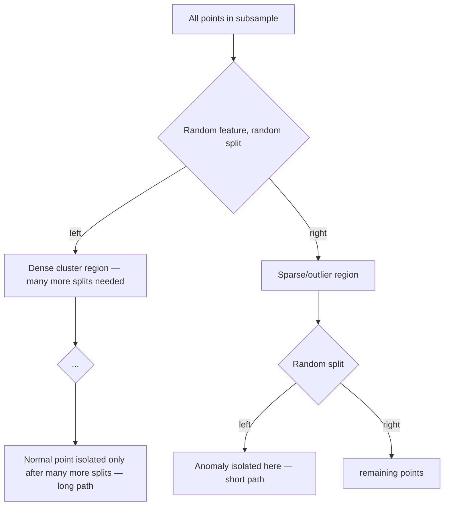
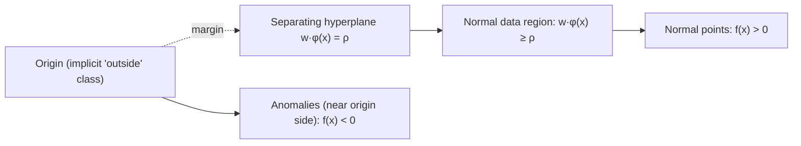

# **Anomaly Detection: Isolation Forest and One-Class SVM**

Your existing clustering chapters (K-Means, GMM, DBSCAN) can flag outliers only as a side effect — DBSCAN's noise label and GMM's low-likelihood scoring both require first modeling the *normal* data's structure. This chapter covers two methods purpose-built for anomaly detection with the opposite philosophy: **Isolation Forest** exploits the fact that anomalies are *easy to isolate* via random partitioning, without ever modeling what "normal" looks like; **One-Class SVM** directly learns a boundary around the normal data region using the same margin-maximization machinery as your existing SVM chapters, but with no negative class at all.

---

## **1. Isolation Forest**

### **1.1 Core Idea**

Anomalies are (by definition) few and different from the bulk of the data. Consider randomly partitioning the feature space by repeatedly picking a random feature and a random split value between its min and max: an anomalous point — sitting far from the dense normal region, or on an unusual combination of feature values — tends to get **separated from all other points in very few random splits**, while a normal point buried inside a dense cluster requires many splits to isolate. Isolation Forest (Liu, Ting, Zhou, 2008) turns this observation directly into an anomaly score, without ever computing a distance, density, or fitting a distribution — a fundamentally different strategy from every clustering-based method in your existing notes.

### **1.2 Building an Isolation Tree (iTree)**

Given a subsample $X'$ of size $\psi$ (subsampling, not the full dataset, is a deliberate design choice — see §1.6):

1. If $|X'| \le 1$ or a maximum depth is reached, stop (external/leaf node).
2. Pick a feature $q$ uniformly at random from the $d$ available features.
3. Pick a split value $p$ uniformly at random between $\min(X'_q)$ and $\max(X'_q)$.
4. Partition $X'$ into $X'_{\text{left}} = \{x\in X': x_q < p\}$ and $X'_{\text{right}} = \{x\in X' : x_q \ge p\}$.
5. Recurse on each side, building left and right subtrees.

An **isolation forest** is an ensemble of $t$ such iTrees, each built from an independent random subsample.



### **1.3 Path Length as an Anomaly Signal**

Define $h(x)$ as the **path length** — the number of edges from the root to the leaf where $x$ is isolated — in a given iTree. Anomalies have systematically **shorter** average path lengths across the forest; normal points buried in dense regions have **longer** average path lengths. This single quantity, averaged over $t$ trees, is the raw signal Isolation Forest is built on.

### **1.4 Deriving the Normalized Anomaly Score**

Raw path length alone isn't directly comparable across dataset sizes $n$ (a tree over more points is naturally taller everywhere), so it must be normalized against what an **average, non-anomalous** point's path length would be. An isolation tree, structurally, is exactly a **Binary Search Tree (BST)** built on random split points — the average path length to isolate a point in a BST built from $n$ i.i.d. random insertions is a classical result:

$$
c(n) = 2H(n-1) - \frac{2(n-1)}{n}, \qquad H(i) = \sum_{k=1}^{i}\frac1k \approx \ln(i) + 0.5772\ (\text{Euler-Mascheroni constant})
$$

This is the expected **unsuccessful-search path length** in a randomly built BST of $n$ nodes — exactly analogous to an iTree, since both structures are built by repeated random binary partitioning. $c(n)$ is used to normalize the observed average path length $E[h(x)]$ (averaged across all $t$ trees in the forest) into a bounded, dataset-size-independent anomaly score:

$$
\boxed{s(x,n) = 2^{-\frac{E[h(x)]}{c(n)}}}
$$

**Interpreting the score:**
- If $E[h(x)] \to 0$ (isolated almost immediately): $s(x,n) \to 2^0 = 1$ — strong anomaly signal.
- If $E[h(x)] \to c(n)$ (isolated at exactly the average rate expected for random data): $s(x,n) \to 2^{-1} = 0.5$ — no clear anomaly signal, indistinguishable from typical data.
- If $E[h(x)] \gg c(n)$ (requires far more splits than average to isolate — deep inside a dense, uniform cluster): $s(x,n) \to 0$ — clearly normal.

A threshold (commonly $s>0.5$–$0.6$, tuned per application, or via a target contamination rate) converts the continuous score into a binary anomaly/normal decision.

### **1.5 Why This Works Without Modeling Normality**

Every clustering-based anomaly method (GMM's likelihood, DBSCAN's density, distance-to-centroid) requires first characterizing what the normal data distribution *looks like* — its shape, density, or cluster structure — and anomalies fall out as a residual "doesn't fit" category. Isolation Forest inverts this: it never estimates a density or fits any distributional assumption about the *majority* class at all. It only exploits a purely structural, geometric fact — anomalies require fewer random axis-aligned cuts to separate from everything else — which is why it tends to be both faster and less sensitive to the *shape* of the normal-data manifold than density-based competitors, at the cost of being an axis-aligned method (§1.7).

### **1.6 Why Subsampling Instead of the Full Dataset**

Counter to typical ensemble intuition (where more data per tree usually helps), Isolation Forest deliberately builds each iTree from a **small subsample** ($\psi=256$ is the paper's default, regardless of total dataset size $n$). Two reasons: (1) with the **full** dataset, dense normal regions require very deep trees to fully partition, diluting the very short-path-length signal that separates anomalies — subsampling keeps trees shallow and the isolation-path contrast sharp; (2) it makes training and scoring cost nearly independent of $n$ (§4), a major practical advantage at scale that no density-based or distance-based method shares.

### **1.7 Worked Numeric Example**

For $n=256$ (the default subsample size):

$$
c(256) = 2\big(\ln(255)+0.5772\big) - \frac{2(255)}{256} \approx 2(5.5413+0.5772) - 1.9922 \approx 2(6.1185) - 1.9922 \approx 12.237 - 1.992 = 10.245
$$

Suppose a point's average path length across the forest is $E[h(x)] = 3.0$ (isolated quickly):

$$
s = 2^{-3.0/10.245} = 2^{-0.2928} \approx 0.816
$$

A clearly anomalous score. Compare a point with $E[h(x)] = 10.0$ (close to the average):

$$
s = 2^{-10.0/10.245} = 2^{-0.9761} \approx 0.508
$$

Essentially indistinguishable from typical data — consistent with the interpretation in §1.4.

---

## **2. One-Class SVM**

### **2.1 Motivation and Setup**

Your existing SVM/Kernel SVM chapters solve binary classification by maximizing the margin between two labeled classes. One-Class SVM (Schölkopf et al., 2001) adapts the same margin-maximization machinery to an **unsupervised** setting with no negative class: given only (mostly normal) unlabeled data, find a decision boundary in the kernel-induced feature space that separates the data region from the origin with maximum margin, treating the origin as the sole implicit "other class."

### **2.2 The $\nu$-SVM Objective**

$$
\min_{w,\rho,\xi}\ \frac12\|w\|^2 - \rho + \frac{1}{\nu n}\sum_{i=1}^n \xi_i
\qquad\text{s.t.}\qquad
w^\top\phi(x_i) \ge \rho - \xi_i,\quad \xi_i \ge 0
$$

where $\phi$ is the (possibly kernel-implicit) feature map, $\rho$ is the offset of the separating hyperplane from the origin, and $\xi_i\ge0$ are slack variables allowing some points to fall on the "wrong" side (analogous to soft-margin SVM in your existing chapters). The decision function is

$$
f(x) = \operatorname{sign}\big(w^\top\phi(x) - \rho\big)
$$

$f(x)>0$: inside the learned normal region; $f(x)<0$: anomaly.



### **2.3 Dual Formulation and the Role of the Kernel**

Following the identical Lagrangian/KKT derivation used for soft-margin SVM (your existing Kernel SVM chapter), the dual problem is

$$
\min_{\alpha}\ \frac12\sum_{i,j}\alpha_i\alpha_j K(x_i,x_j)
\qquad\text{s.t.}\qquad
0\le \alpha_i \le \frac{1}{\nu n},\quad \sum_i\alpha_i = 1
$$

with decision function expressed purely through the kernel (the same "kernel trick" from your existing chapters — $\phi$ is never computed explicitly):

$$
f(x) = \operatorname{sign}\left(\sum_i \alpha_i K(x_i,x) - \rho\right)
$$

The RBF kernel $K(x,y)=\exp(-\gamma\|x-y\|^2)$ is the standard default, letting the learned boundary wrap around arbitrarily shaped normal-data regions rather than being restricted to a linear boundary in the original feature space — precisely the same benefit derived in your existing Kernel SVM chapter, now applied to one-class boundary-fitting instead of two-class separation.

### **2.4 Interpreting $\nu$**

The hyperparameter $\nu \in (0,1]$ has two provable, simultaneous interpretations (Schölkopf et al., 2001):

$$
\nu \ge \text{fraction of training points that are outliers (margin errors, } \xi_i>0\text{)}
$$

$$
\nu \le \text{fraction of training points that become support vectors}
$$

**Intuition:** $\nu$ directly controls the trade-off between how tightly the boundary hugs the training data (small $\nu$: very few points allowed to be misclassified as outliers, tight/conservative decision region) versus how permissively it's fit (large $\nu$: more slack allowed, looser boundary) — a single, interpretable knob replacing the more opaque soft-margin $C$ parameter of standard SVM.

### **2.5 Relationship to SVDD (Support Vector Data Description)**

An essentially equivalent formulation (Tax & Duin, 1999) instead directly fits the **smallest enclosing hypersphere** (center $a$, radius $R$) containing most of the data in feature space:

$$
\min_{a,R,\xi}\ R^2 + \frac{1}{\nu n}\sum_i\xi_i \qquad\text{s.t.}\qquad \|\phi(x_i)-a\|^2 \le R^2+\xi_i
$$

For the RBF kernel specifically (where $K(x,x)=1$ for all $x$, i.e., every point maps to the unit hypersphere in feature space), One-Class SVM and SVDD are provably equivalent up to a reparameterization — both reduce to finding a boundary at fixed "radius" from a reference point in a space where all mapped points already lie on a sphere.

---

## **3. Comparison Table**

| Aspect | Isolation Forest | One-Class SVM | GMM (existing Ch. 40) | DBSCAN (existing Ch. 40) |
|---|---|---|---|---|
| Models normal-data distribution? | no — purely structural/geometric | yes — implicit boundary via margin | yes — explicit density $p(x)$ | no — density-connectivity only |
| Key hyperparameter | number of trees $t$, subsample size $\psi$ | kernel, $\nu$, $\gamma$ | number of components $K$ | $\varepsilon$, minPts |
| Scales to large $n$ | yes — near-linear, subsampling-driven | poor — $O(n^2)$–$O(n^3)$ dual QP | moderate | moderate (with spatial index) |
| Handles non-convex normal regions | yes (ensemble of axis-aligned partitions approximates arbitrary regions) | yes (via RBF kernel) | only within a mixture of ellipses | yes |
| Sensitive to feature scaling | less so (axis-aligned random splits per feature) | yes (kernel distance-based) | yes | yes |
| Output | continuous anomaly score | binary decision (or signed distance) | likelihood $p(x)$, usable as anomaly score | binary noise label only |

---

## **4. Python Implementation From Scratch (Isolation Forest)**

```python
import numpy as np


class IsolationTree:
    def __init__(self, height_limit):
        self.height_limit = height_limit
        self.left = self.right = None
        self.split_feature = self.split_value = None
        self.size = 0  # number of points at this node, used for early-termination path length correction

    def fit(self, X, current_height=0):
        self.size = X.shape[0]
        if current_height >= self.height_limit or self.size <= 1:
            return self  # leaf (external node)

        d = X.shape[1]
        self.split_feature = np.random.randint(d)
        col = X[:, self.split_feature]
        lo, hi = col.min(), col.max()
        if lo == hi:
            return self  # cannot split further along this feature; treat as leaf
        self.split_value = np.random.uniform(lo, hi)

        left_mask = col < self.split_value
        self.left = IsolationTree(self.height_limit).fit(X[left_mask], current_height + 1)
        self.right = IsolationTree(self.height_limit).fit(X[~left_mask], current_height + 1)
        return self

    def path_length(self, x, current_height=0):
        if self.left is None and self.right is None:
            # Leaf reached before full isolation: correct with c(size) for the remaining unsplit points.
            return current_height + _c(self.size)
        if x[self.split_feature] < self.split_value:
            return self.left.path_length(x, current_height + 1)
        return self.right.path_length(x, current_height + 1)


def _c(n):
    """Average unsuccessful-search path length in a random BST of n nodes (§1.4)."""
    if n <= 1:
        return 0.0
    harmonic = np.log(n - 1) + 0.5772156649  # Euler-Mascheroni approximation to H(n-1)
    return 2 * harmonic - 2 * (n - 1) / n


class IsolationForest:
    def __init__(self, n_estimators=100, subsample_size=256, seed=0):
        self.n_estimators = n_estimators
        self.subsample_size = subsample_size
        self.trees = []
        self.rng = np.random.default_rng(seed)

    def fit(self, X):
        n = X.shape[0]
        psi = min(self.subsample_size, n)
        height_limit = int(np.ceil(np.log2(psi)))  # trees only need to be this deep to fully isolate a subsample

        for _ in range(self.n_estimators):
            idx = self.rng.choice(n, size=psi, replace=False)
            tree = IsolationTree(height_limit).fit(X[idx])
            self.trees.append(tree)
        self.c_norm = _c(psi)
        return self

    def anomaly_score(self, X):
        avg_path_length = np.mean(
            [[tree.path_length(x) for tree in self.trees] for x in X], axis=1
        )
        return 2 ** (-avg_path_length / self.c_norm)


# Toy run: a dense normal cluster plus a handful of scattered outliers
rng = np.random.default_rng(1)
normal = rng.normal(loc=0, scale=1.0, size=(200, 2))
outliers = rng.uniform(low=-8, high=8, size=(10, 2))
X = np.vstack([normal, outliers])

forest = IsolationForest(n_estimators=100, subsample_size=128, seed=2).fit(X)
scores = forest.anomaly_score(X)
print("Mean score, normal points:", scores[:200].mean())
print("Mean score, outlier points:", scores[200:].mean())
```

`height_limit = ceil(log2(psi))` caps tree depth at roughly what's needed to fully isolate a random subsample of that size — since path-length contrast for anomalies emerges within the first few splits, there is no benefit to growing trees deeper (this is also why Isolation Forest training is so much cheaper than a typical fully-grown decision tree ensemble).

---

## **5. Equivalent Implementation With scikit-learn**

```python
from sklearn.ensemble import IsolationForest as SKIsolationForest
from sklearn.svm import OneClassSVM
from sklearn.preprocessing import StandardScaler
from sklearn.pipeline import make_pipeline

iso = SKIsolationForest(n_estimators=100, max_samples=256, contamination=0.05, random_state=0)
iso.fit(X)
iso_scores = iso.decision_function(X)   # higher = more normal (note: sign convention is FLIPPED vs §1.4's s(x,n))
iso_labels = iso.predict(X)             # +1 = normal, -1 = anomaly

ocsvm = make_pipeline(
    StandardScaler(),
    OneClassSVM(kernel="rbf", gamma="scale", nu=0.05),
)
ocsvm.fit(X)
ocsvm_labels = ocsvm.predict(X)          # +1 = normal, -1 = anomaly
ocsvm_scores = ocsvm.decision_function(X)  # signed distance to the separating hyperplane
```

**Internals:**
- scikit-learn's `IsolationForest.decision_function` returns `average_path_length_offset - normalized_score`, i.e., it **flips the sign convention** from §1.4 so that **higher** values mean more normal (consistent with other scikit-learn anomaly detectors) — always check the sign convention before thresholding a raw score from a new library.
- `contamination` sets the expected fraction of anomalies in the training data, used only to automatically choose a score threshold for `.predict()`'s binary output — it does not affect how trees are built.
- `OneClassSVM` solves the dual QP from §2.3 via the same SMO-style solver (`libsvm`) as scikit-learn's regular `SVC`, inheriting its $O(n^2)$–$O(n^3)$ scaling and the corresponding practical size limits (§6) — `StandardScaler` is essential beforehand since the RBF kernel is distance-based.
- `gamma="scale"` (the default) sets $\gamma = 1/(d\cdot\operatorname{Var}(X))$, automatically adapting the kernel bandwidth to the data's scale — a reasonable starting point before any manual tuning.

---

## **6. Complexity**

| Method | Training Time | Scoring Time (per point) | Space |
|---|---|---|---|
| Isolation Forest | $O(t\cdot\psi\log\psi)$ — **independent of full dataset size $n$** | $O(t\log\psi)$ | $O(t\psi)$ |
| One-Class SVM (dual QP, `libsvm`) | $O(n^2)$ to $O(n^3)$ typical | $O(n_{\text{SV}}\cdot d)$ (one kernel evaluation per support vector) | $O(n_{\text{SV}}\cdot d)$ |

Isolation Forest's near-constant-in-$n$ training cost (via fixed subsample size $\psi$, independent of $n$) is its single biggest practical advantage at scale; One-Class SVM's quadratic-to-cubic dual QP makes it impractical much past tens of thousands of points without approximations (e.g., the Nyström method or `SGDOneClassSVM`'s linear approximation in scikit-learn).

---

## **7. Numerical Stability, Edge Cases, and Pitfalls**

**Isolation Forest:**
- **Irrelevant/noisy features dilute the signal:** since features are picked uniformly at random for splitting, a dataset with many irrelevant features relative to the few that actually separate anomalies wastes many splits on uninformative dimensions, weakening the path-length contrast; feature selection or importance-weighted split sampling can help in high dimensions.
- **Axis-aligned splits limit boundary shapes:** each split only thresholds a single feature, so the effective decision boundary is a union of axis-aligned boxes; anomalies defined by a *rotated* or *diagonal* relationship between correlated features can be harder to isolate quickly than the paper's examples suggest — Extended Isolation Forest (Hariri et al.) addresses this with random-hyperplane splits instead of axis-aligned ones.
- **Duplicate/constant-valued regions:** if many points share identical values along the split feature (`lo == hi` in §4's code), no further split is possible along that feature at that node — handled by falling back to a leaf, but can inflate path lengths for legitimately anomalous points trapped in a large duplicate cluster.
- **Categorical features require encoding** (as with most distance/threshold-based methods) — one-hot or ordinal encoding, chosen consistently with whether category order is meaningful.

**One-Class SVM:**
- **Extremely sensitive to $\nu$ and $\gamma$/kernel choice:** unlike Isolation Forest's relatively robust defaults, One-Class SVM's boundary shape and outlier fraction are both governed by hyperparameters with no fully automatic selection method (cross-validation is not directly applicable in the unsupervised setting without some labeled anomalies for validation) — typically tuned via domain knowledge of the expected contamination rate or a small labeled validation set.
- **Poor scalability:** the $O(n^2)$–$O(n^3)$ dual QP (§6) makes vanilla `OneClassSVM` impractical for large datasets without switching to `SGDOneClassSVM` (a linear, stochastic-gradient approximation) or subsampling.
- **Requires feature scaling**, since the RBF kernel's notion of distance is scale-dependent — an unscaled large-magnitude feature will dominate the kernel and effectively ignore the rest.
- **Assumes the origin is a meaningful "outside" reference in feature space** — a modeling choice baked into the formulation (§2.1) that is not always a natural fit for every kernel/data combination; RBF kernels (where $K(x,x)=1$ always) make this assumption much more sensible than, e.g., a linear kernel on unnormalized data.

---

## **8. Connections to Related ML Concepts**

- **Density-based anomaly detection (GMM, DBSCAN — existing Ch. 40):** the complementary approach to both methods here — model the normal distribution explicitly (GMM likelihood) or via connectivity (DBSCAN noise label), then flag what doesn't fit, versus Isolation Forest's distribution-free structural approach or One-Class SVM's margin-based boundary approach.
- **Random forests / decision trees (existing chapters):** Isolation Forest reuses the "ensemble of randomized trees" template from Random Forest, but repurposes tree structure itself (path length) as the signal, rather than using trees for their usual role of averaging predictions.
- **Soft-margin and Kernel SVM (existing chapters):** One-Class SVM's dual derivation, KKT conditions, and kernel trick are a direct, minimal adaptation of the machinery in your existing SVM chapters — understanding soft-margin SVM's Lagrangian derivation there transfers almost unchanged here.
- **Autoencoder-based anomaly detection (generative-models chapter):** a third major anomaly-detection paradigm — train an autoencoder on normal data only, then flag high reconstruction error at test time as anomalous; conceptually similar to GMM's "low likelihood = anomaly" but using a neural network's reconstruction ability instead of an explicit density.
- **Extreme value theory:** the theoretical justification for many threshold-based anomaly scores (including calibrating Isolation Forest/One-Class SVM score cutoffs) draws on extreme value statistics for the tail behavior of the score distribution under the normal class.

---

## **9. References for Deeper Reading**

- Fei Tony Liu, Kai Ming Ting, Zhi-Hua Zhou, "Isolation Forest", ICDM 2008 (the original paper). https://cs.nju.edu.cn/zhouzh/zhouzh.files/publication/icdm08b.pdf
- Fei Tony Liu, Kai Ming Ting, Zhi-Hua Zhou, "Isolation-Based Anomaly Detection", ACM TKDD, 2012 (extended journal version, $c(n)$ derivation).
- Bernhard Schölkopf et al., "Estimating the Support of a High-Dimensional Distribution", Neural Computation, 2001 (the original One-Class SVM / $\nu$-SVM paper).
- David M. J. Tax and Robert P. W. Duin, "Support Vector Data Description", Machine Learning, 2004 (SVDD, §2.5).
- Sahand Hariri, Matias Carrasco Kind, Robert J. Brunner, "Extended Isolation Forest", IEEE TKDE, 2021 (fixes the axis-aligned-split limitation, §7).
- scikit-learn documentation, `ensemble.IsolationForest` and `svm.OneClassSVM`. https://scikit-learn.org/stable/modules/outlier_detection.html
