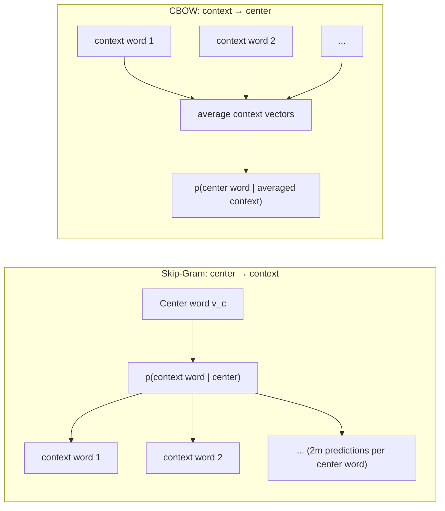

# **Word Embeddings: Word2Vec and GloVe**

Your existing NLP chapter treats words largely as discrete tokens (bag-of-words, TF-IDF); your Transformer chapter starts from an embedding matrix without deriving where its pretrained/pretrainable structure comes from. Word2Vec and GloVe are the algorithms that turn one-hot, meaningless discrete tokens into dense vectors where **geometric relationships encode semantic relationships** ($\vec{\text{king}} - \vec{\text{man}} + \vec{\text{woman}} \approx \vec{\text{queen}}$) — the representation-learning breakthrough that made every downstream neural NLP architecture (including the embedding layer feeding your Transformer chapter) practical.

---

## **1. Motivation: Why Not One-Hot / Bag-of-Words?**

A one-hot vector for a vocabulary of size $V$ has dimension $V$ (often $10^5$–$10^6$), is maximally sparse, and — critically — has **zero inner product between any two distinct words**: "cat" and "dog" are exactly as (dis)similar as "cat" and "refrigerator" under a one-hot representation, because $e_i^\top e_j = 0$ for all $i\ne j$. There is no notion of similarity, no way to generalize what's learned about "cat" to help predict something about "dog." Dense embeddings fix this by learning a low-dimensional vector per word ($d\approx 100$–$300$, versus $V$) such that words with similar **distributional behavior** (appearing in similar contexts) end up with similar vectors.

### **1.1 The Distributional Hypothesis**

The entire family of methods in this chapter rests on one linguistic assumption (Firth, 1957): *"You shall know a word by the company it keeps."* Words that occur in similar contexts tend to have similar meanings. This turns a semantic problem (what does a word *mean*?) into a purely statistical, corpus-derivable one (what words tend to co-occur with it?) — no hand-crafted semantic ontology required.

---

## **2. Word2Vec: Skip-Gram**

### **2.1 Setup**

Given a corpus, slide a window of size $m$ over each position $t$; the **center word** $w_t$ should predict its **context words** $w_{t+j}$ for $j\in\{-m,\dots,-1,1,\dots,m\}$ (skipping $j=0$). Each word $w$ has **two** learned vectors: $v_w$ (as a center word) and $u_w$ (as a context word) — using separate vectors for the two roles simplifies the gradient derivation below and is standard practice (the two are sometimes averaged or one is discarded after training).

### **2.2 The Full-Softmax Objective**

The probability of context word $o$ given center word $c$ is modeled with a softmax over the entire vocabulary:

$$
p(o \mid c) = \frac{\exp(u_o^\top v_c)}{\sum_{w=1}^{V} \exp(u_w^\top v_c)}
$$

The training objective maximizes the average log-probability of all observed (center, context) pairs across the corpus of length $T$:

$$
J(\theta) = \frac{1}{T}\sum_{t=1}^{T}\sum_{-m\le j\le m,\ j\ne0} \log p(w_{t+j}\mid w_t)
$$

### **2.3 Why Full Softmax Is Computationally Infeasible**

Both the softmax denominator and its gradient require summing over **all $V$ vocabulary words** for *every single training pair* — with $V$ often in the hundreds of thousands and a corpus of billions of tokens, this is computationally prohibitive. This single bottleneck is what negative sampling (and the alternative, hierarchical softmax) exists to solve.

### **2.4 Negative Sampling — Derivation**

Reframe the problem: instead of predicting the exact identity of the context word out of $V$ candidates (a $V$-way classification problem), turn it into $k+1$ independent **binary** classification problems — "is this (center, context) pair a real co-occurrence from the corpus, or a randomly sampled fake ('negative') pair?" Define the probability that pair $(c,o)$ is real using the logistic sigmoid of their dot product:

$$
p(D=1\mid c,o) = \sigma(u_o^\top v_c) = \frac{1}{1+\exp(-u_o^\top v_c)}
$$

For each true observed pair $(c,o)$, sample $k$ **negative** words $w_1,\dots,w_k$ from a noise distribution $p_n(w)$ (independent of $c$). The per-pair objective to **maximize** is

$$
\log\sigma(u_o^\top v_c) + \sum_{i=1}^{k} \mathbb{E}_{w_i\sim p_n}\left[\log\sigma(-u_{w_i}^\top v_c)\right]
$$

**Term-by-term meaning:** the first term pushes the true context word's dot product with the center word **up** (toward being classified "real"); the second term pushes $k$ randomly-sampled words' dot products **down** (toward being classified "fake"), using $\sigma(-x) = 1-\sigma(x)$ so the same sigmoid form handles both directions. This completely replaces the $O(V)$ softmax computation per training pair with an $O(k)$ computation ($k$ typically $5$–$20$ for smaller datasets, $2$–$5$ for very large corpora) — the single most important practical trick that made training word embeddings on web-scale corpora feasible.

### **2.5 Choosing the Noise Distribution**

Mikolov et al. (2013) found empirically that sampling negatives proportional to **unigram frequency raised to the $3/4$ power**, rather than raw frequency, works best:

$$
p_n(w) \propto U(w)^{3/4}
$$

where $U(w)$ is $w$'s raw corpus frequency. **Intuition:** raising to the $3/4$ power flattens the distribution — it downweights extremely frequent words (like "the") relative to raw frequency, and correspondingly upweights rare words, giving more informative negative samples than pure frequency-proportional sampling would (which would sample "the" as a negative constantly, wasting most negative-sampling capacity on a word that carries little discriminative signal).

### **2.6 CBOW: The Mirror-Image Variant**

Continuous Bag-of-Words (CBOW) reverses the prediction direction: given the **context** words, predict the **center** word. The context vectors are averaged (or summed) into a single vector before the softmax/negative-sampling classification step:

$$
p(c \mid \{w_{t+j}\}_{j\ne0}) \propto \exp\left(u_c^\top \cdot \frac{1}{2m}\sum_{j\ne0} v_{w_{t+j}}\right)
$$

CBOW smooths over the context (averaging washes out noise from any single context word), making it generally faster to train and better for **frequent** words; Skip-gram, by contrast, treats each context word as a separate training example (from one center word, generating $2m$ separate predictions), giving it more effective training signal per rare word and generally better representations for **infrequent** words — this frequent/rare trade-off is the standard practical guidance for choosing between the two.



---

## **3. GloVe: Global Vectors**

### **3.1 Motivation — Global Co-occurrence Statistics**

Word2Vec only ever looks at **local context windows**, one training pair at a time, and never directly uses global corpus-wide co-occurrence *counts*. GloVe (Pennington, Socher, Manning, 2014) instead starts from the full **co-occurrence matrix** $X$, where $X_{ij}$ = number of times word $j$ appears in word $i$'s context window across the entire corpus, and derives an objective directly from properties this matrix should satisfy.

### **3.2 The Key Insight: Co-occurrence Probability Ratios Encode Meaning**

Consider two words $i,j$ (e.g., "ice" and "steam") and a probe word $k$. GloVe's motivating observation is that the **ratio** $P_{ik}/P_{jk}$ (where $P_{ik}=X_{ik}/\sum_w X_{iw}$) is far more informative than either raw co-occurrence probability alone:

- $k=\text{"solid"}$: $P_{ik}/P_{jk}$ is large (solid co-occurs much more with ice than steam).
- $k=\text{"gas"}$: $P_{ik}/P_{jk}$ is small (gas co-occurs much more with steam than ice).
- $k=\text{"water"}$ (relevant to both) or $k=\text{"fashion"}$ (relevant to neither): the ratio is $\approx 1$.

This ratio behavior — large/small/near-1 depending on whether $k$ discriminates between $i$ and $j$ — is exactly the signal GloVe wants its embeddings to reproduce.

### **3.3 Deriving the GloVe Objective**

GloVe posits that word vectors should satisfy, for some function $F$:

$$
F(v_i, v_j, u_k) = \frac{P_{ik}}{P_{jk}}
$$

Restricting $F$ to depend only on the vector difference (so the relationship depends on the relative, not absolute, position of $i$ and $j$) and only through a dot product (so the two arguments combine linearly, matching the linear-substructure goal — e.g., analogies as vector differences):

$$
F\big((v_i-v_j)^\top u_k\big) = \frac{P_{ik}}{P_{jk}}
$$

Requiring $F$ to be a homomorphism from $(\mathbb R,+)$ to $(\mathbb R_{>0},\times)$ — so that swapping the roles of $i,j$ correctly inverts the ratio — forces $F=\exp$:

$$
\exp\big((v_i-v_j)^\top u_k\big) = \frac{P_{ik}}{P_{jk}} \;\Longrightarrow\; \exp(v_i^\top u_k) = P_{ik}\cdot(\text{term not depending on } j) \;\Longrightarrow\; v_i^\top u_k = \log X_{ik} - \log\left(\sum_w X_{iw}\right)
$$

The second term depends only on $i$ (not $k$), so it's absorbed into a per-word bias $b_i$; symmetrically, a bias $\tilde b_k$ absorbs another normalization constant, giving the target relationship:

$$
v_i^\top u_k + b_i + \tilde b_k = \log X_{ik}
$$

### **3.4 The Weighted Least-Squares Loss**

Turning the above into a regression objective, minimizing squared error between the model's prediction and the observed log-co-occurrence, weighted to avoid two failure modes — rare co-occurrences ($X_{ik}$ small or $0$) being over-weighted (they're noisy estimates) and extremely frequent co-occurrences (e.g., "the", "of") dominating the loss:

$$
\boxed{J = \sum_{i,k:\,X_{ik}>0} f(X_{ik})\Big(v_i^\top u_k + b_i + \tilde b_k - \log X_{ik}\Big)^2}
$$

with weighting function

$$
f(x) = \begin{cases} (x/x_{\max})^\alpha, & x < x_{\max} \\ 1, & \text{otherwise} \end{cases}
$$

typically $\alpha=0.75$ (notably the same exponent as Word2Vec's negative-sampling noise distribution, §2.5 — both are empirically-tuned corrections for the same underlying issue: raw frequency over-weights extremely common events) and $x_{\max}\approx100$. $f(0)=0$ handles the (very common, since most word pairs never co-occur) zero-count case by simply excluding those terms from the sum entirely — avoiding $\log(0)$.

### **3.5 GloVe as Implicit Matrix Factorization**

The objective in §3.4 is literally a **weighted low-rank matrix factorization** of $\log X$ (plus bias terms) into $V\times d$ and $d\times V$ factors — connecting GloVe directly to classical dimensionality-reduction techniques (your existing PCA chapter). Levy & Goldberg (2014) further showed that Word2Vec's skip-gram-with-negative-sampling objective is, at its optimum, **implicitly factorizing a shifted Pointwise Mutual Information (PMI) matrix**:

$$
v_i^\top u_j \approx \operatorname{PMI}(i,j) - \log k
$$

(where $k$ is the number of negative samples) — a striking theoretical unification showing that Word2Vec and GloVe, despite very different-looking training procedures (local sliding-window classification versus global co-occurrence regression), are both, at their core, learning low-rank factorizations of co-occurrence-derived statistics.

---

## **4. Worked Numeric Example (Skip-Gram Negative Sampling Gradient)**

Let $d=2$. Suppose center word "cat" has $v_c = [1.0, 0.5]$, true context word "meows" has $u_o = [0.8, 0.3]$, and one sampled negative "airplane" has $u_{w_1} = [-0.5, 0.9]$.

**Positive term:**

$$
u_o^\top v_c = (0.8)(1.0)+(0.3)(0.5) = 0.95, \qquad \sigma(0.95) = 0.7211
$$

**Negative term:**

$$
u_{w_1}^\top v_c = (-0.5)(1.0)+(0.9)(0.5) = -0.05, \qquad \sigma(-(-0.05)) = \sigma(0.05) = 0.5125
$$

Per-pair objective value: $\log(0.7211) + \log(0.5125) = -0.3272 + (-0.6685) = -0.9957$ (to be maximized; gradient ascent moves $v_c, u_o$ to increase this).

**Gradient with respect to $v_c$** (from $\partial/\partial v_c\left[\log\sigma(u_o^\top v_c) + \log\sigma(-u_{w_1}^\top v_c)\right]$, using $\sigma'(x)=\sigma(x)(1-\sigma(x))$ and the chain rule):

$$
\nabla_{v_c} = \big(1-\sigma(u_o^\top v_c)\big)u_o - \sigma(u_{w_1}^\top v_c)\,u_{w_1}
$$

$$
= (1-0.7211)(0.8,0.3) - \sigma(-0.05)\,(-0.5,0.9) = 0.2789(0.8,0.3) - 0.4875(-0.5,0.9)
$$

$$
= (0.2231,0.0837) - (-0.2438,0.4388) = (0.4669, -0.3551)
$$

This gradient is added (scaled by a learning rate) to $v_c$: it pushes $v_c$ toward $u_o$ (the true context word's direction) and away from $u_{w_1}$ (the negative sample's direction) — exactly the intuitive "pull real pairs together, push fake pairs apart" behavior the objective was designed to produce.

---

## **5. Word2Vec vs. GloVe**

| Aspect | Word2Vec (Skip-gram/CBOW) | GloVe |
|---|---|---|
| Signal used | local context windows, one training pair at a time | global co-occurrence counts, aggregated once |
| Training procedure | online, streaming SGD over the corpus | batch: build $X$ once, then optimize weighted least squares |
| Underlying mathematical structure | implicitly factorizes a shifted PMI matrix (Levy & Goldberg) | explicitly, directly factorizes weighted $\log X$ |
| Scalability | scales naturally to streaming/very large corpora (no need to materialize $X$) | requires building/storing the (sparse) co-occurrence matrix upfront |
| Empirical quality | comparable on most benchmarks | comparable on most benchmarks; often slightly better on analogy tasks in the original paper's evaluation |

---

## **6. Python Implementation From Scratch (Skip-Gram with Negative Sampling)**

```python
import numpy as np
from collections import Counter


def build_vocab(tokenized_corpus):
    counts = Counter(tokenized_corpus)
    vocab = {w: i for i, (w, _) in enumerate(counts.most_common())}
    freqs = np.array([counts[w] for w in vocab], dtype=np.float64)
    return vocab, freqs


def make_noise_distribution(freqs, power=0.75):
    """Unigram^0.75 distribution for negative sampling (§2.5)."""
    weighted = freqs ** power
    return weighted / weighted.sum()


def sigmoid(x):
    return 1.0 / (1.0 + np.exp(-x))


def generate_pairs(token_ids, window_size):
    pairs = []
    T = len(token_ids)
    for t in range(T):
        for j in range(-window_size, window_size + 1):
            if j == 0 or not (0 <= t + j < T):
                continue
            pairs.append((token_ids[t], token_ids[t + j]))  # (center, context)
    return pairs


class SkipGramNegativeSampling:
    def __init__(self, vocab_size, dim, seed=0):
        rng = np.random.default_rng(seed)
        self.V = rng.normal(0, 0.1, size=(vocab_size, dim))  # center-word vectors
        self.U = rng.normal(0, 0.1, size=(vocab_size, dim))  # context-word vectors

    def train_pair(self, center, context, negatives, lr=0.01):
        v_c = self.V[center]
        u_o = self.U[context]

        pos_grad_coef = 1 - sigmoid(u_o @ v_c)  # (1 - sigma(u_o^T v_c))
        grad_v = pos_grad_coef * u_o
        grad_u_o = pos_grad_coef * v_c

        for neg in negatives:
            u_neg = self.U[neg]
            neg_grad_coef = sigmoid(u_neg @ v_c)  # sigma(u_neg^T v_c)
            grad_v -= neg_grad_coef * u_neg
            self.U[neg] += lr * (-neg_grad_coef * v_c)  # push negative's vector away

        self.V[center] += lr * grad_v
        self.U[context] += lr * grad_u_o


# Toy end-to-end run
corpus = "the cat sat on the mat the dog chased the cat".split()
vocab, freqs = build_vocab(corpus)
token_ids = [vocab[w] for w in corpus]
noise_dist = make_noise_distribution(freqs)

rng = np.random.default_rng(1)
model = SkipGramNegativeSampling(vocab_size=len(vocab), dim=10, seed=2)
pairs = generate_pairs(token_ids, window_size=2)

for epoch in range(50):
    for center, context in pairs:
        negatives = rng.choice(len(vocab), size=5, p=noise_dist)
        model.train_pair(center, context, negatives, lr=0.05)

print("Vector for 'cat':", model.V[vocab["cat"]])
```

This directly implements the gradient derived numerically in §4 (`pos_grad_coef` and `neg_grad_coef` are exactly the $(1-\sigma(\cdot))$ and $\sigma(\cdot)$ terms from that derivation), updating both center and context vectors, plus every sampled negative's context vector, on each training pair.

---

## **7. Equivalent Implementation With PyTorch / gensim**

```python
import torch
from torch import nn
import torch.nn.functional as F


class SkipGramModel(nn.Module):
    def __init__(self, vocab_size, dim):
        super().__init__()
        self.center_embed = nn.Embedding(vocab_size, dim)   # V matrix
        self.context_embed = nn.Embedding(vocab_size, dim)  # U matrix

    def forward(self, center, context, negatives):
        v_c = self.center_embed(center)               # (batch, dim)
        u_o = self.context_embed(context)              # (batch, dim)
        u_neg = self.context_embed(negatives)           # (batch, k, dim)

        pos_score = (v_c * u_o).sum(dim=1)              # dot product per example
        neg_score = torch.bmm(u_neg, v_c.unsqueeze(2)).squeeze(2)  # (batch, k)

        pos_loss = F.logsigmoid(pos_score)
        neg_loss = F.logsigmoid(-neg_score).sum(dim=1)
        return -(pos_loss + neg_loss).mean()  # negative log-likelihood to minimize


model = SkipGramModel(vocab_size=10000, dim=100)
optimizer = torch.optim.Adam(model.parameters(), lr=1e-3)

center = torch.randint(0, 10000, (64,))
context = torch.randint(0, 10000, (64,))
negatives = torch.randint(0, 10000, (64, 5))

loss = model(center, context, negatives)
loss.backward()
optimizer.step()
```

**Internals worth knowing:**
- `nn.Embedding` is literally a lookup table (a $V\times d$ matrix) with gradients only flowing back into the rows actually indexed in a given batch — an efficient sparse-update mechanism under the hood (via `sparse=True` or, in dense mode, the optimizer still only receives nonzero gradients for touched rows), critical for vocabularies of size $10^5$–$10^6$.
- `F.logsigmoid(x) = -softplus(-x)` computes $\log\sigma(x)$ in a single numerically stable operation, exactly analogous to the stable sigmoid/BCE patterns used throughout the LSTM, VAE, and GAN chapters.
- **gensim** (`gensim.models.Word2Vec(sentences, vector_size=100, window=5, min_count=5, sg=1, negative=5)`) is the standard production library for training Word2Vec directly from raw tokenized sentences, handling vocabulary building, subsampling of frequent words, and multi-threaded training internally; `sg=1` selects skip-gram, `sg=0` selects CBOW.

---

## **8. Complexity**

| Method | Training Time | Space |
|---|---|---|
| Skip-gram + negative sampling | $O(T\cdot m\cdot k\cdot d)$ — $T$=corpus length, $m$=window, $k$=negatives, $d$=embedding dim | $O(Vd)$ for both embedding matrices |
| Full softmax (naive) | $O(T\cdot m\cdot V\cdot d)$ | $O(Vd)$ |
| GloVe | $O(\text{nnz}(X)\cdot d)$ per epoch — nnz = nonzero co-occurrence entries, typically $\ll V^2$ | $O(Vd)$ embeddings + $O(\text{nnz}(X))$ for the sparse co-occurrence matrix |

Negative sampling's $O(k)$ replacing full softmax's $O(V)$ per training pair (with $k\ll V$, e.g., $k=5$ vs. $V=10^6$) is the entire reason Word2Vec scales to web-sized corpora.

---

## **9. Numerical Stability, Edge Cases, and Pitfalls**

- **Static embeddings cannot handle polysemy:** a word like "bank" gets exactly one vector, forced to be some blend of "river bank" and "financial bank" senses — this is the single biggest limitation that contextual embeddings (BERT/Transformer-based, built on the attention mechanism in your existing Transformer chapter) were built to fix, since those produce a *different* vector for the same word depending on surrounding context.
- **Out-of-vocabulary (OOV) words:** any word not seen (frequently enough) during training has no embedding at all; **FastText** (Bojanowski et al., 2017) addresses this by representing each word as a bag of character $n$-grams and summing their embeddings, so even unseen words get a reasonable vector from their subword pieces.
- **Rare-word quality:** words below the minimum-count threshold are typically dropped entirely; words just above it still get noisy embeddings from too few training examples — a fundamental data-hungriness of the distributional approach, not a fixable hyperparameter issue.
- **Window size trade-off:** small windows ($m=2$–$5$) tend to capture more syntactic similarity (words interchangeable grammatically); large windows ($m=10+$) tend to capture more topical/semantic similarity — this is a real, meaningfully different qualitative behavior, not just a speed/quality dial.
- **Frequent-word subsampling:** without correction, extremely common words ("the", "a") dominate training-pair generation while contributing little semantic signal; standard implementations (including gensim) randomly discard frequent-word occurrences with a probability increasing in their frequency before generating training pairs, distinct from (but complementary to) the $3/4$-power noise distribution used for negatives.
- **GloVe's $\log(0)$ handling:** the vast majority of word pairs never co-occur ($X_{ij}=0$), and the weighting function $f(0)=0$ is what makes this tractable — a from-scratch implementation that instead tried $\log(X_{ij})$ for all $V^2$ pairs (rather than only the nonzero, sparse entries) would both be computationally infeasible and hit $\log(0)=-\infty$.
- **Embedding dimension choice:** too small underfits available distributional information; too large increases overfitting risk and compute/memory cost with diminishing returns past a few hundred dimensions for most applications — $d=100$–$300$ is the typical practical range.

---

## **10. Connections to Related ML Concepts**

- **Matrix factorization (PCA — existing chapter):** §3.5 shows both GloVe and Word2Vec are, at their core, low-rank factorizations of a co-occurrence-derived matrix — the same underlying linear-algebra idea as PCA, just applied to a different (co-occurrence/PMI, rather than covariance) matrix.
- **Negative sampling and contrastive/noise-contrastive estimation:** the "real pair vs. sampled fake pair" binary classification trick in §2.4 is a specific instance of Noise-Contrastive Estimation (Gutmann & Hyvärinen, 2010), the same broader principle underlying modern contrastive self-supervised learning (e.g., SimCLR-style methods) — training a model to distinguish real associations from randomly sampled ones, without ever needing an expensive full-partition-function computation.
- **Transformer embeddings (existing chapter):** the embedding matrix at the input of your Transformer chapter is frequently initialized from (or trained analogously to) the methods here; the key conceptual leap Transformers add is making embeddings **contextual** (via self-attention) rather than static per-word vectors.
- **The kernel/inner-product view of similarity:** cosine similarity between word vectors as a proxy for semantic similarity is the same "inner product as similarity" idea underlying kernel methods (your SVM chapters) and metric learning generally.
- **Analogical reasoning as vector arithmetic:** the famous $\vec{\text{king}}-\vec{\text{man}}+\vec{\text{woman}}\approx\vec{\text{queen}}$ result is a direct empirical consequence of the objective's design (§3.3's requirement that $F$ depend only on vector *differences*), not a separate mechanism bolted on afterward.

---

## **11. References for Deeper Reading**

- Tomas Mikolov et al., "Efficient Estimation of Word Representations in Vector Space" (the original Word2Vec paper), 2013. https://arxiv.org/abs/1301.3781
- Tomas Mikolov et al., "Distributed Representations of Words and Phrases and their Compositionality" (negative sampling), NeurIPS 2013. https://arxiv.org/abs/1310.4546
- Jeffrey Pennington, Richard Socher, Christopher D. Manning, "GloVe: Global Vectors for Word Representation", EMNLP 2014. https://nlp.stanford.edu/pubs/glove.pdf
- Omer Levy and Yoav Goldberg, "Neural Word Embedding as Implicit Matrix Factorization", NeurIPS 2014 (the PMI-factorization equivalence, §3.5).
- Piotr Bojanowski et al., "Enriching Word Vectors with Subword Information" (FastText), TACL 2017. https://arxiv.org/abs/1607.04606
- Michael Gutmann and Aapo Hyvärinen, "Noise-Contrastive Estimation: A New Estimation Principle for Unnormalized Statistical Models", AISTATS 2010.
- gensim documentation, `models.Word2Vec`. https://radimrehurek.com/gensim/models/word2vec.html
