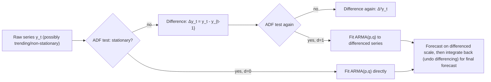

# **ARIMA and Classical Time Series Forecasting**

Your regression chapters assume i.i.d. (or at least exchangeable) observations; your LSTM/GRU chapter (Ch. 038) handles sequential dependence with a learned nonlinear recurrence but needs substantial data and offers little built-in statistical interpretability. ARIMA sits between these: a linear, statistically well-understood model of temporal dependence — how much a value depends on its own past values and past shocks — that remains a strong, cheap, interpretable baseline (and is often still competitive) for univariate forecasting, especially with limited data.

---

## **1. Stationarity**

A time series $\{y_t\}$ is (weakly/covariance) **stationary** if its mean, variance, and autocovariance structure do not depend on $t$:

$$
\mathbb E[y_t] = \mu \ \text{(constant)}, \qquad \operatorname{Cov}(y_t,y_{t+k}) = \gamma_k \ \text{(depends only on lag } k\text{, not } t\text{)}
$$

**Why this matters:** every model in this chapter (AR, MA, ARMA) is defined by *time-invariant* coefficients relating a value to its own past — this only makes statistical sense if the underlying process's behavior is itself time-invariant. Fitting an AR model to a series with a trending mean or growing variance produces coefficients that don't generalize, since the "rules" governing the series are themselves changing over time. Non-stationary series (trends, growing variance, seasonality) must be transformed (typically via differencing, §3) into a stationary series before AR/MA modeling applies.

**Testing:** the Augmented Dickey-Fuller (ADF) test is the standard hypothesis test for a unit root (non-stationarity); rejecting the null hypothesis provides evidence the series is stationary. This chapter assumes stationarity has been checked/achieved and focuses on the modeling that follows.

---

## **2. Autoregressive (AR) Models**

### **2.1 AR(p) Definition**

$$
y_t = c + \sum_{i=1}^{p} \phi_i y_{t-i} + \varepsilon_t, \qquad \varepsilon_t \sim \text{i.i.d.}(0,\sigma^2)
$$

$y_t$ is modeled as a linear combination of its own **previous $p$ values** plus white noise $\varepsilon_t$. This is structurally identical to linear regression (your existing chapter) where the "features" are the series' own lagged values instead of external covariates — a direct, useful bridge for intuition.

### **2.2 Stationarity Condition and the Characteristic Equation**

Define the lag operator $L$: $Ly_t = y_{t-1}$, so the AR(p) model is $\phi(L)y_t = c+\varepsilon_t$ with $\phi(L) = 1-\phi_1L-\dots-\phi_pL^p$. The process is stationary if and only if all roots of the **characteristic equation**

$$
1 - \phi_1 z - \phi_2 z^2 - \dots - \phi_p z^p = 0
$$

lie **outside the unit circle** ($|z|>1$). For AR(1) specifically ($y_t=c+\phi y_{t-1}+\varepsilon_t$), the single root is $z=1/\phi$, so the condition reduces to the well-known $|\phi|<1$: if $|\phi|\ge1$, shocks never decay (or grow without bound), and the series is non-stationary (a random walk when $\phi=1$ exactly).

### **2.3 Yule-Walker Equations — Deriving Parameter Estimates**

Multiply the AR(p) equation (mean-centered, $c=0$ WLOG) by $y_{t-k}$ and take expectations:

$$
\mathbb E[y_ty_{t-k}] = \sum_{i=1}^p\phi_i\,\mathbb E[y_{t-i}y_{t-k}] + \mathbb E[\varepsilon_ty_{t-k}]
$$

For $k>0$, $\varepsilon_t$ (occurring at time $t$) is uncorrelated with $y_{t-k}$ (determined by information strictly before $t$), so the last term vanishes, giving the **Yule-Walker equations** relating autocovariances $\gamma_k = \operatorname{Cov}(y_t,y_{t-k})$:

$$
\gamma_k = \sum_{i=1}^p \phi_i\,\gamma_{k-i}, \qquad k=1,\dots,p
$$

This is a linear system: given sample autocovariances $\hat\gamma_0,\dots,\hat\gamma_p$ (computed directly from data), solve the $p\times p$ linear system for $\hat\phi_1,\dots,\hat\phi_p$ — a closed-form (non-iterative) estimator, in contrast to the maximum-likelihood estimation typically required once MA terms are involved (§4).

### **2.4 The Autocorrelation Function (ACF) and Partial ACF (PACF)**

The **ACF** at lag $k$ is $\rho_k = \gamma_k/\gamma_0$ — the correlation between $y_t$ and $y_{t-k}$, including indirect correlation through intermediate lags. The **PACF** at lag $k$ is the correlation between $y_t$ and $y_{t-k}$ **after removing** the linear effect of $y_{t-1},\dots,y_{t-k+1}$ — i.e., the *direct* contribution of lag $k$ alone.

**Why this matters for model identification:** for a true AR(p) process, the PACF is exactly zero beyond lag $p$ (there is no *direct* dependence on lags further back than $p$, by definition of the model) while the ACF decays gradually. This gives a practical, data-driven rule: plot the PACF and look for the lag beyond which it drops to (statistically insignificant) zero — that lag is a candidate $p$.

---

## **3. Moving Average (MA) Models**

### **3.1 MA(q) Definition**

$$
y_t = \mu + \varepsilon_t + \sum_{i=1}^q \theta_i \varepsilon_{t-i}, \qquad \varepsilon_t \sim \text{i.i.d.}(0,\sigma^2)
$$

Unlike AR, which regresses on past **values**, MA regresses on past **shocks** (unobserved noise terms) — the current value is a weighted sum of the current and $q$ most recent random innovations. MA processes are **always stationary** for any finite $\theta_i$ (there is no analogous unit-root condition — a finite sum of a bounded number of finite-variance noise terms always has finite, time-invariant variance).

### **3.2 Why MA Has No Simple Closed-Form Estimator**

Unlike AR's Yule-Walker system, the $\varepsilon_{t-i}$ terms are **unobserved** (they are the model's own residuals, not data), so there is no direct analog of "solve a linear system from sample statistics." MA (and ARMA) parameters are instead typically estimated via (conditional or exact) **maximum likelihood**, iteratively: given trial parameters, the residuals $\hat\varepsilon_t$ can be reconstructed recursively from the data and the trial parameters, the likelihood evaluated, and the parameters updated (e.g., via Newton-type numerical optimization) until convergence — a fundamentally iterative fitting procedure, in contrast to AR(p)'s closed form.

### **3.3 ACF/PACF Signature of MA(q)**

Exactly the mirror image of AR: for a true MA(q) process, the **ACF** is exactly zero beyond lag $q$ (an MA(q) process only has direct correlation across shocks shared within $q$ steps), while the **PACF** decays gradually. This ACF-cutoff/PACF-cutoff duality is the standard practical heuristic for distinguishing "looks more AR-like" from "looks more MA-like" during model identification, before falling back on formal criteria (§5).

---

## **4. ARMA and ARIMA**

### **4.1 ARMA(p,q)**

Combining both components:

$$
y_t = c + \sum_{i=1}^p\phi_iy_{t-i} + \varepsilon_t + \sum_{i=1}^q\theta_i\varepsilon_{t-i}
$$

ARMA models can represent a given autocorrelation structure with **fewer total parameters** than a pure AR or pure MA model alone would need (a classical result: certain AR processes have an equivalent MA representation of infinite order, and vice versa — combining both often gives a much more parsimonious finite-order fit).

### **4.2 ARIMA(p,d,q): Handling Non-Stationarity via Differencing**

Real series are frequently non-stationary (trending). The **differencing operator** $\Delta y_t = y_t - y_{t-1} = (1-L)y_t$ removes a linear trend; applying it $d$ times, $\Delta^d y_t = (1-L)^dy_t$, removes polynomial trends of degree up to $d-1$. **ARIMA(p,d,q)** applies an ARMA(p,q) model to the $d$-times-differenced series:

$$
\phi(L)(1-L)^d y_t = c + \theta(L)\varepsilon_t
$$

**Why differencing works (intuition):** if $y_t = \alpha + \beta t + s_t$ (a deterministic linear trend $\beta t$ plus a stationary component $s_t$), then $\Delta y_t = \beta + \Delta s_t$ — the trend term $\beta t$ is annihilated by differencing (its first difference is the constant $\beta$), leaving a stationary series. $d$ is chosen as the smallest number of differences needed to pass a stationarity test (ADF) on the differenced series — typically $d\in\{0,1,2\}$ for real applications; $d\ge2$ is unusual outside specialized contexts.



### **4.3 Choosing $(p,d,q)$: Information Criteria**

Beyond the ACF/PACF heuristics (§2.4, §3.3), the standard rigorous approach (exactly analogous to choosing $K$ in your GMM chapter) fits several candidate $(p,d,q)$ combinations and selects via penalized likelihood:

$$
\operatorname{AIC} = -2\hat\ell + 2(p+q+1), \qquad \operatorname{BIC} = -2\hat\ell + (p+q+1)\log n
$$

where $\hat\ell$ is the maximized log-likelihood and $(p+q+1)$ counts AR, MA, and (if included) intercept/drift parameters. Automated procedures (e.g., `auto_arima`/`pmdarima`, following Hyndman & Khandakar's algorithm) search over a grid of $(p,d,q)$ and return the AIC/BIC-minimizing combination, largely automating what was historically a manual ACF/PACF-reading exercise.

---

## **5. Forecasting Equations**

Given a fitted ARIMA model, the $h$-step-ahead point forecast $\hat y_{T+h}$ is computed **recursively**: forecast $\hat y_{T+1}$ using the model equation with known data up to $T$; then forecast $\hat y_{T+2}$ using $\hat y_{T+1}$ in place of the (unknown) true $y_{T+1}$; and so on. For AR(1) specifically:

$$
\hat y_{T+1} = c + \phi y_T, \qquad \hat y_{T+2} = c+\phi\hat y_{T+1} = c+\phi(c+\phi y_T), \qquad \dots
$$

giving the general $h$-step form (by unrolling the recursion, geometric-series style):

$$
\hat y_{T+h} = c\sum_{i=0}^{h-1}\phi^i + \phi^h y_T \;\xrightarrow{h\to\infty}\; \frac{c}{1-\phi} \quad \text{(the process's unconditional mean, since } |\phi|<1\text{)}
$$

**Intuition:** forecasts converge to the series' long-run mean as the horizon grows, since the influence of the last known value $y_T$ decays geometrically at rate $\phi^h$ — a structurally important property (mean-reversion) that distinguishes stationary-model forecasts from, e.g., a random walk's forecast (which stays flat at the last observed value forever, since $\phi=1$).

### **5.1 Worked Numeric Example**

Fitted AR(1): $c=2$, $\phi=0.6$, last observed value $y_T = 10$.

$$
\hat y_{T+1} = 2+0.6(10) = 8.0
$$

$$
\hat y_{T+2} = 2+0.6(8.0) = 6.8
$$

$$
\hat y_{T+3} = 2+0.6(6.8) = 6.08
$$

Unconditional mean: $c/(1-\phi) = 2/0.4 = 5.0$. The forecasts are visibly converging toward $5.0$ as $h$ grows ($8.0\to6.8\to6.08\to\dots$), illustrating the geometric mean-reversion from §5.

---

## **6. Python Implementation From Scratch**

### **6.1 Simulating and Fitting AR(1) via Yule-Walker**

```python
import numpy as np


def simulate_ar1(n, c, phi, sigma, seed=0):
    rng = np.random.default_rng(seed)
    y = np.zeros(n)
    y[0] = c / (1 - phi)  # start at the unconditional mean
    for t in range(1, n):
        y[t] = c + phi * y[t - 1] + rng.normal(0, sigma)
    return y


def fit_ar1_yule_walker(y):
    """
    Closed-form AR(1) estimate via the Yule-Walker equation (§2.3):
    gamma_1 = phi * gamma_0  =>  phi_hat = gamma_1 / gamma_0
    """
    y_centered = y - y.mean()
    gamma_0 = np.mean(y_centered[:] ** 2)
    gamma_1 = np.mean(y_centered[1:] * y_centered[:-1])
    phi_hat = gamma_1 / gamma_0
    c_hat = y.mean() * (1 - phi_hat)  # from mu = c / (1 - phi)
    return c_hat, phi_hat


def forecast_ar1(c, phi, y_last, horizon):
    forecasts = []
    y_prev = y_last
    for _ in range(horizon):
        y_next = c + phi * y_prev
        forecasts.append(y_next)
        y_prev = y_next
    return np.array(forecasts)


# Toy run
y = simulate_ar1(n=500, c=2.0, phi=0.6, sigma=1.0, seed=42)
c_hat, phi_hat = fit_ar1_yule_walker(y)
print(f"True (c=2.0, phi=0.6) | Estimated (c={c_hat:.3f}, phi={phi_hat:.3f})")

forecasts = forecast_ar1(c_hat, phi_hat, y_last=y[-1], horizon=5)
print("5-step forecasts:", forecasts)
```

### **6.2 First-Differencing for Non-Stationary Series**

```python
def difference(y, d=1):
    """Apply the differencing operator (1-L)^d, d times."""
    diffed = y.copy()
    for _ in range(d):
        diffed = np.diff(diffed)
    return diffed


def undifference(diffed_forecast, last_values, d=1):
    """
    Integrate a forecast on the differenced scale back to the original scale.
    For d=1: cumulative sum starting from the last observed original value.
    """
    if d == 1:
        return last_values[-1] + np.cumsum(diffed_forecast)
    raise NotImplementedError("Higher-order undifferencing composes this operation d times.")


# Toy: trending series, difference once, forecast, then integrate back
trend_series = np.cumsum(simulate_ar1(300, c=0.0, phi=0.3, sigma=1.0, seed=1)) + np.arange(300) * 0.5
y_diff = difference(trend_series, d=1)
c_hat_d, phi_hat_d = fit_ar1_yule_walker(y_diff)
diff_forecasts = forecast_ar1(c_hat_d, phi_hat_d, y_last=y_diff[-1], horizon=5)
level_forecasts = undifference(diff_forecasts, trend_series, d=1)
print("Forecasts on original (undifferenced) scale:", level_forecasts)
```

---

## **7. Equivalent Implementation With statsmodels**

```python
import pandas as pd
from statsmodels.tsa.arima.model import ARIMA
from statsmodels.tsa.stattools import adfuller, acf, pacf

# Stationarity check
adf_stat, p_value, *_ = adfuller(trend_series)
print(f"ADF p-value: {p_value:.4f}")  # p > 0.05 typically taken as evidence of non-stationarity

# ACF/PACF for manual (p, d, q) identification
acf_vals = acf(y_diff, nlags=20)
pacf_vals = pacf(y_diff, nlags=20)

# Fit ARIMA(p, d, q)
model = ARIMA(trend_series, order=(1, 1, 0))  # AR(1) on the once-differenced series
fitted = model.fit()
print(fitted.summary())

forecast_result = fitted.get_forecast(steps=5)
point_forecast = forecast_result.predicted_mean
conf_interval = forecast_result.conf_int()  # forecast uncertainty grows with horizon
```

**Internals:**
- `ARIMA(order=(p,d,q))` internally applies the differencing operator $d$ times, fits the resulting ARMA(p,q) via (by default) full maximum likelihood using a **Kalman filter** state-space representation of the ARMA process (not literally the Yule-Walker closed form from §2.3, which is only exact for pure-AR models) — this is what lets `statsmodels` handle MA terms, missing data, and exact likelihoods consistently within one framework.
- `get_forecast().conf_int()` returns forecast confidence intervals that **widen with the forecast horizon** — a direct consequence of forecast-error variance accumulating as the recursive point-forecast formula (§5) propagates uncertainty further into the future; this growing-uncertainty behavior is a structural feature of the model, not a numerical artifact.
- `adfuller` returns a test statistic and p-value for the null hypothesis of a unit root (non-stationarity); a low p-value (conventionally $<0.05$) is evidence to reject non-stationarity in favor of stationarity.

---

## **8. Complexity**

| Step | Time |
|---|---|
| Yule-Walker AR(p) fit | $O(n + p^3)$ (compute $p+1$ sample autocovariances in $O(n)$, solve a $p\times p$ linear system) |
| Full MLE (ARMA/ARIMA via Kalman filter) | $O(n\cdot(p+q)^2)$ typical per likelihood evaluation, times the number of optimizer iterations |
| $h$-step forecast | $O(h)$ (simple recursive unrolling, §5) |

ARIMA is dramatically cheaper to fit and forecast with than an LSTM/GRU of comparable modeling ambition (Ch. 038), at the cost of only capturing **linear** temporal dependence — this cost/expressiveness trade-off is the central practical decision point between classical and deep sequence models for forecasting.

---

## **9. Numerical Stability, Edge Cases, and Pitfalls**

- **Fitting AR/ARMA to a non-stationary series without differencing:** produces $|\hat\phi|$ estimates near or at $1$, unstable/non-generalizing forecasts, and violates the theoretical assumptions the whole modeling framework rests on (§1) — always check stationarity (ADF test) before fitting, not after.
- **Over-differencing:** differencing more times than necessary ($d$ too large) can introduce spurious negative autocorrelation and unnecessarily inflate forecast variance — $d$ should be the *minimum* number of differences that achieves stationarity, not applied liberally "to be safe."
- **Seasonality:** plain ARIMA does not model periodic/seasonal patterns (e.g., weekly, yearly cycles); **SARIMA** (Seasonal ARIMA) extends the framework with an additional seasonal AR/MA/differencing structure at the seasonal period $s$ — using plain ARIMA on a strongly seasonal series without this extension leaves systematic, predictable error on the table.
- **Exogenous variables:** plain ARIMA is univariate (forecasts a series from its own past only); **ARIMAX**/**SARIMAX** add external regressors (e.g., holidays, price, weather) as additional linear terms — relevant whenever a known external driver affects the series.
- **Overfitting via excessive $(p,q)$:** always select order via AIC/BIC (§4.3) on held-out or penalized-likelihood grounds, not by maximizing in-sample fit — the same principle as regularization/model-selection in every other chapter (Ridge/Lasso, GMM's $K$).
- **Confusing point forecasts with the full predictive distribution:** ARIMA forecasts come with well-calibrated (under the model's Gaussian-noise assumption) growing confidence intervals (§7) — reporting only the point forecast without the widening uncertainty band overstates confidence, especially at longer horizons.
- **Structural breaks:** ARIMA (like any model assuming fixed, time-invariant coefficients) fails silently across a regime change (e.g., a sudden shift in the data-generating process) — no amount of $(p,d,q)$ tuning fixes a model whose fundamental stationarity/linearity assumption has been violated by the underlying process itself changing.

---

## **10. Connections to Related ML Concepts**

- **Linear regression (existing chapter):** AR(p) is literally linear regression of $y_t$ on its own lagged values — the same OLS machinery, specialized to autoregressive features.
- **Markov chains:** an AR(1) process is a (continuous-state, Gaussian-noise) first-order Markov process — the next value depends on the current state and nothing further back, exactly the Markov property.
- **State-space models / Kalman filters:** any ARMA model has an equivalent state-space representation, which is precisely how `statsmodels` (and most modern implementations) fit ARMA/ARIMA models via exact maximum likelihood — connecting classical time-series modeling directly to the Kalman-filtering literature and, more distantly, to the state-space sequence models mentioned as a modern alternative to RNNs in the LSTM/GRU chapter (Ch. 038, §11).
- **LSTM/GRU (Ch. 038):** the nonlinear, data-hungry alternative to ARIMA — ARIMA is preferred when data is limited, interpretability matters, and dependence is close to linear; RNN/LSTM variants (or Transformers) are preferred with abundant data and genuinely nonlinear, long-range, or multivariate dependence.
- **Exponential smoothing (Holt-Winters):** a sibling classical forecasting family that models trend/seasonality via exponentially-weighted recent observations rather than an explicit autoregressive/moving-average structure; often compared head-to-head with ARIMA on the same forecasting benchmarks.
- **Regularization/model selection (Ridge/Lasso, GMM chapters):** AIC/BIC-based $(p,d,q)$ selection is the same penalized-likelihood principle used to choose $\lambda$ or $K$ elsewhere in these notes — trading fit against model complexity via an explicit, comparable penalty term.

---

## **11. References for Deeper Reading**

- George E. P. Box, Gwilym M. Jenkins, Gregory C. Reinsel, *Time Series Analysis: Forecasting and Control* (the foundational "Box-Jenkins" methodology).
- Rob J. Hyndman and George Athanasopoulos, *Forecasting: Principles and Practice* (free online, extremely practical). https://otexts.com/fpp3/
- Rob J. Hyndman and Yeasmin Khandakar, "Automatic Time Series Forecasting: The forecast Package for R", Journal of Statistical Software, 2008 (the `auto_arima` algorithm, §4.3).
- David A. Dickey and Wayne A. Fuller, "Distribution of the Estimators for Autoregressive Time Series with a Unit Root", JASA, 1979 (the ADF test).
- statsmodels documentation, `tsa.arima.model.ARIMA`. https://www.statsmodels.org/stable/generated/statsmodels.tsa.arima.model.ARIMA.html
- pmdarima documentation, `auto_arima`. https://alkaline-ml.com/pmdarima/
