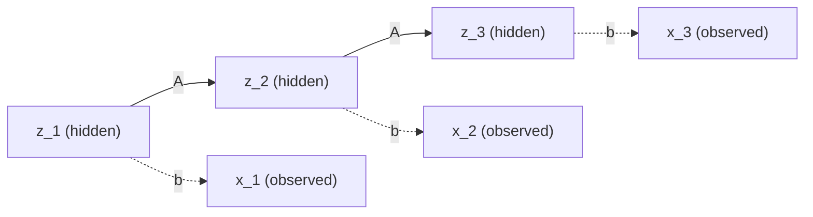

# **Hidden Markov Models (HMMs)**

ARIMA (Ch. 044) models a continuous, linearly-evolving state; LSTM/GRU (Ch. 038) learns a continuous, nonlinearly-evolving state via gradient descent. A Hidden Markov Model sits at a third point in this space: a **discrete**, small, interpretable latent state that evolves via a simple Markov chain, with each hidden state emitting an observation from its own distribution. HMMs are the workhorse for problems where "the system is secretly in one of a few modes at any time, and we only see noisy emissions from that mode" — speech recognition, part-of-speech tagging, gene sequence analysis, regime-switching in finance.

---

## **1. Formal Setup**

An HMM is defined by:

- A set of $N$ hidden states $\{1,\dots,N\}$; hidden state sequence $z_1,\dots,z_T$.
- A set of possible observations (discrete alphabet, or continuous emission distributions); observed sequence $x_1,\dots,x_T$.
- **Initial distribution** $\pi_i = p(z_1=i)$.
- **Transition matrix** $A_{ij} = p(z_t=j\mid z_{t-1}=i)$ — the Markov property: the next state depends only on the current state, not the full history.
- **Emission distribution** $b_i(x) = p(x_t=x \mid z_t=i)$ — depends only on the current hidden state, not on past states or observations.

The joint probability of a full hidden/observed trajectory factorizes as

$$
p(z_{1:T}, x_{1:T}) = \pi_{z_1}\,b_{z_1}(x_1)\prod_{t=2}^{T} A_{z_{t-1}z_t}\,b_{z_t}(x_t)
$$



This graphical structure — a Markov chain over hidden states, each emitting an observation — is exactly what distinguishes an HMM from a GMM (Ch. 040): a **GMM has one latent variable per data point, independent across points**; an **HMM has one latent variable per time step, chained together by the transition matrix $A$**. An HMM is, in a precise sense, a mixture model with temporal dependence added to the latent variable.

### **1.1 Three Fundamental Problems**

Rabiner's (1989) classic framing, which this chapter follows:

1. **Evaluation:** given a model $\lambda=(\pi,A,B)$ and an observed sequence, compute $p(x_{1:T}\mid\lambda)$ — solved by the **Forward algorithm**.
2. **Decoding:** given a model and observations, find the single most likely hidden state sequence $z_{1:T}^\star$ — solved by the **Viterbi algorithm**.
3. **Learning:** given only observations, estimate $\lambda=(\pi,A,B)$ — solved by the **Baum-Welch algorithm** (an instance of EM, directly connecting to the GMM chapter's EM derivation).

---

## **2. The Forward Algorithm — Evaluation**

### **2.1 Why Naive Marginalization Fails**

$$
p(x_{1:T}) = \sum_{z_{1:T}} p(z_{1:T},x_{1:T})
$$

sums over $N^T$ possible hidden-state sequences — exponential in $T$, computationally infeasible beyond tiny $T$. The forward algorithm exploits the Markov structure to compute this sum in **polynomial** time via dynamic programming.

### **2.2 Deriving the Forward Recursion**

Define the forward variable

$$
\alpha_t(i) \triangleq p(x_{1:t}, z_t=i)
$$

(the joint probability of observing everything up to time $t$ **and** being in state $i$ at time $t$). Initialize:

$$
\alpha_1(i) = \pi_i\,b_i(x_1)
$$

For $t>1$, condition on the state at $t-1$ and use the Markov property (the transition to $z_t$ depends only on $z_{t-1}$, and the emission $x_t$ depends only on $z_t$):

$$
\alpha_t(j) = \left[\sum_{i=1}^N \alpha_{t-1}(i)\,A_{ij}\right] b_j(x_t)
$$

**Derivation of this step:** $\alpha_t(j) = p(x_{1:t},z_t=j) = \sum_i p(x_{1:t-1},z_{t-1}=i,z_t=j,x_t) = \sum_i p(x_{1:t-1},z_{t-1}=i)\,p(z_t=j\mid z_{t-1}=i)\,p(x_t\mid z_t=j)$, using the Markov and emission-independence properties to factor the joint, then recognizing $p(x_{1:t-1},z_{t-1}=i)=\alpha_{t-1}(i)$ by definition. This is exactly the same "sum over previous states, weighted by transition, times new evidence" structure as belief propagation on any chain-structured graphical model.

Finally,

$$
\boxed{p(x_{1:T}) = \sum_{i=1}^N \alpha_T(i)}
$$

This reduces the cost from $O(N^T)$ to $O(N^2T)$ — the entire "trick" of the forward algorithm is reusing the partial sums $\alpha_{t-1}(\cdot)$ instead of recomputing every full path from scratch, precisely the dynamic-programming principle.

### **2.3 The Backward Algorithm (Needed Later for Learning)**

Symmetrically, define $\beta_t(i) \triangleq p(x_{t+1:T}\mid z_t=i)$ (probability of all *future* observations given the current state), computed backward from $T$:

$$
\beta_T(i) = 1 \quad\text{(by convention)}, \qquad \beta_t(i) = \sum_{j=1}^N A_{ij}\,b_j(x_{t+1})\,\beta_{t+1}(j)
$$

$\alpha_t(i)\beta_t(i) = p(x_{1:T},z_t=i)$ combines information from both directions — the full sequence's probability, conditioned on state $i$ at time $t$ — which is exactly what the learning algorithm (§4) needs to compute state occupancy probabilities.

---

## **3. The Viterbi Algorithm — Decoding**

### **3.1 Setup**

Decoding wants the single **best** hidden path, not a sum over all paths:

$$
z_{1:T}^\star = \arg\max_{z_{1:T}} p(z_{1:T}\mid x_{1:T}) = \arg\max_{z_{1:T}} p(z_{1:T},x_{1:T})
$$

(the two are equivalent since $p(x_{1:T})$ doesn't depend on $z_{1:T}$).

### **3.2 Deriving the Viterbi Recursion**

Define $\delta_t(i) \triangleq \max_{z_{1:t-1}} p(z_{1:t-1}, z_t=i, x_{1:t})$ — the probability of the **best** path ending in state $i$ at time $t$ (not a sum over all paths, as in $\alpha_t(i)$, but a $\max$). Initialize $\delta_1(i)=\pi_ib_i(x_1)$; the recursion replaces the forward algorithm's **sum** with a **max**:

$$
\delta_t(j) = \left[\max_{i} \delta_{t-1}(i)\,A_{ij}\right] b_j(x_t), \qquad \psi_t(j) = \arg\max_i \delta_{t-1}(i)A_{ij}
$$

$\psi_t(j)$ (the "backpointer") records which previous state $i$ achieved the max, needed to reconstruct the full optimal path afterward. This exact **sum-vs-max** substitution — same recursive structure, different aggregation operator — is a very general pattern in dynamic programming on chain/tree-structured graphs (the same substitution turns the forward algorithm into Viterbi, and turns sum-product belief propagation into max-product belief propagation generally).

### **3.3 Backtracking**

$$
z_T^\star = \arg\max_i \delta_T(i), \qquad z_t^\star = \psi_{t+1}(z_{t+1}^\star) \text{ for } t=T-1,\dots,1
$$

Trace backward through the stored backpointers to recover the full optimal state sequence — this backtracking step is why $\psi_t$ must be stored at every step, unlike the forward algorithm which only needs the running $\alpha$ values.

---

## **4. Baum-Welch — Learning (EM for HMMs)**

### **4.1 Why This Is EM**

Parameters $(\pi,A,B)$ cannot be estimated by direct MLE because the hidden states $z_{1:T}$ are unobserved — the exact same obstacle that motivated EM for GMMs (Ch. 040). Baum-Welch is EM specialized to the HMM's chain-structured latent variables, using the forward-backward algorithm to compute the E-step's required posteriors exactly (again mirroring GMM's exact discrete E-step, versus the VAE's approximate one).

### **4.2 E-Step: Computing State and Transition Posteriors**

Define the **state occupancy** posterior (analogous to GMM's responsibility $\gamma_{ik}$):

$$
\gamma_t(i) \triangleq p(z_t=i\mid x_{1:T}) = \frac{\alpha_t(i)\beta_t(i)}{\sum_j\alpha_t(j)\beta_t(j)}
$$

and the **transition** posterior (the joint probability of being in state $i$ at $t$ and state $j$ at $t+1$, given all observations):

$$
\xi_t(i,j) \triangleq p(z_t=i,z_{t+1}=j\mid x_{1:T}) = \frac{\alpha_t(i)\,A_{ij}\,b_j(x_{t+1})\,\beta_{t+1}(j)}{\sum_{i',j'}\alpha_t(i')A_{i'j'}b_{j'}(x_{t+1})\beta_{t+1}(j')}
$$

Both are computed **exactly** (no approximation) from a single forward pass and single backward pass — $O(N^2T)$ total, no more expensive than evaluation alone.

### **4.3 M-Step: Closed-Form Updates**

Exactly analogous to GMM's closed-form M-step (Ch. 040, §1.3), maximizing the expected complete-data log-likelihood under the E-step's posteriors gives:

$$
\hat\pi_i = \gamma_1(i)
$$

$$
\hat A_{ij} = \frac{\sum_{t=1}^{T-1}\xi_t(i,j)}{\sum_{t=1}^{T-1}\gamma_t(i)} \qquad\text{(expected transitions } i\to j \text{, normalized by expected time spent in } i\text{)}
$$

For discrete emissions with alphabet symbol $k$:

$$
\hat b_i(k) = \frac{\sum_{t:\,x_t=k}\gamma_t(i)}{\sum_{t=1}^T\gamma_t(i)}
$$

For Gaussian emissions $b_i(x)=\mathcal N(x;\mu_i,\sigma_i^2)$, the update is **identical in form** to GMM's M-step (Ch. 040, §1.3), just using $\gamma_t(i)$ (time-indexed) instead of $\gamma_{ik}$ (point-indexed) as the weight:

$$
\hat\mu_i = \frac{\sum_t\gamma_t(i)x_t}{\sum_t\gamma_t(i)}, \qquad \hat\sigma_i^2 = \frac{\sum_t\gamma_t(i)(x_t-\hat\mu_i)^2}{\sum_t\gamma_t(i)}
$$

This is the precise sense in which an HMM with Gaussian emissions is "a GMM with a Markov chain added to the latent variable, and EM adapted accordingly" — nearly the identical M-step, plus the additional $A$-matrix update the temporal structure requires.

### **4.4 Algorithm and Monotonic Improvement**

1. Initialize $(\pi,A,B)$ (randomly, or from domain knowledge).
2. Repeat until convergence:
   a. **E-step:** run forward-backward to compute $\alpha,\beta,\gamma,\xi$.
   b. **M-step:** update $\pi,A,B$ via the closed forms above.
3. As with GMM's EM (Ch. 040, §1.4), each iteration provably does not decrease the observed-data log-likelihood $p(x_{1:T}\mid\lambda)$ — but convergence is only to a local optimum, so multiple random restarts are standard practice.

---

## **5. Worked Numeric Example**

Classic 2-state weather HMM: hidden states $\{\text{Sunny},\text{Rainy}\}$, observation $\{\text{Umbrella},\text{NoUmbrella}\}$.

$$
\pi = (0.6,\ 0.4)\ (\text{Sunny, Rainy}), \qquad A = \begin{bmatrix}0.7&0.3\\0.4&0.6\end{bmatrix}, \qquad B = \begin{bmatrix}0.1&0.9\\0.8&0.2\end{bmatrix}
$$

(rows = Sunny/Rainy, columns = Umbrella/NoUmbrella for $B$). Observe $x_1=\text{Umbrella}$, $x_2=\text{Umbrella}$.

**Forward pass:**

$$
\alpha_1(\text{Sunny}) = \pi_S\,b_S(\text{U}) = 0.6\times0.1 = 0.06
$$

$$
\alpha_1(\text{Rainy}) = \pi_R\,b_R(\text{U}) = 0.4\times0.8 = 0.32
$$

$$
\alpha_2(\text{Sunny}) = \big[\alpha_1(S)A_{SS}+\alpha_1(R)A_{RS}\big]b_S(\text{U}) = [0.06(0.7)+0.32(0.4)](0.1) = [0.042+0.128](0.1) = 0.0170
$$

$$
\alpha_2(\text{Rainy}) = \big[\alpha_1(S)A_{SR}+\alpha_1(R)A_{RR}\big]b_R(\text{U}) = [0.06(0.3)+0.32(0.6)](0.8) = [0.018+0.192](0.8) = 0.1680
$$

$$
p(x_{1:2}=\text{U,U}) = \alpha_2(S)+\alpha_2(R) = 0.0170+0.1680 = 0.1850
$$

Two umbrella-days in a row is much more consistent with rain, and indeed the "rainy" path dominates the total probability mass ($0.168$ vs. $0.017$) — matching intuition before any formal decoding step.

**Viterbi (most likely state at $t=2$):** since $\delta_2(\text{Rainy})=0.1680 > \delta_2(\text{Sunny})=0.0170$ using the identical max-substituted recursion, the most likely state at $t=2$ is Rainy, consistent with the forward-computed mass above.

---

## **6. Python Implementation From Scratch**

```python
import numpy as np


def forward(pi, A, B, obs):
    """B: (n_states, n_obs_symbols) emission matrix. obs: array of observation-symbol indices."""
    T, N = len(obs), len(pi)
    alpha = np.zeros((T, N))
    alpha[0] = pi * B[:, obs[0]]
    for t in range(1, T):
        alpha[t] = (alpha[t - 1] @ A) * B[:, obs[t]]
    return alpha


def backward(A, B, obs):
    T, N = len(obs), A.shape[0]
    beta = np.zeros((T, N))
    beta[T - 1] = 1.0
    for t in range(T - 2, -1, -1):
        beta[t] = A @ (B[:, obs[t + 1]] * beta[t + 1])
    return beta


def viterbi(pi, A, B, obs):
    T, N = len(obs), len(pi)
    delta = np.zeros((T, N))
    psi = np.zeros((T, N), dtype=int)
    delta[0] = pi * B[:, obs[0]]

    for t in range(1, T):
        for j in range(N):
            trans = delta[t - 1] * A[:, j]
            psi[t, j] = np.argmax(trans)
            delta[t, j] = trans.max() * B[j, obs[t]]

    path = np.zeros(T, dtype=int)
    path[T - 1] = np.argmax(delta[T - 1])
    for t in range(T - 2, -1, -1):
        path[t] = psi[t + 1, path[t + 1]]
    return path, delta[T - 1].max()


def baum_welch(A, B, pi, obs, n_iter=50):
    N, T = A.shape[0], len(obs)
    for _ in range(n_iter):
        alpha = forward(pi, A, B, obs)
        beta = backward(A, B, obs)

        # gamma_t(i): state occupancy posterior
        gamma = alpha * beta
        gamma /= gamma.sum(axis=1, keepdims=True)

        # xi_t(i,j): transition posterior, for t = 0..T-2
        xi = np.zeros((T - 1, N, N))
        for t in range(T - 1):
            num = alpha[t][:, None] * A * B[:, obs[t + 1]][None, :] * beta[t + 1][None, :]
            xi[t] = num / num.sum()

        # M-step
        pi = gamma[0]
        A = xi.sum(axis=0) / gamma[:-1].sum(axis=0)[:, None]
        for k in range(B.shape[1]):
            mask = (obs == k)
            B[:, k] = gamma[mask].sum(axis=0) / gamma.sum(axis=0)

    return A, B, pi


# Toy run: weather HMM
pi0 = np.array([0.6, 0.4])
A0 = np.array([[0.7, 0.3], [0.4, 0.6]])
B0 = np.array([[0.1, 0.9], [0.8, 0.2]])  # rows=states, cols=[Umbrella, NoUmbrella]
obs_seq = np.array([0, 0, 1, 0, 0])  # 0=Umbrella, 1=NoUmbrella

alpha = forward(pi0, A0, B0, obs_seq)
print("P(observations):", alpha[-1].sum())

path, best_prob = viterbi(pi0, A0, B0, obs_seq)
print("Most likely state path:", path, "| probability:", best_prob)

A_fit, B_fit, pi_fit = baum_welch(A0.copy(), B0.copy(), pi0.copy(), obs_seq, n_iter=20)
print("Re-estimated A:\n", A_fit)
```

`gamma /= gamma.sum(axis=1, keepdims=True)` implements the $\alpha_t(i)\beta_t(i)/\sum_j\alpha_t(j)\beta_t(j)$ normalization from §4.2 directly; note $\alpha_t(i)\beta_t(i) = p(x_{1:T},z_t=i)$ for **any** $t$, so the row sum $\sum_j\alpha_t(j)\beta_t(j) = p(x_{1:T})$ is (in exact arithmetic) the same value regardless of $t$ — a useful correctness check when debugging an implementation.

---

## **7. Equivalent Implementation With hmmlearn**

```python
from hmmlearn import hmm
import numpy as np

model = hmm.CategoricalHMM(n_components=2, n_iter=100, random_state=0)
model.startprob_ = pi0
model.transmat_ = A0
model.emissionprob_ = B0

obs_2d = obs_seq.reshape(-1, 1)
log_likelihood = model.score(obs_2d)          # log P(observations) — the forward algorithm, in log-space
state_path = model.predict(obs_2d)             # Viterbi decoding
model_fit = hmm.CategoricalHMM(n_components=2, n_iter=100).fit(obs_2d)  # Baum-Welch from random init

# Continuous (Gaussian) emissions:
gauss_model = hmm.GaussianHMM(n_components=2, covariance_type="diag", n_iter=100)
gauss_model.fit(continuous_obs_sequence)  # e.g., a (T, d) array of continuous observations
```

**Internals:**
- `hmmlearn` performs all forward/backward/Viterbi computation **in log-space** internally (via the log-sum-exp trick, the same numerical-stability pattern used in the GMM chapter's responsibility computation) rather than multiplying raw probabilities directly — essential for numerical stability (§8).
- `.score()` returns the **log**-likelihood directly (the log of the forward algorithm's final sum), avoiding ever computing the (potentially astronomically small) raw probability explicitly.
- `GaussianHMM` implements exactly the Gaussian-emission M-step update derived in §4.3, reusing the same underlying statistics computation as `hmmlearn`'s GMM-related code paths.

---

## **8. Complexity**

| Algorithm | Time | Space |
|---|---|---|
| Forward / Backward | $O(N^2T)$ | $O(NT)$ |
| Viterbi | $O(N^2T)$ | $O(NT)$ (for backpointers) |
| Baum-Welch (per iteration) | $O(N^2T)$ | $O(NT)$ |

All three share the same asymptotic cost, since each is one dynamic-programming pass (or, for Baum-Welch, one forward + one backward pass) over the chain — the constant-factor difference between sum (forward), max (Viterbi), and the extra posterior bookkeeping (Baum-Welch) does not change the order of growth.

---

## **9. Numerical Stability, Edge Cases, and Pitfalls**

- **Underflow in raw-probability forward/Viterbi computation:** $\alpha_t(i)$ is a product of many probabilities $\le 1$, shrinking geometrically toward $0$ as $T$ grows — for even moderately long sequences ($T$ in the hundreds), naive floating-point multiplication underflows to exactly $0$. Standard fixes: (1) work entirely in **log-space** using the log-sum-exp trick (identical pattern to the softmax/cross-entropy stability fix in the LSTM and GMM chapters), or (2) rescale $\alpha_t$ at every step by a running normalization constant (the classical "scaling" approach in Rabiner's original tutorial).
- **Local optima in Baum-Welch:** as with GMM's EM (Ch. 040), Baum-Welch only guarantees monotonic improvement, not global optimality — always use multiple random restarts and keep the best final log-likelihood.
- **Choosing the number of hidden states $N$:** no closed-form answer; use domain knowledge where available, or AIC/BIC model selection (identical principle to GMM's $K$ selection and ARIMA's $(p,d,q)$ selection) sweeping over candidate $N$.
- **Label switching:** as with GMM, hidden-state indices are arbitrary and interchangeable across different Baum-Welch runs or restarts — comparing "state 1" across two fits requires matching states by their emission distributions first.
- **Degenerate/zero emission or transition probabilities:** if the M-step ever drives some $A_{ij}$ or $b_i(k)$ to exactly $0$ (e.g., a state-symbol combination never observed in a short training sequence), that transition/emission becomes permanently impossible in all future iterations — Laplace (add-one) smoothing on the M-step counts is standard practice to avoid this.
- **Discrete vs. continuous emissions:** `CategoricalHMM` requires a small, closed observation alphabet; continuous data needs `GaussianHMM` (or a Gaussian mixture emission per state) — using the wrong emission model for the observation type produces uninterpretable or degenerate fits.
- **Confusing the Forward algorithm's sum with Viterbi's max:** the forward algorithm's $\alpha_T(i)$ summed over $i$ gives the sequence probability under **all** possible paths; it is not the probability of the single most likely path (that's Viterbi's $\delta_T$) — conflating the two is a common conceptual error when first learning HMMs.

---

## **10. Connections to Related ML Concepts**

- **GMM (Ch. 040):** an HMM is a GMM with a Markov chain linking successive latent variables together, and Baum-Welch is EM adapted to that chained structure — the M-step for Gaussian emissions is essentially identical to GMM's M-step, just reweighted by $\gamma_t(i)$ instead of $\gamma_{ik}$.
- **ARIMA (Ch. 044) and Kalman filters:** HMMs, ARMA/ARIMA models, and Kalman-filtered state-space models are all instances of the same general "hidden state evolves via a transition model, observations depend on the hidden state" template — the difference is whether the hidden state is **discrete** (HMM) or **continuous and linear-Gaussian** (Kalman filter/ARIMA's state-space form).
- **RNN/LSTM (Ch. 038):** an HMM's hidden state is a small, discrete, exactly-inferable Markov chain; an RNN's hidden state is a large, continuous, nonlinear vector learned end-to-end via backpropagation — HMMs trade representational capacity for exact inference (forward/Viterbi/Baum-Welch are all exact, polynomial-time algorithms) and interpretability, while RNNs trade exactness for much greater expressive power.
- **Dynamic programming / Bellman equations (Q-learning chapter):** the forward and Viterbi recursions are structurally the same "optimal substructure + overlapping subproblems" dynamic programming pattern as the Bellman equation — both reuse partial solutions ($\alpha_{t-1}(\cdot)$ here, $Q(s,a)$ there) instead of recomputing from scratch.
- **Conditional Random Fields (CRFs):** the discriminative counterpart to HMMs for sequence labeling — CRFs model $p(z_{1:T}\mid x_{1:T})$ directly (without an explicit generative/emission model), often outperforming HMMs on structured-prediction tasks like named-entity recognition, at the cost of losing the generative "sample new sequences" capability HMMs retain.

---

## **11. References for Deeper Reading**

- Lawrence R. Rabiner, "A Tutorial on Hidden Markov Models and Selected Applications in Speech Recognition", Proceedings of the IEEE, 1989 (the canonical HMM reference, source of the three-problems framing).
- Leonard E. Baum et al., "A Maximization Technique Occurring in the Statistical Analysis of Probabilistic Functions of Markov Chains", Annals of Mathematical Statistics, 1970 (the original Baum-Welch derivation).
- Andrew J. Viterbi, "Error Bounds for Convolutional Codes and an Asymptotically Optimum Decoding Algorithm", IEEE Trans. Information Theory, 1967.
- Christopher M. Bishop, *Pattern Recognition and Machine Learning*, Chapter 13 (Sequential Data / HMMs).
- Kevin P. Murphy, *Machine Learning: A Probabilistic Perspective*, Chapter 17 (Markov and Hidden Markov Models).
- hmmlearn documentation. https://hmmlearn.readthedocs.io/
