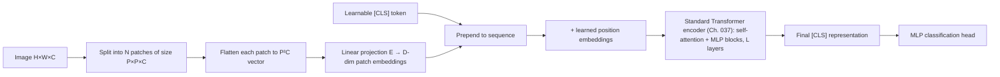

# **Vision Transformers (ViT)**

Your CNN chapter (Ch. 029) covers convolution's built-in inductive biases — locality (a neuron only looks at a small spatial neighborhood) and translation equivariance (the same filter weights apply everywhere) — which make CNNs highly data-efficient for images. Your Transformer chapter (Ch. 037) covers self-attention's ability to model arbitrary long-range dependencies with no locality assumption at all, at the cost of needing to learn spatial structure entirely from data. Vision Transformer (Dosovitskiy et al., 2020) asks the direct question: what happens if you strip away almost every image-specific architectural assumption and apply a near-vanilla Transformer encoder directly to images? The answer — it matches or beats CNNs, but only past a very large data/compute threshold — is itself the chapter's central lesson about inductive bias versus scale.

---

## **1. From Image to Token Sequence: Patch Embedding**

### **1.1 The Core Problem**

Self-attention (Ch. 037) operates over a **sequence of tokens**; an image is a $H\times W\times C$ grid of pixels, not a sequence. Applying self-attention directly at the pixel level would require $N=HW$ tokens, and self-attention's $O(N^2)$ cost (§5) makes this utterly infeasible even for modest image resolutions (a $224\times224$ image has $50{,}176$ pixels). ViT's key architectural move is to **first chop the image into patches**, treating each patch as one "token" — cutting the sequence length by a factor of $P^2$ for patch size $P$.

### **1.2 Patch Embedding — Derivation**

Given image $x\in\mathbb R^{H\times W\times C}$ and patch size $P$ (commonly $16$), reshape into $N = \frac{HW}{P^2}$ non-overlapping patches, each flattened into a vector of dimension $P^2C$:

$$
x_p \in \mathbb R^{N\times(P^2C)}, \qquad N=\frac{HW}{P^2}
$$

Project each flattened patch into the Transformer's model dimension $D$ via a single shared learned linear map (equivalent, and in practice implemented as, a strided convolution with kernel size $P$ and stride $P$):

$$
z_0^{(i)} = E\,x_p^{(i)}, \qquad E\in\mathbb R^{D\times(P^2C)},\ i=1,\dots,N
$$

This linear projection is the **entire** extent of ViT's image-specific processing — everything after this point is a standard Transformer encoder (Ch. 037), operating on $N$ patch-token embeddings exactly as it would on $N$ word-token embeddings.

### **1.3 The [CLS] Token and Position Embeddings**

Following BERT's encoder-only convention, prepend a learnable **[CLS] token** embedding $z_0^{(0)}$ to the sequence; after the full encoder stack, the final representation at this position is used for classification (a single, permutation-invariant summary of the whole image, analogous to — but distinct from — the graph-level pooling/readout mechanism in your Graph ML chapters).

Because self-attention (Ch. 037) is **permutation-equivariant** — it has no inherent notion of spatial position at all, patches could be fed in any order and attention would treat them identically — a **learned position embedding** $E_{\text{pos}}\in\mathbb R^{(N+1)\times D}$ is added directly to the patch embeddings:

$$
z_0 = [z_{\text{cls}};\,z_0^{(1)};\,\dots;\,z_0^{(N)}] + E_{\text{pos}}
$$

This is architecturally identical to the positional-encoding requirement in your Transformer chapter, just learned (rather than the fixed sinusoidal scheme) and indexing 2D patch grid positions rather than 1D sequence positions.



### **1.4 The Encoder Stack (Unchanged From Ch. 037)**

Each of the $L$ encoder layers applies exactly the multi-head self-attention + position-wise MLP + LayerNorm + residual-connection structure already derived in your Transformer chapter — ViT introduces **no new attention mechanism**. The self-attention over patch tokens lets any patch attend to any other patch **in a single layer**, regardless of spatial distance — in sharp contrast to a CNN, where two spatially distant pixels only interact after enough stacked convolutional layers to grow the receptive field that far (a core structural difference explored further in §4).

---

## **2. Why Strip Away Convolutional Inductive Bias?**

### **2.1 What CNNs Bake In, Architecturally**

Two assumptions are hard-coded into every convolutional layer (Ch. 029): **locality** (a filter only sees a small spatial window) and **translation equivariance** (the identical filter weights are applied at every spatial position — shifting the input shifts the output identically). These are excellent priors for natural images (nearby pixels are usually related; a cat is still a cat wherever it appears in the frame), and they make CNNs highly **sample-efficient** — the model doesn't need to relearn "adjacent pixels are correlated" or "detect edges regardless of position" separately for every possible location; it's forced to share that knowledge across all positions by construction.

### **2.2 What ViT Gives Up, and What It Gains**

ViT's patch-linear-projection + self-attention has **no locality bias** (any patch can attend to any other patch from layer 1) and **no translation-equivariance guarantee** built into the architecture (the learned position embeddings are specific to absolute position, not relative shift-invariant offsets). This means ViT must **learn** these useful patterns from data statistically, rather than having them for free from the architecture — which is precisely why ViT requires vastly more training data to reach CNN-level performance in the low-data regime, and why it eventually surpasses CNNs when data is abundant enough to learn better, less-constrained patterns than the CNN's fixed locality assumption allows.

### **2.3 The Empirical Finding (Dosovitskiy et al., 2020)**

Trained from scratch on ImageNet-1k alone (relatively small by modern standards, ~1.3M images), ViT underperforms comparable CNNs (ResNets). Pretrained on JFT-300M (300 million images) and fine-tuned, ViT **matches or exceeds** state-of-the-art CNNs while using less compute at the fine-tuning stage. This single empirical result crystallizes the general inductive-bias-versus-scale trade-off that recurs across deep learning: hand-coded structural priors help most when data is scarce, and increasingly become a *ceiling* rather than a *floor* once enough data is available for a more flexible architecture to learn better structure on its own.

---

## **3. Worked Numeric Example (Patch Embedding)**

Toy image: $H=W=4$, $C=1$ (grayscale), patch size $P=2$, so $N=\frac{4\times4}{2^2}=4$ patches, each flattened to $P^2C=4$ values. Suppose the image is

$$
x = \begin{bmatrix} 1&2&5&6\\3&4&7&8\\9&10&13&14\\11&12&15&16\end{bmatrix}
$$

The four $2\times2$ patches, flattened (row-major within each patch):

$$
x_p^{(1)}=[1,2,3,4], \quad x_p^{(2)}=[5,6,7,8], \quad x_p^{(3)}=[9,10,11,12], \quad x_p^{(4)}=[13,14,15,16]
$$

With a toy projection matrix $E\in\mathbb R^{2\times4}$ (projecting to $D=2$), say $E = \begin{bmatrix}0.1&0.1&0.1&0.1\\0.5&-0.5&0.5&-0.5\end{bmatrix}$:

$$
z_0^{(1)} = E\,x_p^{(1)} = \big[0.1(1{+}2{+}3{+}4),\ 0.5(1)-0.5(2)+0.5(3)-0.5(4)\big] = [1.0,\ -1.0]
$$

$$
z_0^{(2)} = E\,x_p^{(2)} = [0.1(26),\ 0.5(5)-0.5(6)+0.5(7)-0.5(8)] = [2.6,\ -1.0]
$$

Each patch is now a 2-dimensional token embedding, ready to have position embeddings added and be fed through the standard encoder stack (§1.4) exactly like word tokens.

---

## **4. Self-Attention Range vs. CNN Receptive Field**

A CNN's receptive field — the region of input pixels influencing a given output unit — grows **linearly** with depth for stacked $k\times k$ convolutions (each layer adds $k-1$ pixels of radius); reaching a receptive field covering the whole image requires enough layers (or larger kernels/dilations/pooling) to grow it that far. ViT's self-attention gives **every** patch a direct, single-hop connection to every other patch **starting from layer 1** — the same "$O(1)$-hop versus $O(\text{depth})$-hop" distinction already drawn between attention and recurrence in the LSTM/GRU chapter (Ch. 038, §11), now drawn between attention and convolution instead. This is precisely why ViT can model long-range, whole-image dependencies (e.g., relating an object in one corner to context in the opposite corner) more directly than a CNN of comparable depth.

---

## **5. Complexity**

Let $N$ = number of patches, $D$ = embedding dimension, $L$ = number of encoder layers, $P$ = patch size, $C$ = image channels.

| Component | Time | Notes |
|---|---|---|
| Patch embedding | $O(N\cdot P^2C\cdot D)$ | one shared linear projection per patch |
| Self-attention (per layer) | $O(N^2D)$ | dominant cost as $N$ grows — same quadratic-in-sequence-length cost as any Transformer (Ch. 037) |
| MLP block (per layer) | $O(ND^2)$ | standard position-wise feedforward cost |
| Full encoder | $O(L(N^2D+ND^2))$ | |
| Comparable CNN layer | $O(HWC^2K^2)$ | linear in spatial size $HW$, not quadratic — a structural advantage for very high-resolution inputs |

Halving the patch size $P$ quadruples $N$ (four times as many patches for the same image), which **quadruples** the dominant $N^2D$ attention cost — this is why practical ViT variants use $P=16$ (or larger, $P=32$, for even larger images) rather than very fine patches, and why extending ViT to high-resolution, dense-prediction tasks (segmentation, detection) motivated windowed/hierarchical attention variants (§7).

---

## **6. Python Implementation From Scratch**

```python
import numpy as np


def patchify(image, patch_size):
    """image: (H, W, C). Returns (N, patch_size*patch_size*C) flattened patches, row-major."""
    H, W, C = image.shape
    ph = pw = patch_size
    patches = []
    for i in range(0, H, ph):
        for j in range(0, W, pw):
            patch = image[i:i + ph, j:j + pw, :]
            patches.append(patch.flatten())
    return np.stack(patches)  # (N, ph*pw*C)


def patch_embed(image, patch_size, E, cls_token, pos_embed):
    """
    E: (D, patch_size*patch_size*C) projection matrix.
    cls_token: (D,) learned class token.
    pos_embed: (N+1, D) learned position embeddings.
    """
    patches = patchify(image, patch_size)   # (N, P^2*C)
    tokens = patches @ E.T                   # (N, D)
    tokens = np.vstack([cls_token[None, :], tokens])  # prepend [CLS] -> (N+1, D)
    return tokens + pos_embed


def layer_norm(x, eps=1e-6):
    mean = x.mean(axis=-1, keepdims=True)
    var = x.var(axis=-1, keepdims=True)
    return (x - mean) / np.sqrt(var + eps)


def self_attention(x, Wq, Wk, Wv):
    """Single-head self-attention, reusing the exact mechanism from the Transformer chapter (Ch. 037)."""
    Q, K, V = x @ Wq, x @ Wk, x @ Wv
    d_k = Q.shape[-1]
    scores = (Q @ K.T) / np.sqrt(d_k)
    scores -= scores.max(axis=-1, keepdims=True)  # numerically stable softmax
    weights = np.exp(scores)
    weights /= weights.sum(axis=-1, keepdims=True)
    return weights @ V


def vit_encoder_layer(x, Wq, Wk, Wv, W1, b1, W2, b2):
    """One encoder block: self-attention + residual + LayerNorm, then MLP + residual + LayerNorm."""
    attn_out = self_attention(layer_norm(x), Wq, Wk, Wv)
    x = x + attn_out
    mlp_out = np.maximum(layer_norm(x) @ W1 + b1, 0.0) @ W2 + b2  # GELU commonly used in practice; ReLU for simplicity here
    x = x + mlp_out
    return x


# Toy end-to-end run
rng = np.random.default_rng(0)
image = rng.normal(size=(8, 8, 3))
patch_size, D = 4, 16
N = (8 // patch_size) ** 2

E = rng.normal(0, 0.1, size=(D, patch_size * patch_size * 3))
cls_token = rng.normal(0, 0.1, size=D)
pos_embed = rng.normal(0, 0.1, size=(N + 1, D))

tokens = patch_embed(image, patch_size, E, cls_token, pos_embed)

Wq, Wk, Wv = (rng.normal(0, 0.1, size=(D, D)) for _ in range(3))
W1, b1 = rng.normal(0, 0.1, size=(D, D * 4)), np.zeros(D * 4)
W2, b2 = rng.normal(0, 0.1, size=(D * 4, D)), np.zeros(D)

out = vit_encoder_layer(tokens, Wq, Wk, Wv, W1, b1, W2, b2)
cls_representation = out[0]  # final [CLS] token, fed to a classification head
print("CLS token output shape:", cls_representation.shape)
```

This shows the complete, distinctive ViT-specific machinery (`patchify`, `patch_embed`, the [CLS]-token convention) wired directly into an otherwise unmodified Transformer encoder block, underscoring that ViT's novelty is entirely in the input tokenization, not the encoder itself.

---

## **7. Equivalent Implementation With PyTorch / Hugging Face**

```python
import torch
from torch import nn


class PatchEmbed(nn.Module):
    def __init__(self, img_size, patch_size, in_channels, embed_dim):
        super().__init__()
        self.n_patches = (img_size // patch_size) ** 2
        # A strided convolution with kernel=stride=patch_size implements the
        # "split into patches + linear-project each" operation in one fused op.
        self.proj = nn.Conv2d(in_channels, embed_dim, kernel_size=patch_size, stride=patch_size)

    def forward(self, x):
        x = self.proj(x)                       # (batch, embed_dim, H/P, W/P)
        x = x.flatten(2).transpose(1, 2)        # (batch, N, embed_dim)
        return x


class ViT(nn.Module):
    def __init__(self, img_size=224, patch_size=16, in_channels=3, embed_dim=768,
                 depth=12, n_heads=12, n_classes=1000):
        super().__init__()
        self.patch_embed = PatchEmbed(img_size, patch_size, in_channels, embed_dim)
        n_patches = self.patch_embed.n_patches

        self.cls_token = nn.Parameter(torch.zeros(1, 1, embed_dim))
        self.pos_embed = nn.Parameter(torch.zeros(1, n_patches + 1, embed_dim))

        encoder_layer = nn.TransformerEncoderLayer(
            d_model=embed_dim, nhead=n_heads, dim_feedforward=embed_dim * 4,
            activation="gelu", batch_first=True,
        )
        self.encoder = nn.TransformerEncoder(encoder_layer, num_layers=depth)
        self.head = nn.Linear(embed_dim, n_classes)

    def forward(self, x):
        tokens = self.patch_embed(x)                              # (batch, N, D)
        batch = tokens.shape[0]
        cls_tokens = self.cls_token.expand(batch, -1, -1)
        tokens = torch.cat([cls_tokens, tokens], dim=1)             # prepend [CLS]
        tokens = tokens + self.pos_embed
        encoded = self.encoder(tokens)
        return self.head(encoded[:, 0])                             # classify from [CLS] output


model = ViT(img_size=224, patch_size=16, embed_dim=768, depth=12, n_heads=12, n_classes=1000)
images = torch.randn(4, 3, 224, 224)
logits = model(images)
```

**Internals:**
- `nn.Conv2d(kernel_size=patch_size, stride=patch_size)` is the standard, efficient way to implement patch extraction + linear projection as a single fused convolution op — mathematically identical to `patchify` + matrix-multiply in §6, but leveraging optimized convolution kernels rather than an explicit reshape-and-flatten loop.
- `nn.TransformerEncoder`/`TransformerEncoderLayer` are the **same** modules a text-only Transformer (Ch. 037) would use — no ViT-specific attention implementation exists in the standard library, confirming §1.4's point that ViT's novelty is entirely in tokenization.
- Hugging Face's `transformers.ViTModel`/`ViTForImageClassification` wrap this same structure with pretrained JFT/ImageNet-21k weights, letting `pos_embed` be **interpolated** (bilinearly, over the 2D patch grid) when fine-tuning at a different image resolution than pretraining used — since the learned position embeddings are tied to a specific $N$, changing input resolution changes $N$ and requires this interpolation step.

---

## **8. Numerical Stability, Edge Cases, and Pitfalls**

- **Data hunger without strong regularization/augmentation:** training ViT from scratch on small-to-medium datasets underperforms CNNs (§2.3) unless compensated with heavy data augmentation, regularization, and/or knowledge distillation from a CNN teacher — **DeiT** (Touvron et al., 2021) specifically showed a data-efficient training recipe (plus a distillation token) that lets ViT match CNNs even on ImageNet-1k-scale data alone, substantially softening the "needs JFT-300M" conclusion.
- **Position embedding resolution mismatch:** the learned position embeddings have a fixed size tied to the pretraining resolution's patch count $N$; fine-tuning or inference at a different resolution requires interpolating the position embedding grid (§7) — skipping this (e.g., naively truncating/padding) silently corrupts spatial correspondence.
- **Quadratic attention cost limits patch resolution:** as derived in §5, finer patches (smaller $P$) quickly become computationally prohibitive due to the $O(N^2)$ attention term — this specifically motivated hierarchical, windowed-attention variants like **Swin Transformer** (Liu et al., 2021), which restricts self-attention to local windows (reintroducing a controlled amount of locality bias) and shifts the windows between layers to allow cross-window information flow, trading some of ViT's "global from layer 1" property back for linear-in-image-size scaling.
- **Loss of fine-grained spatial precision:** because each patch is projected to a single token, sub-patch spatial detail is discarded before the encoder ever sees it — a genuine information bottleneck (not present in dense per-pixel CNN feature maps) that matters more for dense-prediction tasks (segmentation) than for whole-image classification.
- **No built-in translation equivariance:** since position embeddings are tied to absolute position, a ViT does not automatically treat "the same object shifted by 10 pixels" identically the way a CNN's shared convolution filters guarantee — this is exactly the accepted trade-off from §2.2, mitigated in practice by data augmentation (random crops/translations) forcing the model to learn approximate invariance empirically.
- **[CLS] token vs. global average pooling:** some ViT variants use global average pooling over all patch tokens instead of a dedicated [CLS] token for the final classification representation — both work reasonably well in practice, and the choice is a comparatively minor architectural variant rather than a fundamental design fork.

---

## **9. Connections to Related ML Concepts**

- **CNNs (Ch. 029):** the direct point of contrast throughout this chapter — hard-coded locality/translation-equivariance inductive bias (sample-efficient, less flexible) versus learned-from-data global attention (data-hungry, more flexible, eventually higher ceiling).
- **Transformer encoder (Ch. 037):** ViT reuses the encoder architecture **verbatim** — multi-head self-attention, position-wise MLP, residual connections, LayerNorm — the entire contribution is the patch-based tokenization scheme (§1) that turns an image into a sequence a standard Transformer can consume.
- **Graph-level readout (Graph ML chapters):** the [CLS]-token summary mechanism (§1.3) is conceptually parallel to graph-level pooling/readout — both take a variable-size set of learned per-element (patch/node) representations and reduce them to one fixed-size representation for a whole-input prediction.
- **Positional encoding (Ch. 037):** ViT's learned, 2D-grid position embeddings are a direct architectural analog of the Transformer's sequence position encodings, adapted to patches arranged on a 2D grid instead of tokens in a 1D sequence.
- **Word embeddings (Ch. 043):** the patch-embedding linear projection $E$ plays the same architectural role as a word-embedding lookup table — mapping a raw, high-dimensional input unit (a flattened patch vs. a one-hot word) into a dense $D$-dimensional token vector before any sequence modeling occurs.
- **DeiT / knowledge distillation:** DeiT's teacher-student training recipe for data-efficient ViT training is a direct application of knowledge distillation (a smaller/different model learning from a stronger teacher's outputs), relevant more broadly wherever a data-hungry architecture needs to be trained under limited-data constraints.

---

## **10. References for Deeper Reading**

- Alexey Dosovitskiy et al., "An Image is Worth 16x16 Words: Transformers for Image Recognition at Scale" (the original ViT paper), ICLR 2021. https://arxiv.org/abs/2010.11929
- Hugo Touvron et al., "Training Data-Efficient Image Transformers & Distillation Through Attention" (DeiT), ICML 2021. https://arxiv.org/abs/2012.12877
- Ze Liu et al., "Swin Transformer: Hierarchical Vision Transformer using Shifted Windows", ICCV 2021. https://arxiv.org/abs/2103.14030
- Ashish Vaswani et al., "Attention Is All You Need", NeurIPS 2017 (the base Transformer architecture ViT reuses).
- Xiaohua Zhai et al., "Scaling Vision Transformers", CVPR 2022 (scaling laws for ViT).
- timm (PyTorch Image Models) documentation. https://github.com/huggingface/pytorch-image-models
- Hugging Face documentation, `transformers.ViTModel`. https://huggingface.co/docs/transformers/model_doc/vit
