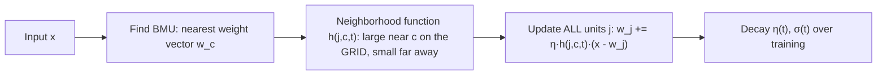

# **Self-Organizing Maps (SOM)**

K-Means (existing chapter) and GMM (Ch. 040) partition data into clusters with no relationship *between* clusters — cluster 3 and cluster 7 are exchangeable labels with no notion of which clusters are "similar" to each other. A Self-Organizing Map (Kohonen, 1982) instead arranges cluster prototypes on a fixed low-dimensional **grid** (typically 2D) and trains them so that **nearby grid positions represent similar data** — simultaneously performing clustering and a topology-preserving dimensionality reduction, useful for visualizing high-dimensional data on a 2D map.

---

## **1. Setup**

A SOM consists of a grid of $M$ **neurons** (units), each $j$ with a **weight vector** (prototype) $w_j\in\mathbb R^d$ in the same space as the input data, and a fixed 2D grid position $g_j\in\mathbb R^2$ (typically arranged in a rectangular or hexagonal lattice). Unlike k-means (where centroids have no relationship to each other), the grid positions $g_j$ are fixed and never updated — only the weight vectors $w_j$ are learned, and they are learned in a way that respects grid neighborhood structure.

---

## **2. Training Algorithm**

For each training input $x$ (presented one at a time, online):

1. **Find the Best Matching Unit (BMU):**
$$
c = \arg\min_j \|x - w_j\|_2
$$
the neuron whose prototype is currently closest to $x$ — identical to k-means' nearest-centroid assignment step.

2. **Update the BMU and its grid-neighbors:**
$$
w_j \leftarrow w_j + \eta(t)\,h(j,c,t)\,(x - w_j) \qquad \text{for all } j
$$

where $\eta(t)$ is a (decaying) learning rate and $h(j,c,t)$ is a **neighborhood function** — large ($\approx1$) for units $j$ near the BMU $c$ **on the grid**, decaying toward $0$ for units far from $c$ on the grid (regardless of how far their weight vectors are in data space). The standard choice is a Gaussian in grid distance:

$$
h(j,c,t) = \exp\left(-\frac{\|g_j-g_c\|^2}{2\sigma(t)^2}\right)
$$

with $\sigma(t)$ (the neighborhood radius) **decaying over training** — early training moves large neighborhoods of the grid together (coarse, global ordering), late training only nudges the BMU and its immediate grid-neighbors (fine-tuning), directly analogous to a decaying learning rate/temperature schedule elsewhere in ML.

3. Repeat over many epochs, decaying both $\eta(t)$ and $\sigma(t)$.



### **2.1 Why This Produces Topology Preservation**

The crucial difference from k-means: k-means only updates the single nearest centroid on each step (a "winner-take-all" update); SOM updates the BMU **and its grid-neighbors together**, pulling them all slightly toward $x$. Over many training examples, grid-adjacent units are repeatedly co-updated toward similar inputs, so they converge to similar weight vectors — **grid distance comes to approximate data-space similarity**. This is the entire mechanism behind the "self-organizing" property: no explicit topology-preservation term is in the loss; it emerges purely from neighbors being updated together, repeatedly, over training.

---

## **3. Worked Numeric Example**

1D input, 1D grid with 3 units: $w_1=0,\ w_2=5,\ w_3=10$, grid positions $g_1=1,g_2=2,g_3=3$. Input $x=4$.

**BMU:** distances are $|4-0|=4,\ |4-5|=1,\ |4-10|=6$ → BMU is unit 2.

**Neighborhood** ($\sigma=1$): $h(1,2)=\exp(-1/2)=0.6065$, $h(2,2)=1$, $h(3,2)=\exp(-1/2)=0.6065$.

**Updates** ($\eta=0.5$):
$$
w_1 \leftarrow 0+0.5(0.6065)(4-0) = 1.213, \qquad w_2\leftarrow5+0.5(1)(4-5)=4.5, \qquad w_3\leftarrow10+0.5(0.6065)(4-10)=8.181
$$

All three units moved toward $x=4$, with unit 2 (the BMU) moving the most and its grid-neighbors moving proportionally less — exactly the "pull the whole neighborhood along" mechanism from §2.1.

---

## **4. Python Implementation From Scratch**

```python
import numpy as np


class SOM:
    def __init__(self, grid_shape, input_dim, seed=0):
        rng = np.random.default_rng(seed)
        self.grid_shape = grid_shape
        self.weights = rng.normal(size=(*grid_shape, input_dim))
        gy, gx = np.meshgrid(np.arange(grid_shape[0]), np.arange(grid_shape[1]), indexing="ij")
        self.grid_pos = np.stack([gy, gx], axis=-1).astype(float)  # (rows, cols, 2)

    def find_bmu(self, x):
        dists = np.linalg.norm(self.weights - x, axis=-1)
        return np.unravel_index(np.argmin(dists), dists.shape)

    def train(self, X, n_epochs, eta0=0.5, sigma0=None):
        sigma0 = sigma0 or max(self.grid_shape) / 2
        n_iter = n_epochs * len(X)
        it = 0
        for epoch in range(n_epochs):
            for x in X:
                t_frac = it / n_iter
                eta = eta0 * np.exp(-t_frac)
                sigma = sigma0 * np.exp(-t_frac)

                bmu = self.find_bmu(x)
                grid_dist_sq = np.sum((self.grid_pos - self.grid_pos[bmu]) ** 2, axis=-1)
                h = np.exp(-grid_dist_sq / (2 * sigma ** 2))

                self.weights += eta * h[..., None] * (x - self.weights)
                it += 1
        return self


# Toy run: cluster 2D points onto a 5x5 grid
rng = np.random.default_rng(1)
X = np.vstack([rng.normal(loc=[0, 0], scale=0.3, size=(50, 2)),
               rng.normal(loc=[5, 5], scale=0.3, size=(50, 2))])

som = SOM(grid_shape=(5, 5), input_dim=2, seed=2).train(X, n_epochs=50)
print("Trained weight grid corner values:\n", som.weights[0, 0], som.weights[-1, -1])
```

---

## **5. Equivalent Implementation With MiniSom**

```python
from minisom import MiniSom

som = MiniSom(x=10, y=10, input_len=X.shape[1], sigma=1.5, learning_rate=0.5, random_seed=0)
som.random_weights_init(X)
som.train(X, num_iteration=1000)

winners = [som.winner(x) for x in X]  # BMU grid coordinates per input, for visualization/analysis
```

`MiniSom` implements exactly the BMU-search + Gaussian-neighborhood-update loop of §2, with utilities for the standard SOM visualization ("U-Matrix": average distance between each unit's weight and its grid-neighbors' weights, revealing cluster boundaries as high-distance ridges on the map).

---

## **6. Complexity**

Per training example: $O(Md)$ to find the BMU (linear scan over $M$ units), $O(Md)$ to update all units (every unit gets updated, weighted by $h$, even if negligibly for distant ones) — total $O(NMd)$ for $N$ training examples over one epoch, versus k-means' $O(NKd)$ per iteration (identical form, with grid size $M$ playing the role of $K$).

---

## **7. Pitfalls**

- **Grid size and shape must be chosen a priori** (like k-means' $K$), with no automatic selection method built into the base algorithm — too few units under-resolves structure, too many wastes capacity/slows training.
- **Sensitive to learning rate/neighborhood decay schedule:** too fast a decay freezes the map in a poor, unordered initial configuration; too slow wastes training time and can prevent fine-grained differentiation late in training.
- **No probabilistic interpretation:** unlike GMM, a SOM gives no likelihood, density estimate, or principled uncertainty — it's a heuristic, not a generative model.
- **Boundary effects:** units at the edge/corner of the grid have fewer neighbors, and can behave differently (converge more slowly, represent a wider range of inputs) than interior units.
- **Superseded for pure dimensionality reduction** by t-SNE/UMAP for visualization and by autoencoders (Ch. 001) for learned low-dimensional embeddings in most modern pipelines — SOM remains useful specifically when an explicit, interpretable 2D grid with topology-preserving cluster prototypes is the desired output.

---

## **8. Connections**

- **K-Means:** SOM's BMU step is exactly k-means' assignment step; the difference is entirely in *what* gets updated (only the winner, in k-means, versus the winner's whole grid neighborhood, in SOM).
- **Dimensionality reduction (PCA, autoencoders):** SOM performs a form of nonlinear dimensionality reduction (projecting $d$-dimensional data onto a 2D grid) while simultaneously clustering — a dual role neither PCA nor a vanilla autoencoder plays alone.
- **Competitive learning:** SOM is the canonical example of a broader "competitive learning" neural network family, where units compete to respond to inputs and the winner (plus, here, its neighbors) gets updated.

---

## **9. References**

- Teuvo Kohonen, "Self-Organized Formation of Topologically Correct Feature Maps", Biological Cybernetics, 1982.
- Teuvo Kohonen, *Self-Organizing Maps*, Springer, 2001 (the definitive monograph).
- MiniSom documentation. https://github.com/JustGlowing/minisom
