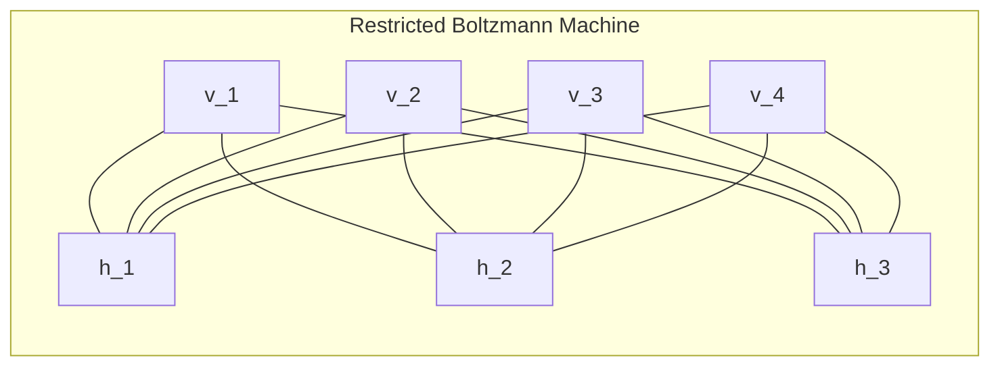
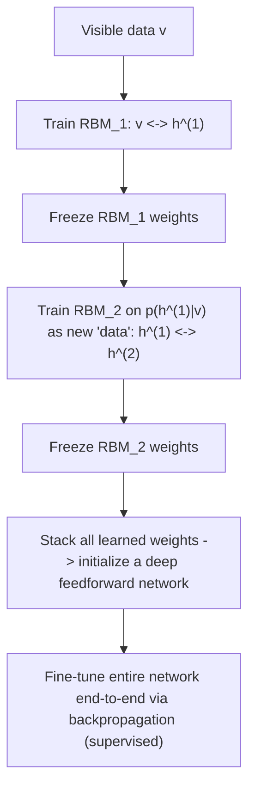

# **Restricted Boltzmann Machines (RBM) and Deep Belief Networks (DBN)**

Before VAEs (Ch. 001) and GANs (Ch. 002) became the dominant deep generative models, RBMs were the workhorse of unsupervised deep learning (2006–2012), notably underpinning the first practical method for training deep networks at all, via layer-wise pretraining. An RBM is an **energy-based model**: instead of directly parameterizing a probability distribution, it defines an energy function over (visible, hidden) variable pairs, and probability is derived from energy via the Boltzmann distribution — a physics-inspired formulation that predates, and structurally differs from, both the VAE's explicit likelihood and the GAN's adversarial game.

---

## **1. Setup: Energy-Based Modeling**

### **1.1 The Boltzmann Distribution**

An RBM has visible units $v\in\{0,1\}^{n_v}$ (observed data, e.g., binary pixels) and hidden units $h\in\{0,1\}^{n_h}$ (latent features), with an **energy function**

$$
E(v,h) = -\sum_i a_iv_i - \sum_j b_jh_j - \sum_{i,j}v_iW_{ij}h_j = -a^\top v - b^\top h - v^\top Wh
$$

where $a,b$ are visible/hidden biases and $W$ is the visible-hidden weight matrix. The joint probability follows the Boltzmann (Gibbs) distribution from statistical mechanics:

$$
p(v,h) = \frac{1}{Z}\exp(-E(v,h)), \qquad Z = \sum_{v,h}\exp(-E(v,h))
$$

**Intuition:** low-energy configurations get high probability, high-energy configurations get low probability — training adjusts $(W,a,b)$ to make energy low at configurations resembling the training data and high everywhere else. $Z$, the **partition function**, normalizes the distribution over the entire (exponentially large) space of all possible $(v,h)$ pairs.

### **1.2 "Restricted": No Intra-Layer Connections**

A general Boltzmann Machine allows connections *within* the visible layer and *within* the hidden layer as well, making inference badly intractable. The **restriction** — no visible-visible or hidden-hidden connections, only visible-hidden — makes the crucial conditional distributions **factorize completely**:

$$
p(h\mid v) = \prod_j p(h_j\mid v), \qquad p(h_j=1\mid v) = \sigma\Big(b_j+\sum_iv_iW_{ij}\Big)
$$

$$
p(v\mid h) = \prod_i p(v_i\mid h), \qquad p(v_i=1\mid h) = \sigma\Big(a_i+\sum_jW_{ij}h_j\Big)
$$

**Derivation sketch:** conditioning on $v$, the energy $E(v,h)$ is linear (additively separable) in each $h_j$ independently (no $h_jh_k$ cross-terms exist, by the restriction), so the conditional distribution over the whole hidden vector factorizes into independent per-unit Bernoulli distributions, each following the standard logistic form from the energy's linear term — this factorization is the entire computational payoff of the "restricted" architecture, making both directions of inference a single matrix-multiply-plus-sigmoid, exactly one layer of a standard feedforward network.



(Full bipartite connectivity visible-hidden; no edges within the visible layer or within the hidden layer.)

---

## **2. Training: Contrastive Divergence**

### **2.1 The Maximum-Likelihood Gradient**

Training maximizes $\log p(v)$ over the training data. Marginalizing out $h$: $p(v)=\frac1Z\sum_h\exp(-E(v,h))$. The gradient of the log-likelihood with respect to any parameter $\theta$ (e.g., $W_{ij}$) has the classical energy-based-model form:

$$
\frac{\partial \log p(v)}{\partial W_{ij}} = \underbrace{\mathbb E_{p(h\mid v)}[v_ih_j]}_{\text{"positive phase," data-driven}} - \underbrace{\mathbb E_{p(v,h)}[v_ih_j]}_{\text{"negative phase," model-driven}}
$$

**Derivation intuition:** the first (positive) term comes from differentiating $\log \sum_h\exp(-E(v,h))$ with $v$ *clamped* to the observed data — an expectation under the tractable conditional $p(h\mid v)$ (§1.2). The second (negative) term comes from differentiating $\log Z$, the normalizer — an expectation over the model's own (unclamped, free-running) joint distribution $p(v,h)$, which requires the model to generate samples from its **current, untrained** distribution to estimate. This positive-phase-minus-negative-phase structure — "increase probability of what the data actually shows, decrease probability of what the model currently (wrongly) believes is likely" — is the generic gradient form for essentially all energy-based models, of which the RBM is the simplest tractable instance.

### **2.2 Why the Negative Phase Is Hard, and Gibbs Sampling**

Exactly computing $\mathbb E_{p(v,h)}[v_ih_j]$ requires sampling from the model's full joint distribution — intractable in general (that's exactly what $Z$ being intractable means). However, the RBM's factorized conditionals (§1.2) make **Gibbs sampling** straightforward: alternately sample $h\sim p(h\mid v)$, then $v\sim p(v\mid h)$, repeating; this Markov chain converges to samples from the true joint $p(v,h)$ — but only after enough alternations to "mix" (forget its starting point), which can require many iterations in practice.

### **2.3 Contrastive Divergence (CD-k) — The Practical Approximation**

Hinton (2002) proposed a strikingly effective shortcut: instead of running the Gibbs chain to convergence, **initialize the chain at an actual training example** $v^{(0)}=v_{\text{data}}$ and run only $k$ steps (commonly $k=1$, "CD-1"):

$$
v^{(0)} \xrightarrow{\text{sample } h} h^{(0)} \xrightarrow{\text{sample } v} v^{(1)} \xrightarrow{\text{sample } h} h^{(1)} \quad (\text{stop here for CD-1})
$$

The approximate gradient uses the **reconstruction** $v^{(1)},h^{(1)}$ in place of a true equilibrium sample:

$$
\Delta W_{ij} \propto \mathbb E[v_i^{(0)}h_j^{(0)}] - \mathbb E[v_i^{(1)}h_j^{(1)}]
$$

**Why this works despite being a biased estimator of the true maximum-likelihood gradient:** starting the chain at real data means even one Gibbs step already produces a sample close to what the model finds locally plausible near real data — exactly the useful contrast (data vs. the model's own reconstruction) needed to push the model to make its energy landscape lower at real data and higher at its own "confabulations," without needing the chain to fully mix. This is a genuine approximation (CD-$k$ does not optimize the true log-likelihood exactly), but it works remarkably well in practice and made RBM training computationally feasible for the first time.

---

## **3. Deep Belief Networks: Stacking RBMs**

### **3.1 Motivation — Pretraining Deep Networks (Historical Context)**

Before batch normalization, residual connections, and better initialization schemes (mid-2000s), training deep feedforward networks directly via backpropagation from random initialization was notoriously difficult — gradients vanished badly through many layers, similar in spirit to the vanishing-gradient problem in vanilla RNNs (Ch. 038, §2.3). Hinton, Osindero, and Teh (2006) showed that **stacking RBMs and training them one layer at a time** (greedy layer-wise pretraining) provided a much better initialization from which supervised fine-tuning via backpropagation could then succeed.

### **3.2 Construction**

1. Train RBM$_1$ on the raw data $v$ to learn hidden features $h^{(1)}$.
2. **Freeze** RBM$_1$'s weights; treat the (now-fixed) hidden activations $p(h^{(1)}=1\mid v)$ as the "data" for a **second** RBM, RBM$_2$, learning a further abstraction $h^{(2)}$.
3. Repeat, stacking as many RBMs as desired — each layer trained greedily, one at a time, never jointly.
4. The resulting stack of learned weights initializes a standard deep feedforward (or, with a final labeled layer, classification) network, which is then **fine-tuned end-to-end** via ordinary backpropagation using the labeled task.



**Why greedy layer-wise pretraining helps:** each RBM only has to solve a comparatively easy, shallow unsupervised learning problem (one layer of features from the layer below), sidestepping the vanishing-gradient difficulty of training all layers jointly from scratch — this gives backpropagation a much better starting point (weights already capturing useful hierarchical structure) than random initialization, from which the harder joint fine-tuning objective becomes tractable.

---

## **4. Worked Numeric Example**

RBM with $n_v=2,\ n_h=1$. Weights $W=[0.5,\ -0.3]^\top$ (visible$\to$hidden), $b=0.1$ (hidden bias). Given $v=[1,1]$:

$$
p(h=1\mid v) = \sigma\big(b+v_1W_1+v_2W_2\big) = \sigma(0.1+0.5-0.3) = \sigma(0.3) = \frac{1}{1+e^{-0.3}} \approx 0.5744
$$

Sample $h=1$ (say, since $0.5744>0.5$ in this illustrative draw). With visible bias $a=[0.2,-0.1]$:

$$
p(v_1=1\mid h=1) = \sigma(a_1+hW_1) = \sigma(0.2+0.5) = \sigma(0.7) \approx 0.6682
$$

$$
p(v_2=1\mid h=1) = \sigma(a_2+hW_2) = \sigma(-0.1-0.3) = \sigma(-0.4) \approx 0.4013
$$

This single Gibbs step (§2.2: $v\to h\to v'$) is exactly the CD-1 reconstruction step used in training: compare $v=[1,1]$ (positive phase) against the reconstruction probabilities $[0.6682, 0.4013]$ (negative phase) to form the gradient in §2.3.

---

## **5. Python Implementation From Scratch (CD-1)**

```python
import numpy as np


def sigmoid(x):
    return 1.0 / (1.0 + np.exp(-x))


class RBM:
    def __init__(self, n_visible, n_hidden, seed=0):
        rng = np.random.default_rng(seed)
        self.W = rng.normal(0, 0.1, size=(n_visible, n_hidden))
        self.a = np.zeros(n_visible)  # visible bias
        self.b = np.zeros(n_hidden)   # hidden bias
        self.rng = rng

    def sample_h_given_v(self, v):
        p_h = sigmoid(v @ self.W + self.b)
        h = (self.rng.random(p_h.shape) < p_h).astype(np.float64)
        return p_h, h

    def sample_v_given_h(self, h):
        p_v = sigmoid(h @ self.W.T + self.a)
        v = (self.rng.random(p_v.shape) < p_v).astype(np.float64)
        return p_v, v

    def contrastive_divergence_step(self, v0_batch, lr=0.01, k=1):
        """CD-k update (§2.3), vectorized over a batch."""
        p_h0, h0 = self.sample_h_given_v(v0_batch)

        v_k, h_k = v0_batch, h0
        for _ in range(k):
            p_v_k, v_k = self.sample_v_given_h(h_k)
            p_h_k, h_k = self.sample_h_given_v(v_k)

        n = v0_batch.shape[0]
        positive_grad = v0_batch.T @ p_h0        # E[v_i h_j] under data
        negative_grad = v_k.T @ p_h_k             # E[v_i h_j] under k-step reconstruction

        self.W += lr * (positive_grad - negative_grad) / n
        self.a += lr * np.mean(v0_batch - v_k, axis=0)
        self.b += lr * np.mean(p_h0 - p_h_k, axis=0)

        reconstruction_error = np.mean((v0_batch - v_k) ** 2)
        return reconstruction_error


# Toy run: binary "images" (a couple of fixed patterns plus noise)
rng = np.random.default_rng(1)
base_patterns = np.array([[1, 1, 0, 0], [0, 0, 1, 1]], dtype=np.float64)
data = np.vstack([base_patterns[rng.integers(0, 2, size=200)]])
data = np.clip(data + rng.binomial(1, 0.05, size=data.shape), 0, 1)  # small label noise

rbm = RBM(n_visible=4, n_hidden=2, seed=2)
for epoch in range(200):
    err = rbm.contrastive_divergence_step(data, lr=0.1, k=1)

print("Final reconstruction error:", err)
print("Learned W:\n", rbm.W)
```

---

## **6. Complexity**

| Operation | Time |
|---|---|
| One Gibbs step ($v\to h$ or $h\to v$) | $O(n_vn_h)$ (one matrix-vector product) |
| CD-$k$ training step, per example | $O(k\cdot n_vn_h)$ |
| DBN greedy pretraining, per layer | same as training one RBM on that layer's input dimension |

CD-1 (the overwhelmingly common choice) makes RBM training roughly as cheap per step as a single feedforward layer's forward+backward pass — its cost profile is what made it practical at the scale 2006-era hardware could support.

---

## **7. Pitfalls**

- **CD-$k$ is a biased gradient estimator**, not true maximum likelihood — training can converge to a systematically different (though often still useful) set of parameters than exact ML would find; increasing $k$ reduces this bias at proportionally increased compute cost.
- **Mixing time / sample quality:** if the Gibbs chain (even at CD-1) starts far from where the model's equilibrium distribution actually concentrates, the negative-phase gradient estimate can be poor — Persistent Contrastive Divergence (Tieleman, 2008) addresses this by maintaining a persistent chain across minibatches rather than always restarting from data.
- **Binary-unit assumption:** the formulation above assumes binary visible/hidden units; continuous data (e.g., real-valued pixel intensities) requires a Gaussian-Bernoulli RBM variant with modified energy function and conditional forms.
- **Largely superseded in practice:** modern initialization schemes (He/Xavier init), batch normalization, residual connections, and abundant labeled data have eliminated the practical need for RBM-based greedy layer-wise pretraining in most applications — RBMs/DBNs are now primarily of historical and pedagogical importance (they were the bridge that made "deep learning" trainable at all, pre-2012), though energy-based modeling as a general framework has seen a research resurgence in other forms.
- **Intractable evaluation:** because $Z$ is intractable, you cannot directly compute $\log p(v)$ for a trained RBM to monitor exact likelihood during training — practitioners instead track reconstruction error (as in §5) or use more expensive techniques (Annealed Importance Sampling) for approximate likelihood estimates.

---

## **8. Connections**

- **VAEs/GANs (Ch. 001-002):** the modern deep generative models that largely superseded RBMs — VAEs replace the intractable-$Z$/Gibbs-sampling machinery with a tractable ELBO and reparameterization trick; GANs replace it with an adversarial discriminator, sidestepping likelihood computation entirely.
- **Boltzmann distribution / statistical mechanics:** the energy-based formulation directly imports the physics concept of a Gibbs distribution over system states, with training literally reshaping an "energy landscape" to make real data low-energy.
- **Autoencoders (Ch. 001):** an RBM's two factorized conditionals ($v\to h$ and $h\to v$) look structurally like an autoencoder's encoder/decoder, but an RBM is a genuine probabilistic (symmetric, undirected) model trained via contrastive divergence, not a deterministic reconstruction-loss-minimizing network.
- **Markov Chain Monte Carlo (MCMC):** Gibbs sampling (§2.2) is a specific, simple instance of the broader MCMC toolkit, directly relevant to any model requiring sampling from an intractable distribution.
- **Score-based/diffusion models (Ch. 003):** modern energy-based and score-matching generative models are, in spirit, intellectual descendants of the same "define an unnormalized energy/score, learn it, sample via a Markov chain" template RBMs pioneered.

---

## **9. References**

- Geoffrey E. Hinton, "Training Products of Experts by Minimizing Contrastive Divergence", Neural Computation, 2002.
- Geoffrey E. Hinton, Simon Osindero, Yee-Whye Teh, "A Fast Learning Algorithm for Deep Belief Nets", Neural Computation, 2006 (the DBN paper).
- Tijmen Tieleman, "Training Restricted Boltzmann Machines using Approximations to the Likelihood Gradient" (Persistent CD), ICML 2008.
- Geoffrey E. Hinton, "A Practical Guide to Training Restricted Boltzmann Machines", 2010 (practical tips, hyperparameters).
- Yoshua Bengio, "Learning Deep Architectures for AI", Foundations and Trends in Machine Learning, 2009 (historical context for layer-wise pretraining).
