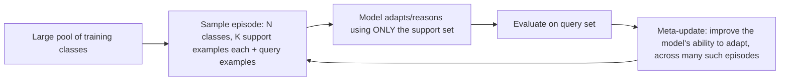
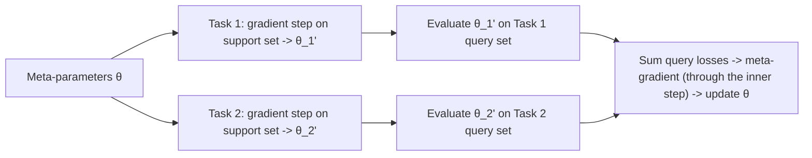

# **Meta-Learning and Few-Shot Learning**

Every model in your existing notes is trained on one task with (ideally) abundant labeled data. Meta-learning asks a different question: can a model be trained across **many different tasks** so that, at test time, it can learn a genuinely **new** task from only a handful of labeled examples (few-shot) or even zero examples (zero-shot)? The shift in perspective is from "learn a function that maps inputs to outputs" to "learn a **learning algorithm** (or a representation, or an initialization) that adapts quickly given a small amount of new task data" — often summarized as "learning to learn."

---

## **1. Problem Formulation: Episodic / Few-Shot Setup**

### **1.1 $N$-way $K$-shot Classification**

The standard few-shot benchmark task: given a **support set** of $N$ classes with $K$ labeled examples each ($N\times K$ total examples), classify examples in a **query set** drawn from the same $N$ classes. Crucially, the $N$ classes at test time are typically **never seen during meta-training** — the model must generalize its *learning strategy*, not merely its class boundaries, to genuinely novel categories.

### **1.2 Meta-Training via Episodes**

Rather than training on one fixed dataset directly, meta-learning trains over a distribution of **tasks** (episodes), each episode itself a small few-shot classification problem sampled from a large pool of training classes (disjoint from the test-time classes):

$$
\mathcal T_i = (\text{support set } S_i,\ \text{query set } Q_i), \qquad \mathcal T_i \sim p(\mathcal T)
$$

The meta-objective is to perform well, in expectation, across this **distribution of tasks** — not to minimize loss on any single fixed task, the fundamental reframing that distinguishes meta-learning from ordinary supervised learning.



---

## **2. Metric-Based Meta-Learning: Prototypical Networks**

### **2.1 Core Idea**

Learn an embedding function $f_\theta$ such that examples of the same class cluster tightly together in embedding space, and classification of a new (query) example reduces to a **nearest-prototype** lookup — no gradient-based adaptation at test time at all.

### **2.2 Prototypes and Classification Rule**

For each class $c$ in the current episode's support set $S_c$, compute the **prototype** (class mean embedding):

$$
p_c = \frac{1}{|S_c|}\sum_{(x_i,y_i)\in S_c} f_\theta(x_i)
$$

Classify a query point $x$ by (negative) distance to each prototype, softmax-normalized:

$$
p(y=c\mid x) = \frac{\exp(-d(f_\theta(x),p_c))}{\sum_{c'}\exp(-d(f_\theta(x),p_{c'}))}
$$

with $d$ typically squared Euclidean distance. This is trained end-to-end (differentiating through the prototype computation and the softmax) via ordinary cross-entropy on many sampled episodes — despite the test-time mechanism looking like a simple nearest-centroid rule (structurally identical to one E-step of k-means, existing chapter), the **embedding function** $f_\theta$ itself is learned specifically so that this simple rule works well across a huge distribution of *never-before-seen* class groupings.

### **2.3 Why Squared Euclidean Distance, Specifically**

Snell et al. (2017) show that using squared Euclidean distance (rather than, say, cosine similarity) makes the classifier mathematically equivalent to fitting a **Gaussian mixture model with one component per class and shared, fixed covariance** (a direct callback to the GMM chapter, Ch. 040): the class-conditional density under a shared-covariance Gaussian is proportional to $\exp(-\|x-\mu_c\|^2)$, exactly matching the softmax-over-negative-squared-distance classification rule — cosine similarity does not correspond to any such exponential-family density, which the authors found empirically degrades performance.

---

## **3. Optimization-Based Meta-Learning: MAML**

### **3.1 Core Idea**

Model-Agnostic Meta-Learning (Finn, Abbeel, Levine, 2017) takes a completely different approach: instead of learning an embedding/metric, learn an **initialization** $\theta$ such that a small number of ordinary gradient-descent steps on a *new* task's support set produces a good model for that task — "a good starting point for fine-tuning," made explicit as the meta-training objective itself, rather than an accidental byproduct of ordinary pretraining.

### **3.2 The Bi-Level Optimization — Derivation**

For each sampled task $\mathcal T_i$ with support set loss $\mathcal L_{\mathcal T_i}^{\text{support}}$, define the **task-adapted** parameters via one (or a few) gradient steps from the shared initialization $\theta$:

$$
\theta_i' = \theta - \alpha\nabla_\theta \mathcal L_{\mathcal T_i}^{\text{support}}(\theta)
$$

The meta-objective evaluates these **adapted** parameters on the task's **query** set, and optimizes the *original* $\theta$ to make this post-adaptation query loss small:

$$
\min_\theta \sum_{\mathcal T_i\sim p(\mathcal T)} \mathcal L_{\mathcal T_i}^{\text{query}}(\theta_i') = \sum_i \mathcal L_{\mathcal T_i}^{\text{query}}\big(\theta-\alpha\nabla_\theta\mathcal L_{\mathcal T_i}^{\text{support}}(\theta)\big)
$$

**This is a second-order optimization problem:** the meta-gradient $\nabla_\theta\left[\mathcal L^{\text{query}}(\theta_i')\right]$ requires differentiating *through* the inner gradient-descent step itself (since $\theta_i'$ is a function of $\theta$ via $\nabla_\theta\mathcal L^{\text{support}}(\theta)$), which involves a **Hessian-vector product** ($\nabla_\theta^2\mathcal L^{\text{support}}$) via the chain rule:

$$
\nabla_\theta \mathcal L^{\text{query}}(\theta_i') = \big(I - \alpha\nabla_\theta^2\mathcal L^{\text{support}}(\theta)\big)\,\nabla_{\theta_i'}\mathcal L^{\text{query}}(\theta_i')
$$

**Intuition:** ordinary training asks "how do I directly improve performance on this data?"; MAML asks "how do I set $\theta$ so that *taking a gradient step* from it improves performance?" — optimizing not the parameters themselves, but the parameters' **sensitivity to a future gradient update**. This is precisely why the objective requires this extra derivative-of-a-derivative (second-order) structure that ordinary single-level training never needs.

### **3.3 First-Order MAML (Practical Approximation)**

Computing the full Hessian-vector product is expensive; a common, cheaper approximation (First-Order MAML, or the closely related **Reptile**, Nichol et al. 2018) simply **ignores** the second-order term, treating $\theta_i'$ as if it were independent of $\theta$ when computing the outer gradient — a biased but computationally much cheaper approximation, found empirically to often work nearly as well as full second-order MAML.

### **3.4 Algorithm**

1. Initialize $\theta$ (meta-parameters).
2. For each meta-training iteration, sample a batch of tasks $\{\mathcal T_i\}$.
3. For each task: compute one (or a few) inner-loop gradient steps on its support set to get $\theta_i'$.
4. Evaluate query loss at $\theta_i'$ for every task; sum/average across the batch.
5. Backpropagate this total query loss through the inner-loop update(s) back to $\theta$ (the outer, "meta," gradient step).
6. Repeat.



---

## **4. Worked Numeric Example (Prototypical Network Classification)**

2-way, 1-shot episode: class A's single support embedding $f_\theta(x_A)=[1,0]$, class B's $f_\theta(x_B)=[0,1]$ (so $p_A=[1,0],\ p_B=[0,1]$ directly, since $K=1$). Query point embedding $f_\theta(x_q)=[0.8,0.3]$.

$$
d(x_q,p_A) = (0.8-1)^2+(0.3-0)^2 = 0.04+0.09=0.13
$$

$$
d(x_q,p_B) = (0.8-0)^2+(0.3-1)^2 = 0.64+0.49=1.13
$$

$$
p(y=A\mid x_q) = \frac{e^{-0.13}}{e^{-0.13}+e^{-1.13}} = \frac{0.8781}{0.8781+0.3230} = 0.7311
$$

The query is classified as class A with $73.1\%$ confidence — much closer to $p_A$ than $p_B$ in embedding space, exactly the nearest-prototype mechanism from §2.2.

---

## **5. Python Implementation From Scratch**

### **5.1 Prototypical Network Episode**

```python
import numpy as np


def softmax(x):
    shifted = x - x.max(axis=-1, keepdims=True)
    exp_x = np.exp(shifted)
    return exp_x / exp_x.sum(axis=-1, keepdims=True)


def compute_prototypes(support_embeddings, support_labels, n_classes):
    """support_embeddings: (n_support, d). Returns (n_classes, d) prototype matrix."""
    d = support_embeddings.shape[1]
    prototypes = np.zeros((n_classes, d))
    for c in range(n_classes):
        prototypes[c] = support_embeddings[support_labels == c].mean(axis=0)
    return prototypes


def prototypical_classify(query_embeddings, prototypes):
    """Returns class probabilities for each query point, via negative squared distance."""
    dists = np.sum((query_embeddings[:, None, :] - prototypes[None, :, :]) ** 2, axis=-1)
    return softmax(-dists)


# Toy episode: 3-way, 2-shot
rng = np.random.default_rng(0)
true_means = rng.normal(size=(3, 4)) * 3
support_labels = np.repeat(np.arange(3), 2)
support_embeddings = true_means[support_labels] + rng.normal(scale=0.3, size=(6, 4))

query_labels = np.repeat(np.arange(3), 5)
query_embeddings = true_means[query_labels] + rng.normal(scale=0.3, size=(15, 4))

prototypes = compute_prototypes(support_embeddings, support_labels, n_classes=3)
probs = prototypical_classify(query_embeddings, prototypes)
predictions = probs.argmax(axis=1)
accuracy = np.mean(predictions == query_labels)
print("Toy episode accuracy:", accuracy)
```

### **5.2 MAML Inner Loop (Conceptual, NumPy)**

```python
def maml_inner_update(theta, grad_fn, support_x, support_y, alpha=0.01):
    """One inner-loop gradient step (§3.2). grad_fn computes dL/dtheta given data and current params."""
    grad = grad_fn(theta, support_x, support_y)
    theta_prime = {k: theta[k] - alpha * grad[k] for k in theta}
    return theta_prime


def maml_meta_loss(theta, tasks, grad_fn, loss_fn, alpha=0.01):
    """Sum of query losses after one inner-loop adaptation per task, §3.4 steps 3-4."""
    total_loss = 0.0
    for support_x, support_y, query_x, query_y in tasks:
        theta_prime = maml_inner_update(theta, grad_fn, support_x, support_y, alpha)
        total_loss += loss_fn(theta_prime, query_x, query_y)
    return total_loss / len(tasks)
```

A real implementation backpropagates `maml_meta_loss` through `maml_inner_update` end-to-end via autograd (PyTorch/JAX), which automatically handles the second-order Hessian-vector-product term from §3.2 — this NumPy sketch shows the *structure* of the bi-level computation without implementing that differentiation manually.

---

## **6. Equivalent Implementation With PyTorch (via `higher` / `learn2learn`)**

```python
import torch
import torch.nn.functional as F
from torch import nn
import learn2learn as l2l

model = nn.Sequential(nn.Linear(4, 32), nn.ReLU(), nn.Linear(32, 5))
maml = l2l.algorithms.MAML(model, lr=0.01, first_order=False)  # first_order=True -> §3.3 approximation
meta_optimizer = torch.optim.Adam(maml.parameters(), lr=1e-3)

for iteration in range(1000):
    meta_optimizer.zero_grad()
    meta_loss = 0.0
    for task in sample_batch_of_tasks():
        learner = maml.clone()                      # a functional copy sharing theta, for one task's adaptation
        support_x, support_y, query_x, query_y = task

        support_loss = F.cross_entropy(learner(support_x), support_y)
        learner.adapt(support_loss)                   # one (or more) inner-loop gradient steps, §3.2

        query_loss = F.cross_entropy(learner(query_x), query_y)
        meta_loss += query_loss

    meta_loss.backward()                              # backprops through the inner adaptation step(s)
    meta_optimizer.step()
```

**Internals:** `maml.clone()` creates a functional copy of the model sharing the same underlying parameters but allowing gradient computation to track the adapted (`theta_i'`) parameters separately per task, without mutating the shared `theta` in place — `learner.adapt()` performs the inner-loop update (§3.2) while keeping the computation graph connected back to the original `theta`, which is exactly what lets `.backward()` on `meta_loss` correctly compute the second-order meta-gradient.

---

## **7. Complexity**

| Method | Per-episode cost | Test-time adaptation cost |
|---|---|---|
| Prototypical Networks | $O(NKd)$ to compute prototypes + $O(NQd)$ to classify queries | **none** — pure forward pass + nearest-prototype lookup, no gradient steps at test time |
| MAML (full, second-order) | inner-loop gradient step(s) + Hessian-vector product for the outer gradient — roughly $2$–$3\times$ the cost of ordinary backprop, per inner step | requires the same inner-loop gradient step(s) at test time on the new task's support set |
| First-Order MAML / Reptile | inner-loop gradient step(s), outer gradient is a first-order approximation (no Hessian-vector product) | same as full MAML |

---

## **8. Pitfalls**

- **Overfitting to the meta-training task distribution:** a model meta-trained on one domain (e.g., natural images) often adapts poorly to few-shot tasks from a substantially different domain — meta-learning generalizes across tasks *drawn from a similar distribution* to meta-training, not to arbitrarily different task distributions.
- **MAML's second-order computation cost and instability:** the Hessian-vector product (§3.2) is memory- and compute-intensive for large models, and the bi-level optimization can be sensitive to inner/outer learning rate choices — a major practical motivation for first-order approximations (§3.3) and metric-based alternatives (§2) that avoid the issue entirely.
- **Choice of distance metric in prototypical networks:** as derived in §2.3, squared Euclidean distance has a principled probabilistic justification (shared-covariance Gaussian mixture); naively swapping in an unrelated distance function loses this justification and can hurt performance even if it seems like a reasonable substitution.
- **Episode/task sampling design matters a lot:** the distribution of $N$ and $K$ used during meta-training should roughly match the distribution expected at test time (e.g., training only on 5-way episodes but testing on 20-way episodes typically degrades performance) — a form of train/test distribution mismatch specific to the episodic setup.
- **Few-shot learning is not the same as transfer learning/fine-tuning:** ordinary pretrain-then-fine-tune (e.g., fine-tuning a pretrained CNN or LLM on a new small dataset) can be a strong few-shot baseline, and meta-learning methods must be compared against it fairly — much of the meta-learning literature's reported gains have narrowed or reversed once fine-tuning baselines were tuned properly (Chen et al., "A Closer Look at Few-Shot Classification", 2019).

---

## **9. Connections**

- **GMM (Ch. 040):** prototypical networks' classification rule is mathematically a shared-covariance Gaussian mixture model's posterior, with an embedding network learned specifically to make that simple rule work across novel class groupings.
- **K-means (existing chapter):** the prototype computation (class-mean embedding) is exactly one M-step update of k-means, applied per-episode rather than iteratively.
- **Transfer learning / fine-tuning:** the baseline meta-learning must beat, and also the closest "ordinary" analog to what MAML is trying to do more explicitly and efficiently (an initialization that adapts quickly).
- **Second-order optimization (AdaBoost/Gradient Boosting chapter's Newton boosting, Ch. 041):** MAML's Hessian-vector product need is a different context for the same broader idea that some optimization problems require reasoning about curvature (second derivatives), not just gradients.
- **In-context learning (modern LLMs):** giving a large pretrained language model a few examples directly in its prompt (no parameter updates at all) is a related, gradient-free form of few-shot adaptation that has become a dominant practical alternative to explicit meta-learning algorithms like MAML for large-scale foundation models.

---

## **10. References**

- Jake Snell, Kevin Swersky, Richard Zemel, "Prototypical Networks for Few-shot Learning", NeurIPS 2017. https://arxiv.org/abs/1703.05175
- Chelsea Finn, Pieter Abbeel, Sergey Levine, "Model-Agnostic Meta-Learning for Fast Adaptation of Deep Networks" (MAML), ICML 2017. https://arxiv.org/abs/1703.03400
- Alex Nichol, Joshua Achiam, John Schulman, "On First-Order Meta-Learning Algorithms" (Reptile), 2018. https://arxiv.org/abs/1803.02999
- Oriol Vinyals et al., "Matching Networks for One Shot Learning", NeurIPS 2016 (an earlier metric-based approach).
- Wei-Yu Chen et al., "A Closer Look at Few-Shot Classification", ICLR 2019 (fine-tuning baselines caveat, §8).
- `learn2learn` documentation. http://learn2learn.net/
