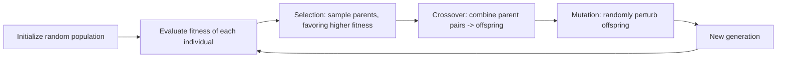

# **Genetic Algorithms and Evolutionary Strategies**

Every optimization method in your existing notes (gradient descent, Newton boosting, EM) requires a differentiable (or at least locally well-behaved) objective. Genetic Algorithms (GAs) and Evolutionary Strategies (ES) instead treat the objective as a **black box** — no gradient needed at all, only the ability to *evaluate* a candidate solution's fitness. This makes them applicable to discrete, non-differentiable, noisy, or combinatorially structured search spaces (architecture search, discrete hyperparameters, program synthesis, reward functions with no useful gradient) where every other method in this repository would need a workaround.

---

## **1. Core Setup**

A GA maintains a **population** of candidate solutions ("individuals"), each encoded as a **chromosome** (a fixed-length string, vector of real numbers, tree, or any other structured representation), and iteratively improves the population via biologically-inspired operators: **selection** (favor higher-fitness individuals), **crossover** (combine two parents' chromosomes), and **mutation** (randomly perturb a chromosome) — repeated over many **generations**.



---

## **2. Selection Operators**

### **2.1 Fitness-Proportionate (Roulette Wheel) Selection**

Sample parent $i$ with probability proportional to its fitness $f_i$:

$$
p(i) = \frac{f_i}{\sum_{j=1}^{n} f_j}
$$

**Pitfall this immediately reveals:** if one individual has fitness far larger than the rest ("super-individual"), it dominates selection near-completely, causing **premature convergence** — the population collapses around one solution before adequately exploring the search space. This directly motivates rank-based or tournament selection instead.

### **2.2 Tournament Selection**

Sample $k$ individuals uniformly at random (a "tournament"), select the one with the best fitness as a parent; repeat to fill the mating pool. Tournament size $k$ directly controls **selection pressure**: $k=1$ is pure random selection (no pressure at all — equivalent to random search); large $k$ approaches always picking the single best individual (very high pressure, faster convergence but higher premature-convergence risk) — an explicit, tunable knob absent from fitness-proportionate selection.

---

## **3. Crossover and Mutation**

### **3.1 Crossover (Recombination)**

For binary/real-valued chromosome vectors, **single-point crossover** picks a random cut position and swaps the tails of two parent chromosomes:

$$
\text{parent}_1 = [a_1,\dots,a_k\,|\,a_{k+1},\dots,a_n], \qquad \text{parent}_2=[b_1,\dots,b_k\,|\,b_{k+1},\dots,b_n]
$$

$$
\text{child}_1 = [a_1,\dots,a_k,b_{k+1},\dots,b_n], \qquad \text{child}_2=[b_1,\dots,b_k,a_{k+1},\dots,a_n]
$$

**Uniform crossover** instead independently chooses each gene from either parent with probability $0.5$ — less positional bias than single-point crossover, since single-point crossover implicitly assumes genes near each other in the encoding are more likely to be jointly useful (a "building block" assumption that may or may not match the actual problem structure).

### **3.2 Mutation**

For binary chromosomes: flip each bit independently with small probability $p_m$. For real-valued chromosomes: add Gaussian noise, $x_i' = x_i + \mathcal N(0,\sigma^2)$. **Why mutation is essential, not optional:** crossover alone can only ever recombine genetic material *already present* in the population — if some useful value never appears at a given position in any individual, no amount of crossover can introduce it. Mutation is the sole mechanism that injects genuinely new information into the population, preventing the search from getting permanently stuck exploring only combinations of the initial population's values.

---

## **4. The Schema Theorem (Why GAs Work, Classically)**

### **4.1 Schemata**

A **schema** is a template over the chromosome alphabet with wildcard positions, e.g., $H=1{*}{*}0{*}$ (a 5-bit schema matching any string with a $1$ in position 1 and a $0$ in position 4). The **order** $o(H)$ is the number of fixed (non-wildcard) positions; the **defining length** $\delta(H)$ is the distance between the first and last fixed positions.

### **4.2 Holland's Schema Theorem — Statement and Intuition**

For a schema $H$ with average fitness $f(H)$ above the population average $\bar f$, under fitness-proportionate selection, single-point crossover (crossover probability $p_c$), and per-bit mutation (rate $p_m$), the expected number of instances of $H$ in the next generation satisfies:

$$
\mathbb E[m(H,t+1)] \ge m(H,t)\cdot\frac{f(H)}{\bar f}\cdot\left[1-p_c\frac{\delta(H)}{n-1}\right]\cdot(1-p_m)^{o(H)}
$$

**Term-by-term meaning:** the $f(H)/\bar f$ factor is exponential growth for above-average schemata under selection alone (this is exactly the same "high-fitness variants get selected more" logic underlying any evolutionary or replicator-dynamics argument); the $\left[1-p_c\delta(H)/(n-1)\right]$ factor accounts for crossover potentially **disrupting** the schema (a schema with fixed positions spread far apart, large $\delta(H)$, is more likely to be split by a random crossover point); the $(1-p_m)^{o(H)}$ factor accounts for mutation potentially flipping one of the schema's fixed bits (more fixed positions, $o(H)$, means more chances for disruption).

**The upshot (informally, "the building block hypothesis"):** short, low-order, above-average-fitness schemata ("building blocks") are propagated with **exponentially increasing** representation in the population over generations, while being only mildly at risk of disruption from crossover/mutation — the classical (though since substantially debated and refined) theoretical argument for why GAs can effectively search combinatorially large spaces by implicitly, parallel-processing many schemata simultaneously across a modestly sized population ("implicit parallelism").

---

## **5. Evolutionary Strategies (ES) — The Continuous-Parameter Cousin**

### **5.1 (μ, λ)-ES**

For continuous optimization (e.g., neural network weights, real-valued hyperparameters), Evolutionary Strategies generate $\lambda$ offspring from $\mu$ parents via Gaussian mutation of a shared mean, then select the best $\mu$ of the $\lambda$ offspring to become the next generation's parents (discarding the previous parents entirely — hence "$(\mu,\lambda)$," as opposed to "$(\mu+\lambda)$-ES," which pools parents and offspring together for selection):

$$
x_i = m + \sigma\,\epsilon_i, \qquad \epsilon_i\sim\mathcal N(0,I),\ i=1,\dots,\lambda
$$

$$
m \leftarrow \frac1\mu\sum_{i\in\text{top-}\mu} x_i
$$

### **5.2 Connection to Policy-Gradient RL**

Modern large-scale ES (Salimans et al., 2017) reframes this as a gradient **estimator** rather than a purely evolutionary search: since $\mathbb E_\epsilon[F(m+\sigma\epsilon)]$ is a smoothed version of the (possibly non-differentiable) objective $F$, its gradient with respect to $m$ can be estimated via a Monte Carlo, finite-difference-style formula:

$$
\nabla_m \mathbb E_\epsilon[F(m+\sigma\epsilon)] \approx \frac{1}{\lambda\sigma}\sum_{i=1}^\lambda F(m+\sigma\epsilon_i)\,\epsilon_i
$$

This is structurally the **same log-derivative-trick estimator** as REINFORCE (the RLHF chapter's policy-gradient derivation, RL Ch. 002, §3.1) — ES can be understood as policy-gradient RL where the "policy" is a Gaussian over parameters $m$ itself, offering an embarrassingly parallel (each of the $\lambda$ perturbations can be evaluated completely independently, with no backpropagation at all) alternative to standard policy-gradient methods, at the cost of higher variance per sample and needing many more objective evaluations to estimate a comparably reliable gradient.

---

## **6. Worked Numeric Example**

Toy 5-bit chromosome fitness = number of 1-bits (a classic GA test function, "OneMax"). Population of 4:

$$
c_1=11010\ (f{=}3), \quad c_2=10110\ (f{=}3), \quad c_3=01001\ (f{=}2), \quad c_4=11111\ (f{=}5)
$$

**Fitness-proportionate selection probabilities** ($\bar f_{\text{total}}=13$): $p_1=3/13=0.231,\ p_2=0.231,\ p_3=0.154,\ p_4=5/13=0.385$ — the all-ones individual $c_4$ is already selected nearly $2\times$ as often as the weakest, illustrating the premature-convergence risk from §2.1 even at this small scale.

**Single-point crossover** of $c_1=11010$ and $c_4=11111$ at cut position 2:

$$
\text{child} = [1,1\,|\,1,1,1] = 11111 \quad (f=5)
$$

Crossover here happened to combine both parents' fit segments into an even-fitter (in this case, maximally fit) child — the intended mechanism, though not guaranteed on every crossover event.

**Mutation** with $p_m=0.2$ per bit on $01001$: suppose bit 1 flips: $11001$ ($f=3$, improved from $2$) — one lucky mutation introduced new genetic material and improved fitness, the mechanism described in §3.2.

---

## **7. Python Implementation From Scratch**

```python
import numpy as np


def onemax_fitness(population):
    return population.sum(axis=1)


def tournament_selection(population, fitness, k, rng):
    n = len(population)
    idx = rng.integers(0, n, size=k)
    winner = idx[np.argmax(fitness[idx])]
    return population[winner]


def single_point_crossover(p1, p2, rng):
    n = len(p1)
    cut = rng.integers(1, n)
    child1 = np.concatenate([p1[:cut], p2[cut:]])
    child2 = np.concatenate([p2[:cut], p1[cut:]])
    return child1, child2


def mutate(chromosome, p_m, rng):
    flips = rng.random(len(chromosome)) < p_m
    return np.where(flips, 1 - chromosome, chromosome)


def genetic_algorithm(n_genes, pop_size, n_generations, p_crossover=0.8, p_mutation=0.02,
                       tournament_k=3, seed=0):
    rng = np.random.default_rng(seed)
    population = rng.integers(0, 2, size=(pop_size, n_genes))

    best_fitness_history = []
    for gen in range(n_generations):
        fitness = onemax_fitness(population)
        best_fitness_history.append(fitness.max())

        new_population = []
        while len(new_population) < pop_size:
            parent1 = tournament_selection(population, fitness, tournament_k, rng)
            parent2 = tournament_selection(population, fitness, tournament_k, rng)

            if rng.random() < p_crossover:
                child1, child2 = single_point_crossover(parent1, parent2, rng)
            else:
                child1, child2 = parent1.copy(), parent2.copy()

            new_population.append(mutate(child1, p_mutation, rng))
            new_population.append(mutate(child2, p_mutation, rng))

        population = np.array(new_population[:pop_size])

    return population, best_fitness_history


final_pop, history = genetic_algorithm(n_genes=20, pop_size=50, n_generations=100, seed=42)
print("Best fitness per generation (every 10th):", history[::10])
print("Final best chromosome fitness:", onemax_fitness(final_pop).max())
```

---

## **8. Equivalent Implementation With DEAP**

```python
from deap import base, creator, tools, algorithms
import random

creator.create("FitnessMax", base.Fitness, weights=(1.0,))
creator.create("Individual", list, fitness=creator.FitnessMax)

toolbox = base.Toolbox()
toolbox.register("attr_bool", random.randint, 0, 1)
toolbox.register("individual", tools.initRepeat, creator.Individual, toolbox.attr_bool, n=20)
toolbox.register("population", tools.initRepeat, list, toolbox.individual)

toolbox.register("evaluate", lambda ind: (sum(ind),))
toolbox.register("mate", tools.cxTwoPoint)
toolbox.register("mutate", tools.mutFlipBit, indpb=0.02)
toolbox.register("select", tools.selTournament, tournsize=3)

population = toolbox.population(n=50)
final_pop, log = algorithms.eaSimple(
    population, toolbox, cxpb=0.8, mutpb=0.2, ngen=100, verbose=False
)
```

DEAP's `eaSimple` implements exactly the select-crossover-mutate-replace loop from §1's diagram, with each operator (`tools.cxTwoPoint`, `tools.mutFlipBit`, `tools.selTournament`) a drop-in, independently swappable implementation of the operators derived in §2–3.

---

## **9. Complexity**

| Operation | Cost per generation |
|---|---|
| Fitness evaluation | $O(P\cdot C_{\text{eval}})$ — $P$=population size, $C_{\text{eval}}$=cost of one fitness evaluation (often the dominant, problem-specific cost) |
| Selection | $O(P)$ (tournament) to $O(P\log P)$ (rank-based, requiring a sort) |
| Crossover/mutation | $O(Pn)$ — $n$ = chromosome length |

The fitness evaluation is almost always the true bottleneck in practice (e.g., if fitness requires training a neural network, as in neuroevolution/architecture search) — GA-specific overhead (selection, crossover, mutation) is usually negligible by comparison, which is precisely why GAs are attractive whenever the objective is expensive-but-black-box: the algorithm's own overhead barely matters relative to the number of expensive fitness evaluations required.

---

## **10. Pitfalls**

- **Premature convergence:** as shown in §2.1 and §6, overly strong selection pressure (fitness-proportionate with a dominant individual, or large tournament size) collapses population diversity before the search adequately explores — mitigated via weaker selection pressure, diversity-preserving techniques (fitness sharing, niching), or simply larger populations.
- **No convergence guarantee:** unlike EM (Ch. 040) or gradient descent under standard smoothness assumptions, GAs come with no formal guarantee of even local-optimum convergence in general — they are a heuristic search strategy, empirically effective on many problems but without the theoretical guarantees available to gradient-based methods.
- **Encoding matters enormously:** how a solution is represented as a chromosome (binary string, real vector, tree, permutation) directly determines what crossover/mutation operators are even valid, and a poor encoding can make an otherwise easy problem effectively unsearchable — this is widely regarded as the single most important design decision in applying a GA to a new problem.
- **Expensive fitness evaluation is often the real bottleneck** (§9): GAs are typically a poor choice when a cheap gradient is actually available (gradient descent will almost always be far more sample-efficient) — GAs earn their keep specifically in gradient-free, black-box, or discrete/combinatorial settings.
- **Hyperparameter sensitivity:** population size, crossover/mutation rates, and selection pressure all interact and typically require problem-specific tuning, with no universally good default (analogous to the learning-rate/architecture tuning burden in gradient-based deep learning, but with less established practical guidance).

---

## **11. Connections**

- **Reinforcement learning (RL Ch. 001, 002):** Evolutionary Strategies (§5.2) are a black-box, gradient-free alternative to policy-gradient RL, using the identical log-derivative-trick estimator structure as REINFORCE, just applied to perturbations of policy parameters rather than sampled actions.
- **Random search / hyperparameter optimization:** GAs are one member of a broader family of derivative-free global optimization methods (alongside simulated annealing, Bayesian optimization, particle swarm optimization) applicable whenever gradients are unavailable or unreliable.
- **Neuroevolution / Neural Architecture Search:** GAs (and ES) have been used to directly search discrete neural architecture spaces or evolve network weights, precisely because architecture choices and certain reward signals are non-differentiable.
- **EM algorithm (Ch. 040) and gradient descent:** the contrast point throughout this chapter — both are local, typically gradient-or-likelihood-based optimization procedures with formal (if only local) convergence guarantees, versus GA/ES's global, population-based, guarantee-free heuristic search.

---

## **12. References**

- John H. Holland, *Adaptation in Natural and Artificial Systems*, University of Michigan Press, 1975 (the foundational GA text, source of the Schema Theorem).
- David E. Goldberg, *Genetic Algorithms in Search, Optimization, and Machine Learning*, Addison-Wesley, 1989 (the classic, highly accessible textbook treatment).
- Hans-Georg Beyer and Hans-Paul Schwefel, "Evolution Strategies: A Comprehensive Introduction", Natural Computing, 2002.
- Tim Salimans et al., "Evolution Strategies as a Scalable Alternative to Reinforcement Learning", 2017. https://arxiv.org/abs/1703.03864
- DEAP (Distributed Evolutionary Algorithms in Python) documentation. https://deap.readthedocs.io/
