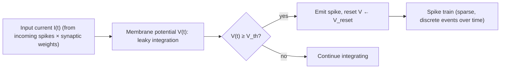

# **Spiking Neural Networks (SNNs)**

Every network in your existing notes (ANN, CNN, RNN/LSTM, Transformer) uses **continuous-valued activations** updated synchronously at every forward pass — a computational abstraction, not a claim about how biological neurons actually work. Spiking Neural Networks instead model neurons that communicate via discrete, timed **spikes** (binary events at specific instants), much closer to biological neural computation, and — critically — activate specialized **neuromorphic hardware** (Intel Loihi, IBM TrueNorth) that can run them at dramatically lower energy cost than a GPU running an equivalent ANN, at the cost of a fundamentally different (and harder) training story.

---

## **1. The Leaky Integrate-and-Fire (LIF) Neuron**

### **1.1 Motivation**

A biological neuron accumulates incoming charge (membrane potential) over time, "leaks" some of it away if input is sparse, and fires a discrete, all-or-nothing spike once the potential crosses a threshold — after which it resets and the process repeats. This is a fundamentally different computational primitive than a sigmoid/ReLU unit, which outputs a real-valued number in one synchronous step with no notion of time or memory of a "just fired" reset state.

### **1.2 The LIF Differential Equation — Derivation**

Model the membrane potential $V(t)$ of a neuron as a leaky electrical capacitor driven by input current $I(t)$:

$$
\tau_m \frac{dV}{dt} = -\big(V(t)-V_{\text{rest}}\big) + R\,I(t)
$$

where $\tau_m=RC$ is the membrane time constant (how quickly charge leaks away), $R$ is membrane resistance, and $V_{\text{rest}}$ is the resting potential. **Intuition for each term:** $-\big(V(t)-V_{\text{rest}}\big)$ is the leak — in the absence of input, $V(t)$ decays exponentially back toward rest (solving the equation with $I=0$ gives $V(t)=V_{\text{rest}}+(V(0)-V_{\text{rest}})e^{-t/\tau_m}$, ordinary exponential decay); $R\,I(t)$ is the driving term — incoming current pushes the potential up.

### **1.3 The Spiking (Threshold-and-Reset) Mechanism**

Superimposed on this continuous dynamics is a discrete event rule:

$$
\text{if } V(t) \ge V_{\text{th}}: \quad \text{emit a spike at time } t, \qquad V(t) \leftarrow V_{\text{reset}}
$$

This threshold-crossing-then-reset is precisely what makes the neuron's output a sparse, discrete **spike train** (a sequence of timestamps) rather than a continuous value — information is encoded in **when** spikes occur (and how many, over some observation window), not in a single real number.

### **1.4 Discretized (Simulation) Form**

For simulation, discretize time into steps of size $\Delta t$ (Euler's method on the ODE from §1.2):

$$
V[t+1] = V[t] + \frac{\Delta t}{\tau_m}\big(-(V[t]-V_{\text{rest}}) + R\,I[t]\big)
$$

$$
s[t] = \mathbb 1\big[V[t]\ge V_{\text{th}}\big], \qquad \text{if } s[t]=1: V[t]\leftarrow V_{\text{reset}}
$$

where $s[t]\in\{0,1\}$ is the binary spike indicator at discrete step $t$ — this is the form actually implemented in software SNN simulators and the form used for the surrogate-gradient training derivation in §3.



---

## **2. Encoding Real-Valued Data as Spike Trains**

Since SNN inputs/outputs are spike trains, not real numbers, real-valued data (e.g., pixel intensities) must first be **encoded**:

- **Rate coding:** encode a value $x\in[0,1]$ as a Poisson spike train with firing rate proportional to $x$ — higher intensity, more frequent spikes over the observation window. Simple, robust to noise, but requires a longer time window to distinguish similar values precisely (more spikes needed for a reliable rate estimate), directly trading off latency against precision.
- **Temporal (latency) coding:** encode $x$ as the **timing** of a single spike — larger $x$ fires earlier, smaller $x$ fires later (or vice versa). Far more information-efficient per spike (one spike can convey a continuous value via its timing, rather than needing many spikes to estimate a rate) but more sensitive to timing noise/jitter.

This encoding step is itself a genuine design decision with real accuracy/latency/robustness trade-offs, unlike an ANN, which consumes real-valued inputs directly with no such preprocessing choice required.

---

## **3. Why SNNs Are Hard to Train: The Non-Differentiability Problem**

### **3.1 The Core Obstacle**

The spike function $s[t]=\mathbb 1[V[t]\ge V_{\text{th}}]$ is a **hard step function** — its derivative is exactly zero everywhere except at $V_{\text{th}}$, where it is an (undefined, infinite-spike) Dirac delta. Backpropagation (the workhorse of every other network in your notes) requires $\partial s/\partial V$ to compute gradients through the spiking nonlinearity, and this derivative is **zero almost everywhere** — vanilla backpropagation through a spiking network gives essentially zero gradient signal everywhere, making direct end-to-end training via standard backprop fundamentally broken, not merely difficult.

### **3.2 Surrogate Gradients — The Practical Fix**

The dominant modern solution (Neftci, Mostafa, Zenke, 2019) keeps the **forward pass** exactly as the true, hard threshold function (preserving genuine spiking behavior and the resulting sparsity/energy benefits), but substitutes a smooth **surrogate** function's derivative during the **backward** pass only:

$$
\text{forward: } s = \mathbb 1[V\ge V_{\text{th}}] \qquad\qquad \text{backward: } \frac{\partial s}{\partial V} \approx \sigma'(\beta(V-V_{\text{th}}))
$$

using, e.g., the derivative of a sigmoid (or a fast-decaying triangular function) centered at the threshold as a smooth stand-in for the true (all-zero-almost-everywhere) derivative. **Why this is a principled hack, not a random workaround:** near the threshold, small changes in $V$ genuinely *do* affect whether a spike would occur nearby in time — the surrogate derivative encodes "how close was this neuron to firing/not-firing," a real, useful gradient signal that the true derivative (identically zero except at one measure-zero point) simply cannot express in a form standard backprop can use. This is directly analogous to how the straight-through estimator is used elsewhere for training with hard, non-differentiable discretization steps (e.g., quantized neural networks) — same underlying "use a different function's gradient than the one that was actually used forward" strategy.

### **3.3 Backpropagation Through Time for SNNs**

Since the LIF dynamics (§1.4) are inherently a discrete-time recurrence in $V[t]$, training an SNN over an observation window unrolls it exactly like an RNN (Ch. 038) and applies BPTT — surrogate gradients (§3.2) at every spike, ordinary chain-rule backpropagation through the leaky-integration recurrence otherwise. This connects SNN training directly back to the vanishing/exploding-gradient analysis in the LSTM/GRU chapter (Ch. 038, §2.3): SNNs face the same repeated-Jacobian-multiplication gradient-flow challenges as vanilla RNNs, now compounded by the surrogate-gradient approximation error at every spike event.

---

## **4. Worked Numeric Example**

LIF neuron, $\tau_m=10$ms, $\Delta t=1$ms (so $\Delta t/\tau_m=0.1$), $V_{\text{rest}}=0$, $V_{\text{th}}=1.0$, $V_{\text{reset}}=0$, constant input current $R\,I=0.15$ per step. Starting at $V[0]=0$:

$$
V[1] = 0+0.1\big(-(0-0)+0.15\big) = 0.015
$$

$$
V[2] = 0.015+0.1(-(0.015)+0.15) = 0.015+0.1(0.135)=0.0285
$$

Continuing this recurrence (each step adds roughly $0.1\times(0.15-V[t])$, a shrinking increment as $V$ approaches the steady-state driving level), $V[t]$ climbs toward an asymptote of $0.15$ under this input alone — **never reaching** $V_{\text{th}}=1.0$ with this weak a constant input, so this neuron would never spike under this specific current. Increasing the input current (say $R\,I=1.5$) makes the steady-state target level exceed $V_{\text{th}}$, guaranteeing a spike (and subsequent reset) once $V[t]$ climbs high enough — illustrating that firing depends on both current magnitude and accumulation time, exactly the "leaky integrate" mechanism from §1.2.

---

## **5. Python Implementation From Scratch (LIF Neuron Simulation)**

```python
import numpy as np


def simulate_lif(input_current, tau_m=10.0, dt=1.0, v_rest=0.0, v_th=1.0, v_reset=0.0):
    """
    input_current: array of shape (T,), the driving current R*I[t] at each timestep.
    Returns: V (membrane potential trace), spikes (binary spike train).
    """
    T = len(input_current)
    V = np.zeros(T + 1)
    spikes = np.zeros(T)
    V[0] = v_rest

    for t in range(T):
        dV = (dt / tau_m) * (-(V[t] - v_rest) + input_current[t])
        V[t + 1] = V[t] + dV

        if V[t + 1] >= v_th:
            spikes[t] = 1.0
            V[t + 1] = v_reset  # hard reset upon spiking (§1.3)

    return V[1:], spikes


def rate_encode(x, T, rng):
    """Rate coding (§2): x in [0,1] -> Poisson-like spike train of length T."""
    return (rng.random(T) < x).astype(np.float64)


# Toy run: encode a value, feed through a LIF neuron, observe spiking
rng = np.random.default_rng(0)
x = 0.7  # a real-valued "pixel intensity"
input_spikes = rate_encode(x, T=100, rng=rng)

V_trace, output_spikes = simulate_lif(input_spikes * 1.5, tau_m=10.0, dt=1.0)
print("Number of output spikes:", output_spikes.sum(), "out of", len(output_spikes), "steps")
```

### **5.1 Surrogate Gradient (Conceptual)**

```python
def spike_forward(v, v_th=1.0):
    """True forward pass: hard threshold."""
    return (v >= v_th).astype(np.float64)


def surrogate_grad(v, v_th=1.0, beta=5.0):
    """
    Backward pass surrogate (§3.2): derivative of a fast sigmoid centered at v_th,
    used IN PLACE OF the true (everywhere-zero) derivative during backprop.
    """
    sig = 1.0 / (1.0 + np.exp(-beta * (v - v_th)))
    return beta * sig * (1 - sig)
```

A full training loop (PyTorch, §6) uses `spike_forward`'s hard threshold in the forward pass but registers `surrogate_grad` as the custom backward function via a custom `autograd.Function`, so gradients flow using the smooth approximation while the network genuinely spikes at inference/forward time.

---

## **6. Equivalent Implementation With snnTorch**

```python
import torch
import snntorch as snn
from snntorch import surrogate


class SimpleSNN(torch.nn.Module):
    def __init__(self, n_in, n_hidden, n_out, beta=0.9):
        super().__init__()
        spike_grad = surrogate.fast_sigmoid(slope=25)  # the surrogate from §3.2/§5.1, pre-implemented

        self.fc1 = torch.nn.Linear(n_in, n_hidden)
        self.lif1 = snn.Leaky(beta=beta, spike_grad=spike_grad)  # beta relates to exp(-dt/tau_m), §1.4
        self.fc2 = torch.nn.Linear(n_hidden, n_out)
        self.lif2 = snn.Leaky(beta=beta, spike_grad=spike_grad)

    def forward(self, x_spike_train):
        mem1 = self.lif1.init_leaky()
        mem2 = self.lif2.init_leaky()
        spk2_rec = []

        for t in range(x_spike_train.shape[0]):  # iterate over the time dimension
            cur1 = self.fc1(x_spike_train[t])
            spk1, mem1 = self.lif1(cur1, mem1)
            cur2 = self.fc2(spk1)
            spk2, mem2 = self.lif2(cur2, mem2)
            spk2_rec.append(spk2)

        return torch.stack(spk2_rec)  # (T, batch, n_out) spike train output


model = SimpleSNN(n_in=784, n_hidden=128, n_out=10)
loss_fn = torch.nn.CrossEntropyLoss()

x_spikes = torch.rand(25, 32, 784) < 0.3   # toy rate-encoded input, (T, batch, features)
output_spikes = model(x_spikes)
spike_counts = output_spikes.sum(dim=0)     # sum spikes over time -> rate-decoded class scores
loss = loss_fn(spike_counts, torch.randint(0, 10, (32,)))
loss.backward()  # uses the surrogate gradient registered in spike_grad automatically
```

**Internals:** `snn.Leaky` implements exactly the discretized LIF recurrence from §1.4 (with `beta` playing the role of the per-step decay factor $1-\Delta t/\tau_m$), maintaining membrane potential as internal recurrent state across the `for t in range(...)` loop — structurally identical to unrolling an RNN cell (Ch. 038) manually, since that's precisely what an SNN's temporal dynamics are; `surrogate.fast_sigmoid` provides the same custom-forward/custom-backward mechanism sketched in §5.1, pre-packaged as a PyTorch-autograd-compatible function.

---

## **7. Complexity and the Energy-Efficiency Case**

### **7.1 Why Neuromorphic Hardware Changes the Cost Model**

On conventional GPU/CPU hardware, simulating an SNN's discrete-time recurrence is typically **more** expensive than an equivalent ANN's single forward pass (extra timesteps to unroll, per §3.3) — SNNs do not win on speed/cost when simulated on hardware built for dense matrix multiplication. Their efficiency case is specifically about **neuromorphic hardware** (Intel Loihi, IBM TrueNorth), which is event-driven: computation and energy are only spent **when a spike actually occurs**, exploiting the fact that biological/SNN spike trains are typically extremely **sparse** (most neurons are silent most of the time). On such hardware, energy cost scales with the *number of spikes*, not the number of neurons/timesteps — a fundamentally different cost model than a GPU's dense, synchronous per-timestep computation over every unit regardless of activity.

### **7.2 Complexity Summary**

| Platform | Cost driver |
|---|---|
| GPU/CPU (dense simulation) | $O(T\cdot(\text{network size}))$ — every neuron computed every timestep, spiking or not; typically slower than an equivalent ANN |
| Neuromorphic hardware (event-driven) | $O(\text{number of spikes})$ — genuinely sub-linear in network size/time when activity is sparse, the actual source of SNNs' claimed energy advantage |

---

## **8. Pitfalls**

- **Non-differentiability is the central obstacle, not a minor implementation detail:** without surrogate gradients (§3.2) or an alternative training strategy (e.g., converting a pretrained ANN's weights into an SNN post-hoc, "ANN-to-SNN conversion," which sidesteps spike-based training entirely but only approximates the ANN's behavior), gradient-based training simply does not work.
- **Simulating on the wrong hardware defeats the purpose:** running an SNN on a GPU captures none of the energy-efficiency benefit (§7.1) and is typically slower than the ANN it's meant to replace — SNN research/deployment claims about efficiency are conditional on actually deploying to neuromorphic hardware, not a universal speed advantage.
- **Encoding/decoding overhead:** converting real-valued data to spike trains (§2) and decoding spike-count/timing outputs back to real-valued predictions adds both latency (especially for rate coding, which needs many timesteps for precision) and an additional source of information loss/design choice absent in ordinary ANNs.
- **Hyperparameter sensitivity:** the surrogate gradient's shape/steepness ($\beta$ in §5.1/§6), the membrane time constant $\tau_m$, and threshold $V_{\text{th}}$ all interact in ways that significantly affect trainability and final accuracy, with less mature/standardized tuning guidance than for conventional ANN hyperparameters.
- **Accuracy gap versus ANNs:** despite substantial progress, SNNs trained with surrogate gradients still generally lag behind equivalently-sized ANNs on standard benchmarks — the case for SNNs is about energy efficiency on specialized hardware and closer biological plausibility, not (yet) raw accuracy superiority.

---

## **9. Connections**

- **RNN/LSTM (Ch. 038):** an SNN's membrane-potential recurrence is structurally an RNN unrolled over time, trained via BPTT exactly as in Ch. 038 — with the added, central complication of surrogate gradients through the spike nonlinearity, and facing the same vanishing/exploding gradient dynamics analysis from that chapter.
- **Straight-through estimators / quantized neural networks:** the surrogate-gradient trick (§3.2) is one instance of a broader "use a different function's derivative than the one computed forward" family of tricks needed whenever a hard, non-differentiable discretization sits inside an otherwise-differentiable network (e.g., training networks with binary/quantized weights).
- **Neuromorphic computing:** SNNs are the dominant computational model for neuromorphic hardware, connecting this chapter to a broader hardware/systems research area distinct from anything else in these notes, which otherwise assume conventional GPU/CPU/TPU execution.
- **Biological neuroscience:** the LIF model (and richer variants, e.g., Hodgkin-Huxley) originates directly from computational neuroscience's effort to model real neurons, making SNNs the ML architecture with the most direct, literal connection to biological plausibility among everything else in these notes.

---

## **10. References**

- Wulfram Gerstner and Werner M. Kistler, *Spiking Neuron Models: Single Neurons, Populations, Plasticity*, Cambridge University Press, 2002 (the foundational LIF/neuroscience reference).
- Emre O. Neftci, Hesham Mostafa, Friedemann Zenke, "Surrogate Gradient Learning in Spiking Neural Networks", IEEE Signal Processing Magazine, 2019. https://arxiv.org/abs/1901.09948
- Jason K. Eshraghian et al., "Training Spiking Neural Networks Using Lessons from Deep Learning" (the snnTorch paper/tutorial), Proceedings of the IEEE, 2023. https://arxiv.org/abs/2109.12894
- Mike Davies et al., "Loihi: A Neuromorphic Manycore Processor with On-Chip Learning", IEEE Micro, 2018 (Intel's neuromorphic chip).
- Paul A. Merolla et al., "A Million Spiking-Neuron Integrated Circuit with a Scalable Communication Network and Interface" (IBM TrueNorth), Science, 2014.
- snnTorch documentation. https://snntorch.readthedocs.io/
