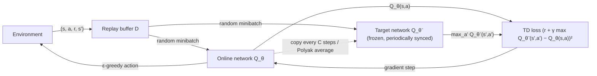

# **Q-Learning and Deep Q-Networks (DQN)**

Your existing bandit notes (UCB, Thompson Sampling) cover the stateless case: one situation, repeated forever, only the action matters. Full reinforcement learning adds **state**: the agent's optimal action depends on where it is, and actions change the state itself, requiring credit assignment across a whole trajectory rather than a single reward. Q-learning is the canonical algorithm for this general setting; DQN scales it to huge/continuous state spaces by replacing an explicit table with a neural network.

---

## **1. Markov Decision Process (MDP) Setup**

An MDP is a tuple $(\mathcal S, \mathcal A, P, R, \gamma)$:

- $\mathcal S$: state space, $\mathcal A$: action space.
- $P(s' \mid s,a)$: transition probability of landing in $s'$ after taking action $a$ in state $s$.
- $R(s,a,s')$: reward received on that transition.
- $\gamma \in [0,1)$: discount factor.

A policy $\pi(a\mid s)$ selects actions. The **action-value function** (Q-function) for policy $\pi$ is the expected discounted return starting from $(s,a)$ and following $\pi$ thereafter:

$$
Q^\pi(s,a) = \mathbb{E}_\pi\left[\sum_{t=0}^{\infty} \gamma^t R(s_t,a_t,s_{t+1}) \;\middle|\; s_0=s,\ a_0=a\right]
$$

The goal is to find an **optimal** policy $\pi^\star$ maximizing expected return from every state, with optimal action-value function

$$
Q^\star(s,a) = \max_\pi Q^\pi(s,a)
$$

If $Q^\star$ is known, the optimal policy is simply $\pi^\star(s) = \arg\max_a Q^\star(s,a)$ — the entire control problem reduces to learning one function.

---

## **2. The Bellman Optimality Equation — Derivation**

Split the infinite sum in $Q^\pi$ into the immediate reward plus the (discounted) return from the next state:

$$
Q^\pi(s,a) = \mathbb{E}_{s'\sim P(\cdot\mid s,a)}\left[R(s,a,s') + \gamma\, \mathbb{E}_{a'\sim\pi(\cdot\mid s')}\big[Q^\pi(s',a')\big]\right]
$$

This is the **Bellman expectation equation** — a recursive, one-step consistency condition that must hold for the true $Q^\pi$ under policy $\pi$. For the *optimal* policy, the inner expectation over $a'$ is replaced by a $\max$, since at the next state the optimal policy will greedily pick the best action:

$$
\boxed{Q^\star(s,a) = \mathbb{E}_{s'\sim P(\cdot\mid s,a)}\left[R(s,a,s') + \gamma\, \max_{a'} Q^\star(s',a')\right]}
$$

This is the **Bellman optimality equation**. It is a fixed-point equation: $Q^\star$ is the function that, when you apply one step of "look at the immediate reward plus the best you could do afterward," reproduces itself. This self-consistency is what Q-learning exploits — it turns learning $Q^\star$ into repeatedly reducing the violation of this equation on observed transitions.

### **2.1 The Bellman Operator Is a Contraction (Why Q-Learning Converges)**

Define the Bellman optimality operator on any function $Q:\mathcal S\times\mathcal A\to\mathbb R$:

$$
(\mathcal T Q)(s,a) = \mathbb{E}_{s'}\left[R(s,a,s') + \gamma\max_{a'}Q(s',a')\right]
$$

For any two functions $Q_1,Q_2$, using $|\max_x f(x) - \max_x g(x)| \le \max_x|f(x)-g(x)|$:

$$
\|\mathcal T Q_1 - \mathcal T Q_2\|_\infty = \gamma\left\|\mathbb E_{s'}\left[\max_{a'}Q_1(s',a') - \max_{a'}Q_2(s',a')\right]\right\|_\infty \le \gamma\|Q_1-Q_2\|_\infty
$$

Since $\gamma < 1$, $\mathcal T$ is a **contraction mapping** in the sup-norm. By the Banach fixed-point theorem, $\mathcal T$ has a unique fixed point (which is exactly $Q^\star$, by construction of the Bellman equation) and repeated application $Q_{k+1} = \mathcal T Q_k$ converges to it geometrically from any starting $Q_0$. Q-learning is a stochastic (sampled, not exact-expectation) version of this exact same iteration, which is why — under standard stochastic-approximation conditions — it converges too.

---

## **3. Tabular Q-Learning**

### **3.1 Update Rule**

Since the transition distribution $P$ is unknown, Q-learning replaces the exact expectation in the Bellman operator with a single sampled transition $(s,a,r,s')$ and moves the current estimate toward that sampled target by a small step (stochastic approximation / Robbins-Monro style update):

$$
\boxed{
Q(s,a) \leftarrow Q(s,a) + \alpha\Big[\underbrace{r + \gamma\max_{a'}Q(s',a')}_{\text{TD target}} - Q(s,a)\Big]
}
$$

$\alpha \in (0,1]$ is the learning rate. The bracketed quantity is the **temporal-difference (TD) error** $\delta = r+\gamma\max_{a'}Q(s',a') - Q(s,a)$: the discrepancy between the current estimate and a one-step-bootstrapped, sampled version of the Bellman target. Averaging over many samples of $s'\sim P(\cdot\mid s,a)$, the TD target's expectation is exactly $(\mathcal T Q)(s,a)$ — so this is stochastic gradient-free fixed-point iteration on a noisy, sampled version of the contraction from §2.1.

### **3.2 Off-Policy: Why the Behavior Policy Doesn't Matter (Much)**

Crucially, the update uses $\max_{a'}Q(s',a')$ — the value of the *greedy* action — regardless of which action $a'$ the agent actually takes next. This makes Q-learning **off-policy**: the data can be collected under any exploration policy (e.g., $\epsilon$-greedy) while the update always targets the optimal (greedy) policy's value. This is what allows using an exploratory behavior policy for data collection while still learning $Q^\star$ rather than the exploratory policy's own (suboptimal) $Q^\pi$.

### **3.3 Exploration: $\epsilon$-Greedy**

$$
a = \begin{cases} \arg\max_a Q(s,a), & \text{with probability } 1-\epsilon \\ \text{uniform random action}, & \text{with probability } \epsilon \end{cases}
$$

This is the same exploration–exploitation trade-off as your bandit notes (UCB, Thompson Sampling), specialized to the simplest possible strategy; $\epsilon$ is typically annealed from near $1$ (mostly explore) down to a small floor (mostly exploit) over training.

### **3.4 Convergence Conditions**

Tabular Q-learning converges to $Q^\star$ with probability 1 provided:

1. Every state-action pair is visited infinitely often (guaranteed by, e.g., $\epsilon$-greedy with $\epsilon$ not decaying to exactly $0$ too fast, or by simply never letting $\epsilon\to 0$ entirely during training).
2. The learning rate satisfies the Robbins-Monro conditions: $\sum_t \alpha_t = \infty$ and $\sum_t \alpha_t^2 < \infty$ (e.g., $\alpha_t = 1/t$), which ensures enough cumulative update magnitude to escape any starting point but with vanishing per-step noise variance as $t\to\infty$.

### **3.5 Worked Numeric Example**

3-state chain $s_0 \to s_1 \to s_2$ (terminal), actions {left, right}, $\gamma=0.9$, $\alpha=0.5$. Suppose current estimates $Q(s_1,\text{right})=2.0$, $Q(s_2,\text{left})=5.0$, $Q(s_2,\text{right})=3.0$, and the agent observes transition $(s_1, \text{right}, r=1, s_2)$:

$$
\text{TD target} = r + \gamma\max_{a'}Q(s_2,a') = 1 + 0.9\max(5.0,3.0) = 1+0.9(5.0) = 5.5
$$

$$
\delta = 5.5 - 2.0 = 3.5
$$

$$
Q(s_1,\text{right}) \leftarrow 2.0 + 0.5(3.5) = 2.0+1.75 = 3.75
$$

The estimate moves halfway ($\alpha=0.5$) toward the bootstrapped target — repeating this across many sampled transitions from all state-action pairs is exactly the sampled contraction iteration from §2.1/§3.1.

---

## **4. From Tables to Function Approximation**

Tabular Q-learning requires one entry per $(s,a)$ pair — infeasible when $\mathcal S$ is large or continuous (e.g., raw pixels). Replace the table with a parametric function $Q_\theta(s,a)$ (a neural network) and adapt the Bellman-error minimization into a supervised-regression-style loss:

$$
\mathcal L(\theta) = \mathbb{E}_{(s,a,r,s')\sim \mathcal D}\left[\Big(r+\gamma\max_{a'}Q_\theta(s',a') - Q_\theta(s,a)\Big)^2\right]
$$

This is exactly squared TD error, now differentiated with respect to $\theta$ and minimized by gradient descent instead of updated table-cell-by-cell. Two problems immediately arise from naively doing this with a neural network, both addressed by DQN (Mnih et al., 2015):

### **4.1 Problem 1 — Correlated, Non-Stationary Data: Experience Replay**

Consecutive transitions from a single trajectory are highly correlated (similar states, similar actions), violating the i.i.d.-minibatch assumption that makes SGD well-behaved, and can cause catastrophic forgetting of earlier experience as the policy (and thus the data distribution) shifts under training. **Fix:** store transitions $(s,a,r,s')$ in a large **replay buffer** and train on uniformly random minibatches sampled from it, decorrelating consecutive updates and reusing past experience many times (improving sample efficiency).

### **4.2 Problem 2 — Moving Target: Target Network**

The regression target $r+\gamma\max_{a'}Q_\theta(s',a')$ depends on the **same** parameters $\theta$ being updated — every gradient step changes the target itself, which can make training oscillate or diverge (a "chasing your own tail" instability absent from ordinary supervised regression, where the label is fixed). **Fix:** maintain a separate **target network** $Q_{\theta^-}$, a periodically-refreshed (every $C$ steps, hard copy) or slowly-tracking (Polyak-averaged, soft copy) copy of $\theta$, and compute the target using the *frozen* $\theta^-$:

$$
\mathcal L(\theta) = \mathbb{E}_{(s,a,r,s')\sim\mathcal D}\left[\Big(r+\gamma\max_{a'}Q_{\theta^-}(s',a') - Q_\theta(s,a)\Big)^2\right]
$$



### **4.3 Overestimation Bias and Double DQN**

$\max_{a'}Q_\theta(s',a')$ uses the **same** network both to *select* the best next action and to *evaluate* its value. If $Q_\theta$ has noisy errors (which any learned approximator does), $\max$ over noisy estimates is a systematically **upward-biased** estimator of the true max (Jensen's-inequality-style argument: $\mathbb E[\max_a X_a] \ge \max_a \mathbb E[X_a]$ for noisy $X_a$), inflating targets and destabilizing training. **Double DQN** (Van Hasselt et al., 2016) decouples selection from evaluation using the two networks already available:

$$
\text{target} = r + \gamma\, Q_{\theta^-}\Big(s', \ \arg\max_{a'} Q_\theta(s',a')\Big)
$$

The **online** network $\theta$ picks the action; the **target** network $\theta^-$ evaluates it. Since the two networks' errors are (mostly) independent, this largely removes the systematic upward bias without any additional network or major architecture change.

---

## **5. Step-by-Step DQN Training Execution**

1. Initialize online network $\theta$, target network $\theta^-\leftarrow\theta$, empty replay buffer $\mathcal D$.
2. For each environment step:
   a. Observe $s$; select $a$ via $\epsilon$-greedy on $Q_\theta(s,\cdot)$.
   b. Execute $a$; observe $r, s'$; push $(s,a,r,s')$ into $\mathcal D$ (dropping oldest if at capacity).
   c. Sample a random minibatch of transitions from $\mathcal D$.
   d. Compute targets using $\theta^-$ (vanilla DQN) or $\theta$-selects/$\theta^-$-evaluates (Double DQN).
   e. Compute squared TD-error loss; backprop; update $\theta$ with one SGD/Adam step.
   f. Every $C$ steps (or continuously via Polyak averaging), sync $\theta^- \leftarrow \theta$.
3. Anneal $\epsilon$ over training.
4. At evaluation/deployment: act purely greedily, $a=\arg\max_a Q_\theta(s,a)$, no exploration.

---

## **6. Python Implementation From Scratch**

### **6.1 Tabular Q-Learning**

```python
import numpy as np


class TabularQLearning:
    def __init__(self, n_states, n_actions, alpha=0.5, gamma=0.9, epsilon=0.1, seed=0):
        self.Q = np.zeros((n_states, n_actions))
        self.alpha, self.gamma, self.epsilon = alpha, gamma, epsilon
        self.rng = np.random.default_rng(seed)
        self.n_actions = n_actions

    def select_action(self, s):
        if self.rng.random() < self.epsilon:
            return self.rng.integers(self.n_actions)
        return int(np.argmax(self.Q[s]))

    def update(self, s, a, r, s_next, done):
        td_target = r if done else r + self.gamma * np.max(self.Q[s_next])
        td_error = td_target - self.Q[s, a]
        self.Q[s, a] += self.alpha * td_error
        return td_error


def run_episode(env_step_fn, agent, s0, max_steps=100):
    s = s0
    for _ in range(max_steps):
        a = agent.select_action(s)
        s_next, r, done = env_step_fn(s, a)
        agent.update(s, a, r, s_next, done)
        s = s_next
        if done:
            break
    return s
```

`done` gating the bootstrap term (`r if done else r + gamma*max(...)`) is essential: at a terminal state there is no future return, so bootstrapping through it would incorrectly inject a nonzero value for a state that has none — a common tabular/DQN implementation bug (§8).

### **6.2 DQN Core Loop (PyTorch)**

```python
import random
from collections import deque, namedtuple

import torch
import torch.nn.functional as F
from torch import nn

Transition = namedtuple("Transition", ["s", "a", "r", "s_next", "done"])


class QNetwork(nn.Module):
    def __init__(self, state_dim, n_actions, hidden=128):
        super().__init__()
        self.net = nn.Sequential(
            nn.Linear(state_dim, hidden), nn.ReLU(),
            nn.Linear(hidden, hidden), nn.ReLU(),
            nn.Linear(hidden, n_actions),
        )

    def forward(self, s):
        return self.net(s)  # returns Q(s, ·) for every action, one forward pass


class ReplayBuffer:
    def __init__(self, capacity):
        self.buffer = deque(maxlen=capacity)

    def push(self, *args):
        self.buffer.append(Transition(*args))

    def sample(self, batch_size):
        batch = random.sample(self.buffer, batch_size)
        return Transition(*zip(*batch))

    def __len__(self):
        return len(self.buffer)


def dqn_update(online_net, target_net, optimizer, buffer, batch_size, gamma, double_dqn=True):
    batch = buffer.sample(batch_size)
    s = torch.stack(batch.s)
    a = torch.tensor(batch.a, dtype=torch.long).unsqueeze(1)
    r = torch.tensor(batch.r, dtype=torch.float32)
    s_next = torch.stack(batch.s_next)
    done = torch.tensor(batch.done, dtype=torch.float32)

    # Q(s, a) for the actions actually taken.
    q_sa = online_net(s).gather(1, a).squeeze(1)

    with torch.no_grad():
        if double_dqn:
            best_actions = online_net(s_next).argmax(dim=1, keepdim=True)         # selection: online net
            q_next = target_net(s_next).gather(1, best_actions).squeeze(1)        # evaluation: target net
        else:
            q_next = target_net(s_next).max(dim=1).values

        td_target = r + gamma * (1.0 - done) * q_next  # (1 - done) zeroes the bootstrap at terminal states

    loss = F.smooth_l1_loss(q_sa, td_target)  # Huber loss: robust to outlier TD errors (see §8)
    optimizer.zero_grad()
    loss.backward()
    torch.nn.utils.clip_grad_norm_(online_net.parameters(), max_norm=10.0)
    optimizer.step()
    return loss.item()


def soft_update(target_net, online_net, tau=0.005):
    """Polyak averaging: target ← τ·online + (1-τ)·target, applied every step instead of a hard periodic copy."""
    for t_param, o_param in zip(target_net.parameters(), online_net.parameters()):
        t_param.data.copy_(tau * o_param.data + (1.0 - tau) * t_param.data)
```

**Key implementation details:**
- `.gather(1, a)` picks out $Q_\theta(s,a)$ for the specific action taken in each row of the batch, from the full $|\mathcal A|$-wide output of one forward pass — evaluating all actions in a single pass (rather than one network call per action) is the standard, efficient DQN output convention.
- `torch.no_grad()` around target computation ensures no gradient flows into the target network's contribution — only the online network's $Q_\theta(s,a)$ term should receive gradients (matching the tabular update's asymmetry between the fixed TD target and the updated estimate).
- `smooth_l1_loss` (Huber loss) is used instead of raw MSE in the original DQN paper because TD errors can occasionally be large (early training, sparse rewards), and Huber loss grows linearly rather than quadratically for large errors, reducing sensitivity to those outlier updates — directly analogous to why Huber loss is preferred in outlier-prone regression generally.

---

## **7. Complexity**

| Component | Time | Space |
|---|---|---|
| Tabular Q-learning update | $O(|\mathcal A|)$ per step (for the max) | $O(|\mathcal S|\cdot|\mathcal A|)$ table |
| DQN forward/backward pass | $O(L\cdot d_h^2)$ per minibatch (ordinary MLP/CNN cost) | $O(L\cdot d_h)$ activations |
| Replay buffer | $O(1)$ push/sample (amortized) | $O(\text{capacity} \cdot \text{transition size})$ — often the dominant memory cost for image observations |

Tabular Q-learning is guaranteed to converge (§3.4) but scales only to enumerable state spaces; DQN trades that convergence guarantee (neural-network Q-learning has no general convergence proof — the contraction argument in §2.1 does not carry over once $Q$ is constrained to a parametric function class) for the ability to handle arbitrarily large/continuous state spaces, in exchange for the empirical stabilization tricks in §4.

---

## **8. Numerical Stability, Edge Cases, and Pitfalls**

- **Forgetting to zero the bootstrap at terminal states** (`(1-done)` in §6.2, `done` gating in §6.1): omitting this silently injects a fictitious future value into terminal transitions, biasing all value estimates near episode ends.
- **Target network update frequency:** too frequent (small $C$, or $\tau$ too large in Polyak averaging) reintroduces the moving-target instability from §4.2; too infrequent slows learning since the network trains against stale targets for longer.
- **Overestimation bias without Double DQN:** especially severe early in training when $Q_\theta$ is still noisy/inaccurate everywhere — can cause runaway value inflation in environments with many actions.
- **Reward scale:** unnormalized, very large or very sparse rewards can produce large TD errors and destabilize gradient updates; reward clipping/normalization (the original DQN paper clips rewards to $\{-1,0,+1\}$ for Atari) is a common, blunt but effective mitigation, with the trade-off that it discards reward *magnitude* information.
- **Replay buffer staleness/size:** too small a buffer reintroduces correlation and forgetting; too large a buffer can retain transitions collected under a very outdated (much worse) policy for too long, slowing adaptation — buffer size is a real hyperparameter, not "bigger is strictly better."
- **Exploration collapse:** annealing $\epsilon\to0$ too fast can lock the agent into a suboptimal greedy policy before it has adequately explored; too slow wastes samples on effectively random behavior.
- **Non-stationarity of the target under function approximation:** unlike the tabular case (§3.4), there is no formal convergence guarantee for DQN — training curves can and do occasionally exhibit instability or performance collapse mid-training; monitoring the TD-error magnitude and periodic evaluation-episode return (not just the training loss) is standard practice for detecting this.
- **Continuous action spaces:** vanilla DQN's $\max_a Q(s,a)$ requires enumerating all actions, which is infeasible for continuous action spaces — this is the reason actor-critic / policy-gradient methods (DDPG, TD3, SAC) exist as a distinct family for continuous control instead of directly extending DQN.

---

## **9. Connections to Related ML Concepts**

- **Multi-armed bandits (already in your notes):** Q-learning is the stateful generalization of the bandit problem — UCB/Thompson Sampling handle the exploration-exploitation trade-off for one fixed situation; Q-learning adds the Bellman-equation machinery needed when actions change which "bandit problem" you face next.
- **TD-learning family:** Q-learning is one member of a broader temporal-difference family that includes SARSA (on-policy: bootstraps using the actually-taken next action rather than the max) and $n$-step / TD($\lambda$) methods that interpolate between one-step bootstrapping and full Monte Carlo returns.
- **Actor-critic and policy gradients:** where Q-learning learns values and derives a policy implicitly (via $\arg\max$), actor-critic methods learn an explicit parameterized policy alongside a value function used to reduce the variance of the policy's gradient estimate — necessary for continuous action spaces where the $\max$ in Q-learning has no closed form.
- **GANs (generative-models chapter):** the online/target network dynamic here and the generator/discriminator dynamic there share the same underlying instability class — both involve one learned function chasing a target defined (in part) by another, changing function, and both use similar stabilization tricks in spirit (freezing/slowly-updating one side while the other trains).
- **Contraction mappings / fixed-point iteration:** the Bellman-operator convergence proof (§2.1) is a specific instance of the Banach fixed-point theorem, the same general tool underlying convergence proofs for value iteration, policy iteration, and many other iterative numerical algorithms.

---

## **10. References for Deeper Reading**

- Christopher J. C. H. Watkins and Peter Dayan, "Q-Learning", Machine Learning, 1992 (convergence proof).
- Richard S. Sutton and Andrew G. Barto, *Reinforcement Learning: An Introduction* (2nd ed.), Chapters 6 (TD Learning) and 9 (function approximation). http://incompleteideas.net/book/the-book.html
- Volodymyr Mnih et al., "Human-level Control through Deep Reinforcement Learning" (DQN), Nature, 2015. https://www.nature.com/articles/nature14236
- Hado van Hasselt, Arthur Guez, David Silver, "Deep Reinforcement Learning with Double Q-learning", AAAI 2016. https://arxiv.org/abs/1509.06461
- Tom Schaul et al., "Prioritized Experience Replay", ICLR 2016. https://arxiv.org/abs/1511.05952
- Ziyu Wang et al., "Dueling Network Architectures for Deep Reinforcement Learning", ICML 2016. https://arxiv.org/abs/1511.06581
- PyTorch DQN tutorial (official). https://pytorch.org/tutorials/intermediate/reinforcement_q_learning.html
