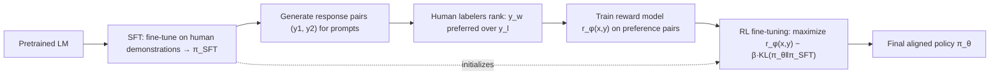

# **RLHF: Reinforcement Learning from Human Feedback**

Pretraining (your Transformer chapter, Ch. 037) optimizes next-token log-likelihood on raw text — a proxy objective that produces a model fluent at *continuing* text, not one aligned with "be helpful, follow instructions, avoid harmful outputs." There is no ground-truth label for "how good is this entire response" the way there is for next-token prediction. RLHF closes this gap by (1) learning a **reward model** from human preference comparisons, then (2) using that learned reward as the RL training signal (Ch. 001's Q-learning covered value-based RL; RLHF instead uses **policy-gradient** RL, introduced here) to fine-tune the language model to produce outputs humans prefer.

---

## **1. The Three-Stage Pipeline**

1. **Supervised Fine-Tuning (SFT):** fine-tune the pretrained model on a smaller set of high-quality human-written demonstrations (prompt → ideal response pairs) via ordinary supervised next-token cross-entropy — this gives a reasonable starting policy $\pi_{\text{SFT}}$, but is limited by how much high-quality demonstration data can be collected.
2. **Reward Model (RM) Training:** collect **human preference comparisons** (given a prompt, humans rank or pick the better of two model-generated responses) and train a separate model $r_\phi(x,y)$ to score how good a response $y$ is for prompt $x$ (§2).
3. **RL Fine-Tuning:** use $r_\phi$ as the reward signal to further fine-tune the policy $\pi_\theta$ (initialized from $\pi_{\text{SFT}}$) via policy-gradient RL, subject to a constraint keeping it close to $\pi_{\text{SFT}}$ (§3–4).



---

## **2. The Reward Model — Bradley-Terry Derivation**

### **2.1 Why Not Ask Humans to Score Responses Directly?**

Absolute quality scores ("rate this response 1–10") are noisy and poorly calibrated across different labelers and sessions — one labeler's "7" is another's "5." **Pairwise comparisons** ("which of these two responses is better?") are much more reliable to elicit consistently, which is why RLHF collects preference pairs rather than absolute ratings.

### **2.2 The Bradley-Terry Preference Model**

Assume each response $y$ for prompt $x$ has some latent, unobserved scalar quality $r^\star(x,y)$, and that human preference between two responses follows the classical Bradley-Terry choice model (used broadly in ranking/tournament settings): the probability that $y_w$ ("winner") is preferred over $y_l$ ("loser") is a logistic function of the reward difference:

$$
p(y_w \succ y_l \mid x) = \frac{\exp(r^\star(x,y_w))}{\exp(r^\star(x,y_w))+\exp(r^\star(x,y_l))} = \sigma\big(r^\star(x,y_w)-r^\star(x,y_l)\big)
$$

**Intuition:** the further $y_w$'s reward is above $y_l$'s, the closer this probability gets to $1$ (near-certain preference); when the two rewards are equal, it's $0.5$ (a coin flip) — the same logistic-difference structure used in the Elo rating system and other pairwise-comparison models.

### **2.3 Maximum Likelihood Training Objective**

Given a dataset of human comparisons $\mathcal D=\{(x,y_w,y_l)\}$, train a parametric reward model $r_\phi$ (typically the same base LM architecture with a scalar output head replacing the token-prediction head) to maximize the likelihood of the observed human preferences under the Bradley-Terry model:

$$
\boxed{\mathcal L_{\text{RM}}(\phi) = -\mathbb E_{(x,y_w,y_l)\sim\mathcal D}\Big[\log\sigma\big(r_\phi(x,y_w)-r_\phi(x,y_l)\big)\Big]}
$$

**Derivation:** this is exactly the negative log-likelihood of the Bradley-Terry probability from §2.2, with $r^\star$ replaced by the learned $r_\phi$ — a direct maximum-likelihood fit, structurally identical to logistic regression (your existing chapter) except the "features" are the *difference* of two learned scalar scores rather than a fixed feature vector. Minimizing $\mathcal L_{\text{RM}}$ pushes $r_\phi(x,y_w)$ up and $r_\phi(x,y_l)$ down whenever a comparison is observed — the same "pull together / push apart" pattern seen in the Word2Vec (Ch. 043) and GAN (Ch. 002) chapters, here applied to scalar reward scores instead of embedding vectors or classifier logits.

### **2.4 What the Reward Model Actually Learns**

Only the **relative ordering** of rewards matters for the Bradley-Terry probability (it depends only on $r_\phi(x,y_w)-r_\phi(x,y_l)$, invariant to any constant shift added to all rewards for a given $x$) — the reward model's outputs are therefore only meaningful up to an additive constant per prompt, not an absolute, universally comparable quality score. This has a direct practical consequence in §5 (reward hacking): the reward model is trained only to *rank* correctly on the comparisons it saw, with no guarantee it generalizes well to out-of-distribution outputs the policy might later discover during RL fine-tuning.

---

## **3. Policy Gradient Methods (Needed Background)**

Your existing Q-learning chapter (RL Ch. 001) covers **value-based** RL: learn $Q^\star$, derive the policy implicitly via $\arg\max$. RLHF instead uses **policy-gradient** methods, which directly parameterize and optimize a policy $\pi_\theta(y\mid x)$ — necessary here because the "action" is generating an entire token sequence, an enormous, effectively continuous-in-practice action space where $\max_a Q(s,a)$ (Q-learning's core operation) is not remotely tractable to compute.

### **3.1 The Policy Gradient Theorem — Derivation Sketch**

The RL objective is to maximize expected return $J(\theta) = \mathbb E_{\tau\sim\pi_\theta}[R(\tau)]$ over trajectories $\tau$. Writing this as an integral and differentiating:

$$
\nabla_\theta J(\theta) = \nabla_\theta \int \pi_\theta(\tau) R(\tau)\,d\tau = \int \nabla_\theta\pi_\theta(\tau)\, R(\tau)\,d\tau
$$

Using the identity $\nabla_\theta\pi_\theta(\tau) = \pi_\theta(\tau)\nabla_\theta\log\pi_\theta(\tau)$ (the "log-derivative trick," valid wherever $\pi_\theta(\tau)>0$):

$$
\nabla_\theta J(\theta) = \int \pi_\theta(\tau)\,\nabla_\theta\log\pi_\theta(\tau)\,R(\tau)\,d\tau = \mathbb E_{\tau\sim\pi_\theta}\big[\nabla_\theta\log\pi_\theta(\tau)\,R(\tau)\big]
$$

This is the **REINFORCE** estimator (Williams, 1992): a Monte Carlo gradient estimate that requires only being able to *sample* trajectories and evaluate log-probabilities — no differentiable reward or environment model needed, in contrast to backpropagating through a reward function directly (which is not possible here, since $r_\phi$ interacts with discrete, sampled tokens). For language-model fine-tuning specifically, one "trajectory" is one generated response $y$ given prompt $x$, so $\nabla_\theta\log\pi_\theta(\tau) = \sum_i\nabla_\theta\log\pi_\theta(y_i\mid x,y_{<i})$ (summed token log-probabilities), and $R(\tau)$ is the (KL-penalized, §4) reward for the full response.

### **3.2 Why Vanilla Policy Gradient Is High-Variance and Unstable**

The raw REINFORCE estimator has notoriously high variance (a single scalar $R(\tau)$ scales the gradient of an entire trajectory's log-probability, and different trajectories can have wildly different returns) and large, poorly-controlled update steps can destroy a previously-good policy in one bad update — a particularly severe risk when the "policy" is a large pretrained language model whose fluency and knowledge could be catastrophically disrupted by one destructive gradient step. This motivates PPO (§ next).

---

## **4. The KL-Constrained RL Objective**

### **4.1 Why an Unconstrained Reward-Maximizing Policy Fails**

If the RL fine-tuning objective were simply $\max_\theta\mathbb E_{y\sim\pi_\theta}[r_\phi(x,y)]$ with no constraint, the policy would be free to drift arbitrarily far from $\pi_{\text{SFT}}$ in pursuit of maximizing the *learned, imperfect* reward model — exploiting whatever quirks or blind spots $r_\phi$ has (§2.4: it only reliably ranks outputs similar to what it was trained on) rather than genuinely producing better responses. This failure mode is called **reward hacking** (or reward over-optimization): the policy finds outputs that score highly under $r_\phi$ but are, by actual human judgment, low-quality, repetitive, or degenerate.

### **4.2 The KL-Penalized Objective**

$$
\boxed{\max_\theta\ \mathbb E_{x\sim\mathcal D,\,y\sim\pi_\theta(\cdot\mid x)}\Big[r_\phi(x,y) - \beta\, D_{\mathrm{KL}}\big(\pi_\theta(\cdot\mid x)\,\|\,\pi_{\text{SFT}}(\cdot\mid x)\big)\Big]}
$$

**Why the KL term specifically (not, say, an $L_2$ parameter penalty):** it directly penalizes the policy's *output distribution* from drifting from the SFT policy's distribution, in the exact same units as the reward — a natural, principled way to trade off reward-seeking against staying "close" to a policy known to be fluent and reasonable (measured in probability-distribution space, not weight space, which is what actually matters for output quality). This also connects directly to the ELBO/VAE machinery (Ch. 001): the objective has the same "maximize an expected value, minus a KL regularizer toward a reference distribution" shape as the VAE's ELBO (Ch. 001, §2.4), with $\pi_{\text{SFT}}$ playing the role of the VAE's fixed prior $p(z)$.

### **4.3 Reparameterizing as a Per-Token Reward**

The token-level implementation of this objective augments the reward-model score with a per-token KL penalty, implemented as a subtracted log-probability-ratio term:

$$
r_{\text{total}}(x,y) = r_\phi(x,y) - \beta\sum_{i}\log\frac{\pi_\theta(y_i\mid x,y_{<i})}{\pi_{\text{SFT}}(y_i\mid x,y_{<i})}
$$

using the fact that $\mathbb E_{y\sim\pi_\theta}\left[\sum_i\log\frac{\pi_\theta(y_i\mid\cdot)}{\pi_{\text{SFT}}(y_i\mid\cdot)}\right] = D_{\mathrm{KL}}(\pi_\theta\|\pi_{\text{SFT}})$ exactly (the KL divergence between two sequence distributions decomposes into a sum of expected token-level log-ratios under the standard chain-rule factorization) — this reformulation lets standard policy-gradient/PPO machinery (which expects a scalar reward per trajectory or per token) directly consume the KL-constrained objective without any special-cased loss term.

---

## **5. PPO (Proximal Policy Optimization) — The Standard RL Fine-Tuning Algorithm**

### **5.1 Motivation**

PPO (Schulman et al., 2017) directly addresses the instability of vanilla policy gradient (§3.2) by explicitly limiting how far a single update can move the policy away from the policy that generated the current batch of experience, without the complexity of a full trust-region constrained optimization (its predecessor, TRPO).

### **5.2 The Clipped Surrogate Objective**

Let $\rho_t(\theta) = \frac{\pi_\theta(a_t\mid s_t)}{\pi_{\theta_{\text{old}}}(a_t\mid s_t)}$ (the probability ratio between the current, being-updated policy and the policy that generated the training batch), and $\hat A_t$ an estimate of the **advantage** (how much better this action was than the average action in this state — typically estimated via the reward model plus a learned value/critic network, analogous to actor-critic methods). PPO's objective is

$$
\mathcal L_{\text{PPO}}(\theta) = \mathbb E_t\left[\min\Big(\rho_t(\theta)\hat A_t,\ \operatorname{clip}(\rho_t(\theta),\,1-\epsilon,\,1+\epsilon)\hat A_t\Big)\right]
$$

**Why the clip and the min:** if $\hat A_t>0$ (a good action), the objective wants to increase $\rho_t$ (make that action more likely), but the $\operatorname{clip}$ caps the reward for doing so beyond $\rho_t=1+\epsilon$ — once the policy has already shifted enough probability toward a good action, there's no further incentive to over-commit to it in a single update. If $\hat A_t<0$ (a bad action), symmetric logic caps how much the update can reduce its probability in one step. The outer $\min$ ensures the clip only ever makes the objective **more conservative** (never accidentally rewards moving further in an unclipped, unbounded direction), which is what gives PPO its practical stability advantage over vanilla policy gradient (§3.2) — large, destabilizing single-step updates are structurally prevented, not just discouraged by a soft penalty.

### **5.3 Full RLHF-PPO Training Loop**

1. Sample a batch of prompts $x$ from the prompt dataset.
2. Generate responses $y\sim\pi_\theta(\cdot\mid x)$ using the current policy.
3. Score each $(x,y)$ with the frozen reward model $r_\phi$, and compute the total KL-penalized reward (§4.3) against the frozen $\pi_{\text{SFT}}$.
4. Estimate advantages $\hat A_t$ (using a learned value function, as in standard actor-critic RL).
5. Update $\pi_\theta$ via one or more epochs of the clipped PPO objective (§5.2) on this batch.
6. Repeat, periodically refreshing $\pi_{\theta_{\text{old}}}$ to the current $\pi_\theta$.

---

## **6. Worked Numeric Example (Reward Model Loss)**

For prompt $x$, suppose the current reward model gives $r_\phi(x,y_w)=2.0$ (the human-preferred response) and $r_\phi(x,y_l)=0.5$ (the rejected response).

$$
r_\phi(x,y_w)-r_\phi(x,y_l) = 1.5, \qquad \sigma(1.5) = \frac{1}{1+e^{-1.5}} \approx 0.8176
$$

$$
\mathcal L_{\text{RM}} = -\log(0.8176) \approx 0.2014
$$

The model already assigns fairly high probability ($81.8\%$) to the correct preference, so the loss is comparatively small; if instead the model had (incorrectly) scored them as $r_\phi(x,y_w)=0.5,\ r_\phi(x,y_l)=2.0$ (reversed), the difference would be $-1.5$, $\sigma(-1.5)\approx0.1824$, and $\mathcal L_{\text{RM}} = -\log(0.1824)\approx1.7016$ — a much larger loss, correctly penalizing the model for disagreeing with the human label.

---

## **7. Direct Preference Optimization (DPO) — Skipping RL Entirely**

### **7.1 Motivation**

PPO-based RLHF requires training and maintaining four models simultaneously (policy, reference/SFT policy, reward model, value/critic model) and is notoriously fiddly to tune and stabilize in practice. DPO (Rafailov et al., 2023) shows that the **same** KL-constrained optimal policy (§4.2) can be reached by directly optimizing a classification-style loss on preference pairs — **no separate reward model, no RL loop, no sampling during training at all**.

### **7.2 Deriving the DPO Loss**

The KL-constrained objective (§4.2) has a known closed-form optimal solution (a standard result for this class of regularized objective, structurally the same result underlying the connection between RL with a KL penalty and a certain "soft" or entropy-regularized optimal policy):

$$
\pi^\star(y\mid x) = \frac{1}{Z(x)}\,\pi_{\text{SFT}}(y\mid x)\,\exp\left(\frac{1}{\beta}r_\phi(x,y)\right)
$$

Solving this for the reward gives an **implicit reward** expressed purely in terms of the optimal policy and the reference policy:

$$
r_\phi(x,y) = \beta\log\frac{\pi^\star(y\mid x)}{\pi_{\text{SFT}}(y\mid x)} + \beta\log Z(x)
$$

Substitute this expression for $r_\phi$ back into the Bradley-Terry reward-difference (§2.2) — the intractable, per-prompt normalizing constant $Z(x)$ **cancels exactly** because it appears identically in both $r_\phi(x,y_w)$ and $r_\phi(x,y_l)$ for the same prompt $x$:

$$
r_\phi(x,y_w)-r_\phi(x,y_l) = \beta\log\frac{\pi^\star(y_w\mid x)}{\pi_{\text{SFT}}(y_w\mid x)} - \beta\log\frac{\pi^\star(y_l\mid x)}{\pi_{\text{SFT}}(y_l\mid x)}
$$

Substituting this directly into the Bradley-Terry negative log-likelihood (§2.3), replacing the explicit reward model with the policy $\pi_\theta$ being trained (standing in for $\pi^\star$) gives the **DPO loss**:

$$
\boxed{\mathcal L_{\text{DPO}}(\theta) = -\mathbb E_{(x,y_w,y_l)}\left[\log\sigma\left(\beta\log\frac{\pi_\theta(y_w\mid x)}{\pi_{\text{SFT}}(y_w\mid x)} - \beta\log\frac{\pi_\theta(y_l\mid x)}{\pi_{\text{SFT}}(y_l\mid x)}\right)\right]}
$$

**This is a remarkable simplification:** it's the exact same functional form as the reward-model loss (§2.3), except the "reward" for each response is now *directly* the (scaled) log-probability-ratio between the policy being trained and the frozen reference policy. Training this loss with ordinary supervised gradient descent on preference pairs **provably converges to the same optimal policy** that the full PPO pipeline (§5) targets, without ever sampling from the policy, training a separate reward model, or running an RL loop — DPO's policy *implicitly is* the reward model, expressed through this reparameterization.

---

## **8. Python Implementation From Scratch**

### **8.1 Reward Model Loss (Bradley-Terry)**

```python
import numpy as np


def sigmoid(x):
    out = np.empty_like(x, dtype=np.float64)
    pos = x >= 0
    out[pos] = 1.0 / (1.0 + np.exp(-x[pos]))
    exp_x = np.exp(x[~pos])
    out[~pos] = exp_x / (1.0 + exp_x)
    return out


def reward_model_loss(r_chosen, r_rejected):
    """
    Bradley-Terry negative log-likelihood (§2.3).
    r_chosen, r_rejected: arrays of scalar reward-model outputs for the
    human-preferred and rejected response in each pair, respectively.
    """
    diff = r_chosen - r_rejected
    # Numerically stable log(sigmoid(diff)) via -softplus(-diff), same pattern as prior chapters.
    log_sigmoid = -np.logaddexp(0, -diff)
    return -np.mean(log_sigmoid)


# Toy batch
r_chosen = np.array([2.0, 1.0, 0.3])
r_rejected = np.array([0.5, 1.2, -0.1])   # note: pair 2 has the model currently WRONG (rejected scored higher)
print("Reward model loss:", reward_model_loss(r_chosen, r_rejected))
```

### **8.2 DPO Loss**

```python
def dpo_loss(logp_chosen_policy, logp_rejected_policy,
             logp_chosen_ref, logp_rejected_ref, beta=0.1):
    """
    DPO loss (§7.2). All log-probability arguments are *sequence-level*
    log pi(y|x), i.e. summed token log-probs, for chosen/rejected responses,
    under the policy being trained vs. the frozen reference (SFT) policy.
    """
    policy_logratio = logp_chosen_policy - logp_rejected_policy
    ref_logratio = logp_chosen_ref - logp_rejected_ref
    logits = beta * (policy_logratio - ref_logratio)

    log_sigmoid = -np.logaddexp(0, -logits)
    return -np.mean(log_sigmoid)


# Toy sequence-level log-probabilities (as would come from summing token log-probs)
logp_chosen_policy = np.array([-5.2, -8.1])
logp_rejected_policy = np.array([-6.0, -7.5])
logp_chosen_ref = np.array([-5.5, -8.3])
logp_rejected_ref = np.array([-5.8, -7.9])

print("DPO loss:", dpo_loss(logp_chosen_policy, logp_rejected_policy,
                             logp_chosen_ref, logp_rejected_ref, beta=0.1))
```

Both losses share the identical `-log_sigmoid(reward_difference)` structure derived in §2.3/§7.2 — DPO simply substitutes a (scaled, reference-normalized) policy log-probability ratio in place of an explicit reward model's output difference.

---

## **9. Equivalent Implementation With Hugging Face TRL**

```python
from trl import RewardTrainer, RewardConfig, DPOTrainer, DPOConfig
from transformers import AutoModelForSequenceClassification, AutoModelForCausalLM, AutoTokenizer

# Reward model training (§2)
reward_model = AutoModelForSequenceClassification.from_pretrained("base-model", num_labels=1)
reward_trainer = RewardTrainer(
    model=reward_model,
    args=RewardConfig(per_device_train_batch_size=4, learning_rate=1e-5),
    train_dataset=preference_dataset,  # each example: {chosen, rejected} text pairs
)
reward_trainer.train()

# DPO fine-tuning (§7) — note: no separate reward model or RL loop needed
policy_model = AutoModelForCausalLM.from_pretrained("sft-model")
dpo_trainer = DPOTrainer(
    model=policy_model,
    ref_model=None,  # TRL can derive the reference implicitly from the same checkpoint if None
    args=DPOConfig(beta=0.1, learning_rate=5e-7),
    train_dataset=preference_dataset,
)
dpo_trainer.train()
```

`DPOConfig(beta=...)` is exactly the $\beta$ from §4.2/§7.2 — controlling how strongly the fine-tuned policy is pulled back toward the reference; TRL's `PPOTrainer` (for the full pipeline, §5) additionally requires a value-model and reward-model instance, reflecting the extra machinery DPO eliminates.

---

## **10. Complexity**

| Stage | Models Trained/Held | Sampling Required During Training? |
|---|---|---|
| SFT | 1 (policy) | no — ordinary supervised fine-tuning |
| Reward Model | 1 (reward model) | no — trained on a fixed, pre-collected preference dataset |
| PPO RL fine-tuning | 4 held simultaneously (policy, reference, reward model, value/critic) | **yes** — must generate responses from the current policy every training step, the dominant cost |
| DPO | 2 held (policy, frozen reference) | no — ordinary supervised loss on a fixed preference dataset, same cost profile as SFT |

PPO's requirement to **sample from the policy during every training step** (to get on-policy trajectories for the policy-gradient estimator) is why it is dramatically more expensive and operationally complex than DPO, which reduces RLHF to a supervised-learning-shaped problem entirely.

---

## **11. Numerical Stability, Edge Cases, and Pitfalls**

- **Reward hacking / over-optimization:** as derived in §4.1, an insufficiently constrained policy exploits reward model blind spots (a extensively documented failure: reward models often correlate spuriously with response **length**, producing policies that learn to pad responses rather than genuinely improve quality) — monitoring KL divergence from the reference policy during training is a standard diagnostic for catching this early.
- **Reward model miscalibration/overfitting:** since the RM is trained on a finite, human-labeled preference set (§2.4), it can fail to generalize to the different (and shifting, as the policy improves during RL) distribution of responses the policy explores during fine-tuning — this out-of-distribution generalization gap is the root cause of reward hacking, not merely an insufficient KL penalty.
- **$\beta$ (KL coefficient) tuning:** too small $\beta$ risks reward hacking and degenerate/repetitive outputs; too large $\beta$ keeps the policy too close to $\pi_{\text{SFT}}$, limiting how much the RL stage can actually improve alignment — this is a genuinely difficult hyperparameter with no universal default, tuned per model/dataset.
- **PPO instability in practice:** despite the clipping mechanism (§5.2) being specifically designed for stability, PPO for language models remains notoriously sensitive to learning rate, batch size, value-function initialization, and reward normalization — a major practical motivation for the DPO line of work.
- **Human labeling noise and inconsistency:** preference labels themselves are noisy (different labelers disagree, individual labelers are inconsistent across similar examples) — the Bradley-Terry model (§2.2) implicitly assumes a single consistent underlying preference function, an idealization that real, aggregated crowd-sourced labels only approximate.
- **DPO's implicit reward is only valid under the modeling assumptions:** the elegant cancellation in §7.2 relies on the Bradley-Terry model and the specific closed-form optimal-policy result being correct/appropriate — DPO does not literally learn a separate, reusable, transferable reward model the way PPO's pipeline explicitly does, which matters if a standalone reward signal is needed for a different downstream purpose (e.g., best-of-$n$ reranking).
- **Distribution shift between SFT and RL/DPO data:** if the prompts or response style used in reward-model/preference-pair collection don't match the prompts the deployed model will actually see, both PPO and DPO can optimize for a preference signal that doesn't transfer to the true deployment distribution.

---

## **12. Connections to Related ML Concepts**

- **Q-learning / value-based RL (RL Ch. 001):** the complementary RL paradigm — Q-learning learns values and derives a policy implicitly; RLHF's PPO stage directly parameterizes and optimizes a policy via policy gradients, necessary here because the action space (token sequences) makes an explicit $\max_aQ(s,a)$ intractable.
- **Actor-critic methods:** PPO is a specific, clipped-update instance of the actor-critic family — the policy is the "actor," the learned value function used for advantage estimation is the "critic," exactly the architecture flagged as the natural extension beyond Q-learning in RL Ch. 001's connections section.
- **Logistic regression (existing chapter):** the Bradley-Terry reward-model loss (§2.3) is structurally logistic regression where the "features" are the difference of two learned scalar model outputs rather than a fixed input vector.
- **VAE's ELBO (Ch. 001):** the KL-constrained RL objective (§4.2) has the identical "expected value minus KL-to-a-reference-distribution" shape as the VAE's training objective, with $\pi_{\text{SFT}}$ playing the role the fixed prior $p(z)$ plays there.
- **GANs (Ch. 002):** both RLHF's reward model and a GAN's discriminator are learned scalar scoring functions trained on a "compare two things" signal (human preference vs. real/fake) that then drives optimization of a separate generative model — a structural parallel, though RLHF's reward model is trained once and frozen (not adversarially co-trained against the policy, unlike a GAN's discriminator).
- **Transformer architecture (Ch. 037):** both the reward model and the policy in RLHF are typically the same underlying Transformer architecture, differing only in the output head (scalar reward vs. next-token distribution) and training objective.

---

## **13. References for Deeper Reading**

- Ralph Allan Bradley and Milton E. Terry, "Rank Analysis of Incomplete Block Designs", Biometrika, 1952 (the original Bradley-Terry model).
- Ronald J. Williams, "Simple Statistical Gradient-Following Algorithms for Connectionist Reinforcement Learning" (REINFORCE), Machine Learning, 1992.
- John Schulman et al., "Proximal Policy Optimization Algorithms", 2017. https://arxiv.org/abs/1707.06347
- Paul Christiano et al., "Deep Reinforcement Learning from Human Preferences", NeurIPS 2017 (foundational preference-based RL, predating LLM-specific RLHF).
- Long Ouyang et al., "Training Language Models to Follow Instructions with Human Feedback" (InstructGPT), NeurIPS 2022. https://arxiv.org/abs/2203.02155
- Rafael Rafailov et al., "Direct Preference Optimization: Your Language Model is Secretly a Reward Model", NeurIPS 2023. https://arxiv.org/abs/2305.18290
- Hugging Face TRL documentation. https://huggingface.co/docs/trl
